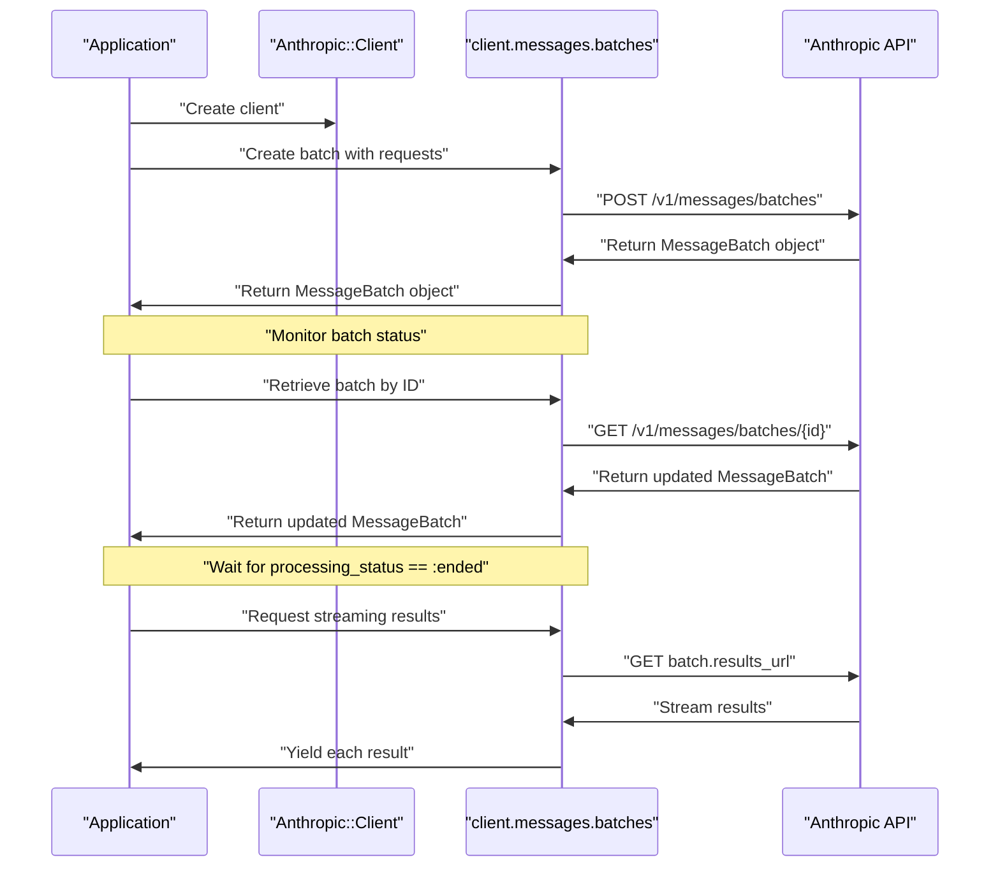
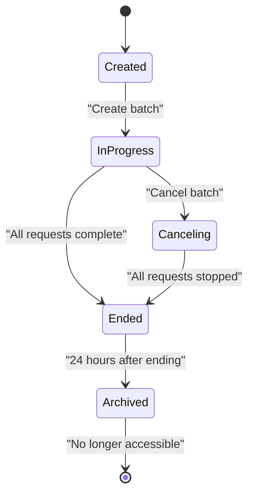
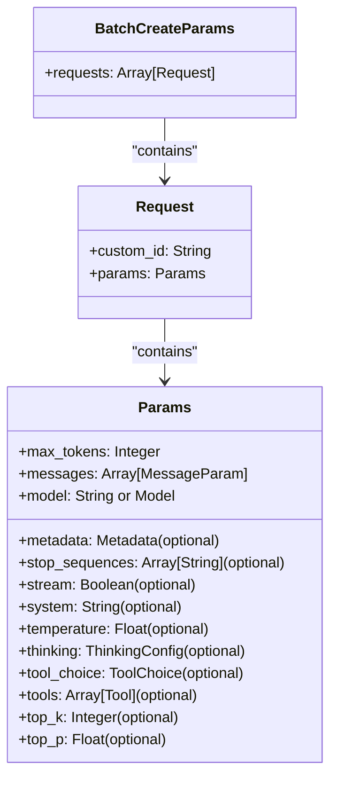
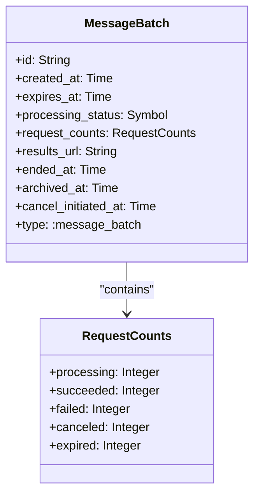

<!-- source: DeepWiki mcp.deepwiki.com · repo anthropics/anthropic-sdk-ruby · page 5.1 Creating and Managing Batches · fetched 2026-10-26 -->

# Creating and Managing Batches

<details>
<summary>Relevant source files</summary>

The following files were used as context for generating this wiki page:

- [lib/anthropic/models/beta/beta_base64_pdf_block.rb](lib/anthropic/models/beta/beta_base64_pdf_block.rb)
- [lib/anthropic/models/beta/beta_image_block_param.rb](lib/anthropic/models/beta/beta_image_block_param.rb)
- [lib/anthropic/models/beta/beta_raw_message_delta_event.rb](lib/anthropic/models/beta/beta_raw_message_delta_event.rb)
- [lib/anthropic/models/beta/beta_tool.rb](lib/anthropic/models/beta/beta_tool.rb)
- [lib/anthropic/models/beta/beta_tool_result_block_param.rb](lib/anthropic/models/beta/beta_tool_result_block_param.rb)
- [lib/anthropic/models/beta/beta_usage.rb](lib/anthropic/models/beta/beta_usage.rb)
- [lib/anthropic/models/beta/messages/beta_message_batch.rb](lib/anthropic/models/beta/messages/beta_message_batch.rb)
- [lib/anthropic/models/image_block_param.rb](lib/anthropic/models/image_block_param.rb)
- [lib/anthropic/models/message_count_tokens_params.rb](lib/anthropic/models/message_count_tokens_params.rb)
- [lib/anthropic/models/messages/batch_create_params.rb](lib/anthropic/models/messages/batch_create_params.rb)
- [lib/anthropic/models/raw_message_delta_event.rb](lib/anthropic/models/raw_message_delta_event.rb)
- [lib/anthropic/models/tool_result_block_param.rb](lib/anthropic/models/tool_result_block_param.rb)
- [lib/anthropic/models/usage.rb](lib/anthropic/models/usage.rb)

</details>


This page explains how to efficiently process multiple message requests in the Anthropic Ruby SDK using batches. Batch processing allows you to submit, track, and retrieve results from multiple message requests as a single unit, which is particularly useful for high-throughput applications.

For information about retrieving and processing batch results after creation, see [Batch Results](#5.2).

## Batch Processing Overview

Batches in the Anthropic Ruby SDK provide a mechanism to:
- Submit multiple message requests in a single API call
- Track processing status of all requests collectively
- Retrieve results efficiently when processing completes
- Match results to original requests using custom IDs

### Batch Processing Workflow



Sources: [lib/anthropic/models/messages/batch_create_params.rb]()

## Batch Lifecycle

Message batches progress through several states during their lifecycle:



- **Created**: Batch is initially created with the `create` method
- **InProgress**: Batch is being processed with status `:in_progress`
- **Canceling**: (Optional) Cancellation initiated with status `:canceling`
- **Ended**: All requests have completed, failed, been canceled, or expired (status `:ended`)
- **Archived**: Batch is archived 24 hours after processing ends and results are no longer available

Sources: [lib/anthropic/models/beta/messages/beta_message_batch.rb:123-135]()

## Creating Batches

To create a batch, use the `batches.create` method of the Messages resource:

```ruby
client = Anthropic::Client.new(api_key: "your_api_key")

batch = client.messages.batches.create(
  requests: [
    {
      custom_id: "request-1",
      params: {
        max_tokens: 1024,
        messages: [
          { role: "user", content: "Explain quantum computing" }
        ],
        model: "claude-3-opus-20240229"
      }
    },
    {
      custom_id: "request-2",
      params: {
        max_tokens: 1024,
        messages: [
          { role: "user", content: "Summarize the history of AI" }
        ],
        model: "claude-3-opus-20240229"
      }
    }
  ]
)
```

### Batch Creation Parameters Structure



Each request within a batch requires:

- **custom_id**: A unique identifier for the request within the batch (required to match results to requests)
- **params**: The message creation parameters, identical to those used for individual message creation

The `params` object contains standard message creation parameters:

- **max_tokens** (required): Maximum number of tokens to generate
- **messages** (required): Array of message objects with role and content
- **model** (required): The Claude model to use
- **metadata** (optional): Custom metadata for the message
- **stop_sequences** (optional): Custom sequences that will cause the model to stop generating
- **system** (optional): System prompt for the message
- **temperature** (optional): Controls randomness (0.0 to 1.0)
- **thinking** (optional): Configuration for extended thinking
- **tool_choice** (optional): How the model should use provided tools
- **tools** (optional): Definitions of tools the model may use

Sources: [lib/anthropic/models/messages/batch_create_params.rb:6-446]()

## Managing Batches

### Retrieving a Batch

To get information about a specific batch:

```ruby
batch = client.messages.batches.retrieve("batch_id")

# Check batch status
puts batch.processing_status  # :in_progress, :canceling, or :ended

# Check request counts
puts "Processing: #{batch.request_counts.processing}"
puts "Succeeded: #{batch.request_counts.succeeded}"
puts "Failed: #{batch.request_counts.failed}"
puts "Canceled: #{batch.request_counts.canceled}"
puts "Expired: #{batch.request_counts.expired}"

# Check if results are available
if batch.results_url
  # Results are available
end
```

### MessageBatch Structure



The `MessageBatch` object includes:

- **id**: Unique identifier for the batch
- **created_at**: Time when the batch was created
- **expires_at**: Time when the batch will expire (24 hours after creation)
- **processing_status**: Current status (`:in_progress`, `:canceling`, or `:ended`)
- **request_counts**: Counts of requests by status
- **results_url**: URL to retrieve results (only available when processing has ended)
- **ended_at**: Time when processing ended (if applicable)
- **archived_at**: Time when the batch was archived (if applicable)
- **cancel_initiated_at**: Time when cancellation was initiated (if applicable)

Sources: [lib/anthropic/models/beta/messages/beta_message_batch.rb:8-136]()

### Listing Batches

To retrieve a list of all your batches:

```ruby
batches = client.messages.batches.list()

# Process each batch
batches.data.each do |batch|
  puts "Batch ID: #{batch.id}, Status: #{batch.processing_status}"
end
```

### Canceling a Batch

To cancel a batch that is still processing:

```ruby
client.messages.batches.cancel("batch_id")
```

This will set the batch's `processing_status` to `:canceling` and stop processing any requests that haven't completed yet.

### Deleting a Batch

To delete a batch:

```ruby
client.messages.batches.delete("batch_id")
```

This removes the batch from your list of batches, but does not stop processing if the batch is still in progress.

## Example Workflow

Here's a complete example of creating and managing a batch:

```ruby
client = Anthropic::Client.new(api_key: "your_api_key")

# Create a batch with multiple requests
batch = client.messages.batches.create(
  requests: [
    {
      custom_id: "question-1",
      params: {
        max_tokens: 1024,
        messages: [{ role: "user", content: "What is artificial intelligence?" }],
        model: "claude-3-opus-20240229"
      }
    },
    {
      custom_id: "question-2",
      params: {
        max_tokens: 1024,
        messages: [{ role: "user", content: "How do neural networks work?" }],
        model: "claude-3-opus-20240229"
      }
    }
  ]
)

# Store the batch ID for later use
batch_id = batch.id

# Poll the batch status until it's finished
loop do
  batch = client.messages.batches.retrieve(batch_id)
  
  puts "Batch status: #{batch.processing_status}"
  puts "Processing: #{batch.request_counts.processing}"
  puts "Succeeded: #{batch.request_counts.succeeded}"
  puts "Failed: #{batch.request_counts.failed}"
  
  break if batch.processing_status == :ended
  sleep 5  # Wait 5 seconds before checking again
end

# Process the results (see Batch Results page for more details)
if batch.results_url
  client.messages.batches.results_streaming(batch_id) do |result|
    custom_id = result[:custom_id]
    
    if result[:error]
      puts "Error for #{custom_id}: #{result[:error]}"
    else
      puts "Result for #{custom_id}: #{result[:message][:content][0][:text]}"
    end
  end
end
```

## Limitations and Best Practices

| Limitation/Constraint | Description |
|-----------------------|-------------|
| Expiration | Batches expire and are archived 24 hours after processing ends |
| Batch size | There are limits to the number of requests per batch (see API documentation) |
| API usage | Each request in a batch counts toward your API usage limits |
| Custom IDs | Must be unique within a batch |
| Polling | Consider implementing exponential backoff when polling batch status |
| Large-scale use | Implement a job queue system for batch creation and processing |

Sources: [lib/anthropic/models/beta/messages/beta_message_batch.rb:8-91]()

---

