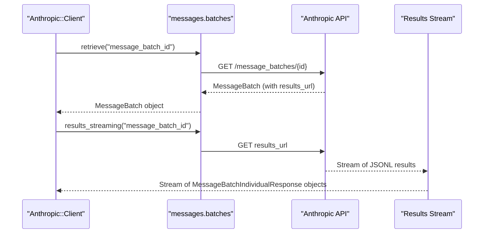

<!-- source: DeepWiki mcp.deepwiki.com · repo anthropics/anthropic-sdk-ruby · page 5.2 Batch Results · fetched 2026-10-26 -->

# Batch Results

<details>
<summary>Relevant source files</summary>

The following files were used as context for generating this wiki page:

- [lib/anthropic/models/beta/beta_message_tokens_count.rb](lib/anthropic/models/beta/beta_message_tokens_count.rb)
- [lib/anthropic/models/beta/messages/beta_message_batch_individual_response.rb](lib/anthropic/models/beta/messages/beta_message_batch_individual_response.rb)
- [lib/anthropic/models/message_tokens_count.rb](lib/anthropic/models/message_tokens_count.rb)
- [lib/anthropic/models/messages/message_batch_individual_response.rb](lib/anthropic/models/messages/message_batch_individual_response.rb)
- [test/anthropic/resources/beta/messages/batches_test.rb](test/anthropic/resources/beta/messages/batches_test.rb)
- [test/anthropic/resources/beta/models_test.rb](test/anthropic/resources/beta/models_test.rb)
- [test/anthropic/resources/messages/batches_test.rb](test/anthropic/resources/messages/batches_test.rb)
- [test/anthropic/resources/models_test.rb](test/anthropic/resources/models_test.rb)
- [test/anthropic/resources/shared_test.rb](test/anthropic/resources/shared_test.rb)

</details>


This document explains how to retrieve and process results from message batches in the Anthropic Ruby SDK. After creating a message batch as described in [Creating and Managing Batches](#5.1), you'll need to retrieve and process the results once processing is complete.

## Understanding Batch Result Structure

When retrieving batch results, each message request in your batch will have a corresponding result. These results are delivered as individual response objects, each containing:

- The `custom_id` you provided when creating the batch request
- A `result` object that contains either a successful message response or information about why the request failed

```mermaid
classDiagram
    class "MessageBatchIndividualResponse" {
        +String custom_id
        +MessageBatchResult result
    }
    
    class "MessageBatchResult" {
        (Union Type)
    }
    
    class "SucceededResult" {
        +Message message
    }
    
    class "ErroredResult" {
        +String error_type
        +String error_message
    }
    
    class "CanceledResult" {
        +String reason
    }
    
    class "ExpiredResult" {
        +String reason
    }
    
    "MessageBatchIndividualResponse" --> "MessageBatchResult" : contains
    "MessageBatchResult" --> "SucceededResult" : can be
    "MessageBatchResult" --> "ErroredResult" : can be
    "MessageBatchResult" --> "CanceledResult" : can be
    "MessageBatchResult" --> "ExpiredResult" : can be
```

Sources: [lib/anthropic/models/messages/message_batch_individual_response.rb:1-42](). 

## Checking Batch Status

Before retrieving results, you should check if your batch processing is complete. You can do this by retrieving the batch and checking its `processing_status`:

```ruby
batch = client.messages.batches.retrieve("message_batch_id")

# Check the processing status
case batch.processing_status
when :in_progress
  puts "Batch is still processing..."
when :completed
  puts "Batch processing complete. Ready to fetch results."
when :failed
  puts "Batch processing failed."
when :canceled
  puts "Batch was canceled."
when :expired
  puts "Batch expired before processing completed."
end

# Check the request counts
puts "Total: #{batch.request_counts.total}"
puts "Completed: #{batch.request_counts.completed}"
puts "Failed: #{batch.request_counts.failed}"
```

The batch object contains important information:
- `processing_status`: Overall status of the batch (`in_progress`, `completed`, `failed`, `canceled`, `expired`)
- `request_counts`: Counts of total, completed, and failed requests
- `results_url`: URL to retrieve results (present only when batch has results available)

Sources: [test/anthropic/resources/messages/batches_test.rb:41-62]().

## Retrieving Batch Results

Once a batch is complete, you can retrieve the results using the `results_streaming` method. This method streams the results as they become available, which is efficient for large batches.



Here's how to retrieve and process batch results:

```ruby
# Streaming approach (recommended for large batches)
client.messages.batches.results_streaming("message_batch_id") do |response|
  # Each response is a MessageBatchIndividualResponse object
  custom_id = response.custom_id
  result = response.result
  
  # Process the result based on its type
  case result
  when Anthropic::Models::Messages::MessageBatchSucceededResult
    message = result.message
    puts "Request #{custom_id} succeeded: #{message.content}"
  when Anthropic::Models::Messages::MessageBatchErroredResult
    puts "Request #{custom_id} failed: #{result.error_type} - #{result.error_message}"
  when Anthropic::Models::Messages::MessageBatchCanceledResult
    puts "Request #{custom_id} was canceled: #{result.reason}"
  when Anthropic::Models::Messages::MessageBatchExpiredResult
    puts "Request #{custom_id} expired: #{result.reason}"
  end
end
```

Sources: [lib/anthropic/models/messages/message_batch_individual_response.rb:6-37]().

## Handling Different Result Types

Each batch result can be one of four types:

1. **Succeeded Result**: Contains the successful message response
2. **Errored Result**: Contains error details for a failed request
3. **Canceled Result**: Indicates the request was canceled
4. **Expired Result**: Indicates the request expired before processing

```ruby
# Example of handling different result types
client.messages.batches.results_streaming("message_batch_id") do |response|
  result = response.result
  
  if result.is_a?(Anthropic::Models::Messages::MessageBatchSucceededResult)
    # Handle successful message
    message = result.message
    content = message.content.first.text
    
    # Process the message content
    # ...
    
  elsif result.is_a?(Anthropic::Models::Messages::MessageBatchErroredResult)
    # Log or handle the error
    error_type = result.error_type
    error_message = result.error_message
    
    # Error handling logic
    # ...
    
  elsif result.is_a?(Anthropic::Models::Messages::MessageBatchCanceledResult)
    # Handle canceled request
    # ...
    
  elsif result.is_a?(Anthropic::Models::Messages::MessageBatchExpiredResult)
    # Handle expired request
    # ...
  end
end
```

Sources: [lib/anthropic/models/messages/message_batch_individual_response.rb:17-25]().

## Best Practices for Batch Results

When working with batch results, consider these best practices:

1. **Use custom IDs effectively**: Assign meaningful custom IDs when creating the batch to easily identify and process results.

2. **Handle all result types**: Always implement handling for all possible result types to ensure robust processing.

3. **Process results asynchronously**: For large batches, consider processing results asynchronously to avoid blocking your application.

4. **Implement error recovery**: Have a strategy for retrying failed requests or gracefully handling errors.

5. **Monitor processing status**: Regularly check the batch status and request counts to track progress.

```ruby
# Example of a more robust batch results processing approach
def process_batch_results(client, batch_id)
  # First check if batch is complete
  batch = client.messages.batches.retrieve(batch_id)
  
  unless batch.processing_status == :completed
    return { status: batch.processing_status, completed: batch.request_counts.completed, total: batch.request_counts.total }
  end
  
  results = { succeeded: [], failed: [], canceled: [], expired: [] }
  
  client.messages.batches.results_streaming(batch_id) do |response|
    custom_id = response.custom_id
    result = response.result
    
    case result
    when Anthropic::Models::Messages::MessageBatchSucceededResult
      results[:succeeded] << { id: custom_id, message: result.message }
    when Anthropic::Models::Messages::MessageBatchErroredResult
      results[:failed] << { id: custom_id, error: "#{result.error_type}: #{result.error_message}" }
    when Anthropic::Models::Messages::MessageBatchCanceledResult
      results[:canceled] << { id: custom_id, reason: result.reason }
    when Anthropic::Models::Messages::MessageBatchExpiredResult
      results[:expired] << { id: custom_id, reason: result.reason }
    end
  end
  
  results
end
```

## Beta vs. Stable API Differences

Both the stable and beta versions of the Messages API support batch processing with nearly identical interfaces. The main difference is in the class names:

| Stable API | Beta API |
|------------|----------|
| `Anthropic::Models::Messages::MessageBatchIndividualResponse` | `Anthropic::Models::Beta::Messages::BetaMessageBatchIndividualResponse` |
| `Anthropic::Models::Messages::MessageBatchSucceededResult` | `Anthropic::Models::Beta::Messages::BetaMessageBatchSucceededResult` |
| `client.messages.batches` | `client.beta.messages.batches` |

When using the beta API, replace the stable API class names with their beta equivalents.

Sources: [lib/anthropic/models/beta/messages/beta_message_batch_individual_response.rb:1-42](), [test/anthropic/resources/beta/messages/batches_test.rb:1-131]().

## Conclusion

Batch results provide a way to efficiently process multiple message requests in the Anthropic Ruby SDK. By understanding the structure of batch results and how to properly retrieve and process them, you can build robust applications that handle large volumes of AI-generated content effectively.

---

