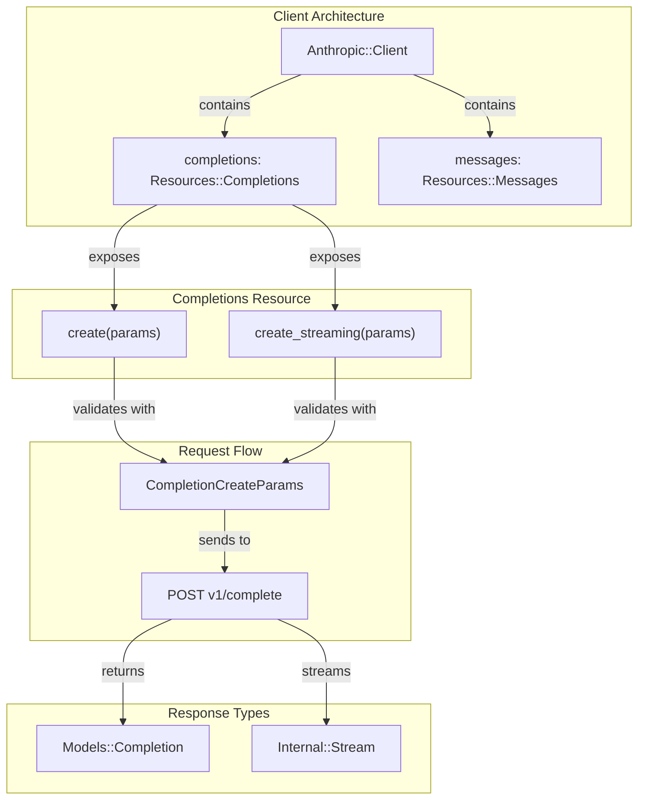
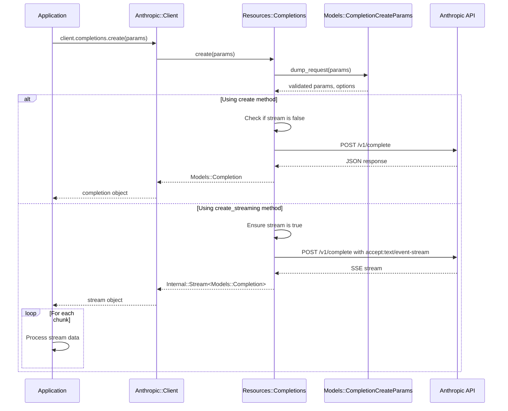

<!-- source: DeepWiki mcp.deepwiki.com · repo anthropics/anthropic-sdk-ruby · page 6 Completions API · fetched 2026-10-26 -->

# Completions API

<details>
<summary>Relevant source files</summary>

The following files were used as context for generating this wiki page:

- [lib/anthropic/models/metadata.rb](lib/anthropic/models/metadata.rb)
- [lib/anthropic/resources/beta.rb](lib/anthropic/resources/beta.rb)
- [lib/anthropic/resources/beta/messages.rb](lib/anthropic/resources/beta/messages.rb)
- [lib/anthropic/resources/beta/messages/batches.rb](lib/anthropic/resources/beta/messages/batches.rb)
- [lib/anthropic/resources/beta/models.rb](lib/anthropic/resources/beta/models.rb)
- [lib/anthropic/resources/completions.rb](lib/anthropic/resources/completions.rb)
- [lib/anthropic/resources/messages.rb](lib/anthropic/resources/messages.rb)
- [lib/anthropic/resources/messages/batches.rb](lib/anthropic/resources/messages/batches.rb)
- [lib/anthropic/resources/models.rb](lib/anthropic/resources/models.rb)

</details>


The Completions API provides a legacy interface for generating text responses from Anthropic's Claude AI models. This document describes the implementation and usage of the Completions API within the Anthropic Ruby SDK.

**Important:** The Completions API is considered legacy and is maintained primarily for backward compatibility. For new development, Anthropic recommends using the [Messages API](#4), as future models and features will only be compatible with the Messages API.

## Overview

The Completions API allows developers to send a text prompt to Claude and receive AI-generated text completions. This functionality is implemented through the `Anthropic::Resources::Completions` class, which provides both synchronous and streaming methods for text generation.



Sources: [lib/anthropic/resources/completions.rb:1-100]()

## API Methods

The Completions API provides two key methods:

### Standard Completion

The `create` method sends a prompt to the model and returns the complete generated text in a single response:

```ruby
response = client.completions.create(
  max_tokens_to_sample: 150,
  model: "claude-2.0",
  prompt: "\n\nHuman: Explain quantum computing in simple terms.\n\nAssistant:",
  temperature: 0.7
)

puts response.completion  # Access the generated text
```

### Streaming Completion

The `create_streaming` method streams the response as it's generated:

```ruby
stream = client.completions.create_streaming(
  max_tokens_to_sample: 150,
  model: "claude-2.0",
  prompt: "\n\nHuman: Write a short poem about programming.\n\nAssistant:"
)

stream.each do |chunk|
  print chunk.completion  # Process each chunk as it arrives
end
```

Sources: [lib/anthropic/resources/completions.rb:6-90]()

## Request Parameters

Both methods accept the same set of parameters:

| Parameter | Type | Required | Description |
|-----------|------|----------|-------------|
| `max_tokens_to_sample` | Integer | Yes | Maximum number of tokens to generate |
| `model` | String/Symbol | Yes | The Claude model to use (e.g., "claude-2.0") |
| `prompt` | String | Yes | The input prompt (must follow Claude format) |
| `metadata` | Hash/Metadata | No | Optional metadata, like user_id |
| `stop_sequences` | Array<String> | No | Sequences that will stop generation |
| `temperature` | Float | No | Controls randomness (0.0-1.0) |
| `top_k` | Integer | No | Limits sampling to top k options |
| `top_p` | Float | No | Nucleus sampling parameter |

**Note:** Do not manually set the `stream` parameter in your requests. The SDK automatically sets the appropriate value based on which method you call. Using `stream: true` with `create` or `stream: false` with `create_streaming` will raise an `ArgumentError`.

Sources: [lib/anthropic/resources/completions.rb:18-28](), [lib/anthropic/models/metadata.rb:1-25]()

## Implementation Details



Sources: [lib/anthropic/resources/completions.rb:33-90]()

## Prompt Format Requirements

The Completions API requires a specific format for prompts with `\n\nHuman:` and `\n\nAssistant:` markers:

```
\n\nHuman: Your question or input here\n\nAssistant:
```

This format differs from the Messages API, which uses a structured message array instead.

## Response Structure

The `Anthropic::Models::Completion` object returned contains:

- `completion`: The generated text
- `stop_reason`: Why generation stopped (e.g., "stop_sequence", "max_tokens")
- `model`: The model that processed the request

For streaming responses, each chunk in the stream is also a `Completion` object, but with partial completions that build up to the final result.

## Migration to Messages API

Anthropic recommends migrating from the Completions API to the Messages API for all new development. Here's a comparison of equivalent API calls:

| Completions API | Messages API |
|-----------------|--------------|
| Requires `\n\nHuman:` and `\n\nAssistant:` format | Uses structured message objects |
| `max_tokens_to_sample` parameter | `max_tokens` parameter |
| Single text prompt | Array of message objects with role and content |
| Limited to text only | Supports text, images, and other content types |

Example migration:

**Completions API:**
```ruby
client.completions.create(
  max_tokens_to_sample: 100,
  model: "claude-2.0",
  prompt: "\n\nHuman: Hello, Claude!\n\nAssistant:"
)
```

**Messages API:**
```ruby
client.messages.create(
  max_tokens: 100,
  model: "claude-3-opus-20240229",
  messages: [
    { role: "user", content: "Hello, Claude!" }
  ]
)
```

For detailed migration guidance, refer to Anthropic's [migration guide](https://docs.anthropic.com/en/api/migrating-from-text-completions-to-messages).

Sources: [lib/anthropic/resources/completions.rb:9-16](), [lib/anthropic/resources/messages.rb:9-51]()

## When to Use the Completions API

Despite being legacy, the Completions API remains useful in specific scenarios:

1. Maintaining existing integrations that already use the Completions API
2. Working with certain older Claude models that only support the Completions format
3. Simple text-only use cases where the older format is more convenient

## Error Handling

Common errors when using the Completions API include:

- `ArgumentError`: When using the wrong method for streaming vs. non-streaming requests
- `Anthropic::Error::InvalidRequestError`: For invalid parameters
- `Anthropic::Error::AuthenticationError`: For API key issues
- `Anthropic::Error::APIError`: For general API errors

## Related Resources

- For new development, use the [Messages API](#4)
- For streaming with Messages, see [Streaming Messages](#4.2)
- For information about available models, see the [Models API](#7)

Sources: [lib/anthropic/resources/completions.rb:35-38](), [lib/anthropic/resources/completions.rb:76-79]()

---

