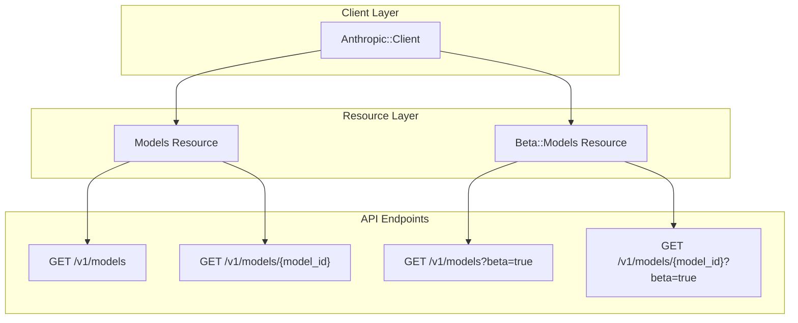
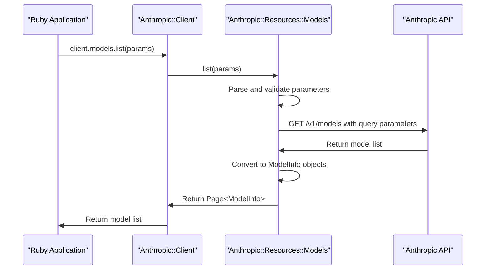
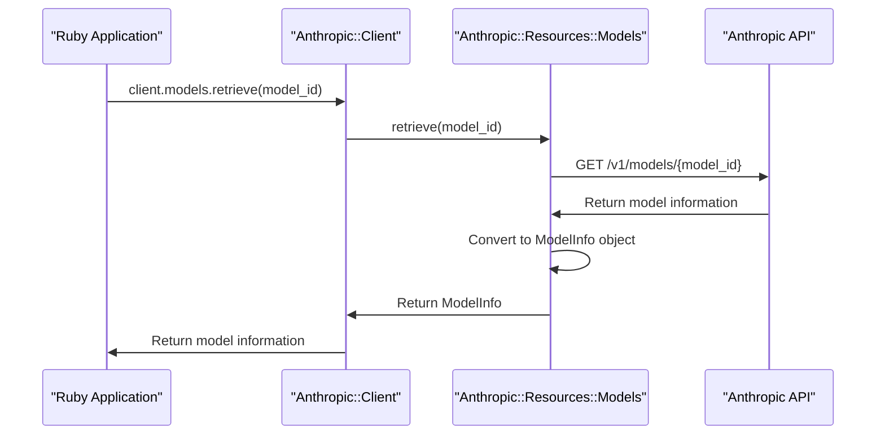
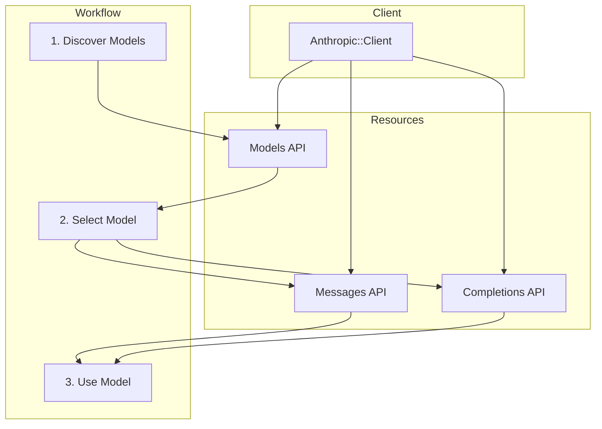

<!-- source: DeepWiki mcp.deepwiki.com · repo anthropics/anthropic-sdk-ruby · page 7 Models API · fetched 2026-10-26 -->

# Models API

<details>
<summary>Relevant source files</summary>

The following files were used as context for generating this wiki page:

- [lib/anthropic/models/metadata.rb](lib/anthropic/models/metadata.rb)
- [lib/anthropic/resources/beta.rb](lib/anthropic/resources/beta.rb)
- [lib/anthropic/resources/beta/messages.rb](lib/anthropic/resources/beta/messages.rb)
- [lib/anthropic/resources/beta/messages/batches.rb](lib/anthropic/resources/beta/messages/batches.rb)
- [lib/anthropic/resources/beta/models.rb](lib/anthropic/resources/beta/models.rb)
- [lib/anthropic/resources/completions.rb](lib/anthropic/resources/completions.rb)
- [lib/anthropic/resources/messages.rb](lib/anthropic/resources/messages.rb)
- [lib/anthropic/resources/messages/batches.rb](lib/anthropic/resources/messages/batches.rb)
- [lib/anthropic/resources/models.rb](lib/anthropic/resources/models.rb)

</details>


The Models API provides functionality to retrieve information about available models in the Anthropic ecosystem. This API allows developers to:

1. List all available models
2. Retrieve specific information about a single model
3. Resolve model aliases to actual model IDs

The Models API is a discovery and metadata service, not used for actual model inference. For model usage, see [Messages API](#4) or [Completions API](#6).

## Overview

The Models API provides a straightforward interface for discovering and examining the AI models available through Anthropic's platform. This information is useful for selecting the appropriate model for your application, checking model capabilities, and staying up-to-date with new model releases.



Sources: [lib/anthropic/resources/models.rb:1-64](), [lib/anthropic/resources/beta/models.rb:1-66]()

## Resource Methods

The Models API provides two primary methods:

### list

Lists all available models that can be used with the API. The response includes model IDs, maximum context window sizes, capabilities, and other metadata.

```ruby
client = Anthropic::Client.new(api_key: "your-api-key")
models = client.models.list
```

The method supports pagination parameters for handling large lists:

| Parameter  | Type    | Description |
|------------|---------|-------------|
| `limit`    | Integer | Maximum number of models to return (default varies) |
| `after_id` | String  | Return models after this ID (for pagination) |
| `before_id`| String  | Return models before this ID (for pagination) |



Sources: [lib/anthropic/resources/models.rb:28-53]()

### retrieve

Retrieves detailed information about a specific model by its ID.

```ruby
client = Anthropic::Client.new(api_key: "your-api-key")
model_info = client.models.retrieve("claude-3-opus-20240229")
```

This method is particularly useful for:
- Resolving model aliases to specific model versions
- Checking a model's capabilities and parameters
- Verifying a model is available before making inference requests



Sources: [lib/anthropic/resources/models.rb:6-26]()

## Response Structure

The Models API returns information in the form of `ModelInfo` objects. These objects contain metadata about the models, such as:

| Field | Description |
|-------|-------------|
| `id` | Unique identifier for the model |
| `name` | Human-readable name of the model |
| `description` | Detailed description of the model |
| `max_tokens` | Maximum context length (input + output tokens) |
| `created` | Timestamp when model was created |
| `cost` | Pricing information |
| `system_prompt_behaviors` | Supported system prompt features |
| `supported_tools` | Tools the model supports (if any) |
| `capabilities` | Specific model capabilities (e.g., multimodal support) |

A typical response from the Models API might look like:

```ruby
# Example ModelInfo object structure
{
  "id" => "claude-3-opus-20240229",
  "name" => "Claude 3 Opus",
  "description" => "Most capable Claude model for complex tasks",
  "max_tokens" => 200000,
  "created" => 1708999800,
  "capabilities" => {
    "multimodal" => true
  }
}
```

Sources: [lib/anthropic/resources/models.rb:16-17](), [lib/anthropic/resources/models.rb:40-41]()

## Beta Models API

The SDK also provides access to beta models through the `beta.models` namespace. This allows early access to upcoming models and features.

```ruby
client = Anthropic::Client.new(api_key: "your-api-key")
beta_models = client.beta.models.list
```

The Beta Models API has the same structure as the standard Models API but accesses different endpoints with the `beta=true` parameter.

```mermaid
classDiagram
    class Client {
        +models: Resources::Models
        +beta: Resources::Beta
    }
    
    class Resources::Models {
        +list(params)
        +retrieve(model_id, params)
    }
    
    class Resources::Beta {
        +models: Beta::Models
    }
    
    class Beta::Models {
        +list(params)
        +retrieve(model_id, params)
    }
    
    Client --> Resources::Models
    Client --> Resources::Beta
    Resources::Beta --> Beta::Models
```

Sources: [lib/anthropic/resources/beta.rb:1-23](), [lib/anthropic/resources/beta/models.rb:1-66]()

## Common Use Cases

### Checking Model Availability

Before using a specific model, you can verify it's available and check its capabilities:

```ruby
begin
  model = client.models.retrieve("claude-3-opus-20240229")
  puts "Model is available with context window of #{model.max_tokens} tokens"
rescue Anthropic::APIError => e
  puts "Model not available: #{e.message}"
end
```

### Programmatically Selecting Models

You can use the Models API to dynamically select the best model for a task:

```ruby
models = client.models.list
# Find models with multimodal capabilities
multimodal_models = models.data.select { |model| model.capabilities&.multimodal }
# Find model with largest context window
largest_context = models.data.max_by { |model| model.max_tokens }
```

### Resolving Model Aliases

Some API calls may use model aliases (like "claude-latest"). You can resolve these to specific model versions:

```ruby
alias_info = client.models.retrieve("claude-latest")
specific_model_id = alias_info.id
puts "The current claude-latest points to: #{specific_model_id}"
```

## Integration with Other APIs

The Models API works alongside other APIs in the SDK, particularly the Messages API and Completions API, which use the models for text generation.



Sources: [lib/anthropic/resources/messages.rb:1-146](), [lib/anthropic/resources/completions.rb:1-101](), [lib/anthropic/resources/models.rb:1-64]()

## Best Practices

1. **Cache model information** for short periods (minutes to hours) to reduce API calls when your application frequently needs model metadata.

2. **Handle pagination** when listing models, especially as Anthropic releases more models over time.

3. **Fallback logic** - Implement fallback model selection in case your preferred model is unavailable.

4. **Check capabilities before using features** - Verify a model supports specific features (like tools or multimodal inputs) before using them.

5. **Use model aliases** for production workflows to automatically benefit from newer models while using specific model IDs for testing and validation.

## Example Implementation

Here's a simple example showing how to use the Models API to select an appropriate model based on requirements:

```ruby
def select_model(client, require_multimodal: false, min_context_size: 0)
  models = client.models.list
  
  # Filter based on requirements
  candidates = models.data.select do |model|
    meets_multimodal = !require_multimodal || model.capabilities&.multimodal
    meets_context = model.max_tokens >= min_context_size
    meets_multimodal && meets_context
  end
  
  # Sort by capability (assuming newer models are better)
  candidates.sort_by { |model| model.created }.last&.id
end

# Usage
client = Anthropic::Client.new(api_key: ENV["ANTHROPIC_API_KEY"])
model_id = select_model(client, require_multimodal: true, min_context_size: 100000)
```

Sources: [lib/anthropic/resources/models.rb:1-64]()

---

