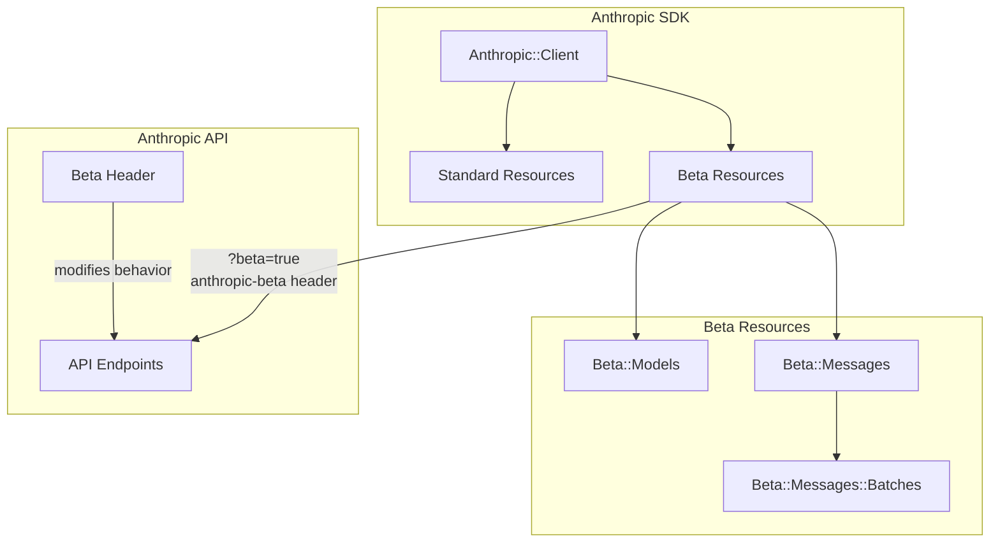
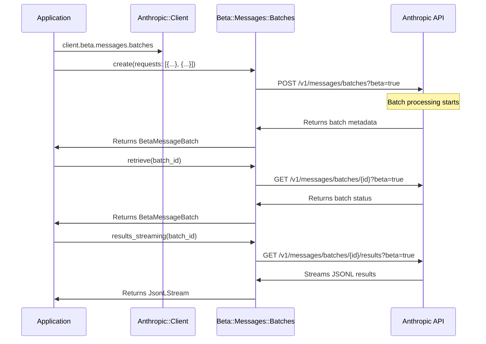
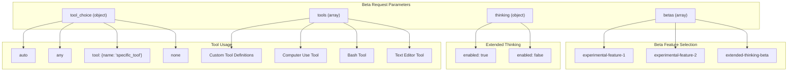
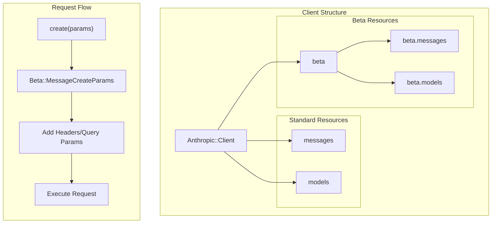

<!-- source: DeepWiki mcp.deepwiki.com · repo anthropics/anthropic-sdk-ruby · page 8 Beta Features · fetched 2026-10-26 -->

# Beta Features

<details>
<summary>Relevant source files</summary>

The following files were used as context for generating this wiki page:

- [lib/anthropic/models/beta/message_count_tokens_params.rb](lib/anthropic/models/beta/message_count_tokens_params.rb)
- [lib/anthropic/models/beta/message_create_params.rb](lib/anthropic/models/beta/message_create_params.rb)
- [lib/anthropic/models/beta/messages/batch_cancel_params.rb](lib/anthropic/models/beta/messages/batch_cancel_params.rb)
- [lib/anthropic/models/beta/messages/batch_create_params.rb](lib/anthropic/models/beta/messages/batch_create_params.rb)
- [lib/anthropic/models/beta/messages/batch_delete_params.rb](lib/anthropic/models/beta/messages/batch_delete_params.rb)
- [lib/anthropic/models/beta/messages/batch_list_params.rb](lib/anthropic/models/beta/messages/batch_list_params.rb)
- [lib/anthropic/models/beta/messages/batch_results_params.rb](lib/anthropic/models/beta/messages/batch_results_params.rb)
- [lib/anthropic/models/beta/messages/batch_retrieve_params.rb](lib/anthropic/models/beta/messages/batch_retrieve_params.rb)
- [lib/anthropic/models/metadata.rb](lib/anthropic/models/metadata.rb)
- [lib/anthropic/resources/beta.rb](lib/anthropic/resources/beta.rb)
- [lib/anthropic/resources/beta/messages.rb](lib/anthropic/resources/beta/messages.rb)
- [lib/anthropic/resources/beta/messages/batches.rb](lib/anthropic/resources/beta/messages/batches.rb)
- [lib/anthropic/resources/beta/models.rb](lib/anthropic/resources/beta/models.rb)
- [lib/anthropic/resources/completions.rb](lib/anthropic/resources/completions.rb)
- [lib/anthropic/resources/messages.rb](lib/anthropic/resources/messages.rb)
- [lib/anthropic/resources/messages/batches.rb](lib/anthropic/resources/messages/batches.rb)
- [lib/anthropic/resources/models.rb](lib/anthropic/resources/models.rb)

</details>


The Beta Features system in the Anthropic Ruby SDK provides access to experimental API features that are under development and not yet part of the stable API. This page documents how to access these features, the available beta endpoints, and how they differ from the standard API.

For information about the standard stable API, see [Overview](#1) and [Getting Started](#2).

## Introduction to Beta Features

The Anthropic API offers experimental features through a beta program. These features may change frequently, have different parameters, or provide new capabilities that aren't available in the stable API. The Ruby SDK provides structured access to these beta features through a dedicated namespace.

When using beta features, you should be aware that:

1. They may change or be removed without notice
2. They might not be as thoroughly tested as stable features
3. They require explicit opt-in through special headers and parameters



Sources: [lib/anthropic/resources/beta.rb:1-23](), [lib/anthropic/resources/beta/messages.rb:1-159](), [lib/anthropic/resources/beta/messages/batches.rb:1-199](), [lib/anthropic/resources/beta/models.rb:1-66]()

## Accessing Beta Features

Beta features are accessed through the `beta` property of the Anthropic client. This provides access to beta versions of the Messages and Models APIs.

Example of accessing beta features:

```ruby
client = Anthropic::Client.new(api_key: "your-api-key")

# Access beta messages API
beta_message = client.beta.messages.create(
  max_tokens: 1024,
  messages: [{ role: "user", content: "Hello, Claude" }],
  model: "claude-3-opus-20240229",
  betas: ["experimental-feature"]
)

# Access beta models API
beta_models = client.beta.models.list()
```

The `betas` parameter allows you to specify which experimental features you want to use. This parameter accepts an array of beta feature identifiers, which can be strings, symbols, or `Anthropic::Models::AnthropicBeta` objects.

Sources: [lib/anthropic/resources/beta.rb:1-23](), [lib/anthropic/resources/beta/messages.rb:1-159](), [lib/anthropic/models/beta/message_create_params.rb:325-333]()

## Beta Messages API

The Beta Messages API parallels the standard Messages API but includes experimental features. It provides methods for creating messages, streaming responses, and counting tokens.

```mermaid
classDiagram
    class Beta {
        +messages: Beta::Messages
        +models: Beta::Models
    }
    
    class "Beta::Messages" {
        +create(max_tokens:, messages:, model:, ...)
        +stream_raw(max_tokens:, messages:, model:, ...)
        +count_tokens(messages:, model:, ...)
        +batches: Beta::Messages::Batches
    }
    
    class "Beta::Messages::Batches" {
        +create(requests:, ...)
        +retrieve(message_batch_id, ...)
        +list(...)
        +delete(message_batch_id, ...)
        +cancel(message_batch_id, ...)
        +results_streaming(message_batch_id, ...)
    }
    
    Beta --> "Beta::Messages" : contains
    "Beta::Messages" --> "Beta::Messages::Batches" : contains
```

Sources: [lib/anthropic/resources/beta.rb:1-23](), [lib/anthropic/resources/beta/messages.rb:1-159](), [lib/anthropic/resources/beta/messages/batches.rb:1-199]()

### Creating Messages

The `create` method allows you to send a request to Claude with text and/or image content, generating a response message.

```ruby
response = client.beta.messages.create(
  max_tokens: 1024,
  messages: [
    {
      role: "user",
      content: "Explain quantum computing in simple terms"
    }
  ],
  model: "claude-3-opus-20240229",
  temperature: 0.7,
  betas: ["extended-thinking-beta"]
)
```

The beta version includes additional parameters not available in the standard API, such as:

- `thinking`: Configuration for enabling Claude's extended thinking capability
- `tool_choice`: Controls how the model uses provided tools
- `betas`: Specifies which beta features to enable

The method returns a `BetaMessage` object containing Claude's response.

Sources: [lib/anthropic/resources/beta/messages.rb:10-55](), [lib/anthropic/models/beta/message_create_params.rb:1-396]()

### Streaming Messages

For long responses or real-time applications, the `stream_raw` method provides a streaming interface:

```ruby
stream = client.beta.messages.stream_raw(
  max_tokens: 1024,
  messages: [
    {
      role: "user",
      content: "Write a long story about a space explorer"
    }
  ],
  model: "claude-3-opus-20240229",
  betas: ["experimental-streaming-feature"]
)

stream.each do |event|
  # Process each streaming event
  puts event.type
  puts event.content if event.respond_to?(:content)
end
```

This method returns a stream of events that represent pieces of the response as they're generated.

Sources: [lib/anthropic/resources/beta/messages.rb:60-111](), [lib/anthropic/models/beta/message_create_params.rb:1-396]()

### Counting Tokens

To estimate token usage without generating a full response, use the `count_tokens` method:

```ruby
token_count = client.beta.messages.count_tokens(
  messages: [
    {
      role: "user",
      content: "How many tokens is this message?"
    }
  ],
  model: "claude-3-opus-20240229",
  betas: ["token-counting-feature"]
)

puts "Input tokens: #{token_count.input_tokens}"
```

This method helps estimate costs and ensure your requests stay within token limits.

Sources: [lib/anthropic/resources/beta/messages.rb:112-146](), [lib/anthropic/models/beta/message_count_tokens_params.rb:1-316]()

## Beta Batches API

The Beta Batches API allows processing multiple message requests efficiently in batches.



Sources: [lib/anthropic/resources/beta/messages/batches.rb:1-199](), [lib/anthropic/models/beta/messages/batch_create_params.rb:1-464]()

### Creating and Managing Batches

To create a message batch:

```ruby
batch = client.beta.messages.batches.create(
  requests: [
    {
      custom_id: "request-1",
      params: {
        max_tokens: 1024,
        messages: [{ role: "user", content: "Question 1" }],
        model: "claude-3-opus-20240229"
      }
    },
    {
      custom_id: "request-2",
      params: {
        max_tokens: 1024,
        messages: [{ role: "user", content: "Question 2" }],
        model: "claude-3-opus-20240229"
      }
    }
  ],
  betas: ["batch-processing-beta"]
)

puts "Batch ID: #{batch.id}"
puts "Status: #{batch.status}"
```

You can retrieve batch status, list all batches, delete completed batches, or cancel in-progress batches:

```ruby
# Retrieve a batch
batch = client.beta.messages.batches.retrieve(batch_id)

# List batches
batches = client.beta.messages.batches.list(limit: 10)

# Cancel a batch
client.beta.messages.batches.cancel(batch_id)

# Delete a batch
client.beta.messages.batches.delete(batch_id)
```

Sources: [lib/anthropic/resources/beta/messages/batches.rb:8-123](), [lib/anthropic/models/beta/messages/batch_create_params.rb:1-464](), [lib/anthropic/models/beta/messages/batch_retrieve_params.rb:1-35](), [lib/anthropic/models/beta/messages/batch_list_params.rb:1-72](), [lib/anthropic/models/beta/messages/batch_cancel_params.rb:1-35](), [lib/anthropic/models/beta/messages/batch_delete_params.rb:1-35]()

### Retrieving Batch Results

Once a batch completes processing, you can retrieve the results:

```ruby
results = client.beta.messages.batches.results_streaming(batch_id)

results.each do |result|
  puts "Result for: #{result.custom_id}"
  if result.error
    puts "Error: #{result.error.message}"
  else
    puts "Response: #{result.message.content}"
  end
end
```

The results are returned as a stream of JSON objects, one per request in the batch. You can match results to requests using the `custom_id` field.

Sources: [lib/anthropic/resources/beta/messages/batches.rb:158-186](), [lib/anthropic/models/beta/messages/batch_results_params.rb:1-35]()

## Beta Models API

The Beta Models API provides information about available models, including experimental models that may not be listed in the standard Models API.

```ruby
# List all available models
models = client.beta.models.list()

# Get details of a specific model
model_info = client.beta.models.retrieve("claude-3-opus-20240229")
```

The Beta Models API follows the same pattern as the standard Models API but may provide additional model information or access to experimental models.

Sources: [lib/anthropic/resources/beta/models.rb:1-66]()

## Beta Parameters System

The Beta API introduces several unique parameters that aren't available in the standard API:



Sources: [lib/anthropic/models/beta/message_create_params.rb:1-396](), [lib/anthropic/models/beta/message_count_tokens_params.rb:1-316]()

### Key Beta Parameters

1. **betas**: Array of beta feature identifiers to enable
   ```ruby
   betas: ["extended-thinking-beta", "experimental-tool-feature"]
   ```

2. **thinking**: Configuration for Claude's extended thinking capability
   ```ruby
   thinking: { enabled: true }
   ```

3. **tool_choice**: Controls how the model uses provided tools
   ```ruby
   tool_choice: { type: "auto" }
   # or
   tool_choice: { type: "tool", name: "calculator" }
   ```

4. **tools**: Definitions of tools the model may use
   ```ruby
   tools: [
     {
       name: "get_weather",
       description: "Get current weather for a location",
       input_schema: {
         type: "object",
         properties: {
           location: {
             type: "string",
             description: "City and state/country"
           }
         },
         required: ["location"]
       }
     }
   ]
   ```

Sources: [lib/anthropic/models/beta/message_create_params.rb:1-396](), [lib/anthropic/models/beta/message_count_tokens_params.rb:1-316]()

## Differences from Standard API

The Beta API differs from the standard API in several important ways:

| Feature | Standard API | Beta API |
|---------|-------------|----------|
| Endpoint URLs | v1/messages | v1/messages?beta=true |
| Headers | Standard headers | Includes "anthropic-beta" header |
| Parameters | Standard parameters | Additional parameters like `betas`, `thinking` |
| Response Models | Message, ModelInfo, etc. | BetaMessage, BetaModelInfo, etc. |
| Stability | Stable, backward compatible | May change without notice |

All beta API requests include:
1. A `?beta=true` query parameter in the URL
2. An `anthropic-beta` header (when `betas` parameter is provided)
3. Beta-specific request and response models

Sources: [lib/anthropic/resources/beta/messages.rb:1-159](), [lib/anthropic/resources/beta/models.rb:1-66](), [lib/anthropic/resources/beta/messages/batches.rb:1-199]()

## Best Practices for Using Beta Features

When working with beta features, consider these best practices:

1. **Test thoroughly**: Beta features may have unexpected behaviors
2. **Handle errors gracefully**: Be prepared for changes in error formats or behavior
3. **Don't rely on beta features in production**: Use them for testing and development only
4. **Stay updated**: Check the Anthropic documentation regularly for changes to beta features
5. **Provide feedback**: Report issues or suggestions to Anthropic

If a beta feature becomes critical to your application, have a fallback plan in case it changes or is removed.

## Implementation Details

Behind the scenes, the Beta API system works by:

1. Creating beta-specific request objects (BetaMessageCreateParams, etc.)
2. Adding beta-specific headers and query parameters
3. Routing requests to beta-specific endpoints
4. Parsing responses into beta-specific model objects



Sources: [lib/anthropic/resources/beta.rb:1-23](), [lib/anthropic/resources/beta/messages.rb:1-159](), [lib/anthropic/resources/beta/models.rb:1-66]()

## Conclusion

The Beta Features system in the Anthropic Ruby SDK provides a structured way to access experimental API features while maintaining a clear separation from the stable API. By using the beta namespace, you can explore new capabilities while ensuring your production code remains stable.

To stay updated on available beta features, consult the Anthropic API documentation or contact Anthropic directly.

---

