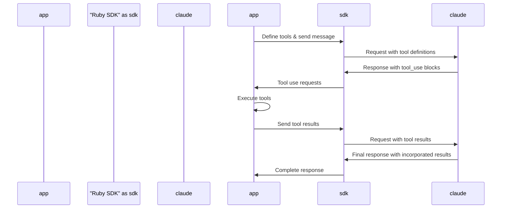
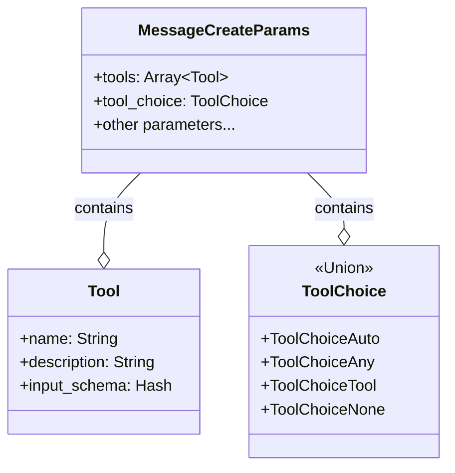
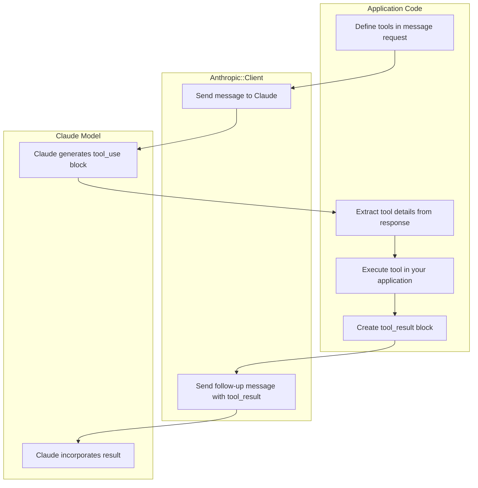

<!-- source: DeepWiki mcp.deepwiki.com · repo anthropics/anthropic-sdk-ruby · page 9 Tool Usage · fetched 2026-10-26 -->

# Tool Usage

<details>
<summary>Relevant source files</summary>

The following files were used as context for generating this wiki page:

- [lib/anthropic/models/beta/beta_tool_choice_any.rb](lib/anthropic/models/beta/beta_tool_choice_any.rb)
- [lib/anthropic/models/beta/beta_tool_choice_auto.rb](lib/anthropic/models/beta/beta_tool_choice_auto.rb)
- [lib/anthropic/models/beta/beta_tool_choice_tool.rb](lib/anthropic/models/beta/beta_tool_choice_tool.rb)
- [lib/anthropic/models/beta/beta_tool_result_block_param.rb](lib/anthropic/models/beta/beta_tool_result_block_param.rb)
- [lib/anthropic/models/message_count_tokens_params.rb](lib/anthropic/models/message_count_tokens_params.rb)
- [lib/anthropic/models/messages/batch_create_params.rb](lib/anthropic/models/messages/batch_create_params.rb)
- [lib/anthropic/models/tool_choice_any.rb](lib/anthropic/models/tool_choice_any.rb)
- [lib/anthropic/models/tool_choice_auto.rb](lib/anthropic/models/tool_choice_auto.rb)
- [lib/anthropic/models/tool_choice_tool.rb](lib/anthropic/models/tool_choice_tool.rb)
- [lib/anthropic/models/tool_result_block_param.rb](lib/anthropic/models/tool_result_block_param.rb)

</details>


This page explains how to use Claude's tool capabilities through the Anthropic Ruby SDK. Tools allow Claude to call external functions defined by you, enabling the model to access real-time data, perform calculations, execute code, and interact with external systems beyond its training data.

## Overview

The tools feature enables a multi-turn interaction pattern where:

1. You define tools that Claude can use
2. Claude generates structured "tool use" requests in its responses
3. You execute these requests in your application code
4. You return the results back to Claude for incorporation into its reasoning



Sources: [lib/anthropic/models/message_count_tokens_params.rb:154-227](), [lib/anthropic/models/messages/batch_create_params.rb:272-347]()

## Tool Definition Structure

Tools are defined using a structured format with the following components:

- `name`: A unique identifier for the tool
- `description`: Optional but recommended explanation of what the tool does
- `input_schema`: JSON Schema defining the structure of inputs the tool accepts

Each tool definition is included in the `tools` array when creating a message:



Sources: [lib/anthropic/models/messages/batch_create_params.rb:272-347](), [lib/anthropic/models/message_count_tokens_params.rb:154-227]()

## Creating and Configuring Tools

To define tools for Claude to use, you provide them in the `tools` parameter when creating a message. Each tool must include a name and input schema, with a description highly recommended for better model understanding.

Here's an example of how to define a tool for getting stock prices:

```ruby
client = Anthropic::Client.new(api_key: "your_api_key")

response = client.messages.create(
  model: "claude-3-opus-20240229",
  max_tokens: 1024,
  messages: [
    { 
      role: "user", 
      content: "What's the current price of Apple stock?"
    }
  ],
  tools: [
    {
      name: "get_stock_price",
      description: "Get the current stock price for a given ticker symbol",
      input_schema: {
        type: "object",
        properties: {
          ticker: {
            type: "string",
            description: "The stock ticker symbol, e.g., AAPL for Apple Inc."
          }
        },
        required: ["ticker"]
      }
    }
  ]
)
```

The `input_schema` uses [JSON Schema](https://json-schema.org/draft/2020-12) format to define the structure of inputs that Claude will provide when using the tool.

Sources: [lib/anthropic/models/messages/batch_create_params.rb:272-347]()

## Controlling Tool Selection with tool_choice

The SDK provides several options to control how Claude selects and uses tools through the `tool_choice` parameter:

| Tool Choice Type | Description | When to Use |
|-----------------|-------------|------------|
| `ToolChoiceAuto` | Let Claude decide whether to use tools | Default behavior - good for most cases |
| `ToolChoiceAny` | Instruct Claude to use any available tool | When you want to ensure Claude uses a tool |
| `ToolChoiceTool` | Instruct Claude to use a specific named tool | When you want Claude to use a particular tool |
| `ToolChoiceNone` | Explicitly prevent Claude from using tools | When you want to disable tool usage |

Here's how to configure each option:

```ruby
# Let Claude decide (default)
tool_choice = { type: "auto" }  # or Anthropic::Models::ToolChoiceAuto.new

# Instruct Claude to use any available tool
tool_choice = { type: "any" }  # or Anthropic::Models::ToolChoiceAny.new

# Instruct Claude to use a specific tool
tool_choice = { 
  type: "tool", 
  name: "get_stock_price" 
}  # or Anthropic::Models::ToolChoiceTool.new(name: "get_stock_price")
```

Sources: [lib/anthropic/models/tool_choice_auto.rb](), [lib/anthropic/models/tool_choice_any.rb](), [lib/anthropic/models/tool_choice_tool.rb]()

## Tool Usage Flow

The complete tool usage flow involves multiple turns of conversation between your application and Claude:



Sources: [lib/anthropic/models/message_count_tokens_params.rb:154-227](), [lib/anthropic/models/tool_result_block_param.rb]()

## Processing Tool Use Responses

When Claude decides to use a tool, the response will contain one or more `tool_use` blocks in the content array. Here's an example response structure:

```ruby
response = {
  id: "msg_abc123",
  content: [
    {
      type: "tool_use",
      id: "toolu_xyz789",
      name: "get_stock_price",
      input: { 
        ticker: "AAPL" 
      }
    }
  ],
  # other response fields...
}
```

You'll need to:
1. Check for tool_use blocks in the response
2. Extract the tool name and input
3. Execute the corresponding function in your application
4. Return the results to Claude

Sources: [lib/anthropic/models/messages/batch_create_params.rb:287-347]()

## Returning Tool Results to Claude

After executing the tool, you need to return the results to Claude using a `tool_result` block in a new user message:

```ruby
client.messages.create(
  model: "claude-3-opus-20240229",
  max_tokens: 1024,
  messages: [
    # Previous messages...
    { 
      role: "user", 
      content: [
        {
          type: "tool_result",
          tool_use_id: "toolu_xyz789",  # Must match the ID from the tool_use block
          content: "175.34 USD"  # String result from your tool execution
        }
      ]
    }
  ]
)
```

The `tool_result` block must include:
- `tool_use_id`: The ID from the original tool_use block
- `content`: The result of executing the tool (as a string or content blocks)

You can also optionally include:
- `is_error`: Boolean indicating if the tool execution failed
- `cache_control`: Cache control settings for the result

Sources: [lib/anthropic/models/tool_result_block_param.rb]()

## Advanced Tool Configuration

### Controlling Parallel Tool Use

By default, Claude can use multiple tools in parallel when appropriate. You can disable this behavior by setting `disable_parallel_tool_use: true` in your tool choice configuration:

```ruby
tool_choice = { 
  type: "auto", 
  disable_parallel_tool_use: true 
}
```

This forces Claude to use at most one tool at a time, which can be helpful for simpler integration workflows.

Sources: [lib/anthropic/models/tool_choice_auto.rb:12-28](), [lib/anthropic/models/tool_choice_any.rb:12-28](), [lib/anthropic/models/tool_choice_tool.rb:17-28]()

### Rich Tool Results

Tool results can be returned as either a simple string or as structured content blocks:

```ruby
# Simple string result
{
  type: "tool_result",
  tool_use_id: "toolu_xyz789",
  content: "175.34 USD"
}

# Structured content blocks
{
  type: "tool_result",
  tool_use_id: "toolu_xyz789",
  content: [
    { type: "text", text: "Current price: 175.34 USD" },
    { 
      type: "image", 
      source: {
        type: "base64",
        media_type: "image/png",
        data: "iVBORw0KGgoAAAANSUhEU..."
      }
    }
  ]
}
```

This allows you to return rich content including text and images as tool results.

Sources: [lib/anthropic/models/tool_result_block_param.rb:21-78]()

## Token Counting with Tools

When you use tools, they contribute to your token count. You can estimate token usage by using the `count_tokens` method with the same parameters:

```ruby
token_count = client.messages.count_tokens(
  model: "claude-3-opus-20240229",
  messages: [...],
  tools: [...],
  tool_choice: {...}
)
```

This helps you manage token usage when implementing tool-based workflows.

Sources: [lib/anthropic/models/message_count_tokens_params.rb:154-227]()

## Batch Processing with Tools

Tool usage is also supported in batch message creation:

```ruby
batch = client.messages.batches.create(
  requests: [
    {
      custom_id: "request_1",
      params: {
        model: "claude-3-opus-20240229",
        max_tokens: 1024,
        messages: [...],
        tools: [...],
        tool_choice: {...}
      }
    },
    # Additional batch requests...
  ]
)
```

This allows you to process multiple tool-using conversations in parallel.

Sources: [lib/anthropic/models/messages/batch_create_params.rb:272-347]()

## Beta Tool Features

The SDK includes beta versions of tools and tool-related features in the `Beta` namespace. These are experimental features that may change in future releases.

```mermaid
classDiagram
    class "Anthropic::Models::ToolResult" {
        +tool_use_id: String
        +content: String|Array
        +is_error: Boolean
    }
    
    class "Anthropic::Models::Beta::BetaToolResult" {
        +tool_use_id: String
        +content: String|Array
        +is_error: Boolean
        +experimental features...
    }
    
    "Anthropic::Models::ToolResult" <|-- "Anthropic::Models::Beta::BetaToolResult" : extends
```

Use the beta versions when you want to experiment with the latest tool capabilities.

Sources: [lib/anthropic/models/beta/beta_tool_result_block_param.rb](), [lib/anthropic/models/beta/beta_tool_choice_auto.rb](), [lib/anthropic/models/beta/beta_tool_choice_any.rb](), [lib/anthropic/models/beta/beta_tool_choice_tool.rb]()

---

