# Page: Overview

# Overview

<details>
<summary>Relevant source files</summary>

The following files were used as context for generating this wiki page:

- [.release-please-manifest.json](.release-please-manifest.json)
- [.stats.yml](.stats.yml)
- [CHANGELOG.md](CHANGELOG.md)
- [Gemfile](Gemfile)
- [Gemfile.lock](Gemfile.lock)
- [README.md](README.md)
- [lib/anthropic.rb](lib/anthropic.rb)
- [lib/anthropic/version.rb](lib/anthropic/version.rb)
- [test/anthropic/client_test.rb](test/anthropic/client_test.rb)
- [test/anthropic/test_helper.rb](test/anthropic/test_helper.rb)

</details>


The Anthropic Ruby SDK provides a clean, type-safe interface for Ruby applications to interact with Anthropic's Claude AI models. This library wraps Anthropic's REST API in an idiomatic Ruby package, offering a comprehensive set of tools for building AI-powered applications with Claude.

For detailed installation and authentication setup, see [Getting Started](#2).

Sources: [README.md:1-44]()

## Key Features

- **Complete API Coverage**: Access to all Anthropic API endpoints including Messages, Completions, and Models
- **Type Safety**: Robust parameter validation and conversion through a comprehensive type system
- **Streaming Support**: Real-time responses with Server-Sent Events (SSE)
- **Pagination**: Auto-paginating iterators for list endpoints
- **Error Handling**: Structured error hierarchy with detailed error information
- **Retry Logic**: Automatic retries with exponential backoff for certain error types
- **Cloud Provider Integration**: Native interfaces for AWS Bedrock and Google Vertex AI
- **Batch Processing**: Efficient handling of multiple message requests
- **Tool Usage**: Support for Claude's tools capability for external function calling
- **LSP Support**: Solargraph and Sorbet type definitions for better IDE integration

Sources: [README.md:26-46](), [README.md:47-231]()

## SDK Architecture

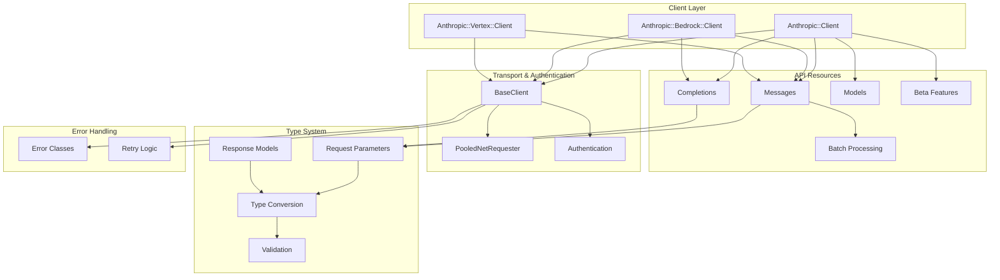

The SDK is organized into several layers that work together to provide a seamless experience. The Client Layer serves as the primary entry point, with different client implementations for direct API access and cloud provider integrations. Resources encapsulate specific API functionality, while the transport layer handles HTTP communications and authentication. The type system ensures proper data validation and conversion.

Sources: [lib/anthropic.rb:37-60](), [README.md:233-289]()

## Client Types

The SDK offers three client implementations to accommodate different integration scenarios:

1. **Anthropic::Client** - Direct integration with Anthropic's API
2. **Anthropic::Bedrock::Client** - Integration via AWS Bedrock
3. **Anthropic::Vertex::Client** - Integration via Google Vertex AI

Each client provides consistent access to the underlying functionality while handling the specific authentication and communication requirements of each platform.

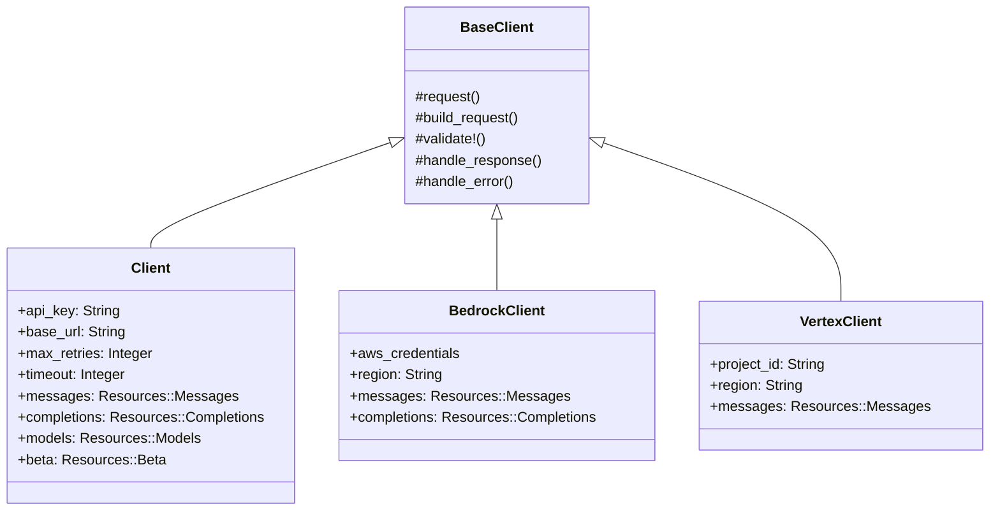

Sources: [lib/anthropic.rb:57-59](), [README.md:233-289]()

## Core Resources

The SDK organizes its functionality into resource classes that provide methods for interacting with specific API endpoints:

| Resource | Purpose | Key Methods |
|----------|---------|-------------|
| Messages | Primary interface for Claude conversations | `create`, `stream_raw`, `count_tokens` |
| Messages::Batches | Process multiple message requests | `create`, `retrieve`, `list`, `delete`, `cancel` |
| Completions | Legacy API for text completion | `create`, `create_streaming` |
| Models | Information about available models | `retrieve`, `list` |
| Beta | Experimental API features | (Various beta endpoints) |

Sources: [lib/anthropic.rb:258-265](), [README.md:26-46]()

## Request Processing Flow

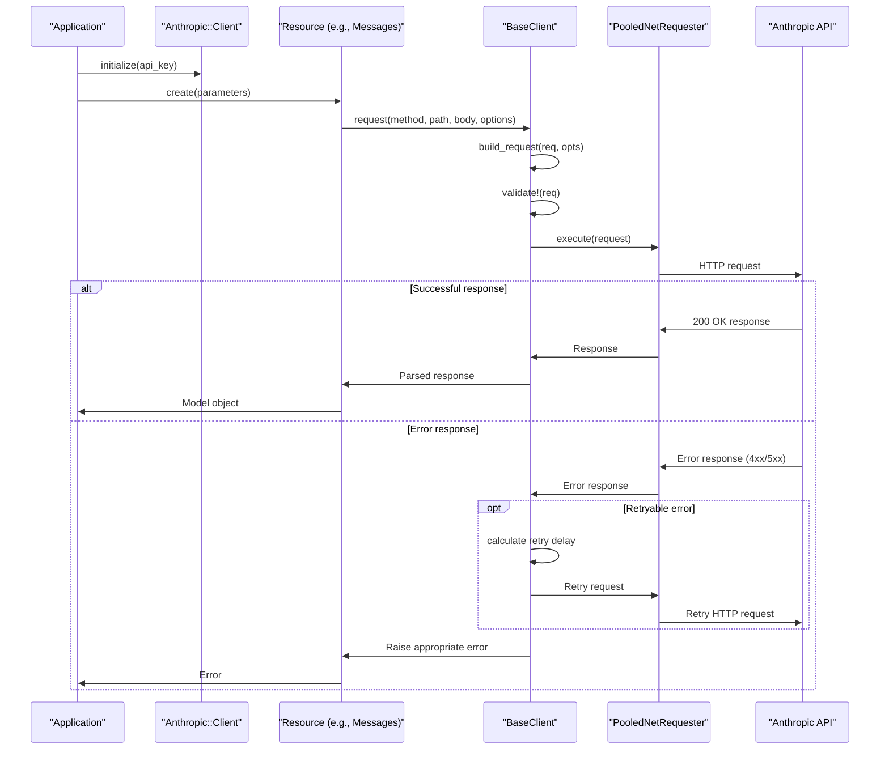

When your application makes a request using the SDK, it goes through several layers of processing before reaching the Anthropic API. The request is validated, authenticated, and potentially retried if certain errors occur. Responses are parsed into appropriate model objects before being returned to your application.

Sources: [README.md:94-122](), [lib/anthropic/client.rb](), [test/anthropic/client_test.rb:1-230]()

## Type System

The SDK uses a comprehensive type system to validate and convert data between Ruby objects and API formats. This ensures that requests are properly formed and responses are correctly parsed.

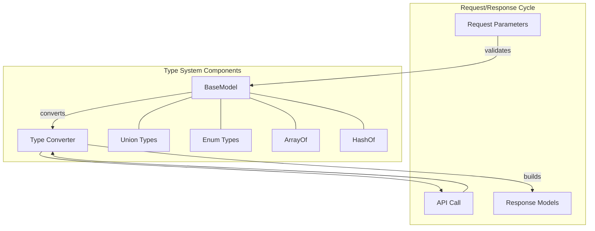

The type system is built around the `BaseModel` class, which provides structure and validation for request parameters and response models. It supports complex data types including unions, enums, arrays, and hashes.

Sources: [lib/anthropic.rb:37-53](), [README.md:180-207]()

## Basic Usage Example

Here's a simple example of using the SDK to create a message with Claude:

```ruby
# Initialize the client
anthropic = Anthropic::Client.new(
  api_key: "my-anthropic-api-key"  # defaults to ENV["ANTHROPIC_API_KEY"]
)

# Create a message
message = anthropic.messages.create(
  max_tokens: 1024,
  messages: [{
    role: "user",
    content: "Hello, Claude"
  }],
  model: "claude-3-5-sonnet-latest"
)

# Access the response content
puts(message.content)
```

For more advanced usage, including streaming, batch processing, and cloud provider integration, refer to the specific sections in this wiki.

Sources: [README.md:28-46]()

## Cloud Provider Integration

The SDK supports accessing Claude models through different cloud providers, giving you flexibility in how you deploy and use the models.

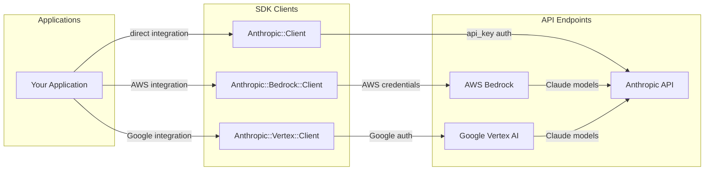

Each client handles its own authentication mechanism while providing a consistent API for interacting with Claude models:

- **Anthropic::Client**: Direct access using an API key
- **Anthropic::Bedrock::Client**: Access through AWS using AWS credentials
- **Anthropic::Vertex::Client**: Access through Google Cloud using Google authentication

Sources: [README.md:233-289](), [lib/anthropic.rb:57-59]()

## Related Topics

This overview provides a high-level introduction to the Anthropic Ruby SDK. For more detailed information on specific topics, refer to these sections:

- For installation and authentication setup, see [Getting Started](#2)
- For detailed client architecture, see [Client Architecture](#3)
- For using the Messages API, see [Messages API](#4)
- For batch processing, see [Batch Processing](#5)
- For cloud provider integration details, see [Cloud Provider Integration](#10)
- For error handling strategies, see [Error Handling](#3.2)

Sources: [README.md:1-10]()

---

# Page: Getting Started

# Getting Started

<details>
<summary>Relevant source files</summary>

The following files were used as context for generating this wiki page:

- [.release-please-manifest.json](.release-please-manifest.json)
- [.solargraph.yml](.solargraph.yml)
- [CHANGELOG.md](CHANGELOG.md)
- [Gemfile](Gemfile)
- [Gemfile.lock](Gemfile.lock)
- [README.md](README.md)
- [anthropic.gemspec](anthropic.gemspec)
- [lib/anthropic/client.rb](lib/anthropic/client.rb)
- [lib/anthropic/models/anthropic_beta.rb](lib/anthropic/models/anthropic_beta.rb)
- [lib/anthropic/models/model.rb](lib/anthropic/models/model.rb)
- [lib/anthropic/version.rb](lib/anthropic/version.rb)
- [rbi/lib/anthropic/client.rbi](rbi/lib/anthropic/client.rbi)
- [sig/anthropic/client.rbs](sig/anthropic/client.rbs)

</details>


This guide will walk you through the process of installing the Anthropic Ruby SDK, setting up authentication, and making your first API call to Claude, Anthropic's large language model. By the end of this guide, you'll have a working setup to start building applications with Claude.

## Installation

The Anthropic Ruby SDK requires Ruby 3.1.0 or higher. To install the SDK, add it to your application's `Gemfile`:

```ruby
gem "anthropic-sdk-beta", "~> 0.1.0.pre.beta.6"
```

Then run:

```bash
bundle install
```

Note: The `anthropic-sdk-beta` gem name is temporary. It will transition to the `anthropic` gem name by May 2025.

Sources: [README.md:11-24](), [lib/anthropic/version.rb:1-5](), [anthropic.gemspec:1-19]()

## Authentication

The Anthropic API requires authentication. You have two options:

1. **API Key** (recommended): Obtain an API key from the [Anthropic Console](https://console.anthropic.com).
2. **Auth Token**: An alternative authentication method.

You can provide authentication credentials either:
- As environment variables: `ANTHROPIC_API_KEY` or `ANTHROPIC_AUTH_TOKEN`
- Directly to the client constructor

```ruby
# Using environment variables (recommended)
ENV["ANTHROPIC_API_KEY"] = "your-api-key"

# Or passing credentials directly
client = Anthropic::Client.new(api_key: "your-api-key")
```

Sources: [README.md:26-46](), [lib/anthropic/client.rb:18-57]()

## Client Architecture

Before making your first API call, it's helpful to understand how the client is structured.

### Client Structure Diagram

```mermaid
classDiagram
    class Client {
        +api_key: String
        +auth_token: String
        +messages: Resources::Messages
        +completions: Resources::Completions
        +models: Resources::Models
        +beta: Resources::Beta
    }
    
    class Resources::Messages {
        +create(max_tokens, messages, model, ...)
        +stream_raw(max_tokens, messages, model, ...)
        +count_tokens(messages, model, ...)
    }
    
    class Resources::Completions {
        +create(max_tokens_to_sample, model, prompt, ...)
        +create_streaming(max_tokens_to_sample, model, prompt, ...)
    }
    
    class Resources::Models {
        +retrieve(model_id, ...)
        +list(...)
    }
    
    class Resources::Beta {
        +messages: Beta::Messages
        +models: Beta::Models
    }
    
    Client -- Resources::Messages : contains
    Client -- Resources::Completions : contains
    Client -- Resources::Models : contains
    Client -- Resources::Beta : contains
```

The `Client` class serves as the main entry point to the SDK. When you initialize a client, it automatically creates resource objects for interacting with different parts of the Anthropic API.

Sources: [lib/anthropic/client.rb:1-107]()

## Making Your First API Call

After setting up authentication, you can start making API calls to Claude. Here's a simple example:

```ruby
require "bundler/setup"
require "anthropic"

# Initialize the client
anthropic = Anthropic::Client.new(
  api_key: "my-anthropic-api-key" # Defaults to ENV["ANTHROPIC_API_KEY"]
)

# Create a message
message = anthropic.messages.create(
  max_tokens: 1024,
  messages: [{
    role: "user",
    content: "Hello, Claude"
  }],
  model: "claude-3-5-sonnet-latest"
)

# Output Claude's response
puts(message.content)
```

This example demonstrates:
1. Initializing the client with your API key
2. Sending a simple message to Claude
3. Receiving and displaying Claude's response

Sources: [README.md:26-46]()

### Request Flow Diagram

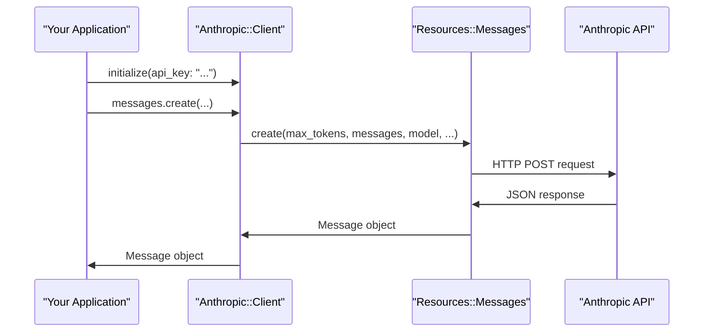

This diagram shows how your request flows through the SDK to the Anthropic API and back.

Sources: [README.md:26-46](), [lib/anthropic/client.rb:1-107]()

## Available Models

The SDK provides access to Anthropic's Claude models. When making requests, you'll need to specify which model you want to use:

| Model | Description | Identifier |
|-------|-------------|------------|
| Claude 3.7 Sonnet | Most intelligent model | `claude-3-7-sonnet-latest` |
| Claude 3.5 Haiku | Fastest and most compact model | `claude-3-5-haiku-latest` |
| Claude 3.5 Sonnet | Previous most intelligent model | `claude-3-5-sonnet-latest` |
| Claude 3 Opus | Excels at writing and complex tasks | `claude-3-opus-latest` |

You can also use specific dated versions of models, such as `claude-3-7-sonnet-20250219` or `claude-3-5-haiku-20241022`.

Note: Some older models like Claude 2.0 and Claude 2.1 are deprecated and will reach end-of-life on July 21st, 2025.

Sources: [lib/anthropic/models/model.rb:1-94]()

## Error Handling

When working with the API, you may encounter errors. The SDK provides structured error handling:

```ruby
begin
  message = anthropic.messages.create(
    max_tokens: 1024,
    messages: [{
      role: "user",
      content: "Hello, Claude"
    }],
    model: "claude-3-5-sonnet-latest"
  )
rescue Anthropic::Errors::APIError => e
  puts(e.status) # e.g., 400
  puts(e.message)
end
```

Common error types include:
- `BadRequestError` (HTTP 400)
- `AuthenticationError` (HTTP 401)
- `PermissionDeniedError` (HTTP 403)
- `NotFoundError` (HTTP 404)
- `RateLimitError` (HTTP 429)
- `InternalServerError` (HTTP 500+)

Sources: [README.md:94-128]()

## Configuration Options

The client supports several configuration options:

### Retries

By default, certain errors will be automatically retried 2 times with exponential backoff:

```ruby
# Configure retries for all requests
anthropic = Anthropic::Client.new(
  max_retries: 5 # default is 2
)

# Or configure per-request
anthropic.messages.create(
  # message parameters...
  request_options: {max_retries: 5}
)
```

### Timeouts

By default, requests will time out after 600 seconds:

```ruby
# Configure timeouts for all requests
anthropic = Anthropic::Client.new(
  timeout: 120 # default is 600
)

# Or configure per-request
anthropic.messages.create(
  # message parameters...
  request_options: {timeout: 30}
)
```

Sources: [README.md:129-179](), [lib/anthropic/client.rb:5-17]()

## Streaming Responses

For applications that require real-time responses, the SDK supports streaming:

```ruby
stream = anthropic.messages.stream_raw(
  max_tokens: 1024,
  messages: [{
    role: "user",
    content: "Hello, Claude"
  }],
  model: "claude-3-5-sonnet-latest"
)

stream.each do |message|
  puts(message.type)
  # Process each chunk of the response as it arrives
end
```

Sources: [README.md:73-92]()

## Cloud Provider Integration

The SDK also supports accessing Claude models through cloud providers:

### Cloud Integration Diagram

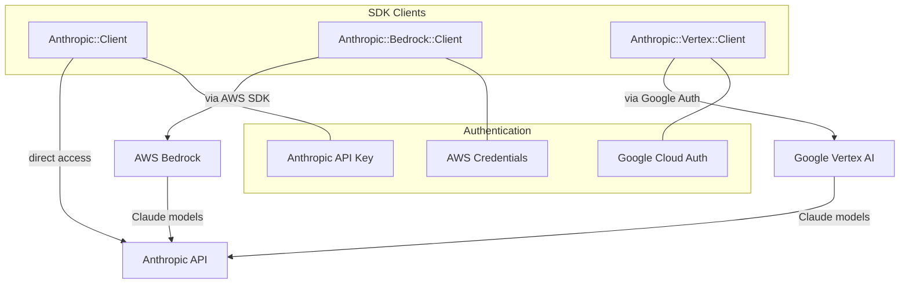

### AWS Bedrock

To use Claude through AWS Bedrock, install the AWS SDK:

```ruby
gem "aws-sdk-bedrockruntime"
```

Then use the Bedrock client:

```ruby
require "anthropic"

anthropic = Anthropic::Bedrock::Client.new

message = anthropic.messages.create(
  max_tokens: 1024,
  messages: [{
    role: "user",
    content: "Hello, Claude"
  }],
  model: "anthropic.claude-3-5-sonnet-20241022-v2:0" # Bedrock model ID
)
```

### Google Vertex AI

To use Claude through Google Vertex AI, install the Google Auth gem:

```ruby
gem "googleauth"
```

Then use the Vertex client:

```ruby
require "anthropic"

anthropic = Anthropic::Vertex::Client.new(
  region: "us-east5", 
  project_id: "my-project-id"
)

message = anthropic.messages.create(
  max_tokens: 1024,
  messages: [{
    role: "user", 
    content: "Hello, Claude"
  }],
  model: "claude-3-7-sonnet@20250219"
)
```

Sources: [README.md:233-289]()

## Next Steps

Now that you've installed the SDK and made your first API call, you can explore more advanced features:

- For details on request parameters and options, see [Request Options](#3.1)
- For comprehensive error handling strategies, see [Error Handling](#3.2)
- To use the Messages API more effectively, see [Messages API](#4)
- To learn about token counting and optimization, see [Token Counting](#4.3)
- To explore batch processing for higher throughput, see [Batch Processing](#5)

For API documentation, you can visit the [Anthropic API Reference](https://docs.anthropic.com/claude/reference/) or view the Ruby SDK documentation on [RubyDoc](https://gemdocs.org/gems/anthropic-sdk-beta).

Sources: [README.md:3-9]()

---

# Page: Client Architecture

# Client Architecture

<details>
<summary>Relevant source files</summary>

The following files were used as context for generating this wiki page:

- [lib/anthropic/client.rb](lib/anthropic/client.rb)
- [lib/anthropic/internal/transport/base_client.rb](lib/anthropic/internal/transport/base_client.rb)
- [lib/anthropic/internal/transport/pooled_net_requester.rb](lib/anthropic/internal/transport/pooled_net_requester.rb)
- [lib/anthropic/internal/type/array_of.rb](lib/anthropic/internal/type/array_of.rb)
- [lib/anthropic/internal/type/hash_of.rb](lib/anthropic/internal/type/hash_of.rb)
- [lib/anthropic/models/anthropic_beta.rb](lib/anthropic/models/anthropic_beta.rb)
- [lib/anthropic/models/model.rb](lib/anthropic/models/model.rb)
- [lib/anthropic/request_options.rb](lib/anthropic/request_options.rb)
- [rbi/lib/anthropic/client.rbi](rbi/lib/anthropic/client.rbi)
- [rbi/lib/anthropic/internal/type/array_of.rbi](rbi/lib/anthropic/internal/type/array_of.rbi)
- [sig/anthropic/client.rbs](sig/anthropic/client.rbs)
- [sig/anthropic/internal/type/array_of.rbs](sig/anthropic/internal/type/array_of.rbs)

</details>


This page documents the architecture of the client system in the Anthropic Ruby SDK, explaining how the different components fit together to handle API requests and responses. For detailed information about configuring specific request options, see [Request Options](#3.1). For error handling details, see [Error Handling](#3.2). For connection management details, see [Connection Management](#3.3).

## Client Overview

The Anthropic Ruby SDK provides a structured client architecture that abstracts away the complexities of making API calls to Anthropic's AI models. The client architecture has several layers:

1. **Client Layer** - Primary entry point for users, provides access to API resources
2. **Transport Layer** - Handles HTTP communication, request building, and response processing
3. **Connection Management** - Manages HTTP connections efficiently
4. **Type System** - Ensures proper validation and conversion of request and response data

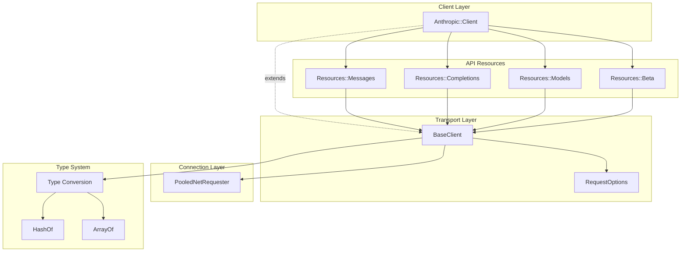

Sources: [lib/anthropic/client.rb:1-107](), [lib/anthropic/internal/transport/base_client.rb:1-473](), [lib/anthropic/internal/transport/pooled_net_requester.rb:1-194]()

## Client Class Structure

The main entry point for interacting with the Anthropic API is the `Anthropic::Client` class, which extends the `BaseClient` transport layer. The client provides access to the various API resources and manages authentication.

```mermaid
classDiagram
    class Anthropic::Client {
        +api_key: String
        +auth_token: String
        +completions: Resources::Completions
        +messages: Resources::Messages
        +models: Resources::Models
        +beta: Resources::Beta
        -auth_headers(): Hash
        -api_key_auth(): Hash
        -bearer_auth(): Hash
        +initialize(api_key, auth_token, base_url, ...)
    }
    
    class BaseClient {
        -requester: PooledNetRequester
        -build_request(req, opts): Hash
        -retry_delay(headers, retry_count): Float
        -send_request(request, ...): Array
        +request(req): Object
    }
    
    class PooledNetRequester {
        -pools: Hash
        -execute(request): Array
    }
    
    class RequestOptions {
        +idempotency_key: String
        +extra_query: Hash
        +extra_headers: Hash
        +extra_body: Object
        +max_retries: Integer
        +timeout: Float
    }
    
    Anthropic::Client --|> BaseClient
    BaseClient --> PooledNetRequester
    BaseClient --> RequestOptions
```

Sources: [lib/anthropic/client.rb:4-106](), [lib/anthropic/internal/transport/base_client.rb:9-470](), [lib/anthropic/request_options.rb:3-75]()

## Client Initialization

The `Anthropic::Client` initialization process sets up the client with appropriate authentication and default configuration parameters.

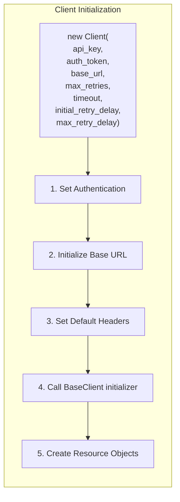

The client supports several initialization parameters with reasonable defaults:

| Parameter | Default | Description |
|-----------|---------|-------------|
| `api_key` | `ENV["ANTHROPIC_API_KEY"]` | Anthropic API key for authentication |
| `auth_token` | `ENV["ANTHROPIC_AUTH_TOKEN"]` | Alternative auth token for authentication |
| `base_url` | `"https://api.anthropic.com"` | API endpoint base URL |
| `max_retries` | `2` | Maximum number of retries for failed requests |
| `timeout` | `600.0` (10 minutes) | Default request timeout in seconds |
| `initial_retry_delay` | `0.5` | Base delay for retries in seconds |
| `max_retry_delay` | `8.0` | Maximum delay between retries in seconds |

Sources: [lib/anthropic/client.rb:74-105](), [lib/anthropic/client.rb:5-16]()

## Request Processing Flow

When a request is made through the client, it follows a specific path through the system components:

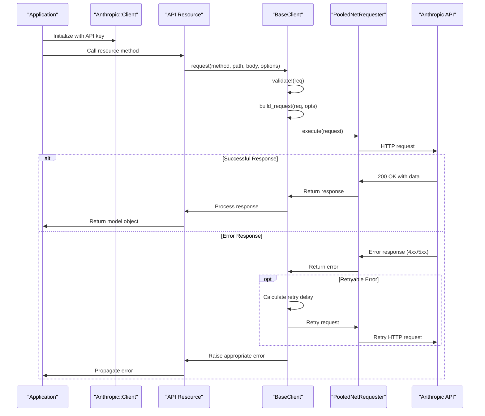

Sources: [lib/anthropic/internal/transport/base_client.rb:394-461](), [lib/anthropic/internal/transport/base_client.rb:232-280](), [lib/anthropic/internal/transport/base_client.rb:332-393]()

## Resource Organization

The client provides access to various API resources, each represented by a dedicated resource class:

| Resource | Description | Key Methods |
|----------|-------------|-------------|
| `messages` | Primary interface for creating messages with Claude models | `create`, `stream_raw`, `count_tokens` |
| `completions` | Legacy interface for text completions | `create`, `create_streaming` |
| `models` | Access model information | `retrieve`, `list` |
| `beta` | Experimental API features | Varies by feature |

Each resource is initialized with a reference to the client and uses the client's `request` method to communicate with the API.

Sources: [lib/anthropic/client.rb:24-34](), [lib/anthropic/client.rb:101-104]()

## Transport Layer

The transport layer, primarily implemented in the `BaseClient` class, handles the core HTTP functionality:

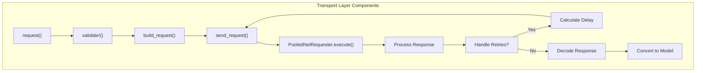

The `BaseClient` is responsible for:
1. Request validation and building
2. Authentication header management
3. Retry logic for failed requests
4. Response processing and error handling
5. Type conversion of responses

Sources: [lib/anthropic/internal/transport/base_client.rb:394-461](), [lib/anthropic/internal/transport/base_client.rb:232-280](), [lib/anthropic/internal/transport/base_client.rb:332-393]()

## Connection Management

The SDK uses the `PooledNetRequester` to efficiently manage HTTP connections. It provides:

1. Connection pooling for performance
2. Timeout handling
3. Socket configuration
4. HTTP request execution

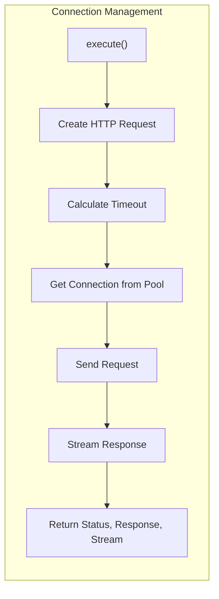

The connection pool is organized by origin (host+scheme) and reuses connections for better performance, with a default pool size equal to the number of processors available on the system.

Sources: [lib/anthropic/internal/transport/pooled_net_requester.rb:7-180](), [lib/anthropic/internal/transport/pooled_net_requester.rb:185-189]()

## Request Options

Each request can be customized with `RequestOptions`, which allows overriding client-level settings on a per-request basis:

| Option | Type | Description |
|--------|------|-------------|
| `idempotency_key` | String | Key for idempotent requests |
| `extra_query` | Hash | Additional query parameters |
| `extra_headers` | Hash | Additional request headers |
| `extra_body` | Hash | Additional request body fields |
| `max_retries` | Integer | Override retry count |
| `timeout` | Float | Override timeout value |

Sources: [lib/anthropic/request_options.rb:9-74]()

## Type System Integration

The SDK includes a robust type system for validating and converting data. Key type components include:

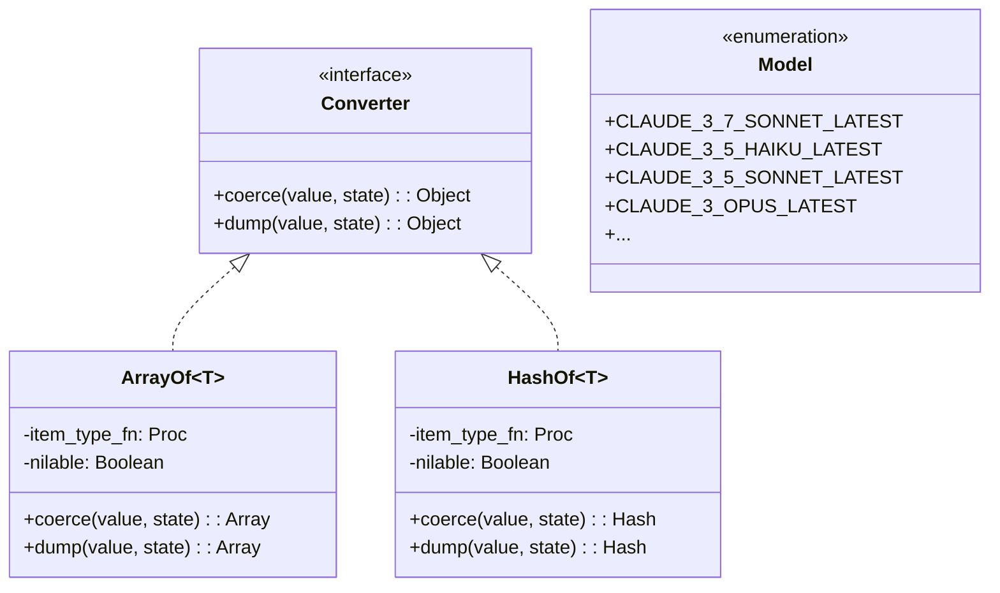

The type system ensures that:
1. Request parameters are properly validated
2. API responses are converted to appropriate Ruby objects
3. Model identifiers are properly validated against available models

Sources: [lib/anthropic/internal/type/array_of.rb:13-128](), [lib/anthropic/internal/type/hash_of.rb:13-148](), [lib/anthropic/models/model.rb:8-93]()

## Authentication Methods

The SDK supports two authentication methods:

1. **API Key Authentication** - Using the `x-api-key` header
2. **Bearer Token Authentication** - Using the `Authorization: Bearer` header

The client will use whichever credentials are provided during initialization, with precedence given to environment variables if no explicit credentials are provided.

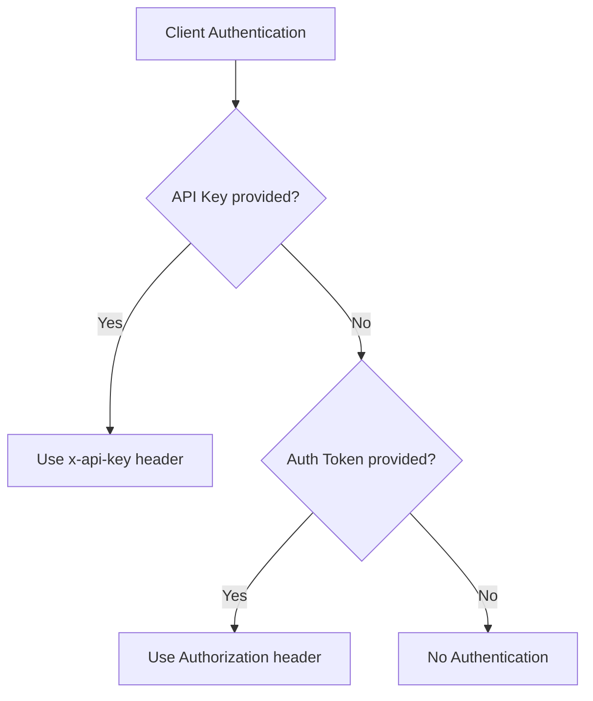

Sources: [lib/anthropic/client.rb:36-57]()

---

# Page: Request Options

# Request Options

<details>
<summary>Relevant source files</summary>

The following files were used as context for generating this wiki page:

- [lib/anthropic/request_options.rb](lib/anthropic/request_options.rb)

</details>


Request Options provide a flexible mechanism for configuring HTTP behavior for individual API requests in the Anthropic Ruby SDK. They allow you to customize networking parameters, add custom data, and override default client settings on a per-request basis.

For information about error handling and retries, see [Error Handling](#3.2). For details on connection management, see [Connection Management](#3.3).

## Overview and Architecture

The `RequestOptions` class is a core component of the SDK's transport layer, allowing fine-grained control over how individual API requests are processed and transmitted.

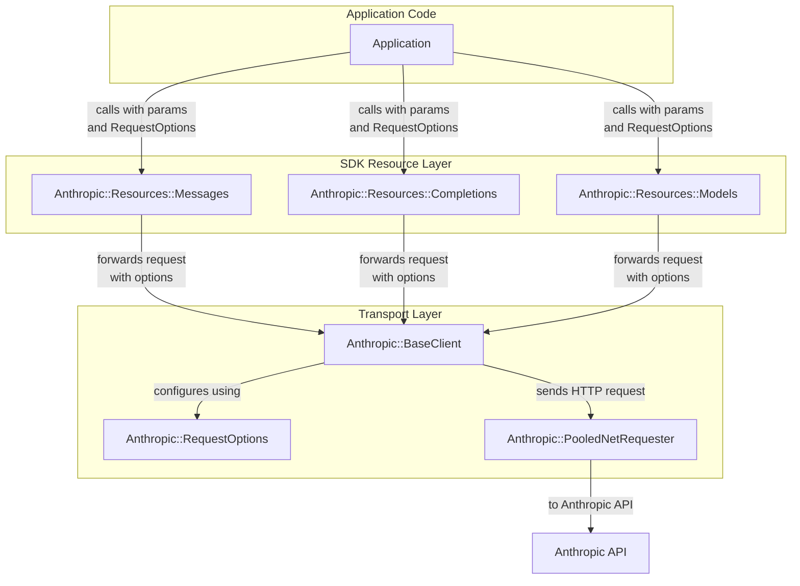

Sources: [lib/anthropic/request_options.rb:1-9]()

Request options can be provided to any API method (such as `messages.create` or `models.list`) using the `opts` parameter. You can pass either a `RequestOptions` instance or a simple Ruby Hash with symbol keys matching the available options.

## Available Options

The `RequestOptions` class provides the following configuration options:

| Option | Type | Description |
|--------|------|-------------|
| `idempotency_key` | String | A unique key to ensure write requests are only processed once |
| `extra_query` | Hash | Additional query parameters to include in the request URL |
| `extra_headers` | Hash | Additional HTTP headers to include with the request |
| `extra_body` | Hash | Additional data to include in the request body |
| `max_retries` | Integer | Maximum number of retry attempts for failed requests |
| `timeout` | Float | Request timeout in seconds |

Sources: [lib/anthropic/request_options.rb:28-66]()

### Request Options Class Structure

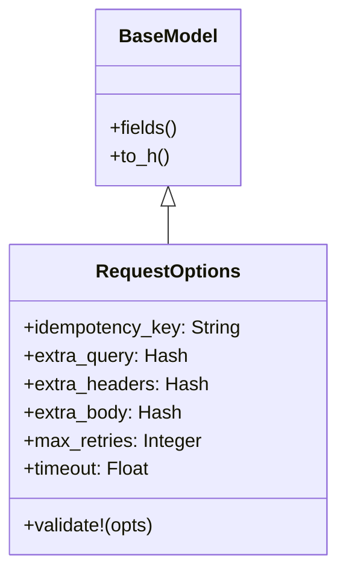

Sources: [lib/anthropic/request_options.rb:9-74]()

## Option Details

### Idempotency Key

The `idempotency_key` option allows you to assign a unique identifier to write operations. If a request fails due to a network issue and is retried with the same idempotency key, the Anthropic API will recognize the duplicate request and return the result of the original request instead of processing it twice.

```ruby
client.messages.create(
  model: "claude-3-opus-20240229",
  max_tokens: 1024,
  messages: [{ role: "user", content: "Hello, Claude!" }],
  opts: { idempotency_key: "unique-operation-id-123" }
)
```

Sources: [lib/anthropic/request_options.rb:28-33]()

### Extra Query Parameters

The `extra_query` option allows you to include additional query parameters in the request URL. These are merged with any query parameters specified at the client level.

```ruby
client.models.list(
  opts: { extra_query: { "version" => "2023-06-01" } }
)
```

The `extra_query` option accepts a hash where keys are strings and values can be strings or arrays of strings.

Sources: [lib/anthropic/request_options.rb:35-40]()

### Extra Headers

The `extra_headers` option allows you to include additional HTTP headers with the request. These are merged with any headers specified at the client level.

```ruby
client.messages.create(
  model: "claude-3-opus-20240229",
  max_tokens: 1024,
  messages: [{ role: "user", content: "Hello, Claude!" }],
  opts: { extra_headers: { "X-Custom-Header" => "custom-value" } }
)
```

Sources: [lib/anthropic/request_options.rb:42-47]()

### Extra Body

The `extra_body` option allows you to include additional data in the request body. These values are deep merged into the request body generated from the regular parameters.

```ruby
client.messages.create(
  model: "claude-3-opus-20240229",
  max_tokens: 1024,
  messages: [{ role: "user", content: "Hello, Claude!" }],
  opts: { extra_body: { "custom_field" => "custom_value" } }
)
```

Sources: [lib/anthropic/request_options.rb:49-54]()

### Max Retries

The `max_retries` option sets the maximum number of retry attempts for failed requests. If a request fails due to a retryable error (such as a rate limit or temporary server error), the SDK will automatically retry the request up to this many times.

```ruby
client.messages.create(
  model: "claude-3-opus-20240229",
  max_tokens: 1024,
  messages: [{ role: "user", content: "Hello, Claude!" }],
  opts: { max_retries: 5 }  # Override default retry limit
)
```

Sources: [lib/anthropic/request_options.rb:56-60]()

### Timeout

The `timeout` option sets the request timeout in seconds. If the API does not respond within this time period, the request will fail with a timeout error.

```ruby
client.messages.create(
  model: "claude-3-opus-20240229",
  max_tokens: 1024,
  messages: [{ role: "user", content: "Hello, Claude!" }],
  opts: { timeout: 120.0 }  # 2-minute timeout
)
```

Sources: [lib/anthropic/request_options.rb:62-66]()

## Request Processing Flow

The following diagram illustrates how request options are processed within the SDK:

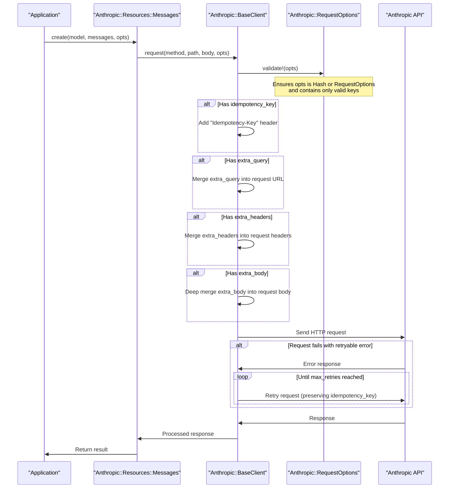

Sources: [lib/anthropic/request_options.rb:10-26]()

## Usage Examples

### Basic Hash Syntax

Request options can be provided to any resource method using the `opts` parameter:

```ruby
# Basic example with timeout and max retries
response = client.messages.create(
  model: "claude-3-opus-20240229",
  max_tokens: 1024,
  messages: [{ role: "user", content: "Hello, Claude!" }],
  opts: {
    timeout: 60.0,
    max_retries: 3
  }
)
```

### Using RequestOptions Class

You can also create an instance of the `RequestOptions` class explicitly:

```ruby
# Using the RequestOptions class
options = Anthropic::RequestOptions.new(
  timeout: 60.0,
  max_retries: 3,
  extra_headers: { "X-Custom-Header" => "custom-value" }
)

response = client.messages.create(
  model: "claude-3-opus-20240229",
  max_tokens: 1024,
  messages: [{ role: "user", content: "Hello, Claude!" }],
  opts: options
)
```

## Configuration Hierarchy

Request options provided for individual API calls supplement or override the configuration set at the client level. The SDK follows a hierarchical approach to configuration:

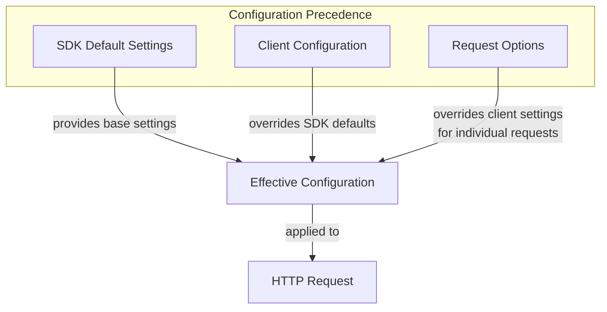

Sources: [lib/anthropic/request_options.rb:1-76]()

For example, if you set a default timeout at the client level but provide a different timeout in the request options, the value from the request options will be used for that specific request only.

## Validation

Request options are validated before being used. The `RequestOptions.validate!` method ensures that:

1. The provided options are either a `RequestOptions` instance or a Hash
2. All keys in the Hash are valid options defined in the `RequestOptions` class

If validation fails, an `ArgumentError` will be raised with a descriptive error message.

```ruby
# This would raise an ArgumentError
client.messages.create(
  model: "claude-3-opus-20240229",
  messages: [{ role: "user", content: "Hello" }],
  opts: { invalid_option: "value" }  # Error: not a valid RequestOptions field
)
```

Sources: [lib/anthropic/request_options.rb:10-26]()

---

# Page: Error Handling

# Error Handling

<details>
<summary>Relevant source files</summary>

The following files were used as context for generating this wiki page:

- [lib/anthropic/errors.rb](lib/anthropic/errors.rb)
- [lib/anthropic/request_options.rb](lib/anthropic/request_options.rb)
- [rbi/lib/anthropic/errors.rbi](rbi/lib/anthropic/errors.rbi)
- [sig/anthropic/errors.rbs](sig/anthropic/errors.rbs)

</details>


The Anthropic Ruby SDK provides a robust error handling system that enables developers to handle various error scenarios that may occur when interacting with the Anthropic API. This document describes the error hierarchy, explains how errors are raised and handled, and provides strategies for dealing with different error types.

For information about configuring request-level options such as timeouts and retries, see [Request Options](#3.1).

## Error Hierarchy

The SDK implements a comprehensive hierarchy of error classes that map to different types of failures that can occur during API interactions. All errors inherit from the base `Anthropic::Errors::Error` class, which itself extends Ruby's `StandardError`.

```mermaid
classDiagram
    class StandardError
    class Error
    class ConversionError
    class APIError
    class APIConnectionError
    class APITimeoutError
    class APIStatusError
    class BadRequestError
    class AuthenticationError
    class PermissionDeniedError
    class NotFoundError
    class ConflictError
    class UnprocessableEntityError
    class RateLimitError
    class InternalServerError

    StandardError <|-- Error
    Error <|-- ConversionError
    Error <|-- APIError
    APIError <|-- APIConnectionError
    APIConnectionError <|-- APITimeoutError
    APIError <|-- APIStatusError
    APIStatusError <|-- BadRequestError
    APIStatusError <|-- AuthenticationError
    APIStatusError <|-- PermissionDeniedError
    APIStatusError <|-- NotFoundError
    APIStatusError <|-- ConflictError
    APIStatusError <|-- UnprocessableEntityError
    APIStatusError <|-- RateLimitError
    APIStatusError <|-- InternalServerError
```

Sources: [lib/anthropic/errors.rb:4-191]()

## Error Types

### Base Error Types

| Error Type | Description | When It Occurs |
|------------|-------------|----------------|
| `Anthropic::Errors::Error` | Base error class | Parent class for all Anthropic errors |
| `Anthropic::Errors::ConversionError` | Type conversion error | When data cannot be properly converted between formats |
| `Anthropic::Errors::APIError` | Generic API error | Base class for all API-related errors |

### Connection Errors

| Error Type | Description | HTTP Status |
|------------|-------------|-------------|
| `Anthropic::Errors::APIConnectionError` | Connection failure | N/A |
| `Anthropic::Errors::APITimeoutError` | Request timeout | N/A |

### HTTP Status Errors

| Error Type | Description | HTTP Status |
|------------|-------------|-------------|
| `Anthropic::Errors::BadRequestError` | Invalid request | 400 |
| `Anthropic::Errors::AuthenticationError` | Authentication failed | 401 |
| `Anthropic::Errors::PermissionDeniedError` | Permission denied | 403 |
| `Anthropic::Errors::NotFoundError` | Resource not found | 404 |
| `Anthropic::Errors::ConflictError` | Resource conflict | 409 |
| `Anthropic::Errors::UnprocessableEntityError` | Invalid parameters | 422 |
| `Anthropic::Errors::RateLimitError` | Rate limit exceeded | 429 |
| `Anthropic::Errors::InternalServerError` | Server-side error | 500+ |

Sources: [lib/anthropic/errors.rb:4-190]()

## Error Properties

The `APIError` class and its descendants contain useful properties that provide context about the error:

```ruby
error.url     # The URL that was being accessed
error.status  # The HTTP status code (if applicable)
error.body    # The response body (if available)
error.message # A human-readable error message
```

Sources: [lib/anthropic/errors.rb:15-22]()

## Error Handling Flow

When a request is made through the SDK, the following error handling flow occurs:

```mermaid
flowchart TD
    A["Client Request"] --> B["BaseClient.request"]
    B --> C{"Request\nSuccessful?"}
    C -->|Yes| D["Return Response"]
    C -->|No| E["Determine Error Type"]
    E --> F{"Is Error\nRetryable?"}
    F -->|Yes| G{"Max Retries\nReached?"}
    G -->|No| H["Calculate Retry Delay"]
    H --> I["Wait"] --> B
    G -->|Yes| J["Raise Appropriate Error"]
    F -->|No| J
    J --> K["BadRequestError"] 
    J --> L["AuthenticationError"]
    J --> M["PermissionDeniedError"]
    J --> N["NotFoundError"]
    J --> O["RateLimitError"]
    J --> P["InternalServerError"]
    J --> Q["Other Error Types"]
```

Sources: [lib/anthropic/errors.rb:92-133]()

## How Errors Are Constructed

When an API request fails, the SDK uses the `APIStatusError.for` factory method to create the appropriate error instance based on the HTTP status code:

```mermaid
sequenceDiagram
    participant Client as "Anthropic::Client"
    participant BaseClient as "BaseClient"
    participant PooledNetRequester as "PooledNetRequester"
    participant API as "Anthropic API"
    participant ErrorFactory as "APIStatusError.for"
    participant ErrorClasses as "Specific Error Classes"
    
    Client->>BaseClient: request(method, path, body)
    BaseClient->>PooledNetRequester: execute(request)
    PooledNetRequester->>API: HTTP Request
    API->>PooledNetRequester: Error Response (4xx/5xx)
    PooledNetRequester->>BaseClient: Error Response
    BaseClient->>ErrorFactory: for(url, status, body)
    
    alt status == 400
        ErrorFactory->>ErrorClasses: new BadRequestError
    else status == 401
        ErrorFactory->>ErrorClasses: new AuthenticationError
    else status == 403
        ErrorFactory->>ErrorClasses: new PermissionDeniedError
    else status == 404
        ErrorFactory->>ErrorClasses: new NotFoundError
    else status == 409
        ErrorFactory->>ErrorClasses: new ConflictError
    else status == 422
        ErrorFactory->>ErrorClasses: new UnprocessableEntityError
    else status == 429
        ErrorFactory->>ErrorClasses: new RateLimitError
    else status >= 500
        ErrorFactory->>ErrorClasses: new InternalServerError
    else other status
        ErrorFactory->>ErrorClasses: new APIStatusError
    end
    
    ErrorClasses->>BaseClient: Error Instance
    BaseClient->>Client: Raise Error
```

Sources: [lib/anthropic/errors.rb:92-133]()

## Best Practices for Error Handling

### Catching Specific Errors

When working with the Anthropic Ruby SDK, it's recommended to catch specific error types when you expect them:

```ruby
begin
  response = client.messages.create(
    model: "claude-3-opus-20240229",
    max_tokens: 1024,
    messages: [{ role: "user", content: "Hello, Claude!" }]
  )
rescue Anthropic::Errors::RateLimitError => e
  # Handle rate limiting specifically
  puts "Rate limit exceeded: #{e.message}"
  sleep(5)
  retry
rescue Anthropic::Errors::APIStatusError => e
  # Handle other API errors
  puts "API error (#{e.status}): #{e.message}"
rescue Anthropic::Errors::APIConnectionError => e
  # Handle connection issues
  puts "Connection error: #{e.message}"
rescue Anthropic::Errors::Error => e
  # Handle any other Anthropic error
  puts "Anthropic error: #{e.message}"
end
```

### Handling Retryable Errors

The SDK automatically retries certain errors (like rate limits and server errors) based on the `max_retries` setting. However, you may want to implement your own retry logic for certain use cases:

```ruby
max_attempts = 3
attempts = 0

begin
  attempts += 1
  response = client.messages.create(
    model: "claude-3-opus-20240229",
    max_tokens: 1024,
    messages: [{ role: "user", content: "Hello, Claude!" }]
  )
rescue Anthropic::Errors::RateLimitError, Anthropic::Errors::InternalServerError => e
  if attempts < max_attempts
    # Exponential backoff
    sleep_time = 2 ** attempts
    puts "Attempt #{attempts} failed. Retrying in #{sleep_time} seconds..."
    sleep(sleep_time)
    retry
  else
    puts "Failed after #{max_attempts} attempts: #{e.message}"
    raise
  end
end
```

## Configuring Error Handling Behavior

You can configure some aspects of error handling through request options:

### Timeouts

Timeout errors (`APITimeoutError`) occur when a request takes longer than the configured timeout period. You can set the timeout at the client level or per-request:

```ruby
# Client-level timeout
client = Anthropic::Client.new(
  api_key: ENV["ANTHROPIC_API_KEY"],
  timeout: 120.0  # 120 seconds
)

# Request-level timeout
response = client.messages.create(
  model: "claude-3-opus-20240229",
  max_tokens: 1024,
  messages: [{ role: "user", content: "Hello, Claude!" }],
  opts: { timeout: 60.0 }  # 60 seconds for this request only
)
```

### Retry Configuration

You can configure the maximum number of retries for each request:

```ruby
# Client-level retry setting
client = Anthropic::Client.new(
  api_key: ENV["ANTHROPIC_API_KEY"],
  max_retries: 3
)

# Request-level retry setting
response = client.messages.create(
  model: "claude-3-opus-20240229",
  max_tokens: 1024,
  messages: [{ role: "user", content: "Hello, Claude!" }],
  opts: { max_retries: 5 }  # Override with 5 retries for this request
)
```

Sources: [lib/anthropic/request_options.rb:56-60]()

## Error Handling for Streaming Responses

When using streaming responses, error handling requires special attention since the response comes in chunks:

```ruby
begin
  client.messages.stream_raw(
    model: "claude-3-opus-20240229",
    max_tokens: 1024,
    messages: [{ role: "user", content: "Hello, Claude!" }]
  ) do |chunk|
    # Process each chunk
    puts chunk
  end
rescue Anthropic::Errors::Error => e
  # Handle errors that might occur during streaming
  puts "Error during streaming: #{e.message}"
end
```

## Conclusion

The Anthropic Ruby SDK provides a comprehensive error handling system that helps you build robust applications that can gracefully handle API errors, connection issues, and other failure scenarios. By understanding the error hierarchy and implementing appropriate error handling strategies, you can create more resilient applications that provide a better user experience even when errors occur.

---

# Page: Connection Management

# Connection Management

<details>
<summary>Relevant source files</summary>

The following files were used as context for generating this wiki page:

- [lib/anthropic/internal/transport/base_client.rb](lib/anthropic/internal/transport/base_client.rb)
- [lib/anthropic/internal/transport/pooled_net_requester.rb](lib/anthropic/internal/transport/pooled_net_requester.rb)
- [lib/anthropic/internal/type/array_of.rb](lib/anthropic/internal/type/array_of.rb)
- [lib/anthropic/internal/type/hash_of.rb](lib/anthropic/internal/type/hash_of.rb)
- [lib/anthropic/internal/util.rb](lib/anthropic/internal/util.rb)
- [rbi/lib/anthropic/internal/page.rbi](rbi/lib/anthropic/internal/page.rbi)
- [rbi/lib/anthropic/internal/type/array_of.rbi](rbi/lib/anthropic/internal/type/array_of.rbi)
- [rbi/lib/anthropic/internal/util.rbi](rbi/lib/anthropic/internal/util.rbi)
- [sig/anthropic/internal/type/array_of.rbs](sig/anthropic/internal/type/array_of.rbs)
- [sig/anthropic/internal/util.rbs](sig/anthropic/internal/util.rbs)

</details>


This document explains how the Anthropic Ruby SDK manages HTTP connections when interacting with the Anthropic API. Efficient connection management is critical for optimizing performance and ensuring reliability when making API requests. For information about configuring request options, see [Request Options](#3.1).

## Overview

The Anthropic Ruby SDK implements connection pooling to efficiently manage HTTP connections to the API. This provides several benefits:

1. **Reduced Latency**: By reusing existing connections rather than establishing new ones for each request
2. **Lower Resource Usage**: Fewer TCP connections means less overhead
3. **Better Throughput**: Multiple requests can be processed more efficiently

```mermaid
flowchart TD
    subgraph "Anthropic Ruby SDK"
        C["Client"] --> BC["BaseClient"]
        BC --> PNR["PooledNetRequester"]
        PNR --> CP["Connection Pool"]
        CP --> H1["HTTP Connection 1"]
        CP --> H2["HTTP Connection 2"]
        CP --> HN["HTTP Connection N"]
    end
    
    H1 --> API["Anthropic API"]
    H2 --> API
    HN --> API
```

Sources: [lib/anthropic/internal/transport/pooled_net_requester.rb:7-11](), [lib/anthropic/internal/transport/base_client.rb:146-148]()

## Connection Pooling Architecture

Connection pooling is primarily implemented through the `Anthropic::Internal::Transport::PooledNetRequester` class, which maintains a pool of HTTP connections organized by origin (scheme, host, and port).

### Key Components

- **PooledNetRequester**: Manages connection pools and executes HTTP requests
- **ConnectionPool**: Third-party gem that provides the pooling functionality
- **Net::HTTP**: Ruby's standard HTTP client used for actual connections

The SDK pools connections per origin (e.g., `https://api.anthropic.com`) and reuses them across requests, applying a keep-alive timeout of 30 seconds.

```mermaid
classDiagram
    class BaseClient {
        -PooledNetRequester requester
        +request(req)
    }
    
    class PooledNetRequester {
        -Hash~String,ConnectionPool~ pools
        -Mutex mutex
        -Integer size
        +execute(request)
        -with_pool(url, deadline)
    }
    
    class ConnectionPool {
        +with(timeout)
    }
    
    class NetHTTP {
        +start()
        +request()
        +keep_alive_timeout
    }
    
    BaseClient --> PooledNetRequester : uses
    PooledNetRequester --> ConnectionPool : maintains
    ConnectionPool --> NetHTTP : provides
```

Sources: [lib/anthropic/internal/transport/pooled_net_requester.rb:7-190](), [lib/anthropic/internal/transport/base_client.rb:146-148]()

## Connection Pool Operation

The SDK dynamically manages connection pools based on the origins of requests:

1. When a request is made to a specific origin (e.g., `https://api.anthropic.com`), the SDK checks if a pool exists for that origin
2. If no pool exists, a new one is created with a size equal to the number of processors on the system
3. For each request, a connection is taken from the pool, used, and then returned to the pool
4. Connections are kept alive for 30 seconds (configurable) before being closed

```mermaid
sequenceDiagram
    participant C as Client
    participant BC as BaseClient
    participant PNR as PooledNetRequester
    participant P as Connection Pool
    participant N as Net::HTTP
    participant API as Anthropic API

    C->>BC: request()
    BC->>PNR: execute(request)
    
    PNR->>PNR: Get pool for origin
    
    alt No pool for origin
        PNR->>P: Create new pool
    end
    
    PNR->>P: with(timeout)
    P->>N: Get connection
    
    alt Connection not started
        N->>N: Set keep_alive_timeout = 30
        N->>N: start()
    end
    
    N->>API: HTTP request
    API->>N: HTTP response
    
    N->>P: Return connection to pool
    PNR->>BC: Return response
    BC->>C: Return decoded response
```

Sources: [lib/anthropic/internal/transport/pooled_net_requester.rb:86-106](), [lib/anthropic/internal/transport/pooled_net_requester.rb:123-180]()

## HTTP Request Execution

The `execute` method in `PooledNetRequester` manages the entire HTTP request lifecycle:

1. Retrieves a connection from the pool for the request's URL
2. Sets appropriate timeouts on the connection
3. Builds the HTTP request with headers and body
4. Sends the request to the API
5. Returns the response status, headers, and body stream

The connection pool size defaults to the number of processors on the system, which allows for efficient parallel processing of requests.

### Request Body Handling

The SDK intelligently handles different types of request bodies:

| Body Type | Handling Method |
|-----------|----------------|
| String | Sets `content-length` and sends directly |
| StringIO | Sets `content-length` and streams content |
| Pathname/IO | Uses chunked encoding if no content-length |
| Enumerator | Uses chunked encoding for streaming |

Sources: [lib/anthropic/internal/transport/pooled_net_requester.rb:58-84](), [lib/anthropic/internal/transport/pooled_net_requester.rb:123-180]()

## Timeout Management

Timeouts are carefully managed throughout the connection lifecycle:

1. **Socket Timeout**: Applied to individual network operations
2. **Request Timeout**: Overall timeout for the entire request

The SDK calibrates socket timeouts based on the remaining time before the request deadline is reached. This ensures that long-running requests respect their overall timeout without unnecessarily aborting operations.

```mermaid
flowchart TD
    R["Request with timeout"] --> D["Calculate deadline (current time + timeout)"]
    D --> E["Execute request"]
    E --> C["Before each operation, calculate remaining time"]
    C --> S["Set socket timeouts (open_timeout, read_timeout, write_timeout, continue_timeout)"]
    S --> O["Perform operation"]
    O --> C
```

Sources: [lib/anthropic/internal/transport/pooled_net_requester.rb:39-42](), [lib/anthropic/internal/transport/base_client.rb:334-334]()

## Connection Error Handling

The SDK implements robust connection error handling:

1. **API Connection Errors**: Network errors, DNS failures, etc.
2. **API Timeout Errors**: Requests that exceed their timeout
3. **API Status Errors**: Unexpected HTTP status codes

For connection-related errors, the SDK implements a retry mechanism with exponential backoff. Retries are controlled by:

- `max_retries`: Maximum number of retry attempts
- `initial_retry_delay`: Base delay before the first retry
- `max_retry_delay`: Maximum delay between retries

The actual retry delay is calculated as:
```
delay = initial_retry_delay * (retry_count^2) * jitter
```
where jitter is a random value between 0.75 and 1.0 to prevent retry storms.

Sources: [lib/anthropic/internal/transport/base_client.rb:288-306](), [lib/anthropic/internal/transport/base_client.rb:379-391]()

## Streaming Response Management

For streaming API responses, the SDK employs specialized handling:

1. Creates an `Enumerator` to wrap the streaming response
2. Uses "fused enumeration" to ensure proper resource cleanup
3. Decodes content appropriately based on content-type headers

Streaming responses are particularly important for real-time AI interactions. The SDK ensures that:

- Connections are properly managed even during long-running streams
- Resources are cleaned up when streams are exhausted or closed early
- Timeout calibration continues throughout streaming

```mermaid
flowchart TD
    R["Request streaming response"] --> E["Create Enumerator wrapper"]
    E --> F["Apply fused enumeration (ensures cleanup)"]
    F --> P["Process first chunk (headers)"]
    P --> D["Decode content based on type"]
    D --> S["Stream response to client"]
    S --> C["Close and cleanup resources"]
```

Sources: [lib/anthropic/internal/transport/pooled_net_requester.rb:167-179](), [lib/anthropic/internal/util.rb:627-649]()

## Advanced Features

### Keep-Alive Management

Connections are kept alive for 30 seconds by default, as defined in `KEEP_ALIVE_TIMEOUT`. This value is chosen based on performance best practices from the Go standard library.

### Connection Reaping

The SDK implements connection "reaping" - the process of properly closing connections when they are no longer needed or when errors occur. This prevents resource leaks and ensures system stability even during high-volume operations.

### Redirect Handling

The SDK follows HTTP redirects according to the HTTP specification, with additional security measures:

- Maximum of 20 redirects per request
- Prevention of HTTPS to HTTP downgrades
- Proper header management during cross-origin redirects

Sources: [lib/anthropic/internal/transport/base_client.rb:10-12](), [lib/anthropic/internal/transport/base_client.rb:89-129](), [lib/anthropic/internal/transport/pooled_net_requester.rb:10-11]()

## Performance Considerations

### Optimal Pool Size

The connection pool size defaults to the number of processors on the system, which is a good starting point for most applications. For applications with specific requirements, consider the following:

- **CPU-bound applications**: Consider reducing the pool size
- **I/O-bound applications**: Consider increasing the pool size
- **High-volume applications**: Monitor connection usage and adjust accordingly

### Resource Usage

Each connection in the pool consumes system resources. The SDK is designed to balance resource usage with performance, but be mindful of the total number of connections across your application, especially in serverless environments.

Sources: [lib/anthropic/internal/transport/pooled_net_requester.rb:185-186]()

---

# Page: Messages API

# Messages API

<details>
<summary>Relevant source files</summary>

The following files were used as context for generating this wiki page:

- [lib/anthropic/models/beta/beta_message.rb](lib/anthropic/models/beta/beta_message.rb)
- [lib/anthropic/models/completion.rb](lib/anthropic/models/completion.rb)
- [lib/anthropic/models/completion_create_params.rb](lib/anthropic/models/completion_create_params.rb)
- [lib/anthropic/models/message.rb](lib/anthropic/models/message.rb)
- [lib/anthropic/models/message_create_params.rb](lib/anthropic/models/message_create_params.rb)
- [lib/anthropic/models/metadata.rb](lib/anthropic/models/metadata.rb)
- [lib/anthropic/resources/beta.rb](lib/anthropic/resources/beta.rb)
- [lib/anthropic/resources/beta/messages.rb](lib/anthropic/resources/beta/messages.rb)
- [lib/anthropic/resources/beta/messages/batches.rb](lib/anthropic/resources/beta/messages/batches.rb)
- [lib/anthropic/resources/beta/models.rb](lib/anthropic/resources/beta/models.rb)
- [lib/anthropic/resources/completions.rb](lib/anthropic/resources/completions.rb)
- [lib/anthropic/resources/messages.rb](lib/anthropic/resources/messages.rb)
- [lib/anthropic/resources/messages/batches.rb](lib/anthropic/resources/messages/batches.rb)
- [lib/anthropic/resources/models.rb](lib/anthropic/resources/models.rb)
- [test/anthropic/resources/beta/messages_test.rb](test/anthropic/resources/beta/messages_test.rb)
- [test/anthropic/resources/beta_test.rb](test/anthropic/resources/beta_test.rb)
- [test/anthropic/resources/completions_test.rb](test/anthropic/resources/completions_test.rb)
- [test/anthropic/resources/messages_test.rb](test/anthropic/resources/messages_test.rb)

</details>


The Messages API is the primary interface for interacting with Claude in the Anthropic Ruby SDK. It provides methods for sending structured messages to Claude and receiving AI-generated responses. This API supports both single queries and multi-turn conversations, with capabilities for streaming responses, token counting, and batch processing.

The Messages API is the recommended way to use Claude's capabilities, replacing the older Completions API (for information about the legacy API, see [Completions API](#6)).

## Architecture Overview

The Messages API is a core resource in the Anthropic Ruby SDK, accessible through the client's `messages` attribute. The following diagram illustrates its position in the SDK architecture:

```mermaid
graph TD
    subgraph "Client Layer"
        C["Anthropic::Client"]
    end
    
    subgraph "Core Resources"
        M["messages"]
        CO["completions"]
        MO["models"]
        B["beta"]
    end
    
    subgraph "Messages Methods"
        CR["create()"]
        SR["stream_raw()"]
        CT["count_tokens()"]
        BA["batches"]
    end
    
    subgraph "Batches Methods"
        BC["create()"]
        BR["retrieve()"]
        BL["list()"]
        BD["delete()"]
        BCA["cancel()"]
        BRS["results_streaming()"]
    end
    
    C --> M
    C --> CO
    C --> MO
    C --> B
    
    M --> CR
    M --> SR
    M --> CT
    M --> BA
    
    BA --> BC
    BA --> BR
    BA --> BL
    BA --> BD
    BA --> BCA
    BA --> BRS
```

Sources: [lib/anthropic/resources/messages.rb:1-145](), [lib/anthropic/resources/messages/batches.rb:1-180]()

## Core Methods

The Messages API provides three main methods for interacting with Claude:

### create

The `create` method sends messages to Claude and returns the model's response as a Message object. This is the primary method for generating responses from Claude.

```ruby
response = client.messages.create(
  max_tokens: 1024,
  messages: [{ role: "user", content: "Hello, Claude" }],
  model: "claude-3-opus-20240229"
)

puts response.content[0].text
```

Sources: [lib/anthropic/resources/messages.rb:9-51]()

### stream_raw

The `stream_raw` method provides streaming responses, allowing you to process Claude's output incrementally as it's generated. This is useful for building real-time interfaces.

```ruby
stream = client.messages.stream_raw(
  max_tokens: 1024,
  messages: [{ role: "user", content: "Hello, Claude" }],
  model: "claude-3-opus-20240229"
)

stream.each do |event|
  case event
  when Anthropic::Models::RawMessageDeltaEvent
    print event.delta.text
  end
end
```

Sources: [lib/anthropic/resources/messages.rb:57-102]()

### count_tokens

The `count_tokens` method counts the number of tokens in a message without generating a response. This is useful for estimating costs or ensuring messages fit within token limits.

```ruby
token_count = client.messages.count_tokens(
  messages: [{ role: "user", content: "Hello, Claude" }],
  model: "claude-3-opus-20240229"
)

puts "Input tokens: #{token_count.input_tokens}"
```

Sources: [lib/anthropic/resources/messages.rb:104-134]()

## Request Processing Flow

The following diagram illustrates how requests flow through the SDK when using the Messages API:

```mermaid
sequenceDiagram
    participant App as "Application"
    participant Client as "Anthropic::Client"
    participant Messages as "Messages Resource"
    participant Params as "MessageCreateParams"
    participant API as "Anthropic API"
    
    App->>Client: messages.create(params)
    Client->>Messages: create(params)
    Messages->>Params: dump_request(params)
    Params->>Params: Validate parameters
    Messages->>API: POST /v1/messages
    Note right of API: Process request with Claude
    API->>Messages: JSON response
    Messages->>Client: Message object
    Client->>App: Message object
```

Sources: [lib/anthropic/resources/messages.rb:37-51](), [lib/anthropic/models/message_create_params.rb:1-381]()

## Request Parameters

When creating a message, you need to provide parameters to control Claude's behavior:

### Required Parameters

- **max_tokens**: Maximum number of tokens to generate (varies by model)
- **messages**: Array of message objects with `role` and `content`
- **model**: The Claude model to use (e.g., `"claude-3-opus-20240229"`)

### Optional Parameters

- **metadata**: Additional information about the request
- **stop_sequences**: Custom text sequences that will cause the model to stop
- **system_**: System prompt for providing context and instructions
- **temperature**: Amount of randomness (0.0-1.0, default 1.0)
- **thinking**: Configuration for enabling Claude's extended thinking
- **tool_choice**: How the model should use provided tools
- **tools**: Definitions of tools the model may use
- **top_k**: Only sample from top K options (advanced)
- **top_p**: Use nucleus sampling (advanced)

Here's a diagram showing the parameter structure:

```mermaid
graph TD
    subgraph "MessageCreateParams"
        RP["Required Parameters"]
        OP["Optional Parameters"]
    end
    
    subgraph "Required"
        MT["max_tokens: Integer"]
        MS["messages: Array[MessageParam]"]
        MM["model: String/Symbol"]
    end
    
    subgraph "Optional"
        MD["metadata: Metadata"]
        SS["stop_sequences: Array[String]"]
        SP["system_: String"]
        TM["temperature: Float"]
        TH["thinking: ThinkingConfig"]
        TC["tool_choice: ToolChoice"]
        TS["tools: Array[Tool]"]
        TK["top_k: Integer"]
        TP["top_p: Float"]
    end
    
    RP --> MT
    RP --> MS
    RP --> MM
    
    OP --> MD
    OP --> SS
    OP --> SP
    OP --> TM
    OP --> TH
    OP --> TC
    OP --> TS
    OP --> TK
    OP --> TP
```

Sources: [lib/anthropic/models/message_create_params.rb:8-378]()

### Messages Format

The `messages` parameter is an array of message objects, each with a `role` and `content`:

```ruby
messages = [
  { role: "user", content: "Hello, Claude" },
  { role: "assistant", content: "Hello! How can I help you today?" },
  { role: "user", content: "Tell me about yourself" }
]
```

Content can be a string or an array of content blocks:

```ruby
# Simple text
{ role: "user", content: "Hello, Claude" }

# Equivalent to
{ role: "user", content: [{ type: "text", text: "Hello, Claude" }] }

# Multimodal with image
{ 
  role: "user",
  content: [
    {
      type: "image",
      source: {
        type: "base64",
        media_type: "image/jpeg",
        data: "base64_encoded_image_data"
      }
    },
    { type: "text", text: "What's in this image?" }
  ]
}
```

Sources: [lib/anthropic/models/message_create_params.rb:25-112]()

## Response Structure

The `create` method returns a Message object with the following structure:

| Property | Type | Description |
|----------|------|-------------|
| id | String | Unique identifier for the message |
| content | Array | Array of content blocks (text, tool_use, thinking) |
| model | String | The model used to generate the response |
| role | Symbol | Always `:assistant` |
| stop_reason | Symbol | Why generation stopped (`:end_turn`, `:max_tokens`, `:stop_sequence`, `:tool_use`) |
| stop_sequence | String | Which custom stop sequence was generated (if any) |
| type | Symbol | Always `:message` |
| usage | Object | Token usage information |

Example response:

```ruby
Message {
  id: "msg_abc123",
  content: [{ type: "text", text: "Hello! I'm Claude..." }],
  model: "claude-3-opus-20240229",
  role: :assistant,
  stop_reason: :end_turn,
  stop_sequence: nil,
  type: :message,
  usage: {
    input_tokens: 10,
    output_tokens: 20,
    cache_creation_input_tokens: 0,
    cache_read_input_tokens: 0
  }
}
```

Sources: [lib/anthropic/models/message.rb:8-136]()

## Batch Processing

The Messages API includes a batches sub-resource for processing multiple message requests efficiently:

```ruby
batch = client.messages.batches.create(
  requests: [
    {
      max_tokens: 1024,
      messages: [{ role: "user", content: "Question 1" }],
      model: "claude-3-opus-20240229"
    },
    {
      max_tokens: 1024,
      messages: [{ role: "user", content: "Question 2" }],
      model: "claude-3-opus-20240229"
    }
  ]
)

# Later, check the status and get results
batch_info = client.messages.batches.retrieve(batch.id)

if batch_info.status == "completed"
  results = client.messages.batches.results_streaming(batch.id)
  results.each do |result|
    puts "Response to #{result.custom_id}: #{result.response.content[0].text}"
  end
end
```

The batch processing flow:

```mermaid
sequenceDiagram
    participant App as "Application"
    participant Client as "Anthropic::Client"
    participant Batches as "Messages::Batches"
    participant API as "Anthropic API"
    
    App->>Client: messages.batches.create(requests)
    Client->>Batches: create(requests)
    Batches->>API: POST /v1/messages/batches
    Note right of API: Process batch asynchronously
    API->>Batches: MessageBatch response
    Batches->>Client: MessageBatch object
    Client->>App: MessageBatch object
    
    Note over App,API: Later, to check status
    App->>Client: messages.batches.retrieve(batch_id)
    Client->>Batches: retrieve(batch_id)
    Batches->>API: GET /v1/messages/batches/{id}
    API->>Batches: Updated MessageBatch
    Batches->>Client: MessageBatch object
    Client->>App: MessageBatch object
    
    Note over App,API: When completed, to get results
    App->>Client: messages.batches.results_streaming(batch_id)
    Client->>Batches: results_streaming(batch_id)
    Batches->>API: GET /v1/messages/batches/{id}/results
    API->>Batches: Stream of results
    Batches->>Client: Stream of results
    Client->>App: Stream of results
```

Batch operations include:
- **create**: Create a batch of message requests
- **retrieve**: Get information about a batch
- **list**: List all batches
- **delete**: Delete a completed batch
- **cancel**: Cancel an in-progress batch
- **results_streaming**: Stream the results of a batch

Sources: [lib/anthropic/resources/messages/batches.rb:7-168]()

## Beta Messages API

The SDK includes a beta version of the Messages API for experimental features:

```ruby
response = client.beta.messages.create(
  max_tokens: 1024,
  messages: [{ role: "user", content: "Hello, Claude" }],
  model: "claude-3-opus-20240229",
  betas: ["anthropic-beta"]
)
```

The beta API has the same core methods and parameters as the standard Messages API but may include additional functionality that's still under development. For more information, see [Beta Features](#8).

Sources: [lib/anthropic/resources/beta/messages.rb:10-146](), [lib/anthropic/resources/beta.rb:1-23]()

## Comparison with Completions API

The Messages API is recommended over the legacy Completions API:

| Feature | Messages API | Completions API |
|---------|-------------|----------------|
| Interface | Structured messages with roles | Raw text prompt with specific format |
| Input format | Array of messages with role and content | Single prompt string with "\n\nHuman:" and "\n\nAssistant:" |
| Multimodal support | Yes (images, etc.) | No |
| Tool usage | Yes | No |
| System prompts | Dedicated parameter | Must be embedded in prompt |
| Future compatibility | Yes | No (legacy) |

The Completions API is maintained for backward compatibility but will not receive new features. For more information, see [Completions API](#6).

Sources: [lib/anthropic/resources/completions.rb:9-16](), [lib/anthropic/models/completion_create_params.rb:1-152]()

## Error Handling

When using the Messages API, you should handle potential errors:

```ruby
begin
  response = client.messages.create(
    max_tokens: 1024,
    messages: [{ role: "user", content: "Hello, Claude" }],
    model: "claude-3-opus-20240229"
  )
rescue Anthropic::Error::BadRequestError => e
  puts "Bad request: #{e.message}"
rescue Anthropic::Error::AuthenticationError => e
  puts "Authentication failed: #{e.message}"
rescue Anthropic::Error::RateLimitError => e
  puts "Rate limit exceeded: #{e.message}"
rescue Anthropic::Error::APIError => e
  puts "API error: #{e.message}"
end
```

For more information on error handling, see [Error Handling](#3.2).

---

# Page: Message Creation

# Message Creation

<details>
<summary>Relevant source files</summary>

The following files were used as context for generating this wiki page:

- [lib/anthropic/models/beta/beta_message.rb](lib/anthropic/models/beta/beta_message.rb)
- [lib/anthropic/models/completion.rb](lib/anthropic/models/completion.rb)
- [lib/anthropic/models/completion_create_params.rb](lib/anthropic/models/completion_create_params.rb)
- [lib/anthropic/models/message.rb](lib/anthropic/models/message.rb)
- [lib/anthropic/models/message_create_params.rb](lib/anthropic/models/message_create_params.rb)
- [lib/anthropic/models/metadata.rb](lib/anthropic/models/metadata.rb)
- [lib/anthropic/resources/beta.rb](lib/anthropic/resources/beta.rb)
- [lib/anthropic/resources/beta/messages.rb](lib/anthropic/resources/beta/messages.rb)
- [lib/anthropic/resources/beta/messages/batches.rb](lib/anthropic/resources/beta/messages/batches.rb)
- [lib/anthropic/resources/beta/models.rb](lib/anthropic/resources/beta/models.rb)
- [lib/anthropic/resources/completions.rb](lib/anthropic/resources/completions.rb)
- [lib/anthropic/resources/messages.rb](lib/anthropic/resources/messages.rb)
- [lib/anthropic/resources/messages/batches.rb](lib/anthropic/resources/messages/batches.rb)
- [lib/anthropic/resources/models.rb](lib/anthropic/resources/models.rb)

</details>


Message Creation is the primary method for interacting with Claude AI models through the Anthropic Ruby SDK. It allows you to send structured input messages to Claude and receive generated responses. This functionality forms the core of most interactions with Claude, supporting both single queries and multi-turn conversations.

For streaming responses, see [Streaming Messages](#4.2). For processing multiple message requests in batches, see [Batch Processing](#5).

## Message Creation Overview

The Messages API enables you to send messages to Claude and receive AI-generated responses. Messages can contain text or multimedia content like images, and Claude will generate a contextually appropriate response.

```mermaid
flowchart TD
    subgraph "Message Creation Flow"
        Client["Anthropic::Client"] -->|"contains"| Messages["Resources::Messages"]
        Messages -->|"provides"| Create["create() method"]
        Create -->|"uses"| MessageCreateParams["Models::MessageCreateParams"]
        Create -->|"returns"| Message["Models::Message"]
        
        MessageCreateParams -->|"validates"| Input["User Parameters"]
        Input -->|"transformed into"| APIRequest["API Request"]
        APIRequest -->|"sent to"| AnthropicAPI["Anthropic API"]
        AnthropicAPI -->|"returns"| APIResponse["API Response"]
        APIResponse -->|"parsed as"| Message
    end
```

Sources: [lib/anthropic/resources/messages.rb:37-51](), [lib/anthropic/models/message_create_params.rb:8-378]()

## Message Creation Parameters

The `create` method accepts a hash of parameters that define your request to Claude. These parameters determine what input Claude receives and how it generates a response.

### Required Parameters

Three parameters are required for every message creation request:

| Parameter | Type | Description |
|-----------|------|-------------|
| `max_tokens` | Integer | Maximum number of tokens Claude will generate in response |
| `messages` | Array | List of message objects forming the conversation history |
| `model` | String/Symbol | The Claude model to use (e.g., `:claude_3_opus`, `:claude_3_sonnet`) |

### Optional Parameters

Several optional parameters let you fine-tune Claude's response:

| Parameter | Type | Description |
|-----------|------|-------------|
| `metadata` | Hash | Additional information about the request (like `user_id`) |
| `stop_sequences` | Array | Custom text sequences that will stop generation |
| `system_` | String/Array | System prompt providing context and instructions |
| `temperature` | Float | Controls randomness (0.0-1.0) |
| `thinking` | Hash | Configuration for Claude's extended thinking capability |
| `tool_choice` | Hash | How Claude should use provided tools |
| `tools` | Array | Definitions of tools the model may use |
| `top_k` | Integer | Only sample from top K options for each token |
| `top_p` | Float | Use nucleus sampling with this probability threshold |

Sources: [lib/anthropic/models/message_create_params.rb:21-322]()

## Message Structure

The `messages` parameter is an array of message objects that form the conversation history. Each message must have a `role` ("user" or "assistant") and `content`.

```mermaid
graph TD
    subgraph "Message Parameter Structure"
        Message["Message Object"] --> Role["role: 'user' or 'assistant'"]
        Message --> Content["content: String or Array"]
        
        Content -->|"if String"| SimpleText["Text Content"]
        Content -->|"if Array"| ContentBlocks["Content Blocks Array"]
        
        ContentBlocks --> TextBlock["Text Block: { type: 'text', text: '...' }"]
        ContentBlocks --> ImageBlock["Image Block: { type: 'image', source: {...} }"]
    end
```

### Example Message Structures

Simple text message:
```ruby
{ role: "user", content: "Hello, Claude" }
```

Message with multiple content blocks (text and image):
```ruby
{
  role: "user",
  content: [
    { type: "text", text: "What's in this image?" },
    {
      type: "image",
      source: {
        type: "base64",
        media_type: "image/jpeg",
        data: "base64_encoded_image_data"
      }
    }
  ]
}
```

Multi-turn conversation:
```ruby
[
  { role: "user", content: "Hello there." },
  { role: "assistant", content: "Hi, I'm Claude. How can I help you?" },
  { role: "user", content: "Can you explain LLMs in plain English?" }
]
```

Sources: [lib/anthropic/models/message_create_params.rb:25-112]()

## Creating Messages

To create a message, you use the `create` method on the Messages resource:

```ruby
client = Anthropic::Client.new(api_key: "your_api_key")

response = client.messages.create(
  max_tokens: 1024,
  messages: [{ role: "user", content: "Hello, Claude!" }],
  model: "claude-3-opus-20240229"
)

puts response.content[0].text
```

If you attempt to use the `create` method with streaming enabled, it will raise an ArgumentError directing you to use `stream_raw` instead.

Sources: [lib/anthropic/resources/messages.rb:38-51]()

## Message Response

The `create` method returns a `Message` object with the following structure:

```mermaid
classDiagram
    class Message {
        +String id
        +Array content
        +String model
        +Symbol role (:assistant)
        +Symbol stop_reason
        +String stop_sequence
        +Symbol type (:message)
        +Usage usage
    }
    
    class Content {
        <<union type>>
        TextBlock
        ToolUseBlock
        ThinkingBlock
        RedactedThinkingBlock
    }
    
    class Usage {
        +Integer input_tokens
        +Integer output_tokens
    }
    
    Message *-- Content : contains
    Message *-- Usage : contains
```

### Message Response Fields

| Field | Type | Description |
|-------|------|-------------|
| `id` | String | Unique identifier for the message |
| `content` | Array | Array of content blocks in Claude's response |
| `model` | String | The model that generated the response |
| `role` | Symbol | Always `:assistant` |
| `stop_reason` | Symbol | Why generation stopped (`:end_turn`, `:max_tokens`, `:stop_sequence`, `:tool_use`) |
| `stop_sequence` | String | The stop sequence that was generated, if any |
| `type` | Symbol | Always `:message` |
| `usage` | Hash | Token usage information |

Content blocks in the response can be of different types, including:
- `TextBlock` - Contains text generated by Claude
- `ToolUseBlock` - Represents Claude using a tool
- `ThinkingBlock` - Shows Claude's thinking process
- `RedactedThinkingBlock` - Placeholder for redacted thinking content

Sources: [lib/anthropic/models/message.rb:8-138]()

## Using System Prompts

System prompts provide context and instructions to Claude about how to respond. They're passed using the `system_` parameter (note the underscore):

```ruby
response = client.messages.create(
  max_tokens: 1024,
  messages: [{ role: "user", content: "What's the weather like today?" }],
  model: "claude-3-opus-20240229",
  system_: "You are a helpful weather assistant. When asked about weather, explain that you don't have access to real-time weather data."
)
```

Sources: [lib/anthropic/models/message_create_params.rb:152-164]()

## Using Tools

Claude can use tools defined in your request. This allows Claude to call external functions or generate structured data:

```ruby
response = client.messages.create(
  max_tokens: 1024,
  messages: [{ role: "user", content: "What's the current price of AAPL stock?" }],
  model: "claude-3-opus-20240229",
  tools: [
    {
      name: "get_stock_price",
      description: "Get the current stock price for a given ticker symbol",
      input_schema: {
        type: "object",
        properties: {
          ticker: {
            type: "string",
            description: "The stock ticker symbol, e.g., AAPL for Apple Inc."
          }
        },
        required: ["ticker"]
      }
    }
  ]
)
```

The response may include `tool_use` content blocks that you can use to implement the actual tool functionality in your application.

Sources: [lib/anthropic/models/message_create_params.rb:212-282]()

## Beta Features

The SDK also provides access to beta features through the `Beta::Messages` resource class:

```ruby
response = client.beta.messages.create(
  max_tokens: 1024,
  messages: [{ role: "user", content: "Hello from the beta API!" }],
  model: "claude-3-opus-20240229",
  betas: ["anthropic-beta"]
)
```

Beta features may include additional parameters, tools, or capabilities not yet available in the standard API.

Sources: [lib/anthropic/resources/beta/messages.rb:40-55]()

## Error Handling

The `create` method will raise exceptions for various error conditions:

- `ArgumentError` if streaming is requested (use `stream_raw` instead)
- API errors from the Anthropic service
- Validation errors if parameters don't meet requirements

For detailed information on handling errors, see [Error Handling](#3.2).

Sources: [lib/anthropic/resources/messages.rb:39-43]()

## Relationship to Other APIs

The Messages API is recommended over the legacy Completions API. For specific use cases, consider these alternative APIs:

- For streaming responses: Use `stream_raw` method ([Streaming Messages](#4.2))
- For counting tokens without generating a response: Use `count_tokens` method ([Token Counting](#4.3))
- For processing multiple requests efficiently: Use `messages.batches.create` ([Creating and Managing Batches](#5.1))

Sources: [lib/anthropic/resources/messages.rb:7-54](), [lib/anthropic/resources/messages.rb:125-134](), [lib/anthropic/resources/messages/batches.rb:7-33]()

---

# Page: Streaming Messages

# Streaming Messages

<details>
<summary>Relevant source files</summary>

The following files were used as context for generating this wiki page:

- [lib/anthropic/internal/type/base_stream.rb](lib/anthropic/internal/type/base_stream.rb)
- [lib/anthropic/models/metadata.rb](lib/anthropic/models/metadata.rb)
- [lib/anthropic/resources/beta.rb](lib/anthropic/resources/beta.rb)
- [lib/anthropic/resources/beta/messages.rb](lib/anthropic/resources/beta/messages.rb)
- [lib/anthropic/resources/beta/messages/batches.rb](lib/anthropic/resources/beta/messages/batches.rb)
- [lib/anthropic/resources/beta/models.rb](lib/anthropic/resources/beta/models.rb)
- [lib/anthropic/resources/completions.rb](lib/anthropic/resources/completions.rb)
- [lib/anthropic/resources/messages.rb](lib/anthropic/resources/messages.rb)
- [lib/anthropic/resources/messages/batches.rb](lib/anthropic/resources/messages/batches.rb)
- [lib/anthropic/resources/models.rb](lib/anthropic/resources/models.rb)
- [rbi/lib/anthropic/internal.rbi](rbi/lib/anthropic/internal.rbi)
- [rbi/lib/anthropic/internal/type/base_page.rbi](rbi/lib/anthropic/internal/type/base_page.rbi)
- [rbi/lib/anthropic/internal/type/base_stream.rbi](rbi/lib/anthropic/internal/type/base_stream.rbi)
- [sig/anthropic/internal.rbs](sig/anthropic/internal.rbs)
- [sig/anthropic/internal/type/base_stream.rbs](sig/anthropic/internal/type/base_stream.rbs)

</details>


This document explains how to use the streaming capabilities of the Anthropic Ruby SDK to receive real-time responses from Claude. Streaming allows you to process Claude's responses incrementally as they are generated, rather than waiting for the complete response. This is particularly useful for providing a more responsive user experience, implementing typewriter-like effects, or handling very long responses efficiently.

For information about non-streaming message creation, see [Message Creation](#4.1). For batch processing of multiple messages, see [Batch Processing](#5).

## Overview of Message Streaming

Streaming in the Anthropic Ruby SDK works by establishing a connection to the API that returns partial results as they become available, using Server-Sent Events (SSE). When streaming, the Claude model generates content in small chunks that are sent to your application as soon as they're available, rather than waiting for the complete response to be generated.

```mermaid
sequenceDiagram
    participant "Client" as client
    participant "Messages Resource" as msgs
    participant "BaseClient" as bc
    participant "HTTP Transport" as http
    participant "Anthropic API" as api
    participant "Stream Object" as stream

    client->>msgs: stream_raw(parameters)
    msgs->>bc: request(method, path, headers, body, stream)
    bc->>http: execute(request with stream=true)
    http->>api: POST with accept: text/event-stream
    api-->>http: SSE Stream (chunks of response)
    http-->>bc: Streaming response
    bc-->>msgs: Stream object
    msgs-->>client: Stream object
    
    Note over client,stream: Client iterates the stream to process events
    client->>stream: each { |event| ... }
    loop For each chunk from API
        stream-->>client: Yield event object
    end
    
    Note over client,stream: Or close early if needed
    client->>stream: close
```

Sources: [lib/anthropic/resources/messages.rb:86-102](), [lib/anthropic/internal/type/base_stream.rb:29-31]()

## Using the Messages API for Streaming

To stream responses from Claude, you use the `stream_raw` method on the `messages` resource. This method has the same parameters as the regular `create` method but returns a stream object instead of a complete response.

### Basic Streaming Usage

```ruby
client = Anthropic::Client.new(api_key: "your_api_key")

stream = client.messages.stream_raw(
  model: "claude-3-opus-20240229",
  max_tokens: 1000,
  messages: [
    { role: "user", content: "Tell me about the solar system" }
  ]
)

# Process events from the stream
stream.each do |event|
  case event.type
  when "message_start"
    puts "Message ID: #{event.message.id}"
  when "content_block_start"
    puts "Starting content block: #{event.index}"
  when "content_block_delta"
    print event.delta.text # Print incrementally
  when "content_block_stop"
    puts "\nContent block #{event.index} completed"
  when "message_stop"
    puts "Message completed"
  end
end

# Don't forget to close the stream when done
stream.close
```

Sources: [lib/anthropic/resources/messages.rb:86-102]()

### Stream Event Types

The stream emits different types of events at different stages of the response. The main event types are:

| Event Type | Description | Object Properties |
|------------|-------------|-------------------|
| `message_start` | Emitted when a message begins | `message` with initial message data |
| `content_block_start` | Emitted when a content block begins | `index`, `content_block` with block metadata |
| `content_block_delta` | Emitted when there's new content | `index`, `delta` with new text or other content |
| `content_block_stop` | Emitted when a content block completes | `index` |
| `message_stop` | Emitted when the message is complete | - |

Sources: [lib/anthropic/resources/messages.rb:82-84]()

## Stream Object Behavior

The stream object returned by `stream_raw` implements the Ruby `Enumerable` interface, which means you can use all the standard collection methods on it. The most common approach is to use the `each` method to process events as they arrive.

```mermaid
classDiagram
    class "Anthropic::Internal::Stream" {
        +each(&block)
        +close()
        +to_enum()
    }
    
    class "Enumerable" {
        +map()
        +select()
        +reduce()
        +...()
    }
    
    class "StreamEvents" {
        RawMessageStartEvent
        RawMessageDeltaEvent
        RawMessageStopEvent
        RawContentBlockStartEvent
        RawContentBlockDeltaEvent
        RawContentBlockStopEvent
    }
    
    "Anthropic::Internal::Stream" --|> "Enumerable" : implements
    "Anthropic::Internal::Stream" --> "StreamEvents" : yields
```

Sources: [lib/anthropic/internal/type/base_stream.rb:12-52]()

### Important Stream Methods

- `each`: Iterates through the stream events as they arrive
- `close`: Closes the underlying connection and releases resources
- `to_enum`: Converts the stream to an Enumerator for more advanced iterations

When you're done with a stream, you should always call `close` to properly release the underlying HTTP connection. The SDK will attempt to close streams during garbage collection, but this is not guaranteed, so explicitly closing the stream is recommended.

Sources: [lib/anthropic/internal/type/base_stream.rb:29-31](), [lib/anthropic/internal/type/base_stream.rb:48-51]()

## Parameters for Streaming

The `stream_raw` method accepts the same parameters as the regular `create` method, with the `stream` parameter automatically set to `true`.

Key parameters include:

| Parameter | Type | Description |
|-----------|------|-------------|
| `max_tokens` | Integer | Maximum number of tokens to generate |
| `messages` | Array | Array of message objects (role and content) |
| `model` | String | Model to use (e.g., "claude-3-opus-20240229") |
| `system_` | String | System prompt |
| `temperature` | Float | Controls randomness (0.0 to 1.0) |
| `stop_sequences` | Array | List of strings that will stop generation |
| `tools` | Array | Tool definitions for function calling |

If you try to use `stream: false` with the `stream_raw` method, it will raise an `ArgumentError` suggesting that you use the `create` method instead.

Sources: [lib/anthropic/resources/messages.rb:67-81](), [lib/anthropic/resources/messages.rb:88-91]()

## Beta Streaming Features

The SDK also provides a beta version of streaming with additional capabilities through the `beta.messages.stream_raw` method. This works similarly to the standard streaming method but accepts additional beta parameters.

To use beta streaming:

```ruby
stream = client.beta.messages.stream_raw(
  model: "claude-3-opus-20240229",
  max_tokens: 1000,
  messages: [
    { role: "user", content: "Tell me about the solar system" }
  ],
  betas: ["anthropic-beta"] # Required for beta features
)
```

The beta endpoint provides access to experimental features before they're available in the main API.

Sources: [lib/anthropic/resources/beta/messages.rb:91-111]()

## Resource Management Patterns

When working with streams, it's important to ensure proper resource management. Here are two common patterns:

### Manual Closing Pattern

```ruby
stream = client.messages.stream_raw(params)
begin
  stream.each do |event|
    # Process event
  end
ensure
  stream.close
end
```

### Using with Enumerable Methods

```ruby
stream = client.messages.stream_raw(params)
begin
  # Collect specific events
  content_events = stream.select { |event| event.type == "content_block_delta" }
  
  # Process the filtered events
  response_text = content_events.map { |event| event.delta.text }.join("")
ensure
  stream.close
end
```

Sources: [lib/anthropic/internal/type/base_stream.rb:29-31]()

## Legacy Completions API Streaming

For backward compatibility, the SDK also supports streaming through the legacy Completions API. This is done using the `create_streaming` method on the `completions` resource:

```ruby
stream = client.completions.create_streaming(
  model: "claude-3-opus-20240229",
  max_tokens_to_sample: 1000,
  prompt: "\n\nHuman: Tell me about the solar system\n\nAssistant:"
)
```

Note that the Completions API is considered legacy, and Anthropic recommends using the Messages API for all new development.

Sources: [lib/anthropic/resources/completions.rb:74-90]()

## Stream Processing Patterns

There are several common patterns for processing streaming responses:

### Accumulating Complete Response

```ruby
full_text = ""
stream.each do |event|
  if event.type == "content_block_delta"
    full_text += event.delta.text
  end
end
```

### Real-time Display

```ruby
stream.each do |event|
  if event.type == "content_block_delta"
    print event.delta.text
    $stdout.flush # Force output to display immediately
  end
end
```

### Parsing Tool Calls

```ruby
stream.each do |event|
  if event.type == "content_block_start" && event.content_block.type == "tool_use"
    tool_name = event.content_block.name
    puts "Starting tool call: #{tool_name}"
  elsif event.type == "content_block_delta" && event.delta.type == "tool_use"
    puts "Tool input update: #{event.delta.text}"
  end
end
```

Sources: [lib/anthropic/resources/messages.rb:82-84]()

## Error Handling in Streams

When working with streams, errors can occur either during stream initialization or while processing events. It's important to handle both cases:

```ruby
begin
  stream = client.messages.stream_raw(params)
  
  begin
    stream.each do |event|
      # Process event
    end
  rescue StandardError => e
    puts "Error during stream processing: #{e.message}"
  ensure
    stream.close
  end
rescue Anthropic::AnthropicError => e
  puts "Error creating stream: #{e.message}"
end
```

For more comprehensive information about error handling in the SDK, see [Error Handling](#3.2).

Sources: [lib/anthropic/internal/type/base_stream.rb:12-52]()

---

# Page: Token Counting

# Token Counting

<details>
<summary>Relevant source files</summary>

The following files were used as context for generating this wiki page:

- [lib/anthropic/models/metadata.rb](lib/anthropic/models/metadata.rb)
- [lib/anthropic/resources/beta.rb](lib/anthropic/resources/beta.rb)
- [lib/anthropic/resources/beta/messages.rb](lib/anthropic/resources/beta/messages.rb)
- [lib/anthropic/resources/beta/messages/batches.rb](lib/anthropic/resources/beta/messages/batches.rb)
- [lib/anthropic/resources/beta/models.rb](lib/anthropic/resources/beta/models.rb)
- [lib/anthropic/resources/completions.rb](lib/anthropic/resources/completions.rb)
- [lib/anthropic/resources/messages.rb](lib/anthropic/resources/messages.rb)
- [lib/anthropic/resources/messages/batches.rb](lib/anthropic/resources/messages/batches.rb)
- [lib/anthropic/resources/models.rb](lib/anthropic/resources/models.rb)

</details>


This page documents the token counting functionality in the Anthropic Ruby SDK, which allows you to count the number of tokens in a message without actually creating it. Token counting is essential for managing costs, staying within model token limits, and optimizing your application's usage of Claude models.

For information about creating messages, see [Message Creation](#4.1). For streaming messages, see [Streaming Messages](#4.2).

## Overview

Token counting enables you to determine the token usage of a potential message before sending it to the API. This is particularly useful for:

1. Cost estimation before making API calls
2. Ensuring messages stay within model context limits
3. Optimizing prompt design
4. Debugging token-related issues

The API returns a count of tokens used by your input, which helps you understand Claude's interpretation of your content.

Sources: [lib/anthropic/resources/messages.rb:104-134]()

## Token Counting Architecture

The token counting functionality is part of the Messages resource in the Anthropic Ruby SDK. Here's how it fits into the overall architecture:

```mermaid
flowchart TD
    subgraph "Client"
        A["Anthropic::Client"]
    end
    
    subgraph "Resources"
        M["Messages"]
        C["Completions"]
        MOD["Models"]
        B["Beta"]
    end
    
    subgraph "Token Counting"
        TC["count_tokens method"]
        BTC["Beta::Messages count_tokens"]
        MCT["MessageCountTokensParams"]
        TCC["MessageTokensCount model"]
    end
    
    A --> M
    A --> C
    A --> MOD
    A --> B
    
    M --> TC
    B --> BM["Beta::Messages"]
    BM --> BTC
    
    TC --> MCT
    TC --> TCC
```

Sources: [lib/anthropic/resources/messages.rb:104-134](), [lib/anthropic/resources/beta/messages.rb:113-146]()

## Using the Token Counting API

The `count_tokens` method is accessible through the Messages resource of the Anthropic client. It accepts parameters similar to message creation but optimized for token counting.

### Method Signature

```mermaid
classDiagram
    class Messages {
        +count_tokens(params)
    }
    
    class MessageCountTokensParams {
        +messages: Array~MessageParam~
        +model: String|Symbol|Model
        +system_: String|Array~TextBlockParam~ [optional]
        +tools: Array~Tool~ [optional]
        +tool_choice: ToolChoice [optional]
        +thinking: ThinkingConfig [optional]
    }
    
    class MessageTokensCount {
        +input_tokens: Integer
        +system_tokens: Integer
        +tools_tokens: Integer
        +total_tokens: Integer
    }
    
    Messages --> MessageCountTokensParams: uses
    Messages --> MessageTokensCount: returns
```

Sources: [lib/anthropic/resources/messages.rb:104-134]()

### Required Parameters

| Parameter | Type | Description |
|-----------|------|-------------|
| `messages` | Array<MessageParam> | Array of message objects in the conversation |
| `model` | String, Symbol, or Model | The Claude model to use (e.g., `:claude_3_opus`) |

### Optional Parameters

| Parameter | Type | Description |
|-----------|------|-------------|
| `system_` | String or Array<TextBlockParam> | System prompt that guides Claude's behavior |
| `tools` | Array<Tool> | Tools that Claude can use |
| `tool_choice` | ToolChoiceAuto, ToolChoiceAny, etc. | Specifies how Claude should choose tools |
| `thinking` | ThinkingConfigEnabled or ThinkingConfigDisabled | Controls thinking mode |

### Return Value

The method returns a `MessageTokensCount` object with the following fields:

| Field | Type | Description |
|-------|------|-------------|
| `input_tokens` | Integer | Tokens used by the input messages |
| `system_tokens` | Integer | Tokens used by the system prompt |
| `tools_tokens` | Integer | Tokens used by tool definitions |
| `total_tokens` | Integer | Total tokens across all components |

Sources: [lib/anthropic/resources/messages.rb:104-134]()

## Implementation Details

### Request Flow

When you call `count_tokens`, the SDK follows this process:

```mermaid
sequenceDiagram
    participant App as Application
    participant Client as Anthropic::Client
    participant Messages as Messages Resource
    participant API as Anthropic API
    
    App->>Messages: count_tokens(parameters)
    Messages->>Messages: Parse and validate parameters
    Messages->>Client: Make API request
    Client->>API: POST to v1/messages/count_tokens
    API->>Client: Return token count data
    Client->>Messages: Parse response
    Messages->>App: Return MessageTokensCount object
```

Sources: [lib/anthropic/resources/messages.rb:104-134]()

### Parameter Processing

The `count_tokens` method uses `MessageCountTokensParams.dump_request` to validate and prepare the parameters:

1. Validates required fields (`messages` and `model`)
2. Validates optional fields if provided
3. Converts Ruby objects to the API-compatible format
4. Prepares the request options

Sources: [lib/anthropic/resources/messages.rb:125-126]()

## Usage Examples

Here's a basic example of using the token counting functionality:

```ruby
# Create an Anthropic client
client = Anthropic::Client.new(api_key: "your_api_key")

# Define messages
messages = [
  { role: "user", content: "Hello, Claude! Can you explain token counting?" }
]

# Count tokens
token_count = client.messages.count_tokens(
  messages: messages,
  model: :claude_3_opus
)

puts "Total tokens: #{token_count.total_tokens}"
puts "Input tokens: #{token_count.input_tokens}"
```

### Advanced Example with System Prompt and Tools

```ruby
# Count tokens with system prompt and tools
token_count = client.messages.count_tokens(
  messages: [
    { role: "user", content: "What's the weather like in San Francisco?" }
  ],
  model: :claude_3_sonnet,
  system_: "You are a helpful weather assistant.",
  tools: [
    {
      name: "get_weather",
      description: "Get the current weather in a location",
      input_schema: {
        type: "object",
        properties: {
          location: {
            type: "string",
            description: "The city and state, e.g. San Francisco, CA"
          }
        },
        required: ["location"]
      }
    }
  ]
)

puts "Total tokens: #{token_count.total_tokens}"
puts "System tokens: #{token_count.system_tokens}"
puts "Tools tokens: #{token_count.tools_tokens}"
```

## Beta Token Counting

The SDK also provides token counting functionality in the Beta namespace, which may include experimental features:

```mermaid
flowchart TD
    subgraph "Standard API"
        M["client.messages.count_tokens()"]
    end
    
    subgraph "Beta API"
        BM["client.beta.messages.count_tokens()"]
    end
    
    subgraph "Parameters"
        SP["Standard Params"]
        BP["Beta Params (may include experimental features)"]
    end
    
    M --> SP
    BM --> BP
```

The Beta version works similarly but may support additional parameters or features not available in the standard API.

Sources: [lib/anthropic/resources/beta/messages.rb:113-146]()

## Best Practices

1. **Preemptive Token Counting**: Count tokens before making message creation requests to avoid unexpected model cutoffs or errors.

2. **Batch Optimization**: For batch processing, use token counting to optimize message batches and ensure they stay within limits.

3. **Cost Estimation**: Use token counting to estimate API costs before making requests.

4. **Content Optimization**: Use token counting to optimize prompts by comparing different versions.

5. **Fallback Decision**: Count tokens to decide whether to use a smaller model if content approaches the context limit of your preferred model.

## Related Resources

* The token counting functionality is also available in batch operations
* Both standard and beta versions of the API support token counting
* Similar functionality is available for completions but through a different interface

Sources: [lib/anthropic/resources/messages.rb:104-134](), [lib/anthropic/resources/beta/messages.rb:113-146]()

---

# Page: Batch Processing

# Batch Processing

<details>
<summary>Relevant source files</summary>

The following files were used as context for generating this wiki page:

- [lib/anthropic/models/messages/batch_results_params.rb](lib/anthropic/models/messages/batch_results_params.rb)
- [lib/anthropic/models/metadata.rb](lib/anthropic/models/metadata.rb)
- [lib/anthropic/resources/beta.rb](lib/anthropic/resources/beta.rb)
- [lib/anthropic/resources/beta/messages.rb](lib/anthropic/resources/beta/messages.rb)
- [lib/anthropic/resources/beta/messages/batches.rb](lib/anthropic/resources/beta/messages/batches.rb)
- [lib/anthropic/resources/beta/models.rb](lib/anthropic/resources/beta/models.rb)
- [lib/anthropic/resources/completions.rb](lib/anthropic/resources/completions.rb)
- [lib/anthropic/resources/messages.rb](lib/anthropic/resources/messages.rb)
- [lib/anthropic/resources/messages/batches.rb](lib/anthropic/resources/messages/batches.rb)
- [lib/anthropic/resources/models.rb](lib/anthropic/resources/models.rb)
- [rbi/lib/anthropic/resources/beta/messages/batches.rbi](rbi/lib/anthropic/resources/beta/messages/batches.rbi)
- [rbi/lib/anthropic/resources/beta/models.rbi](rbi/lib/anthropic/resources/beta/models.rbi)
- [rbi/lib/anthropic/resources/messages/batches.rbi](rbi/lib/anthropic/resources/messages/batches.rbi)
- [rbi/lib/anthropic/resources/models.rbi](rbi/lib/anthropic/resources/models.rbi)
- [sig/anthropic/resources/beta/messages/batches.rbs](sig/anthropic/resources/beta/messages/batches.rbs)
- [sig/anthropic/resources/messages/batches.rbs](sig/anthropic/resources/messages/batches.rbs)
- [test/anthropic/resources/beta/messages/batches_test.rb](test/anthropic/resources/beta/messages/batches_test.rb)
- [test/anthropic/resources/beta/models_test.rb](test/anthropic/resources/beta/models_test.rb)
- [test/anthropic/resources/messages/batches_test.rb](test/anthropic/resources/messages/batches_test.rb)
- [test/anthropic/resources/models_test.rb](test/anthropic/resources/models_test.rb)
- [test/anthropic/resources/shared_test.rb](test/anthropic/resources/shared_test.rb)

</details>


The Batch Processing functionality in the Anthropic Ruby SDK enables efficient processing of multiple message requests simultaneously. This feature is particularly useful for high-throughput applications where you need to send many message requests to Claude without the overhead of individual API calls.

The Message Batches API allows you to submit multiple message creation requests at once as a single batch job. Once submitted, batches are processed asynchronously, and you can later retrieve their results.

## Batch Processing Architecture

Batch processing is implemented as a sub-resource of the Messages API. The architecture follows the pattern shown below:

```mermaid
classDiagram
    class Client {
        +messages: Resources::Messages
    }
    
    class Resources::Messages {
        +create(params)
        +stream_raw(params)
        +count_tokens(params)
        +batches: Messages::Batches
    }
    
    class Messages::Batches {
        +create(requests)
        +retrieve(message_batch_id)
        +list(params)
        +delete(message_batch_id)
        +cancel(message_batch_id)
        +results_streaming(message_batch_id)
    }
    
    Client --> Resources::Messages : contains
    Resources::Messages --> Messages::Batches : contains
```

Sources: [lib/anthropic/resources/messages.rb:6-7](), [lib/anthropic/resources/messages.rb:139-142](), [lib/anthropic/resources/messages/batches.rb:1-179]()

## Batch Processing Workflow

The typical workflow for using batch processing involves creating a batch, checking its status, and then retrieving results:

```mermaid
sequenceDiagram
    participant App as "Your Application"
    participant Client as "Anthropic::Client"
    participant Batches as "Messages::Batches"
    participant API as "Anthropic API"
    
    App->>Client: Initialize client
    App->>Batches: Create batch with multiple requests
    Batches->>API: Submit batch requests
    API->>Batches: Return batch ID and status
    Batches->>App: Return MessageBatch object
    
    loop Until batch is completed
        App->>Batches: Check batch status (retrieve)
        Batches->>API: Poll batch status
        API->>Batches: Return current status
        Batches->>App: Return updated MessageBatch object
    end
    
    App->>Batches: Stream batch results
    Batches->>API: Request batch results
    API-->>Batches: Stream results as JSONL
    Batches-->>App: Stream MessageBatchIndividualResponse objects
```

Sources: [lib/anthropic/resources/messages/batches.rb:7-168]()

## Creating Message Batches

To create a message batch, use the `create` method on the `batches` resource. You need to provide an array of request objects, each containing a `custom_id` and the parameters for a single message request:

```ruby
batch = client.messages.batches.create(
  requests: [
    {
      custom_id: "request-1",
      params: {
        max_tokens: 1024,
        messages: [{content: "Explain quantum computing", role: :user}],
        model: "claude-3-haiku-20240307"
      }
    },
    {
      custom_id: "request-2",
      params: {
        max_tokens: 1024,
        messages: [{content: "Describe machine learning", role: :user}],
        model: "claude-3-haiku-20240307"
      }
    }
  ]
)
```

The `custom_id` field is important as it allows you to match individual results to their corresponding requests.

Sources: [lib/anthropic/resources/messages/batches.rb:7-33](), [test/anthropic/resources/messages/batches_test.rb:7-19]()

## Message Batch Status

After creating a batch, you can check its status using the `retrieve` method:

```ruby
batch = client.messages.batches.retrieve(message_batch_id)
```

The returned `MessageBatch` object contains important information such as:

| Field | Description |
|-------|-------------|
| `id` | Unique identifier for the batch |
| `processing_status` | Current status of the batch (e.g., `in_progress`, `completed`, `failed`) |
| `request_counts` | Counts of total, completed, and failed requests |
| `results_url` | URL to access the results (available when completed) |
| `created_at` | When the batch was created |
| `expires_at` | When the batch results will expire |

Sources: [lib/anthropic/resources/messages/batches.rb:35-57](), [test/anthropic/resources/messages/batches_test.rb:41-61]()

## Batch Lifecycle Management

The SDK provides several methods to manage batches throughout their lifecycle:

### Listing All Batches

You can list all available batches with pagination support:

```ruby
batches = client.messages.batches.list(limit: 10)
batches.each do |batch|
  puts "Batch ID: #{batch.id}, Status: #{batch.processing_status}"
end
```

Sources: [lib/anthropic/resources/messages/batches.rb:59-85](), [test/anthropic/resources/messages/batches_test.rb:64-91]()

### Canceling a Batch

If you need to stop a batch that's still in progress:

```ruby
canceled_batch = client.messages.batches.cancel(message_batch_id)
```

When cancellation is initiated, the batch enters a `canceling` state. The system may complete any in-progress, non-interruptible requests before finalizing cancellation.

Sources: [lib/anthropic/resources/messages/batches.rb:112-140](), [test/anthropic/resources/messages/batches_test.rb:109-129]()

### Deleting a Batch

To permanently delete a batch after it's completed:

```ruby
result = client.messages.batches.delete(message_batch_id)
```

Note that batches can only be deleted once they've finished processing. If you need to delete an in-progress batch, you must cancel it first.

Sources: [lib/anthropic/resources/messages/batches.rb:87-110](), [test/anthropic/resources/messages/batches_test.rb:94-106]()

## Retrieving Batch Results

When a batch is completed, you can access its results using the `results_streaming` method:

```ruby
results_stream = client.messages.batches.results_streaming(message_batch_id)
results_stream.each do |result|
  if result.error
    puts "Error for request #{result.custom_id}: #{result.error.message}"
  else
    puts "Result for request #{result.custom_id}: #{result.message.content}"
  end
end
```

This method returns a stream of `MessageBatchIndividualResponse` objects, one for each request in the batch. Each result includes the `custom_id` from the original request, allowing you to match results to requests.

Results are streamed as a JSONL (JSON Lines) file, with each line containing the result for one request. Results are not guaranteed to be in the same order as the original requests.

Sources: [lib/anthropic/resources/messages/batches.rb:142-168]()

## Beta Batch Processing

The SDK also includes a beta version of the batch processing API under the `beta.messages.batches` namespace. This version has the same core functionality but may include experimental features.

```mermaid
classDiagram
    class Client {
        +messages: Resources::Messages
        +beta: Resources::Beta
    }
    
    class Resources::Beta {
        +messages: Beta::Messages
    }
    
    class Beta::Messages {
        +batches: Beta::Messages::Batches
    }
    
    class Beta::Messages::Batches {
        +create(requests, betas)
        +retrieve(message_batch_id, betas)
        +list(params, betas)
        +delete(message_batch_id, betas)
        +cancel(message_batch_id, betas)
        +results_streaming(message_batch_id, betas)
    }
    
    Client --> Resources::Beta : contains
    Resources::Beta --> Beta::Messages : contains
    Beta::Messages --> Beta::Messages::Batches : contains
```

The main difference is that beta methods accept an additional `betas` parameter to specify which beta features to enable:

```ruby
batch = client.beta.messages.batches.create(
  requests: [...],
  betas: ["anthropic-beta"]
)
```

Sources: [lib/anthropic/resources/beta/messages/batches.rb:1-198](), [test/anthropic/resources/beta/messages/batches_test.rb:7-130]()

## Batch Processing Performance Considerations

When using batch processing, keep these performance considerations in mind:

1. **Batch Size**: Each batch can contain multiple requests, but there are limits to how many requests can be included in a single batch.

2. **Processing Time**: Batches are processed asynchronously and can take up to 24 hours to complete, depending on the number and complexity of requests.

3. **Result Expiration**: Batch results are available for a limited time (indicated by the `expires_at` field) before they're automatically deleted.

4. **Polling Frequency**: When checking batch status, implement appropriate polling intervals to avoid excessive API calls.

## Batch Processing vs. Single Requests

Here's a comparison of when to use batch processing versus individual message requests:

| Scenario | Batch Processing | Individual Requests |
|----------|------------------|---------------------|
| High volume of independent requests | ✅ Efficient | ❌ API overhead |
| Need immediate responses | ❌ Asynchronous | ✅ Synchronous |
| Processing thousands of requests | ✅ Scalable | ❌ Rate limit issues |
| Interactive conversations | ❌ Not suitable | ✅ Better UX |
| Background data processing | ✅ Ideal | ❌ Less efficient |

Sources: [lib/anthropic/resources/messages/batches.rb:7-15](), [lib/anthropic/resources/beta/messages/batches.rb:8-16]()

## Error Handling

Batch processing introduces specific error handling considerations:

1. **Batch-level errors**: These affect the entire batch operation (e.g., invalid batch format).
2. **Request-level errors**: Individual requests within a batch may fail while others succeed.

When streaming results, check each individual response for errors:

```ruby
results_stream = client.messages.batches.results_streaming(message_batch_id)
results_stream.each do |result|
  if result.error
    # Handle individual request error
    puts "Request #{result.custom_id} failed: #{result.error.message}"
  else
    # Process successful result
    puts "Request #{result.custom_id} succeeded"
  end
end
```

Sources: [lib/anthropic/resources/messages/batches.rb:142-168]()

## Summary

The Batch Processing feature in the Anthropic Ruby SDK provides an efficient way to process multiple message requests in a single operation. By submitting requests as a batch, you can achieve higher throughput and better resource utilization for high-volume applications.

The API follows a consistent pattern with methods for creating, retrieving, listing, canceling, and deleting batches, as well as streaming results. The asynchronous nature of batch processing makes it ideal for background tasks and large-scale processing jobs.

For lower-volume, real-time interaction with Claude, you may still prefer using the standard [Messages API](#4) for individual requests.

---

# Page: Creating and Managing Batches

# Creating and Managing Batches

<details>
<summary>Relevant source files</summary>

The following files were used as context for generating this wiki page:

- [lib/anthropic/models/beta/beta_base64_pdf_block.rb](lib/anthropic/models/beta/beta_base64_pdf_block.rb)
- [lib/anthropic/models/beta/beta_image_block_param.rb](lib/anthropic/models/beta/beta_image_block_param.rb)
- [lib/anthropic/models/beta/beta_raw_message_delta_event.rb](lib/anthropic/models/beta/beta_raw_message_delta_event.rb)
- [lib/anthropic/models/beta/beta_tool.rb](lib/anthropic/models/beta/beta_tool.rb)
- [lib/anthropic/models/beta/beta_tool_result_block_param.rb](lib/anthropic/models/beta/beta_tool_result_block_param.rb)
- [lib/anthropic/models/beta/beta_usage.rb](lib/anthropic/models/beta/beta_usage.rb)
- [lib/anthropic/models/beta/messages/beta_message_batch.rb](lib/anthropic/models/beta/messages/beta_message_batch.rb)
- [lib/anthropic/models/image_block_param.rb](lib/anthropic/models/image_block_param.rb)
- [lib/anthropic/models/message_count_tokens_params.rb](lib/anthropic/models/message_count_tokens_params.rb)
- [lib/anthropic/models/messages/batch_create_params.rb](lib/anthropic/models/messages/batch_create_params.rb)
- [lib/anthropic/models/raw_message_delta_event.rb](lib/anthropic/models/raw_message_delta_event.rb)
- [lib/anthropic/models/tool_result_block_param.rb](lib/anthropic/models/tool_result_block_param.rb)
- [lib/anthropic/models/usage.rb](lib/anthropic/models/usage.rb)

</details>


This page explains how to efficiently process multiple message requests in the Anthropic Ruby SDK using batches. Batch processing allows you to submit, track, and retrieve results from multiple message requests as a single unit, which is particularly useful for high-throughput applications.

For information about retrieving and processing batch results after creation, see [Batch Results](#5.2).

## Batch Processing Overview

Batches in the Anthropic Ruby SDK provide a mechanism to:
- Submit multiple message requests in a single API call
- Track processing status of all requests collectively
- Retrieve results efficiently when processing completes
- Match results to original requests using custom IDs

### Batch Processing Workflow

```mermaid
sequenceDiagram
    participant App as "Application"
    participant Client as "Anthropic::Client"
    participant Resource as "client.messages.batches"
    participant API as "Anthropic API"
    
    App->>Client: "Create client"
    App->>Resource: "Create batch with requests"
    Resource->>API: "POST /v1/messages/batches"
    API->>Resource: "Return MessageBatch object"
    Resource->>App: "Return MessageBatch object"
    
    Note over App,Resource: "Monitor batch status"
    
    App->>Resource: "Retrieve batch by ID"
    Resource->>API: "GET /v1/messages/batches/{id}"
    API->>Resource: "Return updated MessageBatch"
    Resource->>App: "Return updated MessageBatch"
    
    Note over App,Resource: "Wait for processing_status == :ended"
    
    App->>Resource: "Request streaming results"
    Resource->>API: "GET batch.results_url"
    API->>Resource: "Stream results"
    Resource->>App: "Yield each result"
```

Sources: [lib/anthropic/models/messages/batch_create_params.rb]()

## Batch Lifecycle

Message batches progress through several states during their lifecycle:

```mermaid
stateDiagram-v2
    [*] --> Created
    Created --> InProgress: "Create batch"
    InProgress --> Ended: "All requests complete"
    InProgress --> Canceling: "Cancel batch"
    Canceling --> Ended: "All requests stopped"
    Ended --> Archived: "24 hours after ending"
    Archived --> [*]: "No longer accessible"
```

- **Created**: Batch is initially created with the `create` method
- **InProgress**: Batch is being processed with status `:in_progress`
- **Canceling**: (Optional) Cancellation initiated with status `:canceling`
- **Ended**: All requests have completed, failed, been canceled, or expired (status `:ended`)
- **Archived**: Batch is archived 24 hours after processing ends and results are no longer available

Sources: [lib/anthropic/models/beta/messages/beta_message_batch.rb:123-135]()

## Creating Batches

To create a batch, use the `batches.create` method of the Messages resource:

```ruby
client = Anthropic::Client.new(api_key: "your_api_key")

batch = client.messages.batches.create(
  requests: [
    {
      custom_id: "request-1",
      params: {
        max_tokens: 1024,
        messages: [
          { role: "user", content: "Explain quantum computing" }
        ],
        model: "claude-3-opus-20240229"
      }
    },
    {
      custom_id: "request-2",
      params: {
        max_tokens: 1024,
        messages: [
          { role: "user", content: "Summarize the history of AI" }
        ],
        model: "claude-3-opus-20240229"
      }
    }
  ]
)
```

### Batch Creation Parameters Structure

```mermaid
classDiagram
    class BatchCreateParams {
        +requests: Array[Request]
    }
    
    class Request {
        +custom_id: String
        +params: Params
    }
    
    class Params {
        +max_tokens: Integer
        +messages: Array[MessageParam]
        +model: String or Model
        +metadata: Metadata (optional)
        +stop_sequences: Array[String] (optional)
        +stream: Boolean (optional)
        +system: String (optional)
        +temperature: Float (optional)
        +thinking: ThinkingConfig (optional)
        +tool_choice: ToolChoice (optional)
        +tools: Array[Tool] (optional)
        +top_k: Integer (optional)
        +top_p: Float (optional)
    }
    
    BatchCreateParams --> Request : "contains"
    Request --> Params : "contains"
```

Each request within a batch requires:

- **custom_id**: A unique identifier for the request within the batch (required to match results to requests)
- **params**: The message creation parameters, identical to those used for individual message creation

The `params` object contains standard message creation parameters:

- **max_tokens** (required): Maximum number of tokens to generate
- **messages** (required): Array of message objects with role and content
- **model** (required): The Claude model to use
- **metadata** (optional): Custom metadata for the message
- **stop_sequences** (optional): Custom sequences that will cause the model to stop generating
- **system** (optional): System prompt for the message
- **temperature** (optional): Controls randomness (0.0 to 1.0)
- **thinking** (optional): Configuration for extended thinking
- **tool_choice** (optional): How the model should use provided tools
- **tools** (optional): Definitions of tools the model may use

Sources: [lib/anthropic/models/messages/batch_create_params.rb:6-446]()

## Managing Batches

### Retrieving a Batch

To get information about a specific batch:

```ruby
batch = client.messages.batches.retrieve("batch_id")

# Check batch status
puts batch.processing_status  # :in_progress, :canceling, or :ended

# Check request counts
puts "Processing: #{batch.request_counts.processing}"
puts "Succeeded: #{batch.request_counts.succeeded}"
puts "Failed: #{batch.request_counts.failed}"
puts "Canceled: #{batch.request_counts.canceled}"
puts "Expired: #{batch.request_counts.expired}"

# Check if results are available
if batch.results_url
  # Results are available
end
```

### MessageBatch Structure

```mermaid
classDiagram
    class MessageBatch {
        +id: String
        +created_at: Time
        +expires_at: Time
        +processing_status: Symbol
        +request_counts: RequestCounts
        +results_url: String
        +ended_at: Time
        +archived_at: Time
        +cancel_initiated_at: Time
        +type: :message_batch
    }
    
    class RequestCounts {
        +processing: Integer
        +succeeded: Integer
        +failed: Integer
        +canceled: Integer
        +expired: Integer
    }
    
    MessageBatch --> RequestCounts : "contains"
```

The `MessageBatch` object includes:

- **id**: Unique identifier for the batch
- **created_at**: Time when the batch was created
- **expires_at**: Time when the batch will expire (24 hours after creation)
- **processing_status**: Current status (`:in_progress`, `:canceling`, or `:ended`)
- **request_counts**: Counts of requests by status
- **results_url**: URL to retrieve results (only available when processing has ended)
- **ended_at**: Time when processing ended (if applicable)
- **archived_at**: Time when the batch was archived (if applicable)
- **cancel_initiated_at**: Time when cancellation was initiated (if applicable)

Sources: [lib/anthropic/models/beta/messages/beta_message_batch.rb:8-136]()

### Listing Batches

To retrieve a list of all your batches:

```ruby
batches = client.messages.batches.list()

# Process each batch
batches.data.each do |batch|
  puts "Batch ID: #{batch.id}, Status: #{batch.processing_status}"
end
```

### Canceling a Batch

To cancel a batch that is still processing:

```ruby
client.messages.batches.cancel("batch_id")
```

This will set the batch's `processing_status` to `:canceling` and stop processing any requests that haven't completed yet.

### Deleting a Batch

To delete a batch:

```ruby
client.messages.batches.delete("batch_id")
```

This removes the batch from your list of batches, but does not stop processing if the batch is still in progress.

## Example Workflow

Here's a complete example of creating and managing a batch:

```ruby
client = Anthropic::Client.new(api_key: "your_api_key")

# Create a batch with multiple requests
batch = client.messages.batches.create(
  requests: [
    {
      custom_id: "question-1",
      params: {
        max_tokens: 1024,
        messages: [{ role: "user", content: "What is artificial intelligence?" }],
        model: "claude-3-opus-20240229"
      }
    },
    {
      custom_id: "question-2",
      params: {
        max_tokens: 1024,
        messages: [{ role: "user", content: "How do neural networks work?" }],
        model: "claude-3-opus-20240229"
      }
    }
  ]
)

# Store the batch ID for later use
batch_id = batch.id

# Poll the batch status until it's finished
loop do
  batch = client.messages.batches.retrieve(batch_id)
  
  puts "Batch status: #{batch.processing_status}"
  puts "Processing: #{batch.request_counts.processing}"
  puts "Succeeded: #{batch.request_counts.succeeded}"
  puts "Failed: #{batch.request_counts.failed}"
  
  break if batch.processing_status == :ended
  sleep 5  # Wait 5 seconds before checking again
end

# Process the results (see Batch Results page for more details)
if batch.results_url
  client.messages.batches.results_streaming(batch_id) do |result|
    custom_id = result[:custom_id]
    
    if result[:error]
      puts "Error for #{custom_id}: #{result[:error]}"
    else
      puts "Result for #{custom_id}: #{result[:message][:content][0][:text]}"
    end
  end
end
```

## Limitations and Best Practices

| Limitation/Constraint | Description |
|-----------------------|-------------|
| Expiration | Batches expire and are archived 24 hours after processing ends |
| Batch size | There are limits to the number of requests per batch (see API documentation) |
| API usage | Each request in a batch counts toward your API usage limits |
| Custom IDs | Must be unique within a batch |
| Polling | Consider implementing exponential backoff when polling batch status |
| Large-scale use | Implement a job queue system for batch creation and processing |

Sources: [lib/anthropic/models/beta/messages/beta_message_batch.rb:8-91]()

---

# Page: Batch Results

# Batch Results

<details>
<summary>Relevant source files</summary>

The following files were used as context for generating this wiki page:

- [lib/anthropic/models/beta/beta_message_tokens_count.rb](lib/anthropic/models/beta/beta_message_tokens_count.rb)
- [lib/anthropic/models/beta/messages/beta_message_batch_individual_response.rb](lib/anthropic/models/beta/messages/beta_message_batch_individual_response.rb)
- [lib/anthropic/models/message_tokens_count.rb](lib/anthropic/models/message_tokens_count.rb)
- [lib/anthropic/models/messages/message_batch_individual_response.rb](lib/anthropic/models/messages/message_batch_individual_response.rb)
- [test/anthropic/resources/beta/messages/batches_test.rb](test/anthropic/resources/beta/messages/batches_test.rb)
- [test/anthropic/resources/beta/models_test.rb](test/anthropic/resources/beta/models_test.rb)
- [test/anthropic/resources/messages/batches_test.rb](test/anthropic/resources/messages/batches_test.rb)
- [test/anthropic/resources/models_test.rb](test/anthropic/resources/models_test.rb)
- [test/anthropic/resources/shared_test.rb](test/anthropic/resources/shared_test.rb)

</details>


This document explains how to retrieve and process results from message batches in the Anthropic Ruby SDK. After creating a message batch as described in [Creating and Managing Batches](#5.1), you'll need to retrieve and process the results once processing is complete.

## Understanding Batch Result Structure

When retrieving batch results, each message request in your batch will have a corresponding result. These results are delivered as individual response objects, each containing:

- The `custom_id` you provided when creating the batch request
- A `result` object that contains either a successful message response or information about why the request failed

```mermaid
classDiagram
    class "MessageBatchIndividualResponse" {
        +String custom_id
        +MessageBatchResult result
    }
    
    class "MessageBatchResult" {
        (Union Type)
    }
    
    class "SucceededResult" {
        +Message message
    }
    
    class "ErroredResult" {
        +String error_type
        +String error_message
    }
    
    class "CanceledResult" {
        +String reason
    }
    
    class "ExpiredResult" {
        +String reason
    }
    
    "MessageBatchIndividualResponse" --> "MessageBatchResult" : contains
    "MessageBatchResult" --> "SucceededResult" : can be
    "MessageBatchResult" --> "ErroredResult" : can be
    "MessageBatchResult" --> "CanceledResult" : can be
    "MessageBatchResult" --> "ExpiredResult" : can be
```

Sources: [lib/anthropic/models/messages/message_batch_individual_response.rb:1-42](). 

## Checking Batch Status

Before retrieving results, you should check if your batch processing is complete. You can do this by retrieving the batch and checking its `processing_status`:

```ruby
batch = client.messages.batches.retrieve("message_batch_id")

# Check the processing status
case batch.processing_status
when :in_progress
  puts "Batch is still processing..."
when :completed
  puts "Batch processing complete. Ready to fetch results."
when :failed
  puts "Batch processing failed."
when :canceled
  puts "Batch was canceled."
when :expired
  puts "Batch expired before processing completed."
end

# Check the request counts
puts "Total: #{batch.request_counts.total}"
puts "Completed: #{batch.request_counts.completed}"
puts "Failed: #{batch.request_counts.failed}"
```

The batch object contains important information:
- `processing_status`: Overall status of the batch (`in_progress`, `completed`, `failed`, `canceled`, `expired`)
- `request_counts`: Counts of total, completed, and failed requests
- `results_url`: URL to retrieve results (present only when batch has results available)

Sources: [test/anthropic/resources/messages/batches_test.rb:41-62]().

## Retrieving Batch Results

Once a batch is complete, you can retrieve the results using the `results_streaming` method. This method streams the results as they become available, which is efficient for large batches.

```mermaid
sequenceDiagram
    participant Client as "Anthropic::Client"
    participant Batches as "messages.batches"
    participant API as "Anthropic API"
    participant Results as "Results Stream"
    
    Client->>Batches: retrieve("message_batch_id")
    Batches->>API: GET /message_batches/{id}
    API-->>Batches: MessageBatch (with results_url)
    Batches-->>Client: MessageBatch object
    
    Client->>Batches: results_streaming("message_batch_id")
    Batches->>API: GET results_url
    API-->>Results: Stream of JSONL results
    Results-->>Client: Stream of MessageBatchIndividualResponse objects
```

Here's how to retrieve and process batch results:

```ruby
# Streaming approach (recommended for large batches)
client.messages.batches.results_streaming("message_batch_id") do |response|
  # Each response is a MessageBatchIndividualResponse object
  custom_id = response.custom_id
  result = response.result
  
  # Process the result based on its type
  case result
  when Anthropic::Models::Messages::MessageBatchSucceededResult
    message = result.message
    puts "Request #{custom_id} succeeded: #{message.content}"
  when Anthropic::Models::Messages::MessageBatchErroredResult
    puts "Request #{custom_id} failed: #{result.error_type} - #{result.error_message}"
  when Anthropic::Models::Messages::MessageBatchCanceledResult
    puts "Request #{custom_id} was canceled: #{result.reason}"
  when Anthropic::Models::Messages::MessageBatchExpiredResult
    puts "Request #{custom_id} expired: #{result.reason}"
  end
end
```

Sources: [lib/anthropic/models/messages/message_batch_individual_response.rb:6-37]().

## Handling Different Result Types

Each batch result can be one of four types:

1. **Succeeded Result**: Contains the successful message response
2. **Errored Result**: Contains error details for a failed request
3. **Canceled Result**: Indicates the request was canceled
4. **Expired Result**: Indicates the request expired before processing

```ruby
# Example of handling different result types
client.messages.batches.results_streaming("message_batch_id") do |response|
  result = response.result
  
  if result.is_a?(Anthropic::Models::Messages::MessageBatchSucceededResult)
    # Handle successful message
    message = result.message
    content = message.content.first.text
    
    # Process the message content
    # ...
    
  elsif result.is_a?(Anthropic::Models::Messages::MessageBatchErroredResult)
    # Log or handle the error
    error_type = result.error_type
    error_message = result.error_message
    
    # Error handling logic
    # ...
    
  elsif result.is_a?(Anthropic::Models::Messages::MessageBatchCanceledResult)
    # Handle canceled request
    # ...
    
  elsif result.is_a?(Anthropic::Models::Messages::MessageBatchExpiredResult)
    # Handle expired request
    # ...
  end
end
```

Sources: [lib/anthropic/models/messages/message_batch_individual_response.rb:17-25]().

## Best Practices for Batch Results

When working with batch results, consider these best practices:

1. **Use custom IDs effectively**: Assign meaningful custom IDs when creating the batch to easily identify and process results.

2. **Handle all result types**: Always implement handling for all possible result types to ensure robust processing.

3. **Process results asynchronously**: For large batches, consider processing results asynchronously to avoid blocking your application.

4. **Implement error recovery**: Have a strategy for retrying failed requests or gracefully handling errors.

5. **Monitor processing status**: Regularly check the batch status and request counts to track progress.

```ruby
# Example of a more robust batch results processing approach
def process_batch_results(client, batch_id)
  # First check if batch is complete
  batch = client.messages.batches.retrieve(batch_id)
  
  unless batch.processing_status == :completed
    return { status: batch.processing_status, completed: batch.request_counts.completed, total: batch.request_counts.total }
  end
  
  results = { succeeded: [], failed: [], canceled: [], expired: [] }
  
  client.messages.batches.results_streaming(batch_id) do |response|
    custom_id = response.custom_id
    result = response.result
    
    case result
    when Anthropic::Models::Messages::MessageBatchSucceededResult
      results[:succeeded] << { id: custom_id, message: result.message }
    when Anthropic::Models::Messages::MessageBatchErroredResult
      results[:failed] << { id: custom_id, error: "#{result.error_type}: #{result.error_message}" }
    when Anthropic::Models::Messages::MessageBatchCanceledResult
      results[:canceled] << { id: custom_id, reason: result.reason }
    when Anthropic::Models::Messages::MessageBatchExpiredResult
      results[:expired] << { id: custom_id, reason: result.reason }
    end
  end
  
  results
end
```

## Beta vs. Stable API Differences

Both the stable and beta versions of the Messages API support batch processing with nearly identical interfaces. The main difference is in the class names:

| Stable API | Beta API |
|------------|----------|
| `Anthropic::Models::Messages::MessageBatchIndividualResponse` | `Anthropic::Models::Beta::Messages::BetaMessageBatchIndividualResponse` |
| `Anthropic::Models::Messages::MessageBatchSucceededResult` | `Anthropic::Models::Beta::Messages::BetaMessageBatchSucceededResult` |
| `client.messages.batches` | `client.beta.messages.batches` |

When using the beta API, replace the stable API class names with their beta equivalents.

Sources: [lib/anthropic/models/beta/messages/beta_message_batch_individual_response.rb:1-42](), [test/anthropic/resources/beta/messages/batches_test.rb:1-131]().

## Conclusion

Batch results provide a way to efficiently process multiple message requests in the Anthropic Ruby SDK. By understanding the structure of batch results and how to properly retrieve and process them, you can build robust applications that handle large volumes of AI-generated content effectively.

---

# Page: Completions API

# Completions API

<details>
<summary>Relevant source files</summary>

The following files were used as context for generating this wiki page:

- [lib/anthropic/models/metadata.rb](lib/anthropic/models/metadata.rb)
- [lib/anthropic/resources/beta.rb](lib/anthropic/resources/beta.rb)
- [lib/anthropic/resources/beta/messages.rb](lib/anthropic/resources/beta/messages.rb)
- [lib/anthropic/resources/beta/messages/batches.rb](lib/anthropic/resources/beta/messages/batches.rb)
- [lib/anthropic/resources/beta/models.rb](lib/anthropic/resources/beta/models.rb)
- [lib/anthropic/resources/completions.rb](lib/anthropic/resources/completions.rb)
- [lib/anthropic/resources/messages.rb](lib/anthropic/resources/messages.rb)
- [lib/anthropic/resources/messages/batches.rb](lib/anthropic/resources/messages/batches.rb)
- [lib/anthropic/resources/models.rb](lib/anthropic/resources/models.rb)

</details>


The Completions API provides a legacy interface for generating text responses from Anthropic's Claude AI models. This document describes the implementation and usage of the Completions API within the Anthropic Ruby SDK.

**Important:** The Completions API is considered legacy and is maintained primarily for backward compatibility. For new development, Anthropic recommends using the [Messages API](#4), as future models and features will only be compatible with the Messages API.

## Overview

The Completions API allows developers to send a text prompt to Claude and receive AI-generated text completions. This functionality is implemented through the `Anthropic::Resources::Completions` class, which provides both synchronous and streaming methods for text generation.

```mermaid
graph TD
    subgraph "Client Architecture"
        Client["Anthropic::Client"] -->|contains| CompletionsResource["completions: Resources::Completions"]
        Client -->|contains| MessagesResource["messages: Resources::Messages"]
    end
    
    subgraph "Completions Resource"
        CompletionsResource -->|exposes| CreateMethod["create(params)"]
        CompletionsResource -->|exposes| CreateStreamingMethod["create_streaming(params)"]
    end
    
    subgraph "Request Flow"
        CreateMethod -->|validates with| CompletionParams["CompletionCreateParams"]
        CreateStreamingMethod -->|validates with| CompletionParams
        CompletionParams -->|sends to| APIEndpoint["POST v1/complete"]
    end
    
    subgraph "Response Types"
        APIEndpoint -->|returns| CompletionModel["Models::Completion"]
        APIEndpoint -->|streams| StreamObject["Internal::Stream<Completion>"]
    end
```

Sources: [lib/anthropic/resources/completions.rb:1-100]()

## API Methods

The Completions API provides two key methods:

### Standard Completion

The `create` method sends a prompt to the model and returns the complete generated text in a single response:

```ruby
response = client.completions.create(
  max_tokens_to_sample: 150,
  model: "claude-2.0",
  prompt: "\n\nHuman: Explain quantum computing in simple terms.\n\nAssistant:",
  temperature: 0.7
)

puts response.completion  # Access the generated text
```

### Streaming Completion

The `create_streaming` method streams the response as it's generated:

```ruby
stream = client.completions.create_streaming(
  max_tokens_to_sample: 150,
  model: "claude-2.0",
  prompt: "\n\nHuman: Write a short poem about programming.\n\nAssistant:"
)

stream.each do |chunk|
  print chunk.completion  # Process each chunk as it arrives
end
```

Sources: [lib/anthropic/resources/completions.rb:6-90]()

## Request Parameters

Both methods accept the same set of parameters:

| Parameter | Type | Required | Description |
|-----------|------|----------|-------------|
| `max_tokens_to_sample` | Integer | Yes | Maximum number of tokens to generate |
| `model` | String/Symbol | Yes | The Claude model to use (e.g., "claude-2.0") |
| `prompt` | String | Yes | The input prompt (must follow Claude format) |
| `metadata` | Hash/Metadata | No | Optional metadata, like user_id |
| `stop_sequences` | Array<String> | No | Sequences that will stop generation |
| `temperature` | Float | No | Controls randomness (0.0-1.0) |
| `top_k` | Integer | No | Limits sampling to top k options |
| `top_p` | Float | No | Nucleus sampling parameter |

**Note:** Do not manually set the `stream` parameter in your requests. The SDK automatically sets the appropriate value based on which method you call. Using `stream: true` with `create` or `stream: false` with `create_streaming` will raise an `ArgumentError`.

Sources: [lib/anthropic/resources/completions.rb:18-28](), [lib/anthropic/models/metadata.rb:1-25]()

## Implementation Details

```mermaid
sequenceDiagram
    participant App as Application
    participant Client as Anthropic::Client
    participant Completions as Resources::Completions
    participant Params as Models::CompletionCreateParams
    participant API as Anthropic API
    
    App->>Client: client.completions.create(params)
    Client->>Completions: create(params)
    Completions->>Params: dump_request(params)
    Params-->>Completions: validated params, options
    
    alt Using create method
        Completions->>Completions: Check if stream is false
        Completions->>API: POST /v1/complete
        API-->>Completions: JSON response
        Completions-->>Client: Models::Completion
        Client-->>App: completion object
    else Using create_streaming method
        Completions->>Completions: Ensure stream is true
        Completions->>API: POST /v1/complete with accept:text/event-stream
        API-->>Completions: SSE stream
        Completions-->>Client: Internal::Stream<Models::Completion>
        Client-->>App: stream object
        loop For each chunk
            App->>App: Process stream data
        end
    end
```

Sources: [lib/anthropic/resources/completions.rb:33-90]()

## Prompt Format Requirements

The Completions API requires a specific format for prompts with `\n\nHuman:` and `\n\nAssistant:` markers:

```
\n\nHuman: Your question or input here\n\nAssistant:
```

This format differs from the Messages API, which uses a structured message array instead.

## Response Structure

The `Anthropic::Models::Completion` object returned contains:

- `completion`: The generated text
- `stop_reason`: Why generation stopped (e.g., "stop_sequence", "max_tokens")
- `model`: The model that processed the request

For streaming responses, each chunk in the stream is also a `Completion` object, but with partial completions that build up to the final result.

## Migration to Messages API

Anthropic recommends migrating from the Completions API to the Messages API for all new development. Here's a comparison of equivalent API calls:

| Completions API | Messages API |
|-----------------|--------------|
| Requires `\n\nHuman:` and `\n\nAssistant:` format | Uses structured message objects |
| `max_tokens_to_sample` parameter | `max_tokens` parameter |
| Single text prompt | Array of message objects with role and content |
| Limited to text only | Supports text, images, and other content types |

Example migration:

**Completions API:**
```ruby
client.completions.create(
  max_tokens_to_sample: 100,
  model: "claude-2.0",
  prompt: "\n\nHuman: Hello, Claude!\n\nAssistant:"
)
```

**Messages API:**
```ruby
client.messages.create(
  max_tokens: 100,
  model: "claude-3-opus-20240229",
  messages: [
    { role: "user", content: "Hello, Claude!" }
  ]
)
```

For detailed migration guidance, refer to Anthropic's [migration guide](https://docs.anthropic.com/en/api/migrating-from-text-completions-to-messages).

Sources: [lib/anthropic/resources/completions.rb:9-16](), [lib/anthropic/resources/messages.rb:9-51]()

## When to Use the Completions API

Despite being legacy, the Completions API remains useful in specific scenarios:

1. Maintaining existing integrations that already use the Completions API
2. Working with certain older Claude models that only support the Completions format
3. Simple text-only use cases where the older format is more convenient

## Error Handling

Common errors when using the Completions API include:

- `ArgumentError`: When using the wrong method for streaming vs. non-streaming requests
- `Anthropic::Error::InvalidRequestError`: For invalid parameters
- `Anthropic::Error::AuthenticationError`: For API key issues
- `Anthropic::Error::APIError`: For general API errors

## Related Resources

- For new development, use the [Messages API](#4)
- For streaming with Messages, see [Streaming Messages](#4.2)
- For information about available models, see the [Models API](#7)

Sources: [lib/anthropic/resources/completions.rb:35-38](), [lib/anthropic/resources/completions.rb:76-79]()

---

# Page: Models API

# Models API

<details>
<summary>Relevant source files</summary>

The following files were used as context for generating this wiki page:

- [lib/anthropic/models/metadata.rb](lib/anthropic/models/metadata.rb)
- [lib/anthropic/resources/beta.rb](lib/anthropic/resources/beta.rb)
- [lib/anthropic/resources/beta/messages.rb](lib/anthropic/resources/beta/messages.rb)
- [lib/anthropic/resources/beta/messages/batches.rb](lib/anthropic/resources/beta/messages/batches.rb)
- [lib/anthropic/resources/beta/models.rb](lib/anthropic/resources/beta/models.rb)
- [lib/anthropic/resources/completions.rb](lib/anthropic/resources/completions.rb)
- [lib/anthropic/resources/messages.rb](lib/anthropic/resources/messages.rb)
- [lib/anthropic/resources/messages/batches.rb](lib/anthropic/resources/messages/batches.rb)
- [lib/anthropic/resources/models.rb](lib/anthropic/resources/models.rb)

</details>


The Models API provides functionality to retrieve information about available models in the Anthropic ecosystem. This API allows developers to:

1. List all available models
2. Retrieve specific information about a single model
3. Resolve model aliases to actual model IDs

The Models API is a discovery and metadata service, not used for actual model inference. For model usage, see [Messages API](#4) or [Completions API](#6).

## Overview

The Models API provides a straightforward interface for discovering and examining the AI models available through Anthropic's platform. This information is useful for selecting the appropriate model for your application, checking model capabilities, and staying up-to-date with new model releases.

```mermaid
flowchart TD
    subgraph "Client Layer"
        direction LR
        C["Anthropic::Client"]
    end
    
    subgraph "Resource Layer"
        direction LR
        M["Models Resource"]
        BM["Beta::Models Resource"]
    end
    
    subgraph "API Endpoints"
        direction LR
        L["GET /v1/models"]
        R["GET /v1/models/{model_id}"]
        BL["GET /v1/models?beta=true"]
        BR["GET /v1/models/{model_id}?beta=true"]
    end
    
    C --> M
    C --> BM
    M --> L
    M --> R
    BM --> BL
    BM --> BR
```

Sources: [lib/anthropic/resources/models.rb:1-64](), [lib/anthropic/resources/beta/models.rb:1-66]()

## Resource Methods

The Models API provides two primary methods:

### list

Lists all available models that can be used with the API. The response includes model IDs, maximum context window sizes, capabilities, and other metadata.

```ruby
client = Anthropic::Client.new(api_key: "your-api-key")
models = client.models.list
```

The method supports pagination parameters for handling large lists:

| Parameter  | Type    | Description |
|------------|---------|-------------|
| `limit`    | Integer | Maximum number of models to return (default varies) |
| `after_id` | String  | Return models after this ID (for pagination) |
| `before_id`| String  | Return models before this ID (for pagination) |

```mermaid
sequenceDiagram
    participant App as "Ruby Application"
    participant Client as "Anthropic::Client"
    participant Models as "Anthropic::Resources::Models"
    participant API as "Anthropic API"
    
    App->>Client: client.models.list(params)
    Client->>Models: list(params)
    Models->>Models: Parse and validate parameters
    Models->>API: GET /v1/models with query parameters
    API->>Models: Return model list
    Models->>Models: Convert to ModelInfo objects
    Models->>Client: Return Page<ModelInfo>
    Client->>App: Return model list
```

Sources: [lib/anthropic/resources/models.rb:28-53]()

### retrieve

Retrieves detailed information about a specific model by its ID.

```ruby
client = Anthropic::Client.new(api_key: "your-api-key")
model_info = client.models.retrieve("claude-3-opus-20240229")
```

This method is particularly useful for:
- Resolving model aliases to specific model versions
- Checking a model's capabilities and parameters
- Verifying a model is available before making inference requests

```mermaid
sequenceDiagram
    participant App as "Ruby Application"
    participant Client as "Anthropic::Client"
    participant Models as "Anthropic::Resources::Models"
    participant API as "Anthropic API"
    
    App->>Client: client.models.retrieve(model_id)
    Client->>Models: retrieve(model_id)
    Models->>API: GET /v1/models/{model_id}
    API->>Models: Return model information
    Models->>Models: Convert to ModelInfo object
    Models->>Client: Return ModelInfo
    Client->>App: Return model information
```

Sources: [lib/anthropic/resources/models.rb:6-26]()

## Response Structure

The Models API returns information in the form of `ModelInfo` objects. These objects contain metadata about the models, such as:

| Field | Description |
|-------|-------------|
| `id` | Unique identifier for the model |
| `name` | Human-readable name of the model |
| `description` | Detailed description of the model |
| `max_tokens` | Maximum context length (input + output tokens) |
| `created` | Timestamp when model was created |
| `cost` | Pricing information |
| `system_prompt_behaviors` | Supported system prompt features |
| `supported_tools` | Tools the model supports (if any) |
| `capabilities` | Specific model capabilities (e.g., multimodal support) |

A typical response from the Models API might look like:

```ruby
# Example ModelInfo object structure
{
  "id" => "claude-3-opus-20240229",
  "name" => "Claude 3 Opus",
  "description" => "Most capable Claude model for complex tasks",
  "max_tokens" => 200000,
  "created" => 1708999800,
  "capabilities" => {
    "multimodal" => true
  }
}
```

Sources: [lib/anthropic/resources/models.rb:16-17](), [lib/anthropic/resources/models.rb:40-41]()

## Beta Models API

The SDK also provides access to beta models through the `beta.models` namespace. This allows early access to upcoming models and features.

```ruby
client = Anthropic::Client.new(api_key: "your-api-key")
beta_models = client.beta.models.list
```

The Beta Models API has the same structure as the standard Models API but accesses different endpoints with the `beta=true` parameter.

```mermaid
classDiagram
    class Client {
        +models: Resources::Models
        +beta: Resources::Beta
    }
    
    class Resources::Models {
        +list(params)
        +retrieve(model_id, params)
    }
    
    class Resources::Beta {
        +models: Beta::Models
    }
    
    class Beta::Models {
        +list(params)
        +retrieve(model_id, params)
    }
    
    Client --> Resources::Models
    Client --> Resources::Beta
    Resources::Beta --> Beta::Models
```

Sources: [lib/anthropic/resources/beta.rb:1-23](), [lib/anthropic/resources/beta/models.rb:1-66]()

## Common Use Cases

### Checking Model Availability

Before using a specific model, you can verify it's available and check its capabilities:

```ruby
begin
  model = client.models.retrieve("claude-3-opus-20240229")
  puts "Model is available with context window of #{model.max_tokens} tokens"
rescue Anthropic::APIError => e
  puts "Model not available: #{e.message}"
end
```

### Programmatically Selecting Models

You can use the Models API to dynamically select the best model for a task:

```ruby
models = client.models.list
# Find models with multimodal capabilities
multimodal_models = models.data.select { |model| model.capabilities&.multimodal }
# Find model with largest context window
largest_context = models.data.max_by { |model| model.max_tokens }
```

### Resolving Model Aliases

Some API calls may use model aliases (like "claude-latest"). You can resolve these to specific model versions:

```ruby
alias_info = client.models.retrieve("claude-latest")
specific_model_id = alias_info.id
puts "The current claude-latest points to: #{specific_model_id}"
```

## Integration with Other APIs

The Models API works alongside other APIs in the SDK, particularly the Messages API and Completions API, which use the models for text generation.

```mermaid
flowchart TD
    subgraph "Client"
        direction LR
        C["Anthropic::Client"]
    end
    
    subgraph "Resources"
        direction TB
        MO["Models API"]
        ME["Messages API"]
        CO["Completions API"]
    end
    
    subgraph "Workflow"
        direction LR
        D["1. Discover Models"]
        S["2. Select Model"]
        U["3. Use Model"]
    end
    
    C --> MO
    C --> ME
    C --> CO
    
    D --> MO
    MO --> S
    S --> ME
    S --> CO
    ME --> U
    CO --> U
```

Sources: [lib/anthropic/resources/messages.rb:1-146](), [lib/anthropic/resources/completions.rb:1-101](), [lib/anthropic/resources/models.rb:1-64]()

## Best Practices

1. **Cache model information** for short periods (minutes to hours) to reduce API calls when your application frequently needs model metadata.

2. **Handle pagination** when listing models, especially as Anthropic releases more models over time.

3. **Fallback logic** - Implement fallback model selection in case your preferred model is unavailable.

4. **Check capabilities before using features** - Verify a model supports specific features (like tools or multimodal inputs) before using them.

5. **Use model aliases** for production workflows to automatically benefit from newer models while using specific model IDs for testing and validation.

## Example Implementation

Here's a simple example showing how to use the Models API to select an appropriate model based on requirements:

```ruby
def select_model(client, require_multimodal: false, min_context_size: 0)
  models = client.models.list
  
  # Filter based on requirements
  candidates = models.data.select do |model|
    meets_multimodal = !require_multimodal || model.capabilities&.multimodal
    meets_context = model.max_tokens >= min_context_size
    meets_multimodal && meets_context
  end
  
  # Sort by capability (assuming newer models are better)
  candidates.sort_by { |model| model.created }.last&.id
end

# Usage
client = Anthropic::Client.new(api_key: ENV["ANTHROPIC_API_KEY"])
model_id = select_model(client, require_multimodal: true, min_context_size: 100000)
```

Sources: [lib/anthropic/resources/models.rb:1-64]()

---

# Page: Beta Features

# Beta Features

<details>
<summary>Relevant source files</summary>

The following files were used as context for generating this wiki page:

- [lib/anthropic/models/beta/message_count_tokens_params.rb](lib/anthropic/models/beta/message_count_tokens_params.rb)
- [lib/anthropic/models/beta/message_create_params.rb](lib/anthropic/models/beta/message_create_params.rb)
- [lib/anthropic/models/beta/messages/batch_cancel_params.rb](lib/anthropic/models/beta/messages/batch_cancel_params.rb)
- [lib/anthropic/models/beta/messages/batch_create_params.rb](lib/anthropic/models/beta/messages/batch_create_params.rb)
- [lib/anthropic/models/beta/messages/batch_delete_params.rb](lib/anthropic/models/beta/messages/batch_delete_params.rb)
- [lib/anthropic/models/beta/messages/batch_list_params.rb](lib/anthropic/models/beta/messages/batch_list_params.rb)
- [lib/anthropic/models/beta/messages/batch_results_params.rb](lib/anthropic/models/beta/messages/batch_results_params.rb)
- [lib/anthropic/models/beta/messages/batch_retrieve_params.rb](lib/anthropic/models/beta/messages/batch_retrieve_params.rb)
- [lib/anthropic/models/metadata.rb](lib/anthropic/models/metadata.rb)
- [lib/anthropic/resources/beta.rb](lib/anthropic/resources/beta.rb)
- [lib/anthropic/resources/beta/messages.rb](lib/anthropic/resources/beta/messages.rb)
- [lib/anthropic/resources/beta/messages/batches.rb](lib/anthropic/resources/beta/messages/batches.rb)
- [lib/anthropic/resources/beta/models.rb](lib/anthropic/resources/beta/models.rb)
- [lib/anthropic/resources/completions.rb](lib/anthropic/resources/completions.rb)
- [lib/anthropic/resources/messages.rb](lib/anthropic/resources/messages.rb)
- [lib/anthropic/resources/messages/batches.rb](lib/anthropic/resources/messages/batches.rb)
- [lib/anthropic/resources/models.rb](lib/anthropic/resources/models.rb)

</details>


The Beta Features system in the Anthropic Ruby SDK provides access to experimental API features that are under development and not yet part of the stable API. This page documents how to access these features, the available beta endpoints, and how they differ from the standard API.

For information about the standard stable API, see [Overview](#1) and [Getting Started](#2).

## Introduction to Beta Features

The Anthropic API offers experimental features through a beta program. These features may change frequently, have different parameters, or provide new capabilities that aren't available in the stable API. The Ruby SDK provides structured access to these beta features through a dedicated namespace.

When using beta features, you should be aware that:

1. They may change or be removed without notice
2. They might not be as thoroughly tested as stable features
3. They require explicit opt-in through special headers and parameters

```mermaid
flowchart TD
    subgraph "Anthropic SDK"
        C["Anthropic::Client"]
        S["Standard Resources"]
        B["Beta Resources"]
        
        C --> S
        C --> B
    end
    
    subgraph "Beta Resources"
        BM["Beta::Models"]
        BMes["Beta::Messages"]
        BMB["Beta::Messages::Batches"]
        
        B --> BM
        B --> BMes
        BMes --> BMB
    end
    
    subgraph "Anthropic API"
        API["API Endpoints"]
        BH["Beta Header"]
        
        B -->|"?beta=true\nanthropic-beta header"| API
        BH -->|modifies behavior| API
    end
```

Sources: [lib/anthropic/resources/beta.rb:1-23](), [lib/anthropic/resources/beta/messages.rb:1-159](), [lib/anthropic/resources/beta/messages/batches.rb:1-199](), [lib/anthropic/resources/beta/models.rb:1-66]()

## Accessing Beta Features

Beta features are accessed through the `beta` property of the Anthropic client. This provides access to beta versions of the Messages and Models APIs.

Example of accessing beta features:

```ruby
client = Anthropic::Client.new(api_key: "your-api-key")

# Access beta messages API
beta_message = client.beta.messages.create(
  max_tokens: 1024,
  messages: [{ role: "user", content: "Hello, Claude" }],
  model: "claude-3-opus-20240229",
  betas: ["experimental-feature"]
)

# Access beta models API
beta_models = client.beta.models.list()
```

The `betas` parameter allows you to specify which experimental features you want to use. This parameter accepts an array of beta feature identifiers, which can be strings, symbols, or `Anthropic::Models::AnthropicBeta` objects.

Sources: [lib/anthropic/resources/beta.rb:1-23](), [lib/anthropic/resources/beta/messages.rb:1-159](), [lib/anthropic/models/beta/message_create_params.rb:325-333]()

## Beta Messages API

The Beta Messages API parallels the standard Messages API but includes experimental features. It provides methods for creating messages, streaming responses, and counting tokens.

```mermaid
classDiagram
    class Beta {
        +messages: Beta::Messages
        +models: Beta::Models
    }
    
    class "Beta::Messages" {
        +create(max_tokens:, messages:, model:, ...)
        +stream_raw(max_tokens:, messages:, model:, ...)
        +count_tokens(messages:, model:, ...)
        +batches: Beta::Messages::Batches
    }
    
    class "Beta::Messages::Batches" {
        +create(requests:, ...)
        +retrieve(message_batch_id, ...)
        +list(...)
        +delete(message_batch_id, ...)
        +cancel(message_batch_id, ...)
        +results_streaming(message_batch_id, ...)
    }
    
    Beta --> "Beta::Messages" : contains
    "Beta::Messages" --> "Beta::Messages::Batches" : contains
```

Sources: [lib/anthropic/resources/beta.rb:1-23](), [lib/anthropic/resources/beta/messages.rb:1-159](), [lib/anthropic/resources/beta/messages/batches.rb:1-199]()

### Creating Messages

The `create` method allows you to send a request to Claude with text and/or image content, generating a response message.

```ruby
response = client.beta.messages.create(
  max_tokens: 1024,
  messages: [
    {
      role: "user",
      content: "Explain quantum computing in simple terms"
    }
  ],
  model: "claude-3-opus-20240229",
  temperature: 0.7,
  betas: ["extended-thinking-beta"]
)
```

The beta version includes additional parameters not available in the standard API, such as:

- `thinking`: Configuration for enabling Claude's extended thinking capability
- `tool_choice`: Controls how the model uses provided tools
- `betas`: Specifies which beta features to enable

The method returns a `BetaMessage` object containing Claude's response.

Sources: [lib/anthropic/resources/beta/messages.rb:10-55](), [lib/anthropic/models/beta/message_create_params.rb:1-396]()

### Streaming Messages

For long responses or real-time applications, the `stream_raw` method provides a streaming interface:

```ruby
stream = client.beta.messages.stream_raw(
  max_tokens: 1024,
  messages: [
    {
      role: "user",
      content: "Write a long story about a space explorer"
    }
  ],
  model: "claude-3-opus-20240229",
  betas: ["experimental-streaming-feature"]
)

stream.each do |event|
  # Process each streaming event
  puts event.type
  puts event.content if event.respond_to?(:content)
end
```

This method returns a stream of events that represent pieces of the response as they're generated.

Sources: [lib/anthropic/resources/beta/messages.rb:60-111](), [lib/anthropic/models/beta/message_create_params.rb:1-396]()

### Counting Tokens

To estimate token usage without generating a full response, use the `count_tokens` method:

```ruby
token_count = client.beta.messages.count_tokens(
  messages: [
    {
      role: "user",
      content: "How many tokens is this message?"
    }
  ],
  model: "claude-3-opus-20240229",
  betas: ["token-counting-feature"]
)

puts "Input tokens: #{token_count.input_tokens}"
```

This method helps estimate costs and ensure your requests stay within token limits.

Sources: [lib/anthropic/resources/beta/messages.rb:112-146](), [lib/anthropic/models/beta/message_count_tokens_params.rb:1-316]()

## Beta Batches API

The Beta Batches API allows processing multiple message requests efficiently in batches.

```mermaid
sequenceDiagram
    participant App as Application
    participant Client as Anthropic::Client
    participant Beta as Beta::Messages::Batches
    participant API as Anthropic API
    
    App->>Client: client.beta.messages.batches
    App->>Beta: create(requests: [{...}, {...}])
    Beta->>API: POST /v1/messages/batches?beta=true
    Note over API: Batch processing starts
    API->>Beta: Returns batch metadata
    Beta->>App: Returns BetaMessageBatch
    
    App->>Beta: retrieve(batch_id)
    Beta->>API: GET /v1/messages/batches/{id}?beta=true
    API->>Beta: Returns batch status
    Beta->>App: Returns BetaMessageBatch
    
    App->>Beta: results_streaming(batch_id)
    Beta->>API: GET /v1/messages/batches/{id}/results?beta=true
    API->>Beta: Streams JSONL results
    Beta->>App: Returns JsonLStream
```

Sources: [lib/anthropic/resources/beta/messages/batches.rb:1-199](), [lib/anthropic/models/beta/messages/batch_create_params.rb:1-464]()

### Creating and Managing Batches

To create a message batch:

```ruby
batch = client.beta.messages.batches.create(
  requests: [
    {
      custom_id: "request-1",
      params: {
        max_tokens: 1024,
        messages: [{ role: "user", content: "Question 1" }],
        model: "claude-3-opus-20240229"
      }
    },
    {
      custom_id: "request-2",
      params: {
        max_tokens: 1024,
        messages: [{ role: "user", content: "Question 2" }],
        model: "claude-3-opus-20240229"
      }
    }
  ],
  betas: ["batch-processing-beta"]
)

puts "Batch ID: #{batch.id}"
puts "Status: #{batch.status}"
```

You can retrieve batch status, list all batches, delete completed batches, or cancel in-progress batches:

```ruby
# Retrieve a batch
batch = client.beta.messages.batches.retrieve(batch_id)

# List batches
batches = client.beta.messages.batches.list(limit: 10)

# Cancel a batch
client.beta.messages.batches.cancel(batch_id)

# Delete a batch
client.beta.messages.batches.delete(batch_id)
```

Sources: [lib/anthropic/resources/beta/messages/batches.rb:8-123](), [lib/anthropic/models/beta/messages/batch_create_params.rb:1-464](), [lib/anthropic/models/beta/messages/batch_retrieve_params.rb:1-35](), [lib/anthropic/models/beta/messages/batch_list_params.rb:1-72](), [lib/anthropic/models/beta/messages/batch_cancel_params.rb:1-35](), [lib/anthropic/models/beta/messages/batch_delete_params.rb:1-35]()

### Retrieving Batch Results

Once a batch completes processing, you can retrieve the results:

```ruby
results = client.beta.messages.batches.results_streaming(batch_id)

results.each do |result|
  puts "Result for: #{result.custom_id}"
  if result.error
    puts "Error: #{result.error.message}"
  else
    puts "Response: #{result.message.content}"
  end
end
```

The results are returned as a stream of JSON objects, one per request in the batch. You can match results to requests using the `custom_id` field.

Sources: [lib/anthropic/resources/beta/messages/batches.rb:158-186](), [lib/anthropic/models/beta/messages/batch_results_params.rb:1-35]()

## Beta Models API

The Beta Models API provides information about available models, including experimental models that may not be listed in the standard Models API.

```ruby
# List all available models
models = client.beta.models.list()

# Get details of a specific model
model_info = client.beta.models.retrieve("claude-3-opus-20240229")
```

The Beta Models API follows the same pattern as the standard Models API but may provide additional model information or access to experimental models.

Sources: [lib/anthropic/resources/beta/models.rb:1-66]()

## Beta Parameters System

The Beta API introduces several unique parameters that aren't available in the standard API:

```mermaid
graph TD
    subgraph "Beta Request Parameters"
        BP["betas (array)"]
        TH["thinking (object)"]
        TC["tool_choice (object)"]
        TB["tools (array)"]
    end
    
    subgraph "Beta Feature Selection"
        BP --> BF1["experimental-feature-1"]
        BP --> BF2["experimental-feature-2"]
        BP --> BF3["extended-thinking-beta"]
    end
    
    subgraph "Extended Thinking"
        TH --> THE["enabled: true"]
        TH --> THD["enabled: false"]
    end
    
    subgraph "Tool Usage"
        TC --> TCA["auto"]
        TC --> TCAY["any"]
        TC --> TCT["tool: {name: 'specific_tool'}"]
        TC --> TCN["none"]
        
        TB --> TBT["Custom Tool Definitions"]
        TB --> TBC["Computer Use Tool"]
        TB --> TBB["Bash Tool"]
        TB --> TBTE["Text Editor Tool"]
    end
```

Sources: [lib/anthropic/models/beta/message_create_params.rb:1-396](), [lib/anthropic/models/beta/message_count_tokens_params.rb:1-316]()

### Key Beta Parameters

1. **betas**: Array of beta feature identifiers to enable
   ```ruby
   betas: ["extended-thinking-beta", "experimental-tool-feature"]
   ```

2. **thinking**: Configuration for Claude's extended thinking capability
   ```ruby
   thinking: { enabled: true }
   ```

3. **tool_choice**: Controls how the model uses provided tools
   ```ruby
   tool_choice: { type: "auto" }
   # or
   tool_choice: { type: "tool", name: "calculator" }
   ```

4. **tools**: Definitions of tools the model may use
   ```ruby
   tools: [
     {
       name: "get_weather",
       description: "Get current weather for a location",
       input_schema: {
         type: "object",
         properties: {
           location: {
             type: "string",
             description: "City and state/country"
           }
         },
         required: ["location"]
       }
     }
   ]
   ```

Sources: [lib/anthropic/models/beta/message_create_params.rb:1-396](), [lib/anthropic/models/beta/message_count_tokens_params.rb:1-316]()

## Differences from Standard API

The Beta API differs from the standard API in several important ways:

| Feature | Standard API | Beta API |
|---------|-------------|----------|
| Endpoint URLs | v1/messages | v1/messages?beta=true |
| Headers | Standard headers | Includes "anthropic-beta" header |
| Parameters | Standard parameters | Additional parameters like `betas`, `thinking` |
| Response Models | Message, ModelInfo, etc. | BetaMessage, BetaModelInfo, etc. |
| Stability | Stable, backward compatible | May change without notice |

All beta API requests include:
1. A `?beta=true` query parameter in the URL
2. An `anthropic-beta` header (when `betas` parameter is provided)
3. Beta-specific request and response models

Sources: [lib/anthropic/resources/beta/messages.rb:1-159](), [lib/anthropic/resources/beta/models.rb:1-66](), [lib/anthropic/resources/beta/messages/batches.rb:1-199]()

## Best Practices for Using Beta Features

When working with beta features, consider these best practices:

1. **Test thoroughly**: Beta features may have unexpected behaviors
2. **Handle errors gracefully**: Be prepared for changes in error formats or behavior
3. **Don't rely on beta features in production**: Use them for testing and development only
4. **Stay updated**: Check the Anthropic documentation regularly for changes to beta features
5. **Provide feedback**: Report issues or suggestions to Anthropic

If a beta feature becomes critical to your application, have a fallback plan in case it changes or is removed.

## Implementation Details

Behind the scenes, the Beta API system works by:

1. Creating beta-specific request objects (BetaMessageCreateParams, etc.)
2. Adding beta-specific headers and query parameters
3. Routing requests to beta-specific endpoints
4. Parsing responses into beta-specific model objects

```mermaid
flowchart TB
    subgraph "Client Structure"
        direction LR
        C["Anthropic::Client"]
        
        subgraph "Standard Resources"
            M["messages"]
            Mo["models"]
        end
        
        subgraph "Beta Resources"
            B["beta"]
            BM["beta.messages"]
            BMo["beta.models"]
        end
        
        C --> M
        C --> Mo
        C --> B
        B --> BM
        B --> BMo
    end
    
    subgraph "Request Flow"
        direction TB
        R["create(params)"]
        P["Beta::MessageCreateParams"]
        H["Add Headers/Query Params"]
        E["Execute Request"]
        
        R --> P
        P --> H
        H --> E
    end
```

Sources: [lib/anthropic/resources/beta.rb:1-23](), [lib/anthropic/resources/beta/messages.rb:1-159](), [lib/anthropic/resources/beta/models.rb:1-66]()

## Conclusion

The Beta Features system in the Anthropic Ruby SDK provides a structured way to access experimental API features while maintaining a clear separation from the stable API. By using the beta namespace, you can explore new capabilities while ensuring your production code remains stable.

To stay updated on available beta features, consult the Anthropic API documentation or contact Anthropic directly.

---

# Page: Tool Usage

# Tool Usage

<details>
<summary>Relevant source files</summary>

The following files were used as context for generating this wiki page:

- [lib/anthropic/models/beta/beta_tool_choice_any.rb](lib/anthropic/models/beta/beta_tool_choice_any.rb)
- [lib/anthropic/models/beta/beta_tool_choice_auto.rb](lib/anthropic/models/beta/beta_tool_choice_auto.rb)
- [lib/anthropic/models/beta/beta_tool_choice_tool.rb](lib/anthropic/models/beta/beta_tool_choice_tool.rb)
- [lib/anthropic/models/beta/beta_tool_result_block_param.rb](lib/anthropic/models/beta/beta_tool_result_block_param.rb)
- [lib/anthropic/models/message_count_tokens_params.rb](lib/anthropic/models/message_count_tokens_params.rb)
- [lib/anthropic/models/messages/batch_create_params.rb](lib/anthropic/models/messages/batch_create_params.rb)
- [lib/anthropic/models/tool_choice_any.rb](lib/anthropic/models/tool_choice_any.rb)
- [lib/anthropic/models/tool_choice_auto.rb](lib/anthropic/models/tool_choice_auto.rb)
- [lib/anthropic/models/tool_choice_tool.rb](lib/anthropic/models/tool_choice_tool.rb)
- [lib/anthropic/models/tool_result_block_param.rb](lib/anthropic/models/tool_result_block_param.rb)

</details>


This page explains how to use Claude's tool capabilities through the Anthropic Ruby SDK. Tools allow Claude to call external functions defined by you, enabling the model to access real-time data, perform calculations, execute code, and interact with external systems beyond its training data.

## Overview

The tools feature enables a multi-turn interaction pattern where:

1. You define tools that Claude can use
2. Claude generates structured "tool use" requests in its responses
3. You execute these requests in your application code
4. You return the results back to Claude for incorporation into its reasoning

```mermaid
sequenceDiagram
    participant "Application" as app
    participant "Ruby SDK" as sdk
    participant "Claude" as claude
    
    app->>sdk: Define tools & send message
    sdk->>claude: Request with tool definitions
    claude->>sdk: Response with tool_use blocks
    sdk->>app: Tool use requests
    app->>app: Execute tools
    app->>sdk: Send tool results
    sdk->>claude: Request with tool results
    claude->>sdk: Final response with incorporated results
    sdk->>app: Complete response
```

Sources: [lib/anthropic/models/message_count_tokens_params.rb:154-227](), [lib/anthropic/models/messages/batch_create_params.rb:272-347]()

## Tool Definition Structure

Tools are defined using a structured format with the following components:

- `name`: A unique identifier for the tool
- `description`: Optional but recommended explanation of what the tool does
- `input_schema`: JSON Schema defining the structure of inputs the tool accepts

Each tool definition is included in the `tools` array when creating a message:

```mermaid
classDiagram
    class MessageCreateParams {
        +tools: Array~Tool~
        +tool_choice: ToolChoice
        +other parameters...
    }
    
    class Tool {
        +name: String
        +description: String
        +input_schema: Hash
    }

    class ToolChoice {
        <<Union>>
        +ToolChoiceAuto
        +ToolChoiceAny
        +ToolChoiceTool
        +ToolChoiceNone
    }
    
    MessageCreateParams --o Tool : contains
    MessageCreateParams --o ToolChoice : contains
```

Sources: [lib/anthropic/models/messages/batch_create_params.rb:272-347](), [lib/anthropic/models/message_count_tokens_params.rb:154-227]()

## Creating and Configuring Tools

To define tools for Claude to use, you provide them in the `tools` parameter when creating a message. Each tool must include a name and input schema, with a description highly recommended for better model understanding.

Here's an example of how to define a tool for getting stock prices:

```ruby
client = Anthropic::Client.new(api_key: "your_api_key")

response = client.messages.create(
  model: "claude-3-opus-20240229",
  max_tokens: 1024,
  messages: [
    { 
      role: "user", 
      content: "What's the current price of Apple stock?"
    }
  ],
  tools: [
    {
      name: "get_stock_price",
      description: "Get the current stock price for a given ticker symbol",
      input_schema: {
        type: "object",
        properties: {
          ticker: {
            type: "string",
            description: "The stock ticker symbol, e.g., AAPL for Apple Inc."
          }
        },
        required: ["ticker"]
      }
    }
  ]
)
```

The `input_schema` uses [JSON Schema](https://json-schema.org/draft/2020-12) format to define the structure of inputs that Claude will provide when using the tool.

Sources: [lib/anthropic/models/messages/batch_create_params.rb:272-347]()

## Controlling Tool Selection with tool_choice

The SDK provides several options to control how Claude selects and uses tools through the `tool_choice` parameter:

| Tool Choice Type | Description | When to Use |
|-----------------|-------------|------------|
| `ToolChoiceAuto` | Let Claude decide whether to use tools | Default behavior - good for most cases |
| `ToolChoiceAny` | Instruct Claude to use any available tool | When you want to ensure Claude uses a tool |
| `ToolChoiceTool` | Instruct Claude to use a specific named tool | When you want Claude to use a particular tool |
| `ToolChoiceNone` | Explicitly prevent Claude from using tools | When you want to disable tool usage |

Here's how to configure each option:

```ruby
# Let Claude decide (default)
tool_choice = { type: "auto" }  # or Anthropic::Models::ToolChoiceAuto.new

# Instruct Claude to use any available tool
tool_choice = { type: "any" }  # or Anthropic::Models::ToolChoiceAny.new

# Instruct Claude to use a specific tool
tool_choice = { 
  type: "tool", 
  name: "get_stock_price" 
}  # or Anthropic::Models::ToolChoiceTool.new(name: "get_stock_price")
```

Sources: [lib/anthropic/models/tool_choice_auto.rb](), [lib/anthropic/models/tool_choice_any.rb](), [lib/anthropic/models/tool_choice_tool.rb]()

## Tool Usage Flow

The complete tool usage flow involves multiple turns of conversation between your application and Claude:

```mermaid
flowchart TD
    A["Define tools in message request"] --> B["Send message to Claude"]
    B --> C["Claude generates tool_use block"]
    C --> D["Extract tool details from response"]
    D --> E["Execute tool in your application"]
    E --> F["Create tool_result block"]
    F --> G["Send follow-up message with tool_result"]
    G --> H["Claude incorporates result"]
    
    subgraph "Application Code"
        A
        D
        E
        F
    end
    
    subgraph "Anthropic::Client"
        B
        G
    end
    
    subgraph "Claude Model"
        C
        H
    end
```

Sources: [lib/anthropic/models/message_count_tokens_params.rb:154-227](), [lib/anthropic/models/tool_result_block_param.rb]()

## Processing Tool Use Responses

When Claude decides to use a tool, the response will contain one or more `tool_use` blocks in the content array. Here's an example response structure:

```ruby
response = {
  id: "msg_abc123",
  content: [
    {
      type: "tool_use",
      id: "toolu_xyz789",
      name: "get_stock_price",
      input: { 
        ticker: "AAPL" 
      }
    }
  ],
  # other response fields...
}
```

You'll need to:
1. Check for tool_use blocks in the response
2. Extract the tool name and input
3. Execute the corresponding function in your application
4. Return the results to Claude

Sources: [lib/anthropic/models/messages/batch_create_params.rb:287-347]()

## Returning Tool Results to Claude

After executing the tool, you need to return the results to Claude using a `tool_result` block in a new user message:

```ruby
client.messages.create(
  model: "claude-3-opus-20240229",
  max_tokens: 1024,
  messages: [
    # Previous messages...
    { 
      role: "user", 
      content: [
        {
          type: "tool_result",
          tool_use_id: "toolu_xyz789",  # Must match the ID from the tool_use block
          content: "175.34 USD"  # String result from your tool execution
        }
      ]
    }
  ]
)
```

The `tool_result` block must include:
- `tool_use_id`: The ID from the original tool_use block
- `content`: The result of executing the tool (as a string or content blocks)

You can also optionally include:
- `is_error`: Boolean indicating if the tool execution failed
- `cache_control`: Cache control settings for the result

Sources: [lib/anthropic/models/tool_result_block_param.rb]()

## Advanced Tool Configuration

### Controlling Parallel Tool Use

By default, Claude can use multiple tools in parallel when appropriate. You can disable this behavior by setting `disable_parallel_tool_use: true` in your tool choice configuration:

```ruby
tool_choice = { 
  type: "auto", 
  disable_parallel_tool_use: true 
}
```

This forces Claude to use at most one tool at a time, which can be helpful for simpler integration workflows.

Sources: [lib/anthropic/models/tool_choice_auto.rb:12-28](), [lib/anthropic/models/tool_choice_any.rb:12-28](), [lib/anthropic/models/tool_choice_tool.rb:17-28]()

### Rich Tool Results

Tool results can be returned as either a simple string or as structured content blocks:

```ruby
# Simple string result
{
  type: "tool_result",
  tool_use_id: "toolu_xyz789",
  content: "175.34 USD"
}

# Structured content blocks
{
  type: "tool_result",
  tool_use_id: "toolu_xyz789",
  content: [
    { type: "text", text: "Current price: 175.34 USD" },
    { 
      type: "image", 
      source: {
        type: "base64",
        media_type: "image/png",
        data: "iVBORw0KGgoAAAANSUhEU..."
      }
    }
  ]
}
```

This allows you to return rich content including text and images as tool results.

Sources: [lib/anthropic/models/tool_result_block_param.rb:21-78]()

## Token Counting with Tools

When you use tools, they contribute to your token count. You can estimate token usage by using the `count_tokens` method with the same parameters:

```ruby
token_count = client.messages.count_tokens(
  model: "claude-3-opus-20240229",
  messages: [...],
  tools: [...],
  tool_choice: {...}
)
```

This helps you manage token usage when implementing tool-based workflows.

Sources: [lib/anthropic/models/message_count_tokens_params.rb:154-227]()

## Batch Processing with Tools

Tool usage is also supported in batch message creation:

```ruby
batch = client.messages.batches.create(
  requests: [
    {
      custom_id: "request_1",
      params: {
        model: "claude-3-opus-20240229",
        max_tokens: 1024,
        messages: [...],
        tools: [...],
        tool_choice: {...}
      }
    },
    # Additional batch requests...
  ]
)
```

This allows you to process multiple tool-using conversations in parallel.

Sources: [lib/anthropic/models/messages/batch_create_params.rb:272-347]()

## Beta Tool Features

The SDK includes beta versions of tools and tool-related features in the `Beta` namespace. These are experimental features that may change in future releases.

```mermaid
classDiagram
    class "Anthropic::Models::ToolResult" {
        +tool_use_id: String
        +content: String|Array
        +is_error: Boolean
    }
    
    class "Anthropic::Models::Beta::BetaToolResult" {
        +tool_use_id: String
        +content: String|Array
        +is_error: Boolean
        +experimental features...
    }
    
    "Anthropic::Models::ToolResult" <|-- "Anthropic::Models::Beta::BetaToolResult" : extends
```

Use the beta versions when you want to experiment with the latest tool capabilities.

Sources: [lib/anthropic/models/beta/beta_tool_result_block_param.rb](), [lib/anthropic/models/beta/beta_tool_choice_auto.rb](), [lib/anthropic/models/beta/beta_tool_choice_any.rb](), [lib/anthropic/models/beta/beta_tool_choice_tool.rb]()

---

# Page: Cloud Provider Integration

# Cloud Provider Integration

<details>
<summary>Relevant source files</summary>

The following files were used as context for generating this wiki page:

- [.release-please-manifest.json](.release-please-manifest.json)
- [CHANGELOG.md](CHANGELOG.md)
- [Gemfile](Gemfile)
- [Gemfile.lock](Gemfile.lock)
- [README.md](README.md)
- [examples/sorbet_demo.rb](examples/sorbet_demo.rb)
- [lib/anthropic/version.rb](lib/anthropic/version.rb)
- [rbi/lib/anthropic/bedrock/client.rbi](rbi/lib/anthropic/bedrock/client.rbi)
- [rbi/lib/anthropic/vertex/client.rbi](rbi/lib/anthropic/vertex/client.rbi)
- [sig/anthropic/bedrock/client.rbs](sig/anthropic/bedrock/client.rbs)
- [sig/anthropic/vertex/client.rbs](sig/anthropic/vertex/client.rbs)

</details>


This page provides an overview of the Anthropic Ruby SDK's integration with cloud provider services that offer Claude AI capabilities. The SDK supports using Claude models through AWS Bedrock and Google Vertex AI, in addition to direct access through the Anthropic API.

For detailed information about specific cloud integrations, see:
- [AWS Bedrock Integration](#10.1)
- [Google Vertex Integration](#10.2)

## Integration Architecture

The Anthropic Ruby SDK provides three distinct client classes that serve as entry points for different deployment scenarios:

```mermaid
flowchart TB
    subgraph "Client Classes"
        AC["Anthropic::Client"]
        BC["Anthropic::Bedrock::Client"]
        VC["Anthropic::Vertex::Client"]
    end
    
    subgraph "Authentication"
        AAK["Anthropic API Key"]
        AWS["AWS Credentials"]
        GCP["Google Cloud Auth"]
    end
    
    subgraph "Service Endpoints"
        API["Anthropic API"]
        AWSB["AWS Bedrock"]
        GV["Google Vertex AI"]
    end
    
    AC -->|"direct access"| AAK --> API
    BC -->|"via AWS SDK"| AWS --> AWSB -->|"Claude models"| API
    VC -->|"via Google Auth"| GCP --> GV -->|"Claude models"| API
```

All three client classes provide a consistent interface for interacting with Claude models, but they handle authentication and request processing differently based on their respective cloud environments.

Sources: [README.md:233-258](), [rbi/lib/anthropic/bedrock/client.rbi](), [rbi/lib/anthropic/vertex/client.rbi]()

## Client Class Inheritance

The cloud-specific clients inherit from the base `Anthropic::Client` class, ensuring they maintain the same interface and resource structure while adding their cloud-specific functionality:

```mermaid
classDiagram
    class Anthropic::Client {
        +messages: Resources::Messages
        +completions: Resources::Completions
        +models: Resources::Models
        +beta: Resources::Beta
    }
    
    class Anthropic::Bedrock::Client {
        +DEFAULT_VERSION: String
        +aws_region: String
        +messages: Resources::Messages
        +completions: Resources::Completions
        +beta: Resources::Beta
        -build_request()
        -fit_req_to_bedrock_specs!()
    }
    
    class Anthropic::Vertex::Client {
        +DEFAULT_VERSION: String
        +region: String
        +project_id: String
        +messages: Resources::Messages
        +beta: Resources::Beta
        -build_request()
        -fit_req_to_vertex_specs!()
    }
    
    Anthropic::Client <|-- Anthropic::Bedrock::Client
    Anthropic::Client <|-- Anthropic::Vertex::Client
```

Each cloud client overrides internal methods like `build_request` to transform standard Anthropic API requests into the format expected by the respective cloud service.

Sources: [rbi/lib/anthropic/bedrock/client.rbi](), [rbi/lib/anthropic/vertex/client.rbi]()

## Request Transformation

When you make a request through a cloud provider client, the SDK handles the complexities of transforming your request to match the cloud provider's API specifications:

```mermaid
sequenceDiagram
    participant App as Application
    participant CloudClient as Cloud Client (Bedrock/Vertex)
    participant Transformer as Request Transformer
    participant CloudSvc as Cloud Service
    participant API as Anthropic API
    
    App->>CloudClient: messages.create(...)
    CloudClient->>Transformer: build_request()
    
    alt AWS Bedrock
        Transformer->>Transformer: fit_req_to_bedrock_specs!()
    else Google Vertex
        Transformer->>Transformer: fit_req_to_vertex_specs!()
    end
    
    Transformer->>CloudSvc: Send transformed request
    CloudSvc->>API: Forward to Anthropic API
    API->>CloudSvc: Response
    CloudSvc->>CloudClient: Response
    CloudClient->>App: Parsed response object
```

This transformation layer ensures that you can use the same SDK interface regardless of which cloud provider you're using to access Claude models.

Sources: [rbi/lib/anthropic/bedrock/client.rbi:14-26](), [rbi/lib/anthropic/vertex/client.rbi:14-21]()

## AWS Bedrock Integration

AWS Bedrock provides managed access to Claude models through Amazon's infrastructure. To use this integration, you need to install the `aws-sdk-bedrockruntime` gem alongside the Anthropic Ruby SDK.

### Key Features:
- Uses AWS credentials for authentication
- Supports both Claude messages and completions APIs
- Requires AWS-specific model IDs

### Basic Usage:

```ruby
require "anthropic"

# Uses AWS credential providers chain
anthropic = Anthropic::Bedrock::Client.new(
  aws_region: "us-east-1"  # Optional, defaults to AWS SDK region resolution
)

message = anthropic.messages.create(
  max_tokens: 1024,
  messages: [{
    role: "user",
    content: "Hello, Claude"
  }],
  model: "anthropic.claude-3-5-sonnet-20241022-v2:0"  # AWS model ID
)

puts message.content
```

For more details on configuring and using Bedrock integration, see [AWS Bedrock Integration](#10.1).

Sources: [README.md:233-262]()

## Google Vertex AI Integration

Google Vertex AI provides managed access to Claude models through Google Cloud infrastructure. To use this integration, you need to install the `googleauth` gem alongside the Anthropic Ruby SDK.

### Key Features:
- Uses Google Cloud authentication
- Supports the Claude messages API
- Requires region and project ID specification
- Uses Vertex AI model IDs

### Basic Usage:

```ruby
require "anthropic"

anthropic = Anthropic::Vertex::Client.new(
  region: "us-east5",
  project_id: "my-project-id"
)

message = anthropic.messages.create(
  max_tokens: 1024,
  messages: [{
    role: "user",
    content: "Hello, Claude"
  }],
  model: "claude-3-7-sonnet@20250219"  # Vertex AI model ID
)

puts message.content
```

For more details on configuring and using Vertex AI integration, see [Google Vertex Integration](#10.2).

Sources: [README.md:263-289]()

## Model ID Differences

Each cloud provider uses different model identifiers for Claude models. This table shows the differences:

| Provider | Example Model ID | Notes |
|----------|-----------------|-------|
| Anthropic API | `claude-3-5-sonnet-latest` | Uses standard Claude model identifiers |
| AWS Bedrock | `anthropic.claude-3-5-sonnet-20241022-v2:0` | Uses AWS's model ID format or inference profile IDs |
| Google Vertex | `claude-3-7-sonnet@20250219` | Uses Vertex AI model ID format |

When switching between providers, be sure to update your model identifiers accordingly.

Sources: [README.md:239-256](), [README.md:274-285]()

## Authentication Mechanisms

Each client uses a different authentication mechanism:

| Client | Authentication Method | Environment Variables | Additional Configuration |
|--------|------------------------|----------------------|--------------------------|
| `Anthropic::Client` | API Key | `ANTHROPIC_API_KEY` | Can be provided directly via `api_key` parameter |
| `Anthropic::Bedrock::Client` | AWS Credentials | AWS credential chain | Region, access keys, or profile name can be specified |
| `Anthropic::Vertex::Client` | Google Application Default Credentials | `CLOUD_ML_REGION`, `ANTHROPIC_VERTEX_PROJECT_ID` | Region and project ID required |

Sources: [README.md:32-34](), [rbi/lib/anthropic/bedrock/client.rbi:53-76](), [rbi/lib/anthropic/vertex/client.rbi:35-53]()

## Implementation Details

Both cloud provider clients extend the base client by:

1. Overriding the `build_request` method to transform requests
2. Providing cloud-specific authentication
3. Mapping standard Anthropic API requests to cloud-specific formats

The clients use private methods like `fit_req_to_bedrock_specs!` and `fit_req_to_vertex_specs!` to perform the necessary transformations.

```mermaid
flowchart TD
    subgraph "Request Processing"
        A["Client Request"]
        B["Build Request Components"]
        C["Transform for Cloud Provider"]
        D["Authenticate Request"]
        E["Execute Request"]
        F["Parse Response"]
    end
    
    A --> B
    B --> C
    C --> D
    D --> E
    E --> F
    
    subgraph "Bedrock Transformation"
        BA["fit_req_to_bedrock_specs!()"]
        BB["Map Model IDs"]
        BC["Add AWS Headers"]
        BD["Format Request Body"]
    end
    
    subgraph "Vertex Transformation"
        VA["fit_req_to_vertex_specs!()"]
        VB["Map Model IDs"]
        VC["Add Google Headers"]
        VD["Format Request Body"]
    end
    
    C --> BA
    BA --> BB --> BC --> BD
    
    C --> VA
    VA --> VB --> VC --> VD
```

Sources: [rbi/lib/anthropic/bedrock/client.rbi:14-50](), [rbi/lib/anthropic/vertex/client.rbi:14-22]()

## Usage Considerations

Consider these factors when choosing which client to use:

1. **Existing Infrastructure**: If you're already using AWS or Google Cloud, using their respective integrations may be more convenient.

2. **Compliance Requirements**: Each cloud provider offers different compliance certifications and data residency options.

3. **Pricing**: Cost structures differ between direct API access and cloud provider offerings.

4. **Feature Availability**: New Claude features may be available at different times across providers.

5. **Authentication Complexity**: Cloud providers use their standard authentication mechanisms, which may be easier to integrate in existing cloud environments.

Each integration provides the same core functionality while leveraging the specific benefits of its cloud environment.

Sources: [README.md:233-289]()

## Summary

The Anthropic Ruby SDK offers flexible options for accessing Claude models:

1. **Direct API access** via `Anthropic::Client` - simplest option requiring just an API key
2. **AWS Bedrock integration** via `Anthropic::Bedrock::Client` - leverages AWS infrastructure and authentication
3. **Google Vertex AI integration** via `Anthropic::Vertex::Client` - utilizes Google Cloud infrastructure and authentication

All three clients maintain a consistent interface, allowing you to switch between them with minimal code changes, primarily adjusting only authentication and model IDs.

For detailed implementation specifics, see the dedicated pages for [AWS Bedrock Integration](#10.1) and [Google Vertex Integration](#10.2).

---

# Page: AWS Bedrock Integration

# AWS Bedrock Integration

<details>
<summary>Relevant source files</summary>

The following files were used as context for generating this wiki page:

- [.release-please-manifest.json](.release-please-manifest.json)
- [CHANGELOG.md](CHANGELOG.md)
- [Gemfile](Gemfile)
- [Gemfile.lock](Gemfile.lock)
- [README.md](README.md)
- [examples/sorbet_demo.rb](examples/sorbet_demo.rb)
- [lib/anthropic/version.rb](lib/anthropic/version.rb)
- [rbi/lib/anthropic/bedrock/client.rbi](rbi/lib/anthropic/bedrock/client.rbi)
- [rbi/lib/anthropic/vertex/client.rbi](rbi/lib/anthropic/vertex/client.rbi)
- [sig/anthropic/bedrock/client.rbs](sig/anthropic/bedrock/client.rbs)
- [sig/anthropic/vertex/client.rbs](sig/anthropic/vertex/client.rbs)

</details>


This page documents how to use Claude models through AWS Bedrock using the Anthropic Ruby SDK. The SDK provides a dedicated Bedrock client that handles authentication, request formatting, and communication with AWS's Bedrock runtime service. For information about Google Vertex AI integration, see [Google Vertex Integration](#10.2).

## Overview

The Anthropic Ruby SDK supports accessing Claude models via AWS Bedrock, which allows you to use Claude directly through your AWS account. This integration provides several benefits:

- **AWS Authentication**: Uses your existing AWS credentials for authentication
- **Regional Deployment**: Access Claude in various AWS regions where Bedrock is available
- **AWS Infrastructure**: Take advantage of AWS's security, compliance, and scalability features
- **Unified Billing**: Claude usage is billed through your AWS account

```mermaid
flowchart TD
    subgraph "Application"
        APP["Your Ruby Application"]
    end
    
    subgraph "Anthropic SDK"
        BR_CLIENT["Anthropic::Bedrock::Client"]
        BASE_CLIENT["Anthropic::Client"]
    end
    
    subgraph "AWS Services"
        BEDROCK["AWS Bedrock Runtime"]
        CREDS["AWS Credentials"]
    end
    
    subgraph "Anthropic API"
        CLAUDE["Claude Models"]
    end
    
    APP --> BR_CLIENT
    BR_CLIENT --> BASE_CLIENT
    BR_CLIENT --> BEDROCK
    BEDROCK --> CLAUDE
    CREDS --> BR_CLIENT
```

Sources: [README.md:233-262](), [rbi/lib/anthropic/bedrock/client.rbi:1-81]()

## Installation and Setup

### Prerequisites

To use the AWS Bedrock integration, you need:

1. The base `anthropic-sdk-beta` gem
2. The `aws-sdk-bedrockruntime` gem
3. AWS credentials configured with appropriate permissions for Bedrock

### Installation

Add both required gems to your Gemfile:

```ruby
gem "anthropic-sdk-beta", "~> 0.1.0.pre.beta.6"
gem "aws-sdk-bedrockruntime"
```

### AWS Authentication

The Bedrock client uses AWS's standard credential providers chain. You can configure credentials in several ways:

- Environment variables
- AWS credential files
- IAM roles
- Explicit credential parameters

The client will automatically locate and use available credentials unless you explicitly provide them during initialization.

Sources: [README.md:233-262](), [Gemfile:34-37]()

## Using the Bedrock Client

### Initializing the Client

Create an instance of the Bedrock client:

```ruby
require "anthropic"

# Basic initialization (uses default AWS credential providers)
anthropic = Anthropic::Bedrock::Client.new
```

The client accepts several initialization parameters:

| Parameter | Description | Default |
|-----------|-------------|---------|
| `aws_region` | AWS region to use | Auto-detected |
| `aws_access_key` | AWS access key ID | Auto-detected |
| `aws_secret_key` | AWS secret access key | Auto-detected |
| `aws_session_token` | AWS session token | Auto-detected |
| `aws_profile` | AWS profile name | Auto-detected |
| `max_retries` | Maximum number of retry attempts | 2 |
| `timeout` | Request timeout in seconds | 600 |

Example with explicit configuration:

```ruby
anthropic = Anthropic::Bedrock::Client.new(
  aws_region: "us-east-1",
  max_retries: 3,
  timeout: 30
)
```

Sources: [rbi/lib/anthropic/bedrock/client.rbi:46-77](), [README.md:233-262]()

### Model IDs

When using AWS Bedrock, you must use AWS's model identifiers instead of the standard Claude model names. These can be either:

1. AWS's model IDs for Anthropic models (e.g., `anthropic.claude-3-5-sonnet-20241022-v2:0`)
2. Inference profile IDs (e.g., `us.anthropic.claude-3-5-haiku-20241022-v1:0`)

AWS model IDs can be found in the [AWS Bedrock model catalog](https://docs.aws.amazon.com/bedrock/latest/userguide/models-supported.html).

```mermaid
flowchart LR
    subgraph "Standard Claude Model Names"
        CM1["claude-3-5-sonnet-latest"]
        CM2["claude-3-haiku-20240307"]
    end
    
    subgraph "AWS Bedrock Model IDs"
        BM1["anthropic.claude-3-5-sonnet-20241022-v2:0"]
        BM2["anthropic.claude-3-haiku-20240307:0"]
        BM3["us.anthropic.claude-3-5-haiku-20241022-v1:0"]
    end
    
    CM1 -- "Bedrock mapping" --> BM1
    CM2 -- "Bedrock mapping" --> BM2
```

Sources: [README.md:233-262]()

## Making API Calls

The Bedrock client shares the same API as the standard Anthropic client, supporting Messages, Completions, and Beta resources.

### Messages API

```ruby
message = anthropic.messages.create(
  max_tokens: 1024,
  messages: [
    {
      role: "user",
      content: "Hello, Claude"
    }
  ],
  model: "anthropic.claude-3-5-sonnet-20241022-v2:0"
)

puts message.content
```

### Completions API

```ruby
completion = anthropic.completions.create(
  max_tokens_to_sample: 1024, 
  model: "anthropic.claude-3-5-sonnet-20241022-v2:0",
  prompt: "\n\nHuman: Hello, Claude\n\nAssistant:"
)

puts completion.completion
```

### Streaming Responses

The Bedrock client also supports streaming responses:

```ruby
stream = anthropic.messages.stream_raw(
  max_tokens: 1024,
  messages: [
    {
      role: "user",
      content: "Hello, Claude"
    }
  ],
  model: "anthropic.claude-3-5-sonnet-20241022-v2:0"
)

stream.each do |chunk|
  puts chunk.type if chunk.type == "content_block_delta"
  puts chunk.delta.text if chunk.delta&.text
end
```

Sources: [README.md:233-262](), [rbi/lib/anthropic/bedrock/client.rbi:8-18]()

## Client Architecture

The Bedrock client extends the base Anthropic client, adapting requests to work with AWS Bedrock's API requirements.

```mermaid
classDiagram
    class AnthropicClient {
        +DEFAULT_MAX_RETRIES
        +DEFAULT_TIMEOUT_IN_SECONDS
        +request()
        +resources...
    }
    
    class BedrockClient {
        +DEFAULT_VERSION
        +aws_region
        +completions
        +messages
        +beta
        -build_request()
        -resolve_region_and_credentials()
        -fit_req_to_bedrock_specs!()
    }
    
    class AWSBedrockRuntime {
        +invoke_model()
        +invoke_model_with_response_stream()
    }
    
    AnthropicClient <|-- BedrockClient
    BedrockClient --> AWSBedrockRuntime: uses
```

### Request Processing Flow

When you make a request through the Bedrock client, it follows these steps:

1. Client receives a request to a resource (messages, completions)
2. The `build_request` method formats the request for AWS Bedrock
3. AWS credentials are resolved and applied to the request
4. The request is sent to AWS Bedrock Runtime service
5. The response is parsed and returned in the same format as the standard client

The core component that handles this transformation is the `fit_req_to_bedrock_specs!` method, which modifies request components to match AWS Bedrock's API requirements.

Sources: [rbi/lib/anthropic/bedrock/client.rbi:1-81](), [sig/anthropic/bedrock/client.rbs:1-42]()

## Error Handling

The Bedrock client handles both Anthropic API errors and AWS-specific errors. AWS errors are translated into the standard Anthropic error hierarchy:

| Error Type | Description |
|------------|-------------|
| `BadRequestError` | Invalid request parameters |
| `AuthenticationError` | AWS credentials are invalid or missing |
| `PermissionDeniedError` | Insufficient permissions to access the model |
| `NotFoundError` | Model not found or not available |
| `RateLimitError` | Exceeded AWS Bedrock quota limits |
| `InternalServerError` | Server-side error in AWS Bedrock |

Requests to AWS Bedrock follow the same retry logic as standard Anthropic API requests, with automatic retries for transient failures.

Sources: [README.md:113-128](), [README.md:129-153]()

## Practical Examples

### Basic Message Creation

```ruby
require "anthropic"

anthropic = Anthropic::Bedrock::Client.new(aws_region: "us-east-1")

message = anthropic.messages.create(
  max_tokens: 1024,
  messages: [
    {
      role: "user",
      content: "Explain quantum computing in simple terms"
    }
  ],
  model: "anthropic.claude-3-5-sonnet-20241022-v2:0"
)

puts message.content
```

### Using Tools with Bedrock

```ruby
require "anthropic"

anthropic = Anthropic::Bedrock::Client.new

# Define a tool
calculator_tool = {
  name: "calculator",
  description: "Evaluate mathematical expressions",
  input_schema: {
    type: "object",
    properties: {
      expression: {
        type: "string",
        description: "The mathematical expression to evaluate"
      }
    },
    required: ["expression"]
  }
}

# Create a message with tool access
message = anthropic.messages.create(
  max_tokens: 1024,
  messages: [
    {
      role: "user",
      content: "What is 354 * 982?"
    }
  ],
  model: "anthropic.claude-3-5-sonnet-20241022-v2:0",
  tools: [calculator_tool]
)

puts message.content
```

## Related Resources

- For standard Anthropic API access, see [Overview](#1)
- For Google Vertex AI integration, see [Google Vertex Integration](#10.2)
- For error handling details, see [Error Handling](#3.2)
- For information about the Messages API, see [Messages API](#4)

Sources: [README.md:233-262](), [rbi/lib/anthropic/bedrock/client.rbi:1-81]()

---

# Page: Google Vertex Integration

# Google Vertex Integration

<details>
<summary>Relevant source files</summary>

The following files were used as context for generating this wiki page:

- [.release-please-manifest.json](.release-please-manifest.json)
- [CHANGELOG.md](CHANGELOG.md)
- [Gemfile](Gemfile)
- [Gemfile.lock](Gemfile.lock)
- [README.md](README.md)
- [examples/sorbet_demo.rb](examples/sorbet_demo.rb)
- [lib/anthropic/version.rb](lib/anthropic/version.rb)
- [rbi/lib/anthropic/bedrock/client.rbi](rbi/lib/anthropic/bedrock/client.rbi)
- [rbi/lib/anthropic/vertex/client.rbi](rbi/lib/anthropic/vertex/client.rbi)
- [sig/anthropic/bedrock/client.rbs](sig/anthropic/bedrock/client.rbs)
- [sig/anthropic/vertex/client.rbs](sig/anthropic/vertex/client.rbs)

</details>


This document explains how to use the Anthropic Ruby SDK to access Claude models through Google Cloud Vertex AI. For direct API usage, see [Overview](#1), and for AWS Bedrock integration, see [AWS Bedrock Integration](#10.1).

## Introduction

The Anthropic Ruby SDK provides a specialized client for accessing Claude models through Google Cloud's Vertex AI service. This integration allows you to leverage Claude's AI capabilities while using Google Cloud for authentication, billing, and infrastructure.

The `Anthropic::Vertex::Client` class offers the same familiar interface as the standard client but routes requests through Google's Vertex AI platform.

Sources: [README.md:262-289]()

## Installation and Dependencies

To use the Vertex AI integration, you must install the SDK with the `googleauth` gem:

```ruby
# Add to your Gemfile
gem "anthropic-sdk-beta", "~> 0.1.0.pre.beta.6"
gem "googleauth"
```

This additional dependency enables Google Cloud authentication functionality required for Vertex AI integration.

Sources: [README.md:262-265](), [Gemfile:34-37](), [Gemfile.lock:79-90]()

## Client Architecture

The Vertex integration follows the same architectural patterns as the rest of the SDK but adapts requests to work with Google's Vertex AI endpoints.

```mermaid
flowchart TB
    subgraph "Client Layer"
        VC["Anthropic::Vertex::Client"]
    end
    
    subgraph "Base Infrastructure"
        BC["Anthropic::Client"]
        BAS["BaseClient"]
        AUTH["Google Authentication"]
    end
    
    subgraph "Resources"
        MS["Messages Resource"]
        BT["Beta Features"]
    end
    
    subgraph "Cloud Infrastructure"
        GCP["Google Cloud Platform"]
        VA["Vertex AI"]
        CR["Claude Runtime"]
    end
    
    VC -->|"extends"| BC
    VC -->|"authenticates via"| AUTH
    VC -->|"provides"| MS
    VC -->|"provides"| BT
    
    AUTH -->|"credentials"| GCP
    VC -->|"routes requests through"| VA
    VA -->|"connects to"| CR
```

The `Anthropic::Vertex::Client` inherits from `Anthropic::Client` and overrides specific functionality to:

1. Use Google Cloud authentication
2. Route requests through Vertex AI endpoints
3. Format requests according to Vertex AI specifications
4. Parse responses from Vertex AI format

Sources: [rbi/lib/anthropic/vertex/client.rbi:1-56](), [sig/anthropic/vertex/client.rbs:1-34]()

## Authentication Configuration

The Vertex client uses Google's Application Default Credentials (ADC) system for authentication. This allows for several authentication methods:

1. Service account key files
2. User credentials from Google Cloud SDK
3. Workload identity on Google Kubernetes Engine
4. Compute Engine default service accounts

```mermaid
flowchart LR
    subgraph "Application"
        VC["Anthropic::Vertex::Client"]
    end
    
    subgraph "Authentication Methods"
        SA["Service Account Key"]
        GS["gcloud CLI auth"]
        WI["Workload Identity"]
        CE["Compute Engine default"]
    end
    
    subgraph "Google Cloud Platform"
        IAM["Identity & Access Management"]
        VA["Vertex AI"]
    end
    
    VC -->|"uses"| ADC["Application Default Credentials"]
    ADC -->|"resolves to"| SA
    ADC -->|"resolves to"| GS
    ADC -->|"resolves to"| WI
    ADC -->|"resolves to"| CE
    
    SA & GS & WI & CE -->|"authenticate with"| IAM
    IAM -->|"authorizes"| VA
```

The client respects standard Google Cloud environment variables such as `GOOGLE_APPLICATION_CREDENTIALS` for specifying authentication details.

Sources: [README.md:264-265](), [rbi/lib/anthropic/vertex/client.rbi:6-19]()

## Initializing the Vertex Client

The Vertex client requires Google Cloud-specific parameters:

```ruby
anthropic = Anthropic::Vertex::Client.new(
  region: "us-east5",              # Google Cloud region where Claude is available
  project_id: "my-project-id",     # Your Google Cloud project ID
  max_retries: 2,                  # Optional: default is 2
  timeout: 600                     # Optional: default is 600 seconds
)
```

Key initialization parameters:

| Parameter | Description | Default |
|-----------|-------------|---------|
| `region` | Google Cloud region where Claude is available | Value of `ENV["CLOUD_ML_REGION"]` |
| `project_id` | Your Google Cloud project ID | Value of `ENV["ANTHROPIC_VERTEX_PROJECT_ID"]` |
| `base_url` | Override the default Vertex API endpoint | `nil` (uses default) |
| `max_retries` | Maximum retry attempts for failed requests | `2` |
| `timeout` | Request timeout in seconds | `600` |

Sources: [README.md:271-274](), [rbi/lib/anthropic/vertex/client.rbi:28-53]()

## Using the Vertex Client

The Vertex client provides the same interface as the standard client, focusing primarily on the Messages API:

```ruby
# Create a message
message = anthropic.messages.create(
  max_tokens: 1024,
  messages: [
    {
      role: "user",
      content: "Hello, Claude"
    }
  ],
  model: "claude-3-7-sonnet@20250219"  # Note the Vertex model ID format
)

# Access the response
puts message.content
```

### Key Differences from Direct API

1. **Model IDs**: Vertex AI uses model identifiers with a different format, typically including `@` followed by a date (e.g., `claude-3-7-sonnet@20250219`)

2. **Authentication**: Uses Google Cloud's authentication system instead of API keys

3. **Request Routing**: Requests go through Google's infrastructure before reaching Anthropic's models

4. **Internal Request Processing**: The `fit_req_to_vertex_specs!` method adapts requests to the format expected by Vertex AI

Sources: [README.md:273-285](), [rbi/lib/anthropic/vertex/client.rbi:32-46]()

## Available Resources

The Vertex client currently supports two main resources:

```mermaid
classDiagram
    class VertexClient {
        +messages: Messages
        +beta: Beta
    }
    
    class Messages {
        +create(max_tokens, messages, model, ...)
        +stream_raw(max_tokens, messages, model, ...)
        +count_tokens(messages, model, ...)
    }
    
    class Beta {
        +messages: Beta::Messages
        +models: Beta::Models
    }
    
    VertexClient --> Messages: contains
    VertexClient --> Beta: contains
```

The Vertex client does not currently support the Completions API or Models API available in the standard client.

Sources: [rbi/lib/anthropic/vertex/client.rbi:14-18](), [sig/anthropic/vertex/client.rbs:10-12]()

## Internal Implementation Details

When using the Vertex client, requests are intercepted and modified before being sent to Google's Vertex AI endpoints:

1. The `build_request` method overrides the standard client behavior to process requests for Vertex AI
2. `fit_req_to_vertex_specs!` transforms request components to match Vertex AI's expected format
3. Google authentication tokens are automatically added to requests

The client also handles response parsing from Vertex AI's format back to the standard structure expected by the SDK's resource classes.

Sources: [rbi/lib/anthropic/vertex/client.rbi:21-32](), [sig/anthropic/vertex/client.rbs:14-21]()

## Troubleshooting

Common issues when using the Vertex integration:

1. **Authentication Errors**: Ensure you have properly configured Google Cloud credentials
   - Run `gcloud auth application-default login` if using local development
   - Check `GOOGLE_APPLICATION_CREDENTIALS` environment variable if using service accounts

2. **Region Issues**: Not all Claude models are available in all GCP regions
   - Check the Google Cloud Console for model availability in your region

3. **Permission Errors**: Ensure your GCP account has appropriate IAM permissions for Vertex AI

4. **Model Naming**: Double-check the model name format, which differs from direct API usage
   - Vertex model names include the version date (e.g., `@20250219` suffix)

Sources: [README.md:271-289]()

## Advanced Configuration

The Vertex client supports the same advanced configuration options as the standard client:

### Timeouts and Retries

```ruby
anthropic = Anthropic::Vertex::Client.new(
  region: "us-east5",
  project_id: "my-project-id",
  max_retries: 5,                  # More retries than default
  timeout: 120,                    # Shorter timeout than default
  initial_retry_delay: 0.5,        # Time to wait before first retry
  max_retry_delay: 30.0            # Maximum time between retries
)
```

### Request-level Options

```ruby
message = anthropic.messages.create(
  max_tokens: 1024,
  messages: [{role: "user", content: "Hello, Claude"}],
  model: "claude-3-7-sonnet@20250219",
  request_options: {
    timeout: 300,
    max_retries: 3
  }
)
```

Sources: [README.md:129-153](), [rbi/lib/anthropic/vertex/client.rbi:34-53]()

## Comparison with Other Access Methods

| Feature | Direct API | Vertex AI | AWS Bedrock |
|---------|------------|-----------|-------------|
| **Authentication** | API Key | Google Cloud IAM | AWS IAM |
| **Billing** | Anthropic directly | Through Google Cloud | Through AWS |
| **Model Access** | All public models | Region-specific availability | Region-specific availability |
| **Client Class** | `Anthropic::Client` | `Anthropic::Vertex::Client` | `Anthropic::Bedrock::Client` |
| **Model ID Format** | `claude-3-5-sonnet-latest` | `claude-3-7-sonnet@20250219` | `anthropic.claude-3-5-sonnet-20241022-v2:0` |
| **Required Gems** | Base SDK only | `googleauth` | `aws-sdk-bedrockruntime` |

Sources: [README.md:233-289]()

## Examples

For full examples of using the Vertex client, see the examples directory in the repository: `examples/vertex`.

Sources: [README.md:289]()

---

# Page: Type System

# Type System

<details>
<summary>Relevant source files</summary>

The following files were used as context for generating this wiki page:

- [lib/anthropic/internal/type/base_model.rb](lib/anthropic/internal/type/base_model.rb)
- [lib/anthropic/internal/type/boolean.rb](lib/anthropic/internal/type/boolean.rb)
- [lib/anthropic/internal/type/converter.rb](lib/anthropic/internal/type/converter.rb)
- [lib/anthropic/internal/type/enum.rb](lib/anthropic/internal/type/enum.rb)
- [lib/anthropic/internal/type/io_like.rb](lib/anthropic/internal/type/io_like.rb)
- [lib/anthropic/internal/type/request_parameters.rb](lib/anthropic/internal/type/request_parameters.rb)
- [lib/anthropic/internal/type/union.rb](lib/anthropic/internal/type/union.rb)
- [rbi/lib/anthropic/internal/type/boolean.rbi](rbi/lib/anthropic/internal/type/boolean.rbi)
- [sig/anthropic/internal/type/boolean.rbs](sig/anthropic/internal/type/boolean.rbs)
- [test/anthropic/internal/type/base_model_test.rb](test/anthropic/internal/type/base_model_test.rb)

</details>


The Anthropic Ruby SDK implements a sophisticated type system that handles conversion, validation, and serialization of data between the Ruby application and Anthropic's APIs. This system ensures type safety, provides helpful error messages, and makes it easier to work with the API's request parameters and response models.

This page documents the internal type system architecture and behavior. For information on using the SDK's public models and parameter types, see [Messages API](#4) and [Completions API](#6).

## Overview of the Type System

The type system serves several critical functions in the SDK:

1. **Type Definition** - Defines structured models for requests and responses
2. **Type Conversion** - Intelligently converts between Ruby and API representations
3. **Type Validation** - Ensures data conforms to expected formats and constraints
4. **Serialization** - Handles conversion to/from JSON for API communication

The type system is designed to operate invisibly to SDK users in most cases, while providing rich debugging information when necessary.

```mermaid
flowchart TD
    subgraph "Type System"
        BM["BaseModel"]
        CONV["Converter"]
        
        subgraph "Type Specializations"
            BOOL["Boolean"]
            ENUM["Enum"]
            UNION["Union"]
            ARR["ArrayOf"]
            HASH["HashOf"]
            IO["IOLike"]
        end
        
        REQ["RequestParameters"]
    end
    
    subgraph "SDK Usage"
        PARAMS["API Request Parameters"]
        RESP["API Response Models"]
        SER["Serialization"]
        VAL["Validation"]
    end
    
    BM --> PARAMS
    BM --> RESP
    CONV --> BM
    CONV --> SER
    BOOL --> BM
    ENUM --> BM
    UNION --> BM
    ARR --> BM
    HASH --> BM
    IO --> BM
    PARAMS --> REQ
    BM --> VAL
```

Sources: [lib/anthropic/internal/type/base_model.rb:1-380](), [lib/anthropic/internal/type/converter.rb:1-247]()

## Core Type System Components

The type system is built around several key components that work together to provide type safety and conversion capabilities.

### BaseModel

The `BaseModel` class serves as the foundation for all structured data models in the SDK, including request parameters and API responses. It provides a way to define fields with specific types and validation rules.

Key features of `BaseModel`:
- Defines required and optional fields with specific types
- Handles validation and conversion of field values
- Supports field mapping between API and SDK representations
- Provides serialization to JSON and other formats
- Supports pattern matching through `deconstruct_keys`

```mermaid
classDiagram
    class BaseModel {
        +known_fields()
        +fields()
        +required(name, type, spec)
        +optional(name, type, spec)
        +request_only(block)
        +response_only(block)
        +coerce(value, state)
        +dump(value, state)
        +[](key)
        +to_h()
        +to_json()
        +initialize(data)
    }
    
    class ModelInstance {
        +field_accessor1
        +field_accessor2
        +[](key)
        +to_h()
        +to_json()
    }
    
    BaseModel <|-- "UserDefinedModel"
    "UserDefinedModel" ..> ModelInstance : instantiates
```

Sources: [lib/anthropic/internal/type/base_model.rb:4-380]()

### Converter

The `Converter` module provides the core type conversion functionality in the SDK. It's responsible for converting Ruby values to and from their API representations:

- **coerce**: Converts API data to appropriate Ruby types
- **dump**: Converts Ruby objects to API-compatible representations

The converter handles both simple primitive types and complex nested structures.

```mermaid
flowchart TD
    subgraph "Converter"
        COERCE["coerce(target, value, state)"]
        DUMP["dump(target, value, state)"]
        TYPE_INFO["type_info(spec)"]
    end
    
    subgraph "Input/Output"
        API_DATA["API Data"]
        RUBY_OBJ["Ruby Objects"]
    end
    
    API_DATA --> COERCE --> RUBY_OBJ
    RUBY_OBJ --> DUMP --> API_DATA
    TYPE_INFO --> COERCE
    TYPE_INFO --> DUMP
```

Sources: [lib/anthropic/internal/type/converter.rb:7-246]()

### Type Specializations

The type system includes several specialized type handlers for different data types:

- **Boolean**: Handles boolean values (true/false)
- **Enum**: Handles enumerated values with predefined sets of options
- **Union**: Handles values that can be one of several different types
- **ArrayOf**: Handles arrays of values with specific item types
- **HashOf**: Handles hashes with specific key and value types
- **IOLike**: Handles IO-like objects (Pathname, StringIO, etc.)

These specializations provide type-specific conversion and validation logic.

```mermaid
classDiagram
    class Converter {
        +coerce(value, state)
        +dump(value, state)
    }
    
    class Boolean {
        +coerce(value, state)
        +dump(value, state)
        +===(other)
        +==(other)
    }
    
    class Enum {
        +values()
        +coerce(value, state)
        +dump(value, state)
        +===(other)
        +==(other)
    }
    
    class Union {
        +variants()
        +discriminator(property)
        +variant(key, spec)
        +coerce(value, state)
        +dump(value, state)
        +===(other)
        +==(other)
    }
    
    Converter <|-- Boolean
    Converter <|-- Enum
    Converter <|-- Union
```

Sources: [lib/anthropic/internal/type/boolean.rb:1-59](), [lib/anthropic/internal/type/enum.rb:1-114](), [lib/anthropic/internal/type/union.rb:1-217]()

## Type Conversion Process

The type system performs two main conversion operations:

1. **Coercion** - Converting from API data to Ruby objects
2. **Dumping** - Converting from Ruby objects to API data

### Coercion Process

The coercion process converts values from API representations to Ruby objects, applying type-specific conversion rules and validation.

```mermaid
flowchart TD
    START["Start Coercion"] --> CHECK_TYPE["Check Value Type"]
    
    CHECK_TYPE --> IS_TARGET{"Is already\ntarget type?"}
    IS_TARGET -->|Yes| RETURN_VALUE["Return Value"]
    IS_TARGET -->|No| HANDLE_TYPE{"Handle by\ntype"}
    
    HANDLE_TYPE -->|Primitive| CONVERT_PRIMITIVE["Convert Primitive\n(String, Integer, etc.)"]
    HANDLE_TYPE -->|BaseModel| CONVERT_MODEL["Convert to Model\n(coerce fields)"]
    HANDLE_TYPE -->|Enum| CONVERT_ENUM["Convert to Enum Value"]
    HANDLE_TYPE -->|Union| TRY_VARIANTS["Try Each Variant\nFind Best Match"]
    HANDLE_TYPE -->|Array| CONVERT_ARRAY["Convert Array Items"]
    HANDLE_TYPE -->|Hash| CONVERT_HASH["Convert Hash Keys/Values"]
    
    CONVERT_PRIMITIVE --> RETURN_VALUE
    CONVERT_MODEL --> RETURN_VALUE
    CONVERT_ENUM --> RETURN_VALUE
    TRY_VARIANTS --> RETURN_VALUE
    CONVERT_ARRAY --> RETURN_VALUE
    CONVERT_HASH --> RETURN_VALUE
```

Sources: [lib/anthropic/internal/type/converter.rb:12-222](), [lib/anthropic/internal/type/base_model.rb:186-253]()

### Dumping Process

The dumping process converts Ruby objects to API-compatible representations, preparing them for transmission to the API.

```mermaid
flowchart TD
    START["Start Dump"] --> CHECK_TYPE["Check Value Type"]
    
    CHECK_TYPE --> HANDLE_TYPE{"Handle by\ntype"}
    
    HANDLE_TYPE -->|BaseModel| DUMP_MODEL["Dump Model to Hash"]
    HANDLE_TYPE -->|Array| DUMP_ARRAY["Dump Array Items"]
    HANDLE_TYPE -->|Hash| DUMP_HASH["Dump Hash Values"]
    HANDLE_TYPE -->|IO/Pathname| SERIALIZE_IO["Create Serialization Adapter"]
    HANDLE_TYPE -->|Other| RETURN_AS_IS["Return Value As Is"]
    
    DUMP_MODEL --> APPLY_FIELD_RULES["Apply Field Rules\n(omit response_only)"]
    APPLY_FIELD_RULES --> RETURN_HASH["Return Serialized Hash"]
    
    DUMP_ARRAY --> RETURN_ARRAY["Return Serialized Array"]
    DUMP_HASH --> RETURN_HASH
    SERIALIZE_IO --> SET_NO_RETRY["Set can_retry=false"]
    SET_NO_RETRY --> RETURN_ADAPTER["Return Serialization Adapter"]
    RETURN_AS_IS --> FINAL["Final Result"]
    
    RETURN_HASH --> FINAL
    RETURN_ARRAY --> FINAL
    RETURN_ADAPTER --> FINAL
```

Sources: [lib/anthropic/internal/type/converter.rb:33-50](), [lib/anthropic/internal/type/base_model.rb:255-295]()

## Model Definition

The type system provides a declarative way to define structured models with field types and validation rules.

### Field Definition

Models define fields using `required` and `optional` methods, specifying the field name, type, and additional options.

```mermaid
flowchart TD
    MODEL["Define Model Class"] --> REQ["Define Required Fields\nrequired :field, Type"]
    MODEL --> OPT["Define Optional Fields\noptional :field, Type"]
    
    REQ --> TYPE_OPTIONS{"Type Options"}
    OPT --> TYPE_OPTIONS
    
    TYPE_OPTIONS -->|"nil?: true"| ALLOW_NIL["Allow Nil Values"]
    TYPE_OPTIONS -->|"api_name: 'fieldName'"| API_NAME["Custom API Field Name"]
    TYPE_OPTIONS -->|"const: :value"| CONST_VAL["Constant Value"]
    
    ALLOW_NIL --> REGISTER["Register Field in known_fields"]
    API_NAME --> REGISTER
    CONST_VAL --> REGISTER
    
    REGISTER --> ACCESSORS["Generate Accessors"]
```

Sources: [lib/anthropic/internal/type/base_model.rb:43-145]()

### Request vs Response Fields

The type system allows designating fields specifically for requests or responses using the `request_only` and `response_only` blocks:

- `request_only`: Fields included when sending requests but not expected in responses
- `response_only`: Fields expected in responses but not included in requests

```mermaid
classDiagram
    class BaseModel {
        +request_only(block)
        +response_only(block)
    }
    
    class RequestModel {
        +required fields
        +optional fields
        +request_only fields
    }
    
    class ResponseModel {
        +required fields
        +optional fields
        +response_only fields
    }
    
    BaseModel <|-- RequestModel
    BaseModel <|-- ResponseModel
    
    note for RequestModel "Fields in request_only block\nare sent to API but not expected\nin responses"
    note for ResponseModel "Fields in response_only block\nare expected from API but\nnot sent in requests"
```

Sources: [lib/anthropic/internal/type/base_model.rb:147-170]()

## Advanced Type Features

The type system includes several advanced features for handling complex data structures and constraints.

### Union Types

Union types allow a field to accept values of different types, with automatic type detection and conversion. The system can use a discriminator field to determine the appropriate type.

```mermaid
flowchart TD
    UNION["Define Union Module"] --> DISCRIMINATOR["Set discriminator field\ndiscriminator :type"]
    UNION --> VARIANTS["Define variants\nvariant :key, Type\nvariant Type"]
    
    DISCRIMINATOR --> COERCE["Coercion Process"]
    VARIANTS --> COERCE
    
    COERCE --> CHECK_DISCRIMINATOR{"Check discriminator\nin value"}
    CHECK_DISCRIMINATOR -->|"Match found"| USE_VARIANT["Use matching variant type"]
    CHECK_DISCRIMINATOR -->|"No match"| TRY_ALL["Try all variants\nfind best match"]
    
    USE_VARIANT --> RETURN["Return converted value"]
    TRY_ALL --> RETURN
```

Sources: [lib/anthropic/internal/type/union.rb:32-216]()

### Enum Types

Enum types provide a way to define a constrained set of valid values for a field, mapping between different representations.

```mermaid
flowchart TD
    ENUM["Define Enum Module"] --> CONSTANTS["Define Constants\nVALUE = :value"]
    CONSTANTS --> VALUES["Generate values list"]
    
    VALUES --> COERCE["Coercion Process"]
    
    COERCE --> CHECK_VALUE{"Is value in\nenum values?"}
    CHECK_VALUE -->|Yes| RETURN_VALUE["Return value"]
    CHECK_VALUE -->|No| RETURN_ORIGINAL["Return original\n(may fail validation)"]
```

Sources: [lib/anthropic/internal/type/enum.rb:6-113]()

### Collection Types (ArrayOf and HashOf)

The type system provides special handlers for collections with type constraints on their elements:

- `ArrayOf`: Arrays where all elements must be of a specific type
- `HashOf`: Hashes with constraints on keys and/or values

These types recursively apply type conversion and validation to collection elements.

Sources: Test usages in [test/anthropic/internal/type/base_model_test.rb:248-292]()

## Integration with SDK Request Flow

The type system is integrated into the SDK's request flow through the `RequestParameters` module, which ensures proper serialization and handling of request options.

```mermaid
sequenceDiagram
    participant Client as Client
    participant Resource as API Resource
    participant Request as RequestParameters
    participant Type as Type System
    participant API as Anthropic API
    
    Client->>Resource: Create request
    Resource->>Request: Prepare parameters
    Request->>Type: dump_request(params)
    Type->>Type: dump(params, state)
    Type->>Type: Extract request_options
    Type->>Request: Return [body, options]
    Request->>API: Send request with body
    API->>Request: Response data
    Request->>Type: coerce(target, data)
    Type->>Client: Return model instance
```

Sources: [lib/anthropic/internal/type/request_parameters.rb:4-49]()

## Error Handling

The type system provides robust error handling with meaningful error messages when type conversion fails.

When a conversion error occurs during model field access, the SDK throws a `Anthropic::Errors::ConversionError` with details about what went wrong. Users can still access the raw value using the `[]` accessor if needed.

```ruby
begin
  model_instance.field  # Parsed and validated field
rescue Anthropic::Errors::ConversionError => e
  raw_value = model_instance[:field]  # Raw, unparsed value
end
```

Sources: [lib/anthropic/internal/type/base_model.rb:89-106]()

## Practical Example

Let's walk through a practical example of how the type system processes a request and response for a message creation:

```mermaid
flowchart TD
    subgraph "Application Code"
        CODE["client.messages.create(\n  model: 'claude-3-opus-20240229',\n  max_tokens: 1024,\n  messages: [{role: 'user', content: 'Hello'}]\n)"]
    end
    
    subgraph "Type System Processing"
        CODE --> PARAMS["MessageCreateParams instance"]
        PARAMS --> VALIDATE["Validate & convert parameters"]
        VALIDATE --> DUMP["Dump to API format"]
        
        DUMP --> API_REQUEST["API Request"]
        API_REQUEST --> API_RESPONSE["API Response"]
        
        API_RESPONSE --> COERCE["Coerce to Message model"]
        COERCE --> MODEL["Message instance"]
    end
    
    MODEL --> APP_RESULT["Return to application"]
```

Sources: Understanding derived from all examined files

## Summary

The Anthropic Ruby SDK's type system provides a robust foundation for working with the Anthropic API, offering:

1. **Type Safety** - Ensures values conform to expected types and formats
2. **Seamless Conversion** - Handles conversion between API and Ruby representations
3. **Helpful Errors** - Provides clear error messages when issues occur
4. **Request/Response Handling** - Manages the serialization and deserialization process
5. **Rich Models** - Creates structured models with validation and accessors

This system operates largely behind the scenes, making the SDK easy to use while providing robust guarantees about data integrity.

Sources: All examined files

---

# Page: Development and Contributions

# Development and Contributions

<details>
<summary>Relevant source files</summary>

The following files were used as context for generating this wiki page:

- [.github/CODEOWNERS](.github/CODEOWNERS)
- [.github/workflows/ci.yml](.github/workflows/ci.yml)
- [.github/workflows/create-releases.yml](.github/workflows/create-releases.yml)
- [.github/workflows/publish-gem.yml](.github/workflows/publish-gem.yml)
- [.github/workflows/release-doctor.yml](.github/workflows/release-doctor.yml)
- [.gitignore](.gitignore)
- [.rubocop.yml](.rubocop.yml)
- [LICENSE](LICENSE)
- [Rakefile](Rakefile)
- [bin/check-release-environment](bin/check-release-environment)

</details>


This page provides comprehensive guidance for developers interested in contributing to the Anthropic Ruby SDK. It covers setting up a development environment, understanding code style guidelines, running tests and lints, and submitting contributions.

## Development Environment Setup

To contribute to the Anthropic Ruby SDK, you'll need a properly configured Ruby development environment.

### Prerequisites

- Ruby 3.1.0 or higher (as specified in [.rubocop.yml:11]())
- Bundler for dependency management
- Git for version control

### Setting Up Your Environment

1. Fork and clone the repository
   ```bash
   git clone https://github.com/yourusername/anthropic-sdk-ruby.git
   cd anthropic-sdk-ruby
   ```

2. Install dependencies
   ```bash
   bundle install
   ```

3. Run tests to verify your setup
   ```bash
   bundle exec rake test
   ```

## Development Workflow

The following diagram illustrates the typical workflow for contributing to the SDK:

```mermaid
flowchart TD
    A["Fork Repository"] --> B["Clone Locally"]
    B --> C["Create Feature Branch"]
    C --> D["Make Changes"]
    D --> E["Run Tests"]
    E -- "Tests Pass" --> F["Run Linters"]
    F -- "Lints Pass" --> G["Submit PR"]
    G --> H["Code Review"]
    H -- "Approved" --> I["Merged to Main"]
    
    E -- "Tests Fail" --> D
    F -- "Lints Fail" --> D
    H -- "Changes Requested" --> D
```

Sources: [.github/workflows/ci.yml](), [Rakefile]()

## Code Style and Guidelines

The SDK follows a consistent code style enforced by RuboCop. The style is defined in the `.rubocop.yml` file and includes conventions for:

- Line length (max 110 characters)
- String literals (double quotes preferred)
- Spacing and indentation
- Class and method structure

### Running Style Checks

```bash
bundle exec rake rubocop    # Run linter
bundle exec rake ruboformat # Auto-format code
```

### Key Style Rules

| Category | Rule | Config Location |
|----------|------|----------------|
| Line Length | Max 110 characters with exceptions | [.rubocop.yml:38-45]() |
| String Style | Double quotes preferred | [.rubocop.yml:254-255]() |
| Method Calls | Parentheses required | [.rubocop.yml:199-204]() |
| Documentation | Not strictly required | [.rubocop.yml:169-170]() |
| Frozen String Literals | Required | [.rubocop.yml:185-188]() |

Sources: [.rubocop.yml]()

## Testing

The SDK uses Minitest for testing. All tests are located in the `test` directory.

### Test Structure

```mermaid
graph TD
    subgraph "Test Framework"
        MT["Minitest"]
    end
    
    subgraph "Test Types"
        UT["Unit Tests"] --> MT
        IT["Integration Tests"] --> MT
    end
    
    subgraph "Test Files"
        TF["*_test.rb files"]
    end
    
    MT --> TF
    
    subgraph "Test Execution"
        RT["rake test"]
        ST["scripts/test"]
    end
    
    RT --> TF
    ST --> TF
```

### Running Tests

```bash
bundle exec rake test            # Run all tests
TEST="./test/path/to/test.rb" bundle exec rake test  # Run specific test
```

Sources: [Rakefile:14-21](), [.github/workflows/ci.yml:27-41]()

## Automated Checks

The SDK uses GitHub Actions for continuous integration. Every pull request and push to main triggers a series of automated checks.

### CI Pipeline

```mermaid
flowchart TD
    PR["Pull Request"]
    Push["Push to main"]
    
    PR --> CI["CI Workflow"]
    Push --> CI
    
    subgraph "CI Process"
        L["Lint Job"] --> LC["Run RuboCop"]
        L --> TC["Run Type Checking"]
        
        T["Test Job"] --> TR["Run Tests"]
    end
    
    CI --> L
    CI --> T
    
    LC -- "Fails" --> PRF["PR Blocked"]
    TC -- "Fails" --> PRF
    TR -- "Fails" --> PRF
    
    LC -- "Passes" --> PRP["PR Approved"]
    TC -- "Passes" --> PRP
    TR -- "Passes" --> PRP
```

Sources: [.github/workflows/ci.yml](), [scripts/lint](), [scripts/test]()

## Type Checking

The SDK uses both Sorbet and Steep for type checking.

### Running Type Checks

```bash
bundle exec rake steep     # Run Steep type checker
bundle exec rake sorbet    # Run Sorbet type checker
bundle exec rake typecheck # Run both type checkers
```

Sources: [Rakefile:72-84]()

## Available Rake Tasks

The SDK provides a variety of Rake tasks for development:

| Task | Description |
|------|-------------|
| `test` | Runs all tests |
| `rubocop` | Runs RuboCop linter |
| `ruboformat` | Auto-formats code with RuboCop |
| `syntax_tree` | Formats RBS files with syntax_tree |
| `format` | Runs both ruboformat and syntax_tree |
| `steep` | Runs Steep type checker |
| `sorbet` | Runs Sorbet type checker |
| `typecheck` | Runs both type checkers |
| `lint` | Runs RuboCop and type checkers |
| `build` | Builds the gem |
| `release` | Builds and releases the gem |

Sources: [Rakefile]()

## Release Process

Releases are managed through GitHub Actions. The process is automated with release-please for version management and changelog generation.

### Release Workflow

```mermaid
flowchart TD
    subgraph "Triggers"
        SCH["Daily Schedule"]
        PUS["Push to main"]
    end
    
    SCH --> REL["release workflow"]
    PUS --> REL
    
    subgraph "Release Process"
        TRP["trigger-release-please"]
        RC["Release Creation"]
        PUB["Publish to RubyGems"]
        RD["Update RubyDocs"]
    end
    
    REL --> TRP
    TRP --> RC
    RC --> PUB
    PUB --> RD
```

### Environment Requirements

The release process requires specific environment variables:

- `GEM_HOST_API_KEY`: API key for RubyGems.org
- `RUBYGEMS_HOST`: (Optional) For private gem repositories

Sources: [.github/workflows/create-releases.yml](), [.github/workflows/publish-gem.yml](), [bin/check-release-environment]()

## Contributing Guidelines

### General Guidelines

1. Create a branch for your contribution
2. Write tests for new features or bug fixes
3. Ensure all tests and lints pass
4. Submit a pull request to the main branch
5. Address any feedback during code review

### Pull Request Review Process

All pull requests are automatically assigned to the `@anthropics/sdk` team for review, as specified in [.github/CODEOWNERS:4]().

### Code Organization

```mermaid
graph TD
    subgraph "Development Components"
        SRC["lib/"] --> CODE["Source Code"]
        TEST["test/"] --> TESTS["Test Files"]
        RBI["rbi/"] --> TYPES["Type Definitions"]
        DOCS["doc/"] --> DOCUMENTATION["Documentation"]
    end
    
    subgraph "Development Tools"
        RAKE["Rakefile"] --> TASKS["Development Tasks"]
        RUBO[".rubocop.yml"] --> STYLE["Style Rules"]
        GHA[".github/workflows/"] --> CI["CI/CD Pipelines"]
    end
```

Sources: [.gitignore](), [Rakefile](), [.rubocop.yml]()

## License

The Anthropic Ruby SDK is released under the MIT License, which allows for modification, distribution, and private/commercial use with proper attribution.

Sources: [LICENSE]()