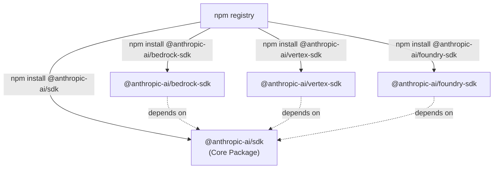
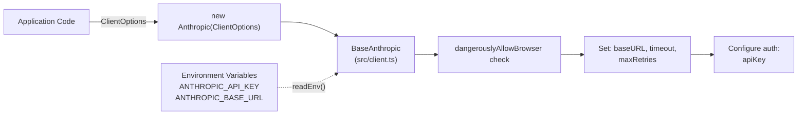

<!-- source: DeepWiki mcp.deepwiki.com · repo anthropics/anthropic-sdk-typescript · page 1.1 Installation & Setup · fetched 2026-10-26 -->

# Installation & Setup

<details>
<summary>Relevant source files</summary>

The following files were used as context for generating this wiki page:

- [CONTRIBUTING.md](CONTRIBUTING.md)
- [README.md](README.md)
- [src/index.ts](src/index.ts)
- [src/resources/completions.ts](src/resources/completions.ts)
- [src/resources/messages.ts](src/resources/messages.ts)
- [tests/api-resources/completions.test.ts](tests/api-resources/completions.test.ts)

</details>


This page covers installing the Anthropic TypeScript SDK and performing basic client configuration. For detailed configuration options, see [Client Configuration](2.1). For platform-specific installations (AWS Bedrock, Google Vertex AI, Azure AI Foundry), see [Cloud Provider SDKs](5).

## Package Installation

The SDK is distributed as the `@anthropic-ai/sdk` npm package. Install it using npm or yarn:

```bash
npm install @anthropic-ai/sdk
```

The package includes TypeScript type definitions and supports both CommonJS and ESM module systems through dual exports.

### Package Structure

**Package installation options**



The repository manages four separate packages:
- **Core SDK** (`@anthropic-ai/sdk`): Direct API access for standard Anthropic API endpoints [src/index.ts:1-32]().
- **Platform SDKs**: Specialized clients for cloud provider integrations (require separate installation) that depend on the core logic.

Sources: [README.md:11-15](), [src/index.ts:1-32]()

## Basic Client Setup

### Importing the Client

```typescript
import Anthropic from '@anthropic-ai/sdk';
```

The default export is the `Anthropic` class [src/index.ts:3-3](), which provides access to resources like `messages` and `completions`.

### Minimal Instantiation

```typescript
const client = new Anthropic({
  apiKey: process.env['ANTHROPIC_API_KEY'], // Optional if env var is set
});
```

The client constructor accepts a `ClientOptions` object [src/index.ts:7-7](). By default, it looks for the `ANTHROPIC_API_KEY` environment variable [README.md:22-24]().

Sources: [src/index.ts:3-7](), [README.md:19-34]()

## Client Instantiation Patterns

**`Anthropic` constructor initialization flow**



The `Anthropic` class [src/client.ts:7-7]() performs the following steps:

1. **Environment resolution**: Automatically retrieves the API key from `process.env['ANTHROPIC_API_KEY']` if not provided in the constructor [README.md:22-24]().
2. **Resource Initialization**: Sets up namespaces like `completions` [src/resources/completions.ts:12-12]() and `messages` [src/resources/messages.ts:3-3]().
3. **Safety Checks**: Validates environment constraints (e.g., preventing browser usage unless `dangerouslyAllowBrowser` is set).

Sources: [src/client.ts:7-7](), [src/resources/completions.ts:12-12](), [README.md:22-24]()

## Configuration Options Overview

The `ClientOptions` [src/client.ts:7-7]() interface accepts parameters to modify the client's behavior:

| Parameter | Type | Default | Description |
|-----------|------|---------|-------------|
| `apiKey` | `string` | `process.env['ANTHROPIC_API_KEY']` | Primary credential for Anthropic API [README.md:22-24](). |
| `baseURL` | `string` | `https://api.anthropic.com` | The base URL for all API requests. |
| `timeout` | `number` | `600000` (10m) | Request timeout in milliseconds [src/resources/completions.ts:45-45](). |
| `maxRetries` | `number` | `2` | Number of times to retry failed requests. |
| `dangerouslyAllowBrowser` | `boolean` | `false` | Must be true to use the SDK in a browser environment. |

Sources: [src/client.ts:7-7](), [src/resources/completions.ts:45-45](), [README.md:22-24]()

## First Request Example

The following example demonstrates a basic request to the Messages API using the `Anthropic` client:

```typescript
import Anthropic from '@anthropic-ai/sdk';

const client = new Anthropic();

async function main() {
  const message = await client.messages.create({
    max_tokens: 1024,
    messages: [{ role: 'user', content: 'Hello, Claude' }],
    model: 'claude-3-opus-20240229',
  });

  console.log(message.content);
}

main();
```

The `client.messages.create` call returns a promise that resolves to a `Message` object [README.md:26-32](). For legacy support, the SDK also provides `client.completions.create` [src/resources/completions.ts:32-41](), though the Messages API is recommended for all new development [src/resources/completions.ts:16-21]().

Sources: [README.md:19-33](), [src/resources/completions.ts:12-54]()

## Runtime Requirements

- **Node.js**: Version 18 or higher is required [README.md:37-37]().
- **Deno/Bun**: Supported via standard npm package compatibility layers.
- **Browsers**: Supported only if `dangerouslyAllowBrowser: true` is passed to the constructor to acknowledge the security risks of exposing API keys.

Sources: [README.md:37-37](), [src/client.ts:7-7]()

## Development Setup

If you are contributing to the SDK or running examples from the repository:

1. **Clone and Install**:
   ```sh
   git clone https://github.com/anthropics/anthropic-sdk-typescript
   yarn install
   ```
2. **Build**:
   ```sh
   yarn build
   ```
3. **Run Examples**:
   You can run files in the `examples/` directory using `yarn tsn` [CONTRIBUTING.md:39-39]().
4. **Testing**:
   Tests require a mock server. Run `./scripts/mock` followed by `yarn run test` [CONTRIBUTING.md:74-80]().

Sources: [CONTRIBUTING.md:10-15](), [CONTRIBUTING.md:39-39](), [CONTRIBUTING.md:74-80]()

---

