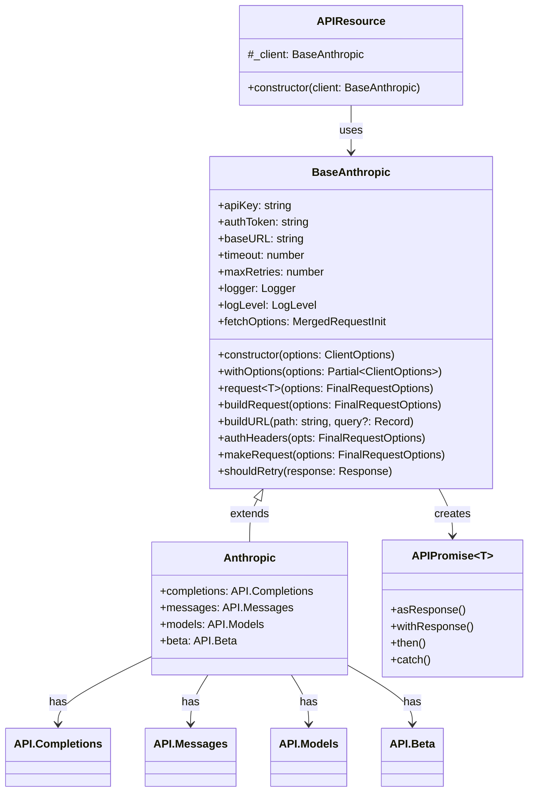
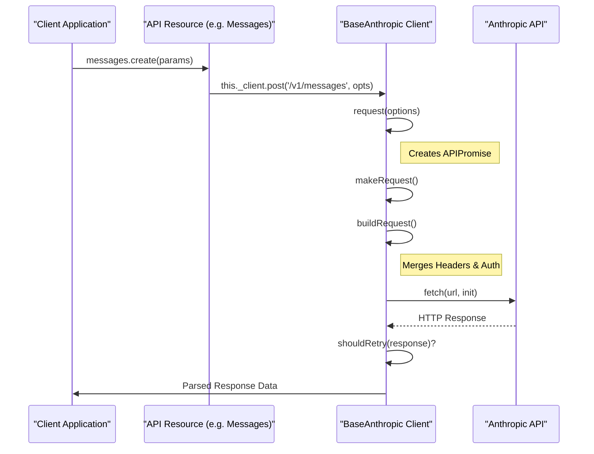
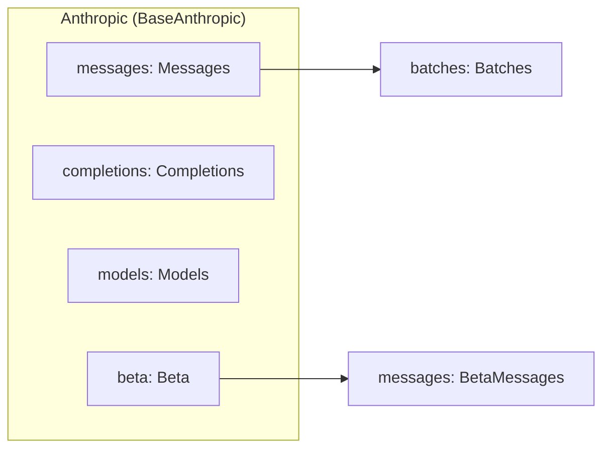

<!-- source: DeepWiki mcp.deepwiki.com · repo anthropics/anthropic-sdk-typescript · page 2 Core Client Architecture · fetched 2026-10-26 -->

# Core Client Architecture

Relevant source files

The following files were used as context for generating this wiki page:

- [src/client.ts](src/client.ts)
- [src/error.ts](src/error.ts)
- [src/resources/index.ts](src/resources/index.ts)
- [src/resources/messages/index.ts](src/resources/messages/index.ts)
- [tests/index.test.ts](tests/index.test.ts)

The `@anthropic-ai/sdk` package is built around two primary classes in `src/client.ts`: `BaseAnthropic`, which implements the foundational HTTP client functionality, and `Anthropic`, which extends it to expose the public API resource namespaces. This document provides a technical overview of the SDK's internal layers, from configuration to request execution.

## Core Components

The SDK uses a layered architecture where high-level resource methods (like `messages.create`) delegate to a central request pipeline.

### Class Hierarchy

Sources: [src/client.ts:337-405](), [src/client.ts:1044-1060](), [src/core/api-promise.ts:10-25](), [src/core/resource.ts:5-12]()

## Client Configuration

The `Anthropic` client is initialized with a `ClientOptions` object. It resolves configuration from these options, falling back to environment variables where applicable.

For a deep dive into all available settings and environment variable resolution, see [Client Configuration](#2.1).

### Key Options Overview

| Option | Default | Source |
|--------|---------|--------|
| `apiKey` | `process.env['ANTHROPIC_API_KEY']` | [src/client.ts:241-244]() |
| `baseURL` | `https://api.anthropic.com` | [src/client.ts:258-261]() |
| `timeout` | `600000` (10 mins) | [src/client.ts:264-267]() |
| `maxRetries` | `2` | [src/client.ts:270-273]() |
| `logLevel` | `'warn'` | [src/client.ts:291-294]() |

Sources: [src/client.ts:237-329](), [src/client.ts:367-405]()

## Authentication

The SDK handles authentication via `X-Api-Key` or `Authorization: Bearer` headers. It supports dynamic key rotation through the `ApiKeySetter` function type.

For details on credential resolution and rotation, see [Authentication](#2.2).

Sources: [src/client.ts:438-478]()

## Request Lifecycle

When a resource method is called, it triggers a multi-stage pipeline:

1.  **Initialization**: The resource calls `this._client.post()` or `get()`.
2.  **APIPromise Creation**: A new `APIPromise` is returned, wrapping the `makeRequest` execution.
3.  **Request Building**: `buildRequest()` assembles the URL, merges headers (default, auth, and per-request), and processes the body.
4.  **Dispatch**: `fetchWithTimeout()` dispatches the request using the configured `fetch` implementation.
5.  **Response Parsing**: The raw response is parsed (usually as JSON) and the `_request_id` is attached.

For a step-by-step walkthrough of the pipeline, see [Request Lifecycle](#2.3).

### Request Processing Pipeline

Sources: [src/client.ts:568-766](), [src/client.ts:925-950]()

## Error Handling

The SDK maps HTTP status codes and network failures to a specific class hierarchy. All API errors inherit from `APIError`, which includes the `request_id` for debugging.

For the full hierarchy and retry logic details, see [Error Handling](#2.4).

### Error Hierarchy

| Error Class | Condition |
|-------------|-----------|
| `BadRequestError` | 400 |
| `AuthenticationError` | 401 |
| `RateLimitError` | 429 |
| `APIConnectionError` | Network failure |

Sources: [src/core/error.ts:10-150](), [src/client.ts:508-515]()

## API Resource Structure

The `Anthropic` client acts as a container for specialized resource classes. Each resource is instantiated with a reference to the client, allowing it to share the central configuration and request logic.

Sources: [src/client.ts:1044-1060](), [src/resources/index.ts:1-205]()

---

