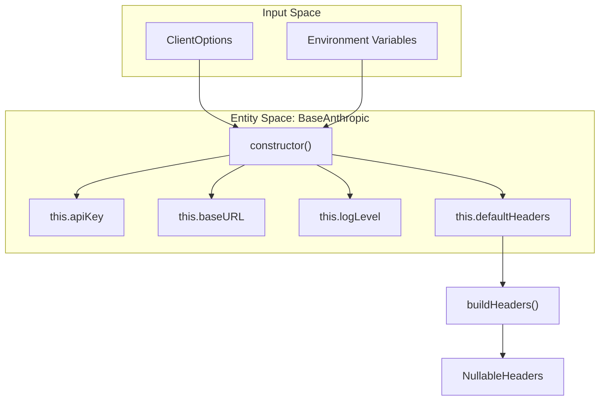
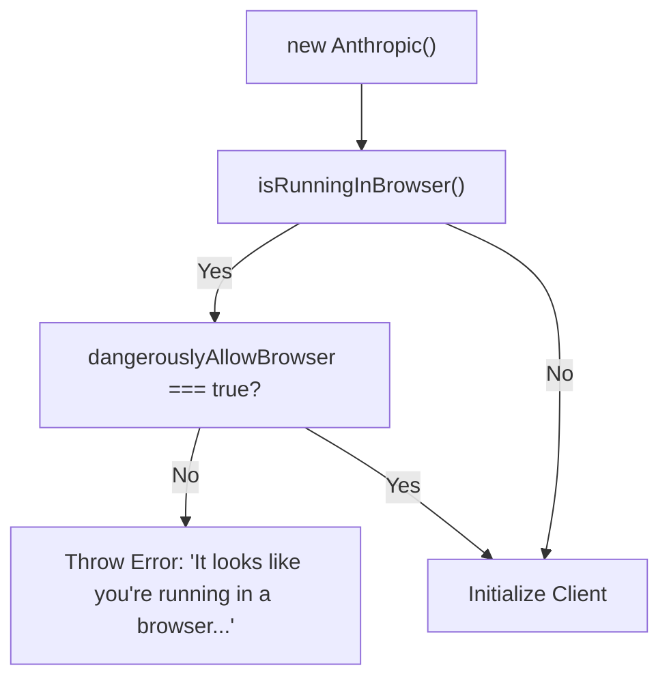

<!-- source: DeepWiki mcp.deepwiki.com · repo anthropics/anthropic-sdk-typescript · page 2.1 Client Configuration · fetched 2026-10-26 -->

# Client Configuration

<details>
<summary>Relevant source files</summary>

The following files were used as context for generating this wiki page:

- [src/client.ts](src/client.ts)
- [src/core/resource.ts](src/core/resource.ts)
- [src/error.ts](src/error.ts)
- [src/internal/headers.ts](src/internal/headers.ts)
- [src/internal/utils/log.ts](src/internal/utils/log.ts)
- [src/internal/utils/path.ts](src/internal/utils/path.ts)
- [src/internal/utils/values.ts](src/internal/utils/values.ts)
- [src/resources/index.ts](src/resources/index.ts)
- [src/resources/messages/index.ts](src/resources/messages/index.ts)
- [tests/index.test.ts](tests/index.test.ts)
- [tests/path.test.ts](tests/path.test.ts)
- [tsc-multi.json](tsc-multi.json)

</details>


The Anthropic TypeScript SDK provides a flexible configuration system for managing authentication, networking behavior, and request handling. This page documents the `ClientOptions` interface, environment variable fallbacks, and the mechanisms for deriving client instances.

## Client Initialization

The primary entry point is the `Anthropic` class, which extends `BaseAnthropic`. It is configured via a `ClientOptions` object passed to the constructor.

```typescript
import Anthropic from '@anthropic-ai/sdk';

const client = new Anthropic({
  apiKey: 'my-api-key', // Defaults to process.env['ANTHROPIC_API_KEY']
  baseURL: 'https://my-proxy.com',
  timeout: 20 * 1000, // 20 seconds
  maxRetries: 5,
});
```

Sources: [src/index.ts:22-44](), [src/client.ts:23-27]()

### Configuration Precedence

The SDK resolves configuration values in the following order:
1. Explicit constructor options.
2. Environment variables (e.g., `ANTHROPIC_API_KEY`, `ANTHROPIC_BASE_URL`).
3. Internal defaults (e.g., `maxRetries: 2`).

Sources: [src/index.ts:46-85](), [tests/index.test.ts:306-347]()

## Client Options Reference

| Option | Type | Default | Description |
| :--- | :--- | :--- | :--- |
| `apiKey` | `string` | `process.env['ANTHROPIC_API_KEY']` | Required for authentication. |
| `authToken` | `string` | `process.env['ANTHROPIC_AUTH_TOKEN']` | Alternative bearer token authentication. |
| `baseURL` | `string` | `https://api.anthropic.com` | The root URL for all API requests. |
| `timeout` | `number` | `600,000` (10 mins) | Request timeout in milliseconds. |
| `maxRetries` | `number` | `2` | Maximum number of retry attempts for failed requests. |
| `defaultHeaders` | `HeadersLike` | `{}` | Headers sent with every request. |
| `defaultQuery` | `Record<string, any>`| `{}` | Query parameters appended to every URL. |
| `dangerouslyAllowBrowser`| `boolean` | `false` | Must be `true` to instantiate the client in a browser. |
| `logLevel` | `LogLevel` | `'warn'` | Sets verbosity: `'off'`, `'error'`, `'warn'`, `'info'`, `'debug'`. |
| `logger` | `Logger` | `console` | Custom logging implementation. |
| `fetch` | `Fetch` | Global `fetch` | Custom fetch implementation (e.g., for proxies). |

Sources: [src/index.ts:46-85](), [src/internal/utils/log.ts:14-22](), [src/client.ts:235-237]()

## Configuration Data Flow

The following diagram illustrates how `ClientOptions` are processed and stored within the `BaseAnthropic` instance.

**Configuration Processing Logic**


Sources: [src/client.ts:18-241](), [src/internal/headers.ts:73-94]()

## Logging and Debugging

The SDK uses a internal logging utility to format request details while protecting sensitive information like API keys.

### Log Levels and Custom Loggers
You can control verbosity via `logLevel` or the `ANTHROPIC_LOG` environment variable. If a custom `logger` is provided, it must implement the `Logger` interface (methods: `debug`, `info`, `warn`, `error`).

```typescript
const client = new Anthropic({
  logLevel: 'debug',
  logger: {
    debug: (msg, ...args) => console.log(`[DEBUG] ${msg}`, ...args),
    info: console.info,
    warn: console.warn,
    error: console.error,
  }
});
```

Sources: [src/internal/utils/log.ts:8-14](), [tests/index.test.ts:81-98]()

### Request Redaction
When logging request details, the SDK automatically redacts sensitive headers including `x-api-key`, `authorization`, `cookie`, and `set-cookie`.

Sources: [src/internal/utils/log.ts:103-118]()

## Derived Clients with `withOptions()`

The `withOptions()` method allows you to create a new client instance that inherits from the current one but overrides specific settings. This is useful for scoped requests (e.g., a specific timeout for one module).

```typescript
const client = new Anthropic({ apiKey: '...' });

// Create a derived client with a shorter timeout
const fastClient = client.withOptions({ timeout: 5000 });
```

**Implementation Detail**: `withOptions()` effectively performs a shallow merge of the new options with the existing client's configuration and returns a new instance.

Sources: [tests/index.test.ts:359-433]()

## Browser Environment Safety

The SDK includes a safety check to prevent accidental exposure of API keys in client-side code. If `isRunningInBrowser()` returns true and `dangerouslyAllowBrowser` is not explicitly set to `true`, the constructor will throw an error.

**Browser Access Guard**


Sources: [src/client.ts:236-237](), [src/index.ts:90-105]()

## Header and Query Merging

Default headers and query parameters are merged during request construction. 
- **Headers**: Handled by `buildHeaders()`. Passing `null` to a header in a specific request will remove a default header.
- **Query**: Merged using `stringifyQuery()`.

**Header Merging Behavior**
```typescript
const client = new Anthropic({
  defaultHeaders: { 'X-Organization-Id': 'org_123' }
});

// The request will have 'X-Organization-Id' removed for this call only
await client.messages.create({...}, {
  headers: { 'X-Organization-Id': null }
});
```

Sources: [src/internal/headers.ts:73-94](), [tests/index.test.ts:43-50](), [tests/index.test.ts:217-224]()

---

