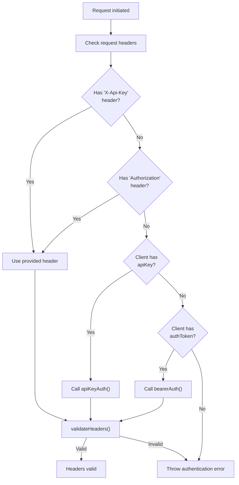
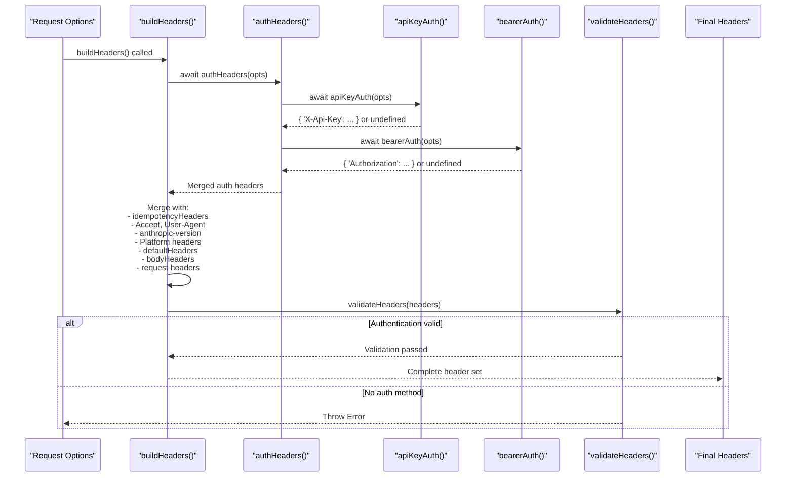

<!-- source: DeepWiki mcp.deepwiki.com · repo anthropics/anthropic-sdk-typescript · page 2.2 Authentication · fetched 2026-10-26 -->

# Authentication

<details>
<summary>Relevant source files</summary>

The following files were used as context for generating this wiki page:

- [src/client.ts](src/client.ts)
- [src/error.ts](src/error.ts)
- [src/resources/index.ts](src/resources/index.ts)
- [src/resources/messages/index.ts](src/resources/messages/index.ts)
- [tests/index.test.ts](tests/index.test.ts)

</details>


## Purpose and Scope

This document explains the authentication system in the Anthropic TypeScript SDK, covering the dual authentication strategy that supports both API key and bearer token authentication. It details how authentication credentials are configured, validated, and transformed into HTTP headers during the request lifecycle.

For information about configuring authentication credentials and other client options, see [Client Configuration](2.1). For details on how authentication headers are integrated into the complete request flow, see [Request Lifecycle](2.3).

---

## Authentication Strategies

The SDK implements two distinct authentication methods that are mutually exclusive per request:

| Strategy | Header Name | Use Case | Source |
|----------|-------------|----------|--------|
| **API Key** | `X-Api-Key` | Standard Anthropic API authentication | Direct API access |
| **Bearer Token** | `Authorization` | OAuth2 or token-based authentication | Enterprise integrations |

Only one authentication method is required per client instance. The SDK validates that at least one authentication method is configured before making requests [src/client.ts:438-460]().

**Sources:** [src/client.ts:249-254](), [src/client.ts:438-460](), [src/client.ts:462-478]()

---

## Configuration

### Static API Key

The most common authentication method uses a static API key string passed via `ClientOptions` [src/client.ts:249]():

```typescript
const client = new Anthropic({
  apiKey: 'your-api-key-here'
});
```

If not provided explicitly, the SDK attempts to resolve the key from the `ANTHROPIC_API_KEY` environment variable during instantiation [src/client.ts:368-371]().

**Sources:** [src/client.ts:249](), [src/client.ts:368-371]()

### Dynamic API Key with ApiKeySetter

For scenarios requiring credential rotation or runtime API key resolution, the `ClientOptions.apiKey` field [src/client.ts:249]() also accepts an `ApiKeySetter`.

**Definition:**
`type ApiKeySetter = () => Promise<string>;` [src/client.ts:235]()

The function is invoked before each request, enabling:
- **Credential rotation** without recreating the client.
- **Dynamic fetching** from secret managers or vaults.
- **Just-in-time authentication** for short-lived tokens.

The function must return a non-empty string. If it returns an empty string or throws an error, the SDK wraps it in an `AnthropicError` with the original error as `cause`.

> **Note:** When an `ApiKeySetter` function is passed, the constructor sets `this.apiKey` (the instance property) to `null` via the assignment at [src/client.ts:403](). The function is preserved in `this._options.apiKey` for use during request preparation.

**Sources:** [src/client.ts:235](), [src/client.ts:249](), [src/client.ts:403]()

### Bearer Token Authentication

For OAuth2 flows or enterprise authentication systems, the SDK supports an `authToken` option [src/client.ts:254]():

```typescript
const client = new Anthropic({
  authToken: 'your-bearer-token'
});
```

The SDK will automatically check the `ANTHROPIC_AUTH_TOKEN` environment variable if this option is not provided [src/client.ts:370]().

**Sources:** [src/client.ts:254](), [src/client.ts:370]()

---

## Authentication Method Resolution

The following diagram shows how the SDK determines which authentication method to use during the request lifecycle:

**Logic Flow: Auth Strategy Selection**


**Sources:** [src/client.ts:438-460](), [src/client.ts:462-478](), [src/client.ts:952-991]()

---

## Header Construction

### Authentication Header Methods

The `BaseAnthropic` class implements three methods for building authentication headers:

#### `authHeaders(opts: FinalRequestOptions)`
The primary method that orchestrates authentication header construction [src/client.ts:462-464](). It calls both `apiKeyAuth()` and `bearerAuth()` in sequence, then passes both results to `buildHeaders` for merging. Both methods are always called; whichever returns `undefined` is ignored by the header merging logic.

**Sources:** [src/client.ts:462-464]()

#### `apiKeyAuth(opts: FinalRequestOptions)`
Constructs the `X-Api-Key` header when `this.apiKey` is non-null. If the client was created without an API key (or with an `ApiKeySetter` function, which leaves `this.apiKey` as `null`), this method returns `undefined` and contributes no header [src/client.ts:466-470]().

**Sources:** [src/client.ts:466-470]()

#### `bearerAuth(opts: FinalRequestOptions)`
Constructs the `Authorization: Bearer <token>` header when `this.authToken` is non-null. Returns `undefined` if no auth token is configured [src/client.ts:473-478]().

**Sources:** [src/client.ts:473-478]()

---

## Header Building Pipeline

The complete header construction process integrates authentication headers with other required headers:

**Pipeline: Header Assembly**


**Sources:** [src/client.ts:952-991](), [src/client.ts:462-478]()

---

## Header Validation

### Validation Logic

The `validateHeaders` method [src/client.ts:438-460]() accepts a `NullableHeaders` object containing two maps: `values` (headers that are present) and `nulls` (headers that were explicitly set to `null` to remove them). It ensures that at least one authentication method is accounted for before a request is dispatched.

The validation checks occur in this order:
1. **Header presence**: If either `X-Api-Key` or `Authorization` exists in the final header set, validation passes.
2. **Client + header match**: If the client has credentials and the corresponding header exists.
3. **Explicit omission**: If a header was explicitly set to `null` in the request options, it is treated as an intentional opt-out.
4. **Error case**: If none of the above criteria are met, the SDK throws an authentication error.

**Sources:** [src/client.ts:438-460]()

---

## Header Override Behavior

Requests can override authentication headers at call time via the second argument of resource methods:

### Replacing Authentication
```typescript
// Override with different API key for a single call
await client.messages.create({
  model: 'claude-3-5-sonnet-20240620',
  max_tokens: 1024,
  messages: [{ role: 'user', content: 'Hello' }]
}, {
  headers: {
    'X-Api-Key': 'different-api-key'
  }
});
```

### Omitting Authentication
```typescript
// Explicitly omit API key (useful for testing or custom proxies)
await client.messages.create({
  /* ... params ... */
}, {
  headers: {
    'X-Api-Key': null
  }
});
```

Setting a header to `null` explicitly removes it from the request, even if the client has authentication configured [src/internal/headers.ts](). This is validated by `validateHeaders` to ensure intentional omission [src/client.ts:438-460]().

**Sources:** [src/client.ts:438-460](), [tests/index.test.ts:43-51]()

---

## Code Entity Reference

The following table maps authentication concepts to specific code entities within `src/client.ts`:

| Concept | Code Entity | Location |
|---------|-------------|----------|
| API key configuration option | `ClientOptions.apiKey` | [src/client.ts:249]() |
| Auth token configuration option | `ClientOptions.authToken` | [src/client.ts:254]() |
| Dynamic key function type | `ApiKeySetter` | [src/client.ts:235]() |
| Client API key property | `BaseAnthropic.apiKey` | [src/client.ts:338]() |
| Client auth token property | `BaseAnthropic.authToken` | [src/client.ts:339]() |
| Primary auth header method | `BaseAnthropic.authHeaders()` | [src/client.ts:462-464]() |
| API key header builder | `BaseAnthropic.apiKeyAuth()` | [src/client.ts:466-470]() |
| Bearer token header builder | `BaseAnthropic.bearerAuth()` | [src/client.ts:473-478]() |
| Header validation logic | `BaseAnthropic.validateHeaders()` | [src/client.ts:438-460]() |
| Header building pipeline | `BaseAnthropic.buildHeaders()` (private) | [src/client.ts:952-991]() |
| Environment variable reading | `readEnv()` | [src/client.ts:368-371]() |

**Sources:** [src/client.ts:235-478](), [src/client.ts:952-991]()

---

## Platform-Specific Authentication

Platform SDKs extend the base authentication system with cloud-provider-specific implementations.

- **Google Vertex AI**: Uses Google OAuth2 credentials and service accounts. See [Vertex AI SDK](5.1).
- **AWS Bedrock**: Uses AWS Signature V4 signing and IAM roles. See [Bedrock SDK](5.2).
- **Azure Foundry**: Uses `azureADTokenProvider` or standard API keys. See [Foundry SDK](5.3).

These platform SDKs typically override the default header generation to implement provider-specific signing while maintaining the same high-level interface as the core SDK.

**Sources:** [src/client.ts:391-407]()

---

