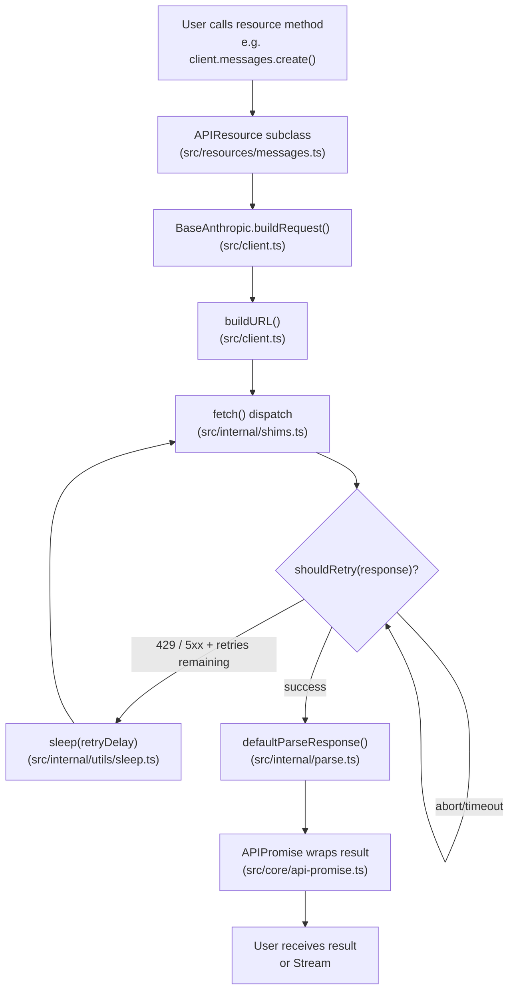
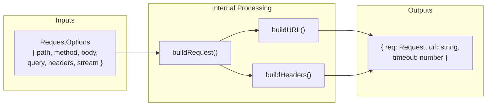
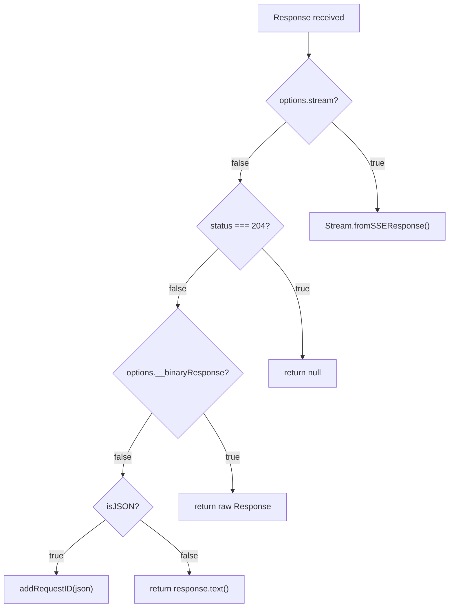

<!-- source: DeepWiki mcp.deepwiki.com · repo anthropics/anthropic-sdk-typescript · page 2.3 Request Lifecycle · fetched 2026-10-26 -->

# Request Lifecycle

Relevant source files

The following files were used as context for generating this wiki page:

- [scripts/utils/attw-report.cjs](scripts/utils/attw-report.cjs)
- [src/api-promise.ts](src/api-promise.ts)
- [src/client.ts](src/client.ts)
- [src/core/streaming.ts](src/core/streaming.ts)
- [src/error.ts](src/error.ts)
- [src/internal/builtin-types.ts](src/internal/builtin-types.ts)
- [src/internal/decoders/jsonl.ts](src/internal/decoders/jsonl.ts)
- [src/internal/errors.ts](src/internal/errors.ts)
- [src/internal/parse.ts](src/internal/parse.ts)
- [src/internal/request-options.ts](src/internal/request-options.ts)
- [src/internal/types.ts](src/internal/types.ts)
- [src/pagination.ts](src/pagination.ts)
- [src/resources/index.ts](src/resources/index.ts)
- [src/resources/messages/index.ts](src/resources/messages/index.ts)
- [tests/index.test.ts](tests/index.test.ts)
- [tests/responses.test.ts](tests/responses.test.ts)
- [tests/utils/typing.ts](tests/utils/typing.ts)

This page describes the internal pipeline a single API call travels through, from a user calling a resource method to receiving a parsed response or stream. It covers URL construction, header and query merging, body serialization, fetch dispatch, retry logic, response parsing, and `_request_id` attachment.

For details on client configuration options (timeouts, `maxRetries`, `defaultHeaders`), see **2.1 Client Configuration**. For error types thrown during this pipeline, see **2.4 Error Handling**. For the streaming-specific path after `defaultParseResponse`, see **3.2.3 Streaming Responses**.

---

## Pipeline Overview

The following diagram bridges the natural language steps of a request to the specific code entities and functions responsible for them.

**Request lifecycle pipeline**

Sources: [src/internal/parse.ts:18-74](), [src/client.ts:5-15](), [src/core/api-promise.ts:28-28]()

---

## Phase 1: Resource Method

Each API resource (e.g., `Messages`, `Completions`) is a subclass of `APIResource`. Resource methods translate user-facing parameters into internal request options (`RequestOptions`) and delegate to the client's `_request()` or specific HTTP verb methods.

In some cases, parameters are extracted from the body and placed into headers. For example, beta features often require an `anthropic-beta` header which the resource layer handles before passing the request down the pipeline.

Sources: [src/resources/index.ts:1-206](), [src/resources/messages/messages.ts:1-234]()

---

## Phase 2: Request Construction — `buildRequest()`

`BaseAnthropic.buildRequest()` assembles the final `RequestInit` and `URL`. It performs header merging, query parameter attachment, and body serialization.

**`buildRequest()` Logic Flow**

Sources: [src/client.ts:237-245](), [tests/index.test.ts:29-51]()

---

## Phase 3: URL Construction — `buildURL()`

`buildURL(path, query)` constructs the full destination:
- Joins the `baseURL` and the resource `path`.
- Merges `defaultQuery` (from client instantiation) with per-request query params.
- Handles `undefined` values by removing the key from the final URL, allowing users to override defaults.

**Query merging precedence**

| Source | Effect |
|---|---|
| `defaultQuery` | Base set of parameters for all requests. |
| Per-request `query` | Overwrites or adds to `defaultQuery`. |
| `undefined` value | Explicitly removes the key from the URL. |

Sources: [tests/index.test.ts:198-225](), [src/internal/utils/query.ts:14-14]()

---

## Phase 4: Header Merging — `buildHeaders()`

`buildHeaders()` merges multiple header sources. It uses the `NullableHeaders` type to distinguish between headers that should be sent and those that should be explicitly omitted.

**Header resolution rules**

| Value | Effect |
|---|---|
| `string` | Sets the header to this value. |
| `undefined` | Keeps the existing default (no-op). |
| `null` | **Removes** the header entirely from the request. |

**Typical merge order**
1. Internal SDK headers (e.g., `x-api-key`, `anthropic-version`, `User-Agent`).
2. `defaultHeaders` provided during client initialization.
3. Per-request `headers` passed in `RequestOptions`.

Sources: [src/internal/headers.ts:23-90](), [tests/index.test.ts:22-51]()

---

## Phase 5: Body Serialization

The body is serialized based on its type. The SDK typically uses a `JSON.stringify` encoder for standard API requests.

| Body type | Serialized as | `Content-Type` |
|---|---|---|
| Plain object / array | `JSON.stringify(body)` | `application/json` |
| `null` / `undefined` | No body sent | Not set |

Sources: [src/internal/request-options.ts:86-93]()

---

## Phase 6: Response Parsing — `defaultParseResponse()`

Once `fetch` returns, `defaultParseResponse` determines how to handle the data based on the `options` and `Content-Type`.

**Parsing dispatch logic**

Sources: [src/internal/parse.ts:18-74](), [src/core/streaming.ts:35-98]()

---

## `_request_id` Attachment — `addRequestID()`

`addRequestID(value, response)` reads the `request-id` header from the API response and attaches it as a non-enumerable property named `_request_id` to the result object.

**Type behavior via `WithRequestID<T>`**

| `T` | `WithRequestID<T>` |
|---|---|
| `Record<string, any>` | `T & { _request_id?: string \| null }` |
| `Array<any>` | `T` (unchanged) |
| `string` / `number` | `T` (unchanged) |

Because `_request_id` is non-enumerable, it does not appear in `JSON.stringify(response)` but can be accessed directly in code.

Sources: [src/internal/parse.ts:76-90](), [tests/responses.test.ts:7-143]()

---

## Phase 7: `APIPromise` wrapping

The entire lifecycle is wrapped in an `APIPromise`. This class allows users to access the parsed data directly or use `.withResponse()` to get both the data and the raw HTTP response metadata.

| Method | Returns |
|---|---|
| `.then()` | The parsed body `T`. |
| `.withResponse()` | `{ data: T, response: Response, request_id: string \| null }`. |

Sources: [src/core/api-promise.ts:28-28](), [tests/responses.test.ts:21-42]()

---

