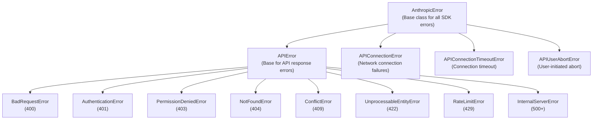
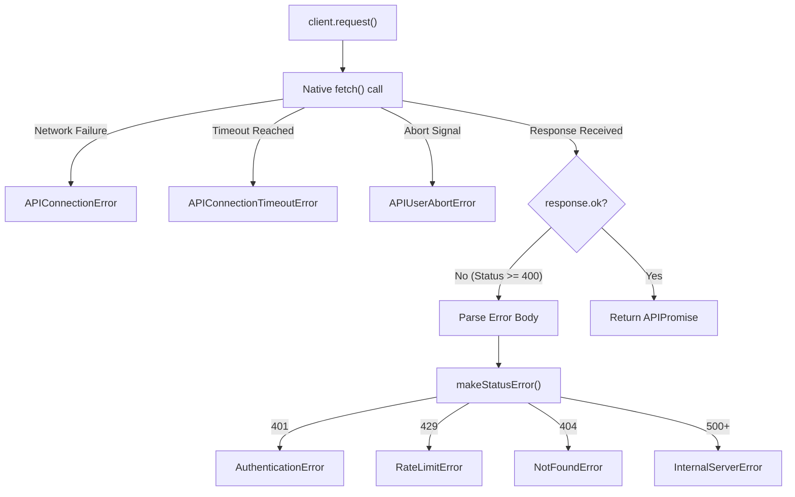
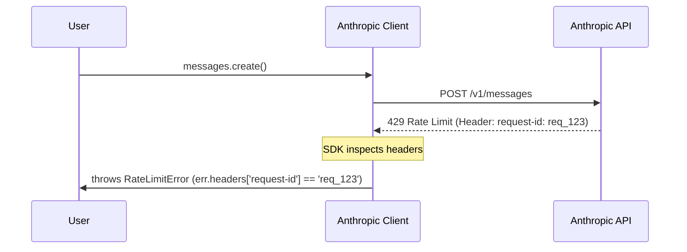

<!-- source: DeepWiki mcp.deepwiki.com · repo anthropics/anthropic-sdk-typescript · page 2.4 Error Handling · fetched 2026-10-26 -->

# Error Handling

<details>
<summary>Relevant source files</summary>

The following files were used as context for generating this wiki page:

- [src/error.ts](src/error.ts)
- [src/index.ts](src/index.ts)
- [src/resources/completions.ts](src/resources/completions.ts)
- [src/resources/messages.ts](src/resources/messages.ts)
- [tests/api-resources/completions.test.ts](tests/api-resources/completions.test.ts)
- [tests/index.test.ts](tests/index.test.ts)

</details>


This document describes the error handling system in the Anthropic TypeScript SDK. It covers the error class hierarchy, how errors are detected and created, retry behavior for different error types, and the `request_id` property on responses.

For information about the request lifecycle that triggers these errors, see [Request Lifecycle](2.3). For information about retry configuration, see [Client Configuration](2.1).

## Error Class Hierarchy

The SDK provides a comprehensive hierarchy of error classes that extend from a base `AnthropicError` class. All errors are exported from the main entry point and defined in `src/core/error.ts`.



**Sources:** [src/index.ts:9-23](), [src/error.ts:1-3]()

### Error Class Reference

| Error Class | HTTP Status | Description |
|-------------|-------------|-------------|
| `AnthropicError` | N/A | Base class for all SDK errors. |
| `APIError` | Various | Base class for errors returned by the API. Contains `status`, `message`, and the raw `error` body. |
| `BadRequestError` | 400 | The request was unacceptable, often due to missing a required parameter. |
| `AuthenticationError` | 401 | No valid API key provided. |
| `PermissionDeniedError` | 403 | The API key does not have permissions to perform the request. |
| `NotFoundError` | 404 | The requested resource doesn't exist. |
| `ConflictError` | 409 | The request conflicts with another request (e.g., using the same idempotency key). |
| `UnprocessableEntityError` | 422 | The request was well-formed but was unable to be followed due to semantic errors. |
| `RateLimitError` | 429 | Too many requests hit the API too quickly. |
| `InternalServerError` | 500+ | Something went wrong on Anthropic's end. |
| `APIConnectionError` | N/A | Failure to connect to the API (network issues). |
| `APIConnectionTimeoutError` | N/A | The request timed out. |
| `APIUserAbortError` | N/A | The request was cancelled by the user (e.g., via `AbortController`). |

**Sources:** [src/index.ts:9-23]()

## Error Detection and Data Flow

The SDK monitors the `fetch` lifecycle and transforms network or status failures into the specific error classes defined above.



**Sources:** [src/index.ts:9-23](), [tests/index.test.ts:7-8]()

## Inspecting Errors and Request IDs

When an error occurs, the `APIError` object contains metadata that is crucial for debugging, specifically the `request_id`. This ID is returned by Anthropic's infrastructure and should be provided when contacting support.

### The request_id Property

Every successful response or error response from the Anthropic API includes a unique `request_id`. In the SDK, this is accessible via:

1.  **On Errors**: The `APIError` instance contains the headers, which include the request ID.
2.  **On Successful Responses**: You can access the raw response (including headers) using the `.withResponse()` method on the `APIPromise`.

```typescript
import Anthropic from '@anthropic-ai/sdk';

const client = new Anthropic();

try {
  const message = await client.messages.create({
    max_tokens: 1024,
    messages: [{ role: 'user', content: 'Hello' }],
    model: 'claude-3-5-sonnet-20241022',
  });
} catch (err) {
  if (err instanceof Anthropic.APIError) {
    console.log(err.status); // 400
    console.log(err.name);   // BadRequestError
    // Access the request ID from headers
    console.log(err.headers.get('request-id'));
  } else {
    throw err;
  }
}
```

**Sources:** [src/index.ts:6-8](), [tests/api-resources/completions.test.ts:17-23]()

## Request IDs in Testing

The SDK's internal testing suite simulates the attachment of `request_id` (often logged as `requestLogID` internally) to ensure that the lifecycle correctly handles these identifiers during retries and logging.



**Sources:** [tests/index.test.ts:64-79](), [src/resources/completions.ts:43-52]()

## Legacy Completions Error Handling

The legacy `Completions` resource follows the same error handling patterns. If a request to `/v1/complete` fails, it will throw the same hierarchy of errors.

```typescript
try {
  await client.completions.create({
    max_tokens_to_sample: 256,
    model: 'claude-opus-4-6',
    prompt: '\n\nHuman: Hello, world!\n\nAssistant:',
  });
} catch (err) {
  if (err instanceof Anthropic.NotFoundError) {
    // Handle 404
  }
}
```

**Sources:** [src/resources/completions.ts:32-41](), [tests/api-resources/completions.test.ts:11-24]()

---

