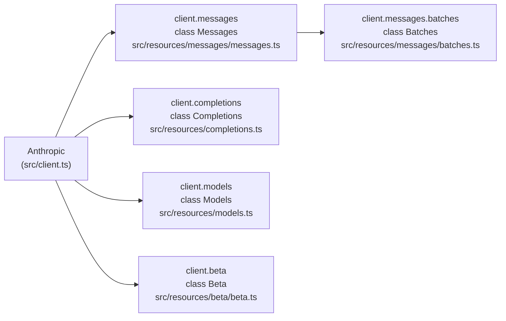
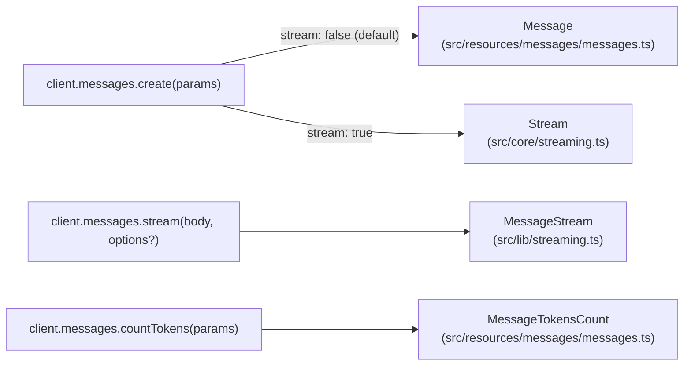

<!-- source: DeepWiki mcp.deepwiki.com · repo anthropics/anthropic-sdk-typescript · page 3 API Resources · fetched 2026-10-26 -->

# API Resources

Relevant source files

The following files were used as context for generating this wiki page:

- [.stats.yml](.stats.yml)
- [api.md](api.md)
- [src/client.ts](src/client.ts)
- [src/resources/index.ts](src/resources/index.ts)
- [src/resources/messages/index.ts](src/resources/messages/index.ts)
- [src/resources/shared.ts](src/resources/shared.ts)

This page describes the stable API resource namespaces exposed by the `Anthropic` client class. It covers `client.messages`, `client.completions`, and `client.models`, along with the `messages.batches` sub-resource. For beta features and the `client.beta` namespace, see [Beta Features](#4).

The resources described here correspond to the files under [src/resources/]() and are attached as properties on the `Anthropic` class in [src/client.ts]().

---

## Resource Attachment to Client

All resource namespaces are instantiated inside the `Anthropic` class constructor and stored as instance properties. Each resource class extends `APIResource` (from [src/core/resource.ts]()), giving it access to the parent client via `this._client`.

**Resource-to-Client wiring in `Anthropic`:**

[src/client.ts:1044-1100]()

| Client property | Resource class | Source file |
|---|---|---|
| `client.messages` | `Messages` | [src/resources/messages/messages.ts]() |
| `client.messages.batches` | `Batches` | [src/resources/messages/batches.ts]() |
| `client.completions` | `Completions` | [src/resources/completions.ts]() |
| `client.models` | `Models` | [src/resources/models.ts]() |
| `client.beta` | `Beta` | [src/resources/beta/beta.ts]() |

Sources: [src/client.ts:27-63](), [src/resources/index.ts:1-205]()

---

## Resource Namespace Map

The following diagram maps each client-facing namespace to its implementing class and source file.

**Stable Resource Namespaces**

Sources: [src/client.ts:27-63](), [src/resources/index.ts:1-205](), [src/resources/messages/index.ts:1-188]()

---

## Messages

`client.messages` is the primary interface for interacting with Claude models. It maps to the `Messages` class defined in [src/resources/messages/messages.ts](). For details, see [Messages API](#3.2).

### Methods

| Method | HTTP | Path | Returns |
|---|---|---|---|
| `.create(params)` | POST | `/v1/messages` | `Message` or `Stream<RawMessageStreamEvent>` |
| `.stream(body, options?)` | POST | `/v1/messages` | `MessageStream` |
| `.countTokens(params)` | POST | `/v1/messages/count_tokens` | `MessageTokensCount` |

`.create()` accepts a `stream: true` parameter to switch to streaming mode, returning a raw `Stream<RawMessageStreamEvent>`. `.stream()` is a convenience wrapper that returns a higher-level `MessageStream` helper.

**Method and type dispatch:**

Sources: [src/resources/messages/messages.ts:234-234](), [src/resources/messages/index.ts:179-192]()

### Key Types

| Type | Description |
|---|---|
| `Message` | Full response object containing `id`, `content`, `model`, `stop_reason`, `usage` |
| `MessageParam` | A single conversation turn (`role` + `content`) |
| `ContentBlock` | Union of `TextBlock`, `ToolUseBlock`, `ThinkingBlock`, etc. |
| `ContentBlockParam` | Union of all input content block param types |
| `StopReason` | `"end_turn"`, `"max_tokens"`, `"stop_sequence"`, `"tool_use"` |
| `Usage` | Token counts: `input_tokens`, `output_tokens`, `cache_read_input_tokens`, `cache_creation_input_tokens` |
| `ToolUnion` | Union of all tool definition types |
| `ToolChoice` | `ToolChoiceAuto`, `ToolChoiceAny`, `ToolChoiceTool`, `ToolChoiceNone` |

Sources: [src/resources/messages/messages.ts:65-234](), [src/resources/messages/index.ts:19-188]()

---

## Messages — Batches Sub-Resource

`client.messages.batches` maps to the `Batches` class in [src/resources/messages/batches.ts](). It provides asynchronous bulk processing of message requests. For details, see [Message Batches](#3.2.4).

### Methods

| Method | HTTP | Path | Returns |
|---|---|---|---|
| `.create(params)` | POST | `/v1/messages/batches` | `MessageBatch` |
| `.retrieve(messageBatchId)` | GET | `/v1/messages/batches/{id}` | `MessageBatch` |
| `.list(params?)` | GET | `/v1/messages/batches` | `MessageBatchesPage` |
| `.delete(messageBatchId)` | DELETE | `/v1/messages/batches/{id}` | `DeletedMessageBatch` |
| `.cancel(messageBatchId)` | POST | `/v1/messages/batches/{id}/cancel` | `MessageBatch` |
| `.results(messageBatchId)` | GET | `/v1/messages/batches/{id}/results` | async iterable of `MessageBatchIndividualResponse` |

### Key Types

| Type | Description |
|---|---|
| `MessageBatch` | Batch object: `id`, `processing_status`, `request_counts`, `results_url`, `expires_at` |
| `MessageBatchResult` | Discriminated union: `MessageBatchSucceededResult`, `MessageBatchErroredResult`, `MessageBatchCanceledResult`, `MessageBatchExpiredResult` |
| `MessageBatchIndividualResponse` | Single request outcome: `custom_id` + `result` |
| `MessageBatchRequestCounts` | Counts by status: `processing`, `succeeded`, `errored`, `canceled`, `expired` |

Sources: [src/resources/messages/index.ts:3-17]()

---

## Models

`client.models` maps to the `Models` class in [src/resources/models.ts](). It provides model introspection — listing available models and retrieving details about a specific model. For details, see [Models API](#3.1).

### Methods

| Method | HTTP | Path | Returns |
|---|---|---|---|
| `.retrieve(modelId, params?)` | GET | `/v1/models/{model_id}` | `ModelInfo` |
| `.list(params?)` | GET | `/v1/models` | `ModelInfosPage` |

### Key Types

| Type | Description |
|---|---|
| `ModelInfo` | Model metadata: `id`, `display_name`, `created_at`, `capabilities` |
| `ModelInfosPage` | Paginated list of `ModelInfo` objects |

Sources: [src/resources/models.ts:37-48](), [src/resources/index.ts:193-205]()

---

## Completions (Legacy)

`client.completions` maps to the `Completions` class in [src/resources/completions.ts](). This resource implements the legacy Text Completions API (endpoint `POST /v1/complete`). New code should use `client.messages` instead. For details, see [Completions API (Legacy)](#3.3).

### Method

| Method | HTTP | Path | Returns |
|---|---|---|---|
| `.create(params)` | POST | `/v1/complete` | `Completion` or `Stream<Completion>` |

### Key Parameters

| Parameter | Required | Description |
|---|---|---|
| `prompt` | Yes | Must use `\n\nHuman: ...\n\nAssistant:` format |
| `model` | Yes | Model identifier string |
| `max_tokens_to_sample` | Yes | Maximum tokens to generate |
| `stop_sequences` | No | Additional stop strings |
| `stream` | No | Enable streaming |

Sources: [src/resources/completions.ts:30-34](), [src/resources/index.ts:19-25]()

---

## Source File Index

| Namespace | Implementation | Exports index |
|---|---|---|
| `client.messages` | [src/resources/messages/messages.ts]() | [src/resources/messages/index.ts]() |
| `client.messages.batches` | [src/resources/messages/batches.ts]() | [src/resources/messages/index.ts:3-17]() |
| `client.models` | [src/resources/models.ts]() | [src/resources/index.ts:193-205]() |
| `client.completions` | [src/resources/completions.ts]() | [src/resources/index.ts:19-25]() |
| All resources (re-export) | — | [src/resources/index.ts]() |

---

## Relationship to Other Pages

| Topic | Page |
|---|---|
| `Messages` API in depth — create, parameters, response shape | [Messages API](#3.2) |
| `messages.batches` in depth | [Message Batches](#3.2.4) |
| `models.retrieve`, `models.list`, pagination | [Models API](#3.1) |
| Legacy completions | [Completions API (Legacy)](#3.3) |
| `client.beta` namespace | [Beta Features](#4) |
| Request lifecycle, retries, error handling | [Core Client Architecture](#2) |

---

