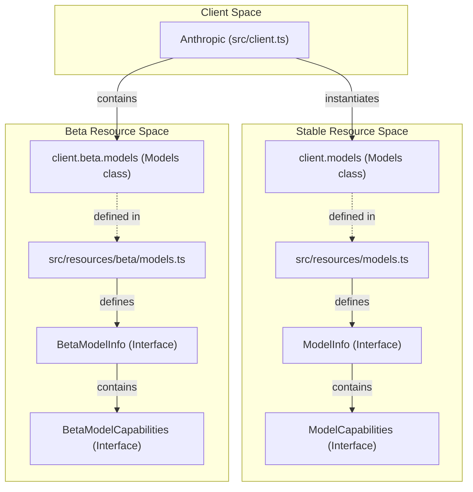
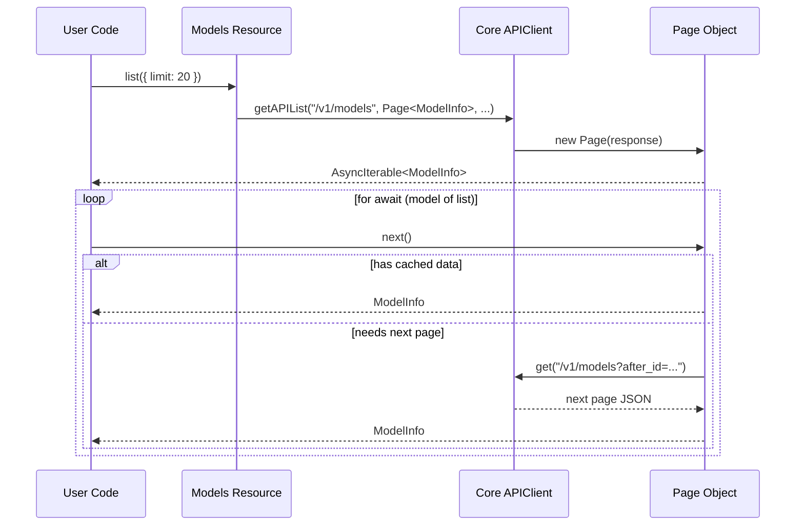

<!-- source: DeepWiki mcp.deepwiki.com · repo anthropics/anthropic-sdk-typescript · page 3.1 Models API · fetched 2026-10-26 -->

# Models API

<details>
<summary>Relevant source files</summary>

The following files were used as context for generating this wiki page:

- [src/resources/beta/models.ts](src/resources/beta/models.ts)
- [src/resources/models.ts](src/resources/models.ts)
- [tests/api-resources/beta/models.test.ts](tests/api-resources/beta/models.test.ts)
- [tests/api-resources/models.test.ts](tests/api-resources/models.test.ts)

</details>


This page documents the `client.models` namespace, which provides read access to metadata and capabilities for available Anthropic models. It covers `retrieve()`, `list()`, the `ModelInfo` response type, and how pagination works for model listings.

---

## Resource Location

The Models resource is implemented in [src/resources/models.ts]() and is exposed on the `Anthropic` client as `client.models`. It is registered in the client constructor and re-exported through the resource index.

**Diagram: Models API Class Relationships**



Sources: [src/resources/models.ts:11]() , [src/resources/beta/models.ts:11]()

---

## Methods

### `client.models.retrieve()`

Fetches metadata for a single model by its ID. This can be used to resolve model aliases to specific model IDs or to check a model's current capabilities.

| Parameter | Type | Required | Description |
| :--- | :--- | :--- | :--- |
| `modelID` | `string` | Yes | The model identifier (e.g., `claude-3-5-sonnet-20240620`). |
| `params` | `ModelRetrieveParams` | No | Optional parameters including `betas` headers. |
| `options` | `RequestOptions` | No | Standard request overrides (headers, timeout, etc.). |

**HTTP:** `GET /v1/models/{modelID}`

**Returns:** `APIPromise<ModelInfo>`

**Example:**
```ts
const modelInfo = await client.models.retrieve('claude-3-5-sonnet-20240620');
console.log(modelInfo.capabilities?.thinking?.supported);
```

Sources: [src/resources/models.ts:18-31]()

---

### `client.models.list()`

Returns a paginated list of available models. More recently released models are listed first.

**HTTP:** `GET /v1/models`

**Returns:** `PagePromise<ModelInfosPage, ModelInfo>`

#### `ModelListParams`
Extends `PageParams` for cursor-based pagination.

| Parameter | Type | Description |
| :--- | :--- | :--- |
| `after_id` | `string` | ID of the model to start after. |
| `before_id` | `string` | ID of the model to start before. |
| `limit` | `number` | Number of models to return per page. |
| `betas` | `AnthropicBeta[]` | Optional beta headers to include. |

**Example:**
```ts
// Automatically fetches more pages as needed using async iteration
for await (const model of client.models.list({ limit: 5 })) {
  console.log(model.display_name);
}
```

Sources: [src/resources/models.ts:39-52]() , [src/resources/models.ts:249-254]()

---

## Data Structures

### `ModelInfo`
The primary data object representing an Anthropic model.

| Field | Type | Description |
| :--- | :--- | :--- |
| `id` | `string` | Unique model identifier. |
| `display_name` | `string` | Human-readable name. |
| `created_at` | `string` | RFC 3339 datetime of release. |
| `capabilities` | `ModelCapabilities` | Detailed feature support (thinking, tools, etc.). |
| `max_input_tokens` | `number \| null` | Context window size. |
| `max_tokens` | `number \| null` | Maximum output tokens allowed. |
| `type` | `'model'` | Constant object type. |

### `ModelCapabilities`
Describes the technical features supported by the model instance.

| Capability | Type | Description |
| :--- | :--- | :--- |
| `thinking` | `ThinkingCapability` | Support for extended reasoning and adaptive thinking. |
| `tool_use` | `CapabilitySupport` | Whether the model can use external tools. |
| `structured_outputs`| `CapabilitySupport` | Support for JSON mode or strict schemas. |
| `context_management`| `ContextManagementCapability` | Support for `compact`, `clear_thinking`, etc. |
| `image_input` | `CapabilitySupport` | Support for vision/image blocks. |
| `pdf_input` | `CapabilitySupport` | Support for document/PDF processing. |

Sources: [src/resources/models.ts:125-170]() , [src/resources/models.ts:172-210]()

---

## Pagination Implementation

The `list()` method utilizes the `Page` class for cursor-based navigation. It returns a `PagePromise`, which allows for both direct await (returning the first page) and async iteration (fetching subsequent pages automatically).

**Diagram: Model List Data Flow**



Sources: [src/resources/models.ts:44-51]() , [src/core/pagination.ts:6-7]()

---

## Beta Variant

A parallel implementation exists under `client.beta.models`. This variant is used to access experimental model features or preview metadata.

*   **Implementation:** [src/resources/beta/models.ts]()
*   **Behavior:** Appends `?beta=true` to the request URL and allows passing `betas` headers via the `params` object.
*   **Types:** Uses `BetaModelInfo` and `BetaModelCapabilities`, which mirror the stable types but may include additional experimental fields.

```ts
// Example Beta Retrieval
const betaModel = await client.beta.models.retrieve('model_id', {
  betas: ['context-management-2025-01-12']
});
```

Sources: [src/resources/beta/models.ts:25-38]() , [src/resources/beta/models.ts:187-225]()

---

