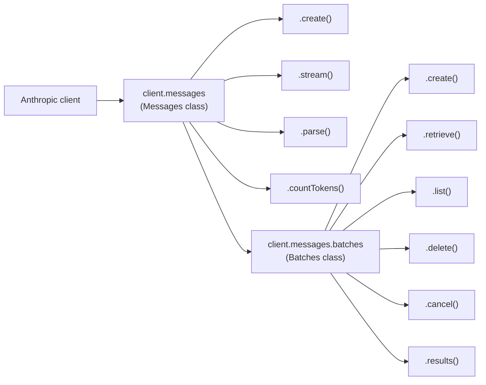
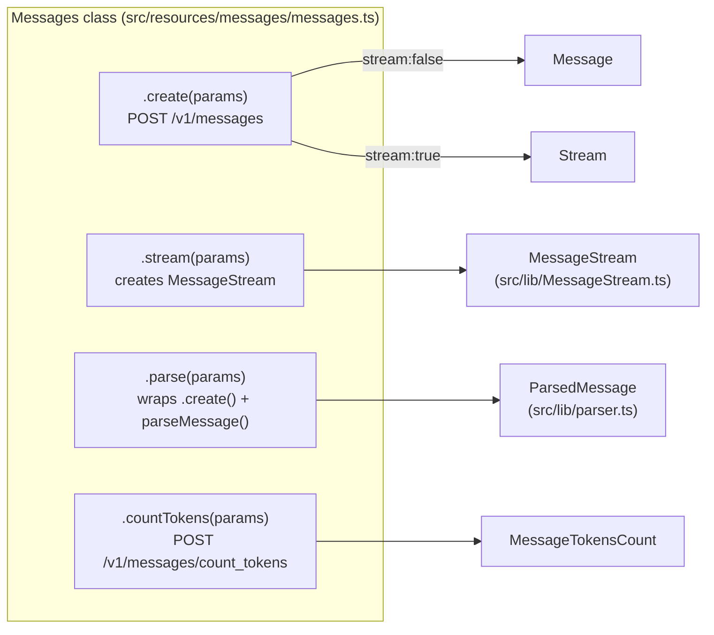

<!-- source: DeepWiki mcp.deepwiki.com · repo anthropics/anthropic-sdk-typescript · page 3.2 Messages API · fetched 2026-10-26 -->

# Messages API

<details>
<summary>Relevant source files</summary>

The following files were used as context for generating this wiki page:

- [.stats.yml](.stats.yml)
- [api.md](api.md)
- [src/resources/beta/messages/messages.ts](src/resources/beta/messages/messages.ts)
- [src/resources/messages/messages.ts](src/resources/messages/messages.ts)

</details>


This page introduces the stable Messages API — the primary interface for sending requests to Claude and receiving generated responses. It describes the `Messages` resource class, the shape of the `Message` response object, stop reasons, and usage fields. For detailed coverage of individual topics, see the sub-pages listed at the end.

- For the **beta** Messages API with extended parameters, see [Beta Messages API](#4.1).
- For the legacy text-completion interface, see [Completions API (Legacy)](#3.3).

---

## Overview

The `Messages` class, defined in [src/resources/messages/messages.ts:36-187](), is the central resource exposed on the `Anthropic` client as `client.messages`. It wraps the `/v1/messages` REST endpoint and provides four calling patterns plus a batch sub-resource.

**Resource hierarchy:**



Sources: [src/resources/messages/messages.ts:36-187](), [src/resources/messages/index.ts](), [api.md:20-22]()

---

## The `Message` Response Object

Every non-streaming call to `client.messages.create()` returns a `Message` object. Its interface is defined in [src/resources/messages/messages.ts:875-940]().

### Field summary

| Field | Type | Description |
|---|---|---|
| `id` | `string` | Unique identifier for this message object. Format may change. |
| `type` | `'message'` | Always `"message"`. |
| `role` | `'assistant'` | Always `"assistant"` for responses. |
| `content` | `ContentBlock[]` | Array of generated content blocks. See [Content Blocks & Tools](#3.2.2). |
| `model` | `Model` | The model identifier used to generate this response. |
| `stop_reason` | `StopReason \| null` | Why the model stopped generating. See table below. |
| `stop_sequence` | `string \| null` | The stop sequence that caused generation to stop, if applicable. |
| `usage` | `Usage` | Token consumption breakdown. |

Sources: [src/resources/messages/messages.ts:875-940](), [api.md:82]()

---

## Stop Reasons

The `StopReason` type is a string union defined in [src/resources/messages/messages.ts:1145-1150]():

```typescript
type StopReason = 'end_turn' | 'max_tokens' | 'stop_sequence' | 'tool_use';
```

| Value | When it occurs |
|---|---|
| `end_turn` | Model reached a natural stopping point. |
| `max_tokens` | The `max_tokens` limit was reached before a natural stop. |
| `stop_sequence` | A string from `stop_sequences` was matched in the output. |
| `tool_use` | Model is requesting a tool call; a `ToolUseBlock` will be in `content`. |

Sources: [src/resources/messages/messages.ts:1145-1150](), [api.md:108]()

---

## Usage Fields

The `Usage` interface tracks token consumption per request:

| Field | Type | Description |
|---|---|---|
| `input_tokens` | `number` | Tokens consumed from the request. |
| `output_tokens` | `number` | Tokens produced by the model. |
| `cache_creation_input_tokens` | `number \| null` | Tokens written to the prompt cache. |
| `cache_read_input_tokens` | `number \| null` | Tokens read from the prompt cache. |

`MessageDeltaUsage` is a partial form of `Usage` emitted in streaming delta events, containing `output_tokens`. `MessageTokensCount` is the response type from `client.messages.countTokens()` and contains `input_tokens`.

Sources: [src/resources/messages/messages.ts:1174-1184](), [api.md:83-87]()

---

## `ContentBlock` Union

The `content` field in a `Message` is an array of `ContentBlock` values. Each block has a discriminating `type` field.

**Content block types in a response:**

```mermaid
graph TD
    CB["ContentBlock (union)"] --> TB["TextBlock\ntype: 'text'"]
    CB --> THK["ThinkingBlock\ntype: 'thinking'"]
    CB --> RTH["RedactedThinkingBlock\ntype: 'redacted_thinking'"]
    CB --> TUB["ToolUseBlock\ntype: 'tool_use'"]
    CB --> STUB["ServerToolUseBlock\ntype: 'server_tool_use'"]
    CB --> WSRB["WebSearchToolResultBlock\ntype: 'web_search_tool_result'"]
    CB --> WFRB["WebFetchToolResultBlock\ntype: 'web_fetch_tool_result'"]
    CB --> CERB["CodeExecutionToolResultBlock\ntype: 'code_execution_tool_result'"]
    CB --> BCER["BashCodeExecutionToolResultBlock\ntype: 'bash_code_execution_tool_result'"]
    CB --> TECER["TextEditorCodeExecutionToolResultBlock\ntype: 'text_editor_code_execution_tool_result'"]
    CB --> TSRB["ToolSearchToolResultBlock\ntype: 'tool_search_tool_result'"]
```



Sources: [src/resources/messages/messages.ts:705-717]()

For input content block types (`ContentBlockParam`) and tool definitions, see [Content Blocks & Tools](#3.2.2).

---

## Method Reference

The following diagram maps the four calling patterns to their underlying implementations and return types.



Sources: [src/resources/messages/messages.ts:58-186]()

### `.create()`

Posts to `/v1/messages`. Accepts `MessageCreateParamsNonStreaming` or `MessageCreateParamsStreaming`. When `stream: false` (default), returns `APIPromise<Message>`. When `stream: true`, returns `APIPromise<Stream<RawMessageStreamEvent>>`.

The method automatically calculates a dynamic timeout for large non-streaming requests based on `max_tokens`. It also emits a console warning if a deprecated model is used [src/resources/messages/messages.ts:71-77](). See [Creating Messages](#3.2.1) for full parameter reference.

### `.stream()`

A convenience wrapper that constructs a `MessageStream` instance (defined in `src/lib/MessageStream.ts`), which supports event handlers like `.on('text', cb)`, `.on('message', cb)`, and `await stream.finalMessage()`. See [Streaming Responses](#3.2.3).

### `.parse()`

Calls `.create()` then passes the result through `parseMessage()` from `src/lib/parser.ts`. The parsed output is attached as `parsed_output` on the returned message. Requires an `output_config.format` like `zodOutputFormat(...)`. See [Structured Outputs](#4.2.1).

### `.countTokens()`

Posts to `/v1/messages/count_tokens`. Returns `MessageTokensCount` containing `input_tokens`. Accepts the same content and tool parameters as `.create()`, but does not generate a response [src/resources/messages/messages.ts:184-186]().

---

## Message Batches Sub-Resource

`client.messages.batches` is an instance of the `Batches` class defined in [src/resources/messages/batches.ts](). It supports creating, polling, and streaming results from batch jobs. See [Message Batches](#3.2.4) for full documentation.

---

## Timeout Behaviour

For non-streaming requests, if no explicit `timeout` is set on the client or request options, the SDK calculates a timeout using the model's token limits and `max_tokens` [src/resources/messages/messages.ts:88-92](). The default fallback for Message creation is 600,000ms (10 minutes) [src/resources/messages/messages.ts:99]().

Sources: [src/resources/messages/messages.ts:88-103]()

---

## Sub-Pages

| Page | Content |
|---|---|
| [Creating Messages](#3.2.1) | Full parameter reference for `client.messages.create()` |
| [Content Blocks & Tools](#3.2.2) | All content block types, tool definitions, `ToolUnion`, `ToolChoice` |
| [Streaming Responses](#3.2.3) | `MessageStream`, SSE pipeline, event handlers, `finalMessage()` |
| [Message Batches](#3.2.4) | `Batches` sub-resource, lifecycle states, JSONL result streaming |

---

