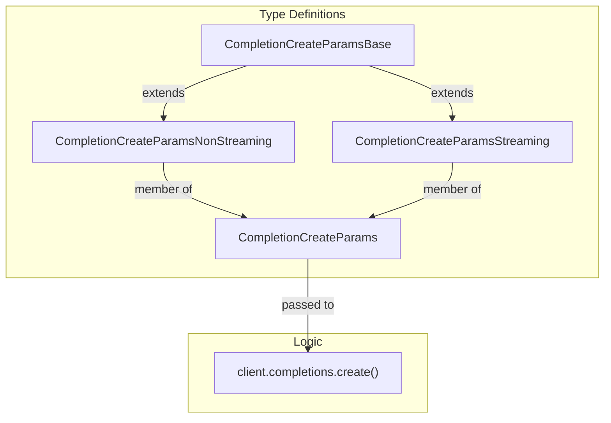

<!-- source: DeepWiki mcp.deepwiki.com · repo anthropics/anthropic-sdk-typescript · page 3.3 Completions API (Legacy) · fetched 2026-10-26 -->

# Completions API (Legacy)

<details>
<summary>Relevant source files</summary>

The following files were used as context for generating this wiki page:

- [src/index.ts](src/index.ts)
- [src/resources/completions.ts](src/resources/completions.ts)
- [src/resources/messages.ts](src/resources/messages.ts)
- [tests/api-resources/completions.test.ts](tests/api-resources/completions.test.ts)

</details>


This page documents the `client.completions.create()` method, the `Completion` response type, and all associated parameters. This API wraps the `/v1/complete` HTTP endpoint, which predates the structured Messages API.

> **Note:** This API is legacy. Anthropic recommends using `client.messages.create()` for all new work. Future models and features will not be compatible with Text Completions. For documentation on the current primary API, see the Messages API ([3.2]()). For guidance on migrating existing code, see the Migration Guide ([7]()).

---

## Overview

The Text Completions API accepts a raw prompt string and returns a single continuation string. It does not support structured content blocks, tool use, vision inputs, or features introduced after mid-2023. 

The resource is implemented in [src/resources/completions.ts:12-54]() and is exposed on the `Anthropic` client as `client.completions`.

---

## Architecture

**Diagram: Completions Resource Wiring**
This diagram shows how the `Completions` class interacts with the base client and the network layer.

```mermaid
graph TD
    subgraph "Code Entity Space"
        A["Anthropic (src/client.ts)"]
        B["client.completions"]
        C["Completions (src/resources/completions.ts)"]
        D["APIResource (src/core/resource.ts)"]
        E["APIPromise (src/core/api-promise.ts)"]
        F["Stream (src/core/streaming.ts)"]
    end

    subgraph "Natural Language Space"
        G["POST /v1/complete"]
    end

    A -->|"initializes"| B
    B -->|"instance of"| C
    C --|"(extends)"| D
    C -->|"returns"| E
    E -->|"wraps"| F
    E -.->|"dispatches to"| G
```

Sources: [src/resources/completions.ts:12-54](), [src/client.ts:7-12](), [src/core/resource.ts:4-10]()

---

**Diagram: Completion Request Type Hierarchy**
This diagram maps the parameter types used by the `create` method.



Sources: [src/resources/completions.ts:95-221]()

---

## The `create()` Method

The `Completions` class ([src/resources/completions.ts:12-14]()) provides the `create()` method with several overloads to handle streaming and non-streaming responses:

| Signature | Returns |
|---|---|
| `create(params: CompletionCreateParamsNonStreaming)` | `APIPromise<Completion>` |
| `create(params: CompletionCreateParamsStreaming)` | `APIPromise<Stream<Completion>>` |

The method performs a `POST` request to `/v1/complete`. It extracts `betas` from the parameters to populate the `anthropic-beta` header via `buildHeaders` ([src/resources/completions.ts:42-52]()).

---

## Request Parameters

All parameters are defined in `CompletionCreateParamsBase` ([src/resources/completions.ts:97-191]()).

### Required Parameters

| Parameter | Type | Description |
|---|---|---|
| `prompt` | `string` | The raw prompt string. Must use the `\n\nHuman:` / `\n\nAssistant:` turn format. |
| `model` | `MessagesAPI.Model` | The model identifier (e.g. `claude-opus-4-6`). |
| `max_tokens_to_sample` | `number` | Maximum number of tokens to generate. |

### Prompt Format

The prompt must alternate between human and assistant turns using the constants exported from the SDK ([src/client.ts:7](), [src/index.ts:7]()):

| Constant | Value |
|---|---|
| `HUMAN_PROMPT` | `\n\nHuman:` |
| `AI_PROMPT` | `\n\nAssistant:` |

A well-formed single-turn prompt looks like:
`"\n\nHuman: {userQuestion}\n\nAssistant:"`

### Optional Parameters

| Parameter | Type | Default | Description |
|---|---|---|---|
| `stream` | `boolean` | `false` | Whether to incrementally stream the response using SSE. |
| `stop_sequences` | `string[]` | — | Sequences that cause the model to stop generating. |
| `temperature` | `number` | `1.0` | Randomness (0.0 to 1.0). |
| `top_k` | `number` | — | Only sample from the top K options. |
| `top_p` | `number` | — | Nucleus sampling probability cutoff. |
| `metadata` | `Metadata` | — | Metadata about the request (e.g., `user_id`). |
| `betas` | `AnthropicBeta[]` | — | Optional header to specify beta version(s). |

Sources: [src/resources/completions.ts:97-191](), [src/index.ts:7]()

---

## The `Completion` Response Type

Defined in [src/resources/completions.ts:56-93]().

| Field | Type | Description |
|---|---|---|
| `id` | `string` | Unique object identifier. |
| `type` | `"completion"` | Always the literal string `"completion"`. |
| `completion` | `string` | The resulting completion text. |
| `model` | `Model` | The model that completed the prompt. |
| `stop_reason` | `string \| null` | Why generation stopped (`"stop_sequence"` or `"max_tokens"`). |

Sources: [src/resources/completions.ts:56-93]()

---

## Streaming

When `stream: true` is passed, `create()` returns an `APIPromise<Stream<Completion>>`. Each chunk in the stream is a `Completion` object. Note that the Completions API does not use the specialized `MessageStream` helper found in the Messages API; it uses the generic `Stream` class ([src/core/streaming.ts]()).

---

## Usage Examples

**Non-streaming request (from tests):**

```ts
const completion = await client.completions.create({
  max_tokens_to_sample: 256,
  model: 'claude-opus-4-6',
  prompt: '\n\nHuman: Hello, world!\n\nAssistant:',
});
```

**Request with optional parameters:**

```ts
const completion = await client.completions.create({
  max_tokens_to_sample: 256,
  model: 'claude-opus-4-6',
  prompt: '\n\nHuman: Hello, world!\n\nAssistant:',
  metadata: { user_id: '13803d75-b4b5-4c3e-b2a2-6f21399b021b' },
  stop_sequences: ['CustomStop'],
  temperature: 0.7,
});
```

Sources: [tests/api-resources/completions.test.ts:11-39]()

---

## Migration Guidance

To migrate from the Completions API to the Messages API:

1.  **Change Endpoint**: Move from `client.completions.create()` to `client.messages.create()`.
2.  **Format Input**: Convert the raw `prompt` string into a `messages` array of objects (e.g., `{ role: "user", content: "..." }`).
3.  **Rename Parameters**: Change `max_tokens_to_sample` to `max_tokens`.
4.  **Update Response Handling**: Access the generated text via `response.content[0].text` instead of `response.completion`.
5.  **Remove Prompt Constants**: Stop using `HUMAN_PROMPT` and `AI_PROMPT` as the Messages API handles these roles structurally.

Refer to the official [Migration Guide](https://docs.claude.com/en/api/migrating-from-text-completions-to-messages) for more complex scenarios.

Sources: [src/resources/completions.ts:16-21]()

---

