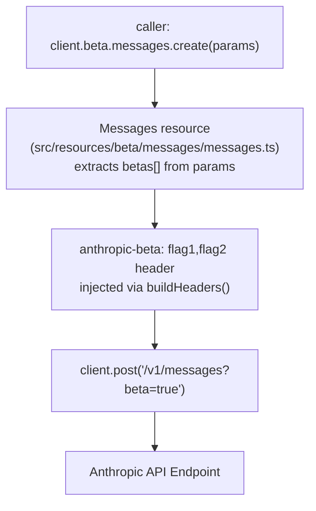
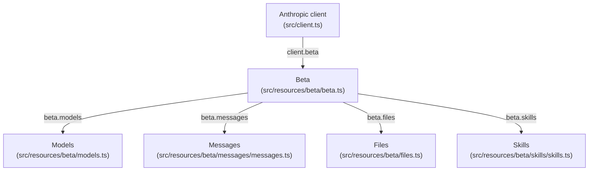
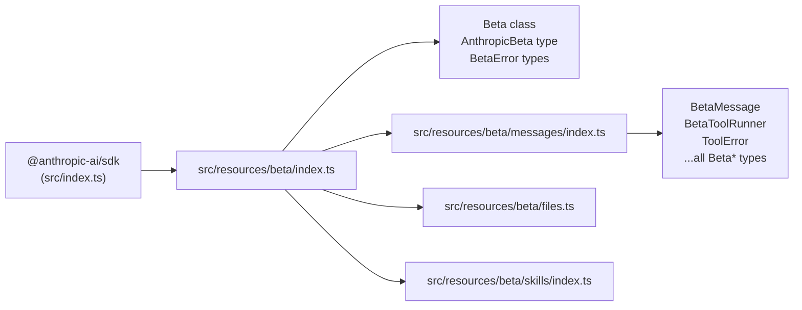

<!-- source: DeepWiki mcp.deepwiki.com · repo anthropics/anthropic-sdk-typescript · page 4 Beta Features · fetched 2026-10-26 -->

# Beta Features

<details>
<summary>Relevant source files</summary>

The following files were used as context for generating this wiki page:

- [src/resources/beta/beta.ts](src/resources/beta/beta.ts)
- [src/resources/beta/index.ts](src/resources/beta/index.ts)
- [src/resources/beta/messages/index.ts](src/resources/beta/messages/index.ts)
- [src/resources/beta/messages/messages.ts](src/resources/beta/messages/messages.ts)
- [src/resources/messages/messages.ts](src/resources/messages/messages.ts)

</details>


This page covers the beta feature system in `@anthropic-ai/sdk`: what it is, how beta flags are transmitted to the API, how the `client.beta` namespace is organized, and which beta capabilities are currently available. For details on specific sub-resources, see the child pages listed at the end of this document.

---

## Overview

The Anthropic API uses an opt-in beta system. Features that are not yet generally available are gated behind named beta flags. Callers signal which beta features they want to use by including one or more beta identifiers in the `anthropic-beta` HTTP request header. The SDK encapsulates this mechanism in two ways:

1.  **The `AnthropicBeta` string union type** — a typed set of known beta identifiers, allowing editors to autocomplete valid values while still accepting any arbitrary string.
2.  **The `client.beta` namespace** — a dedicated `Beta` resource class that groups all beta sub-resources (`messages`, `files`, `models`, `skills`).

The beta namespace is **not** a replacement for the stable API resources; it is an extension of them. Most stable resource methods are mirrored under `client.beta` with additional parameters (e.g., a `betas[]` array) and beta-specific response types.

---

## The `AnthropicBeta` Type

The `AnthropicBeta` type is defined in [src/resources/beta/beta.ts:235-256]() as a string union:

```typescript
export type AnthropicBeta =
  | (string & {})
  | 'message-batches-2024-09-24'
  | 'prompt-caching-2024-07-31'
  | 'computer-use-2024-10-22'
  | 'computer-use-2025-01-24'
  | 'pdfs-2024-09-25'
  | 'token-counting-2024-11-01'
  | 'token-efficient-tools-2025-02-19'
  | 'output-128k-2025-02-19'
  | 'files-api-2025-04-14'
  | 'mcp-client-2025-04-04'
  | 'mcp-client-2025-11-20'
  | 'dev-full-thinking-2025-05-14'
  | 'interleaved-thinking-2025-05-14'
  | 'code-execution-2025-05-22'
  | 'extended-cache-ttl-2025-04-11'
  | 'context-1m-2025-08-07'
  | 'context-management-2025-06-27'
  | 'model-context-window-exceeded-2025-08-26'
  | 'skills-2025-10-02'
  | 'fast-mode-2026-02-01';
```

The `(string & {})` member allows any arbitrary string to be passed (for unreleased or unlisted betas) while still providing autocomplete for the listed identifiers.

### Known Beta Identifiers

| Identifier | Description |
| :--- | :--- |
| `message-batches-2024-09-24` | Message Batches API |
| `prompt-caching-2024-07-31` | Prompt caching / cache control |
| `computer-use-2024-10-22` | Computer use tools (first release) |
| `computer-use-2025-01-24` | Computer use tools (updated) |
| `pdfs-2024-09-25` | PDF document input support |
| `token-counting-2024-11-01` | Token counting endpoint |
| `token-efficient-tools-2025-02-19` | Token-efficient tool definitions |
| `output-128k-2025-02-19` | 128K output tokens |
| `files-api-2025-04-14` | Files API |
| `mcp-client-2025-04-04` | MCP client support (first release) |
| `mcp-client-2025-11-20` | MCP client support (updated) |
| `dev-full-thinking-2025-05-14` | Full thinking output in dev mode |
| `interleaved-thinking-2025-05-14` | Interleaved thinking blocks |
| `code-execution-2025-05-22` | Code execution tool |
| `extended-cache-ttl-2025-04-11` | Extended cache TTL |
| `context-1m-2025-08-07` | 1M token context window |
| `context-management-2025-06-27` | Context management / compaction |
| `model-context-window-exceeded-2025-08-26` | Graceful context window exceeded handling |
| `skills-2025-10-02` | Skills API |
| `fast-mode-2026-02-01` | Fast mode / speed parameter |

Sources: [src/resources/beta/beta.ts:235-256]()

---

## How Beta Headers Are Transmitted

When a caller passes a `betas` array to a beta resource method (e.g., `client.beta.messages.create({ betas: ['files-api-2025-04-14'], ... })`), the resource layer extracts that array and injects it as the `anthropic-beta` HTTP header before the request is dispatched. The `create` method in `src/resources/beta/messages/messages.ts` handles this by mapping the `betas` array to a comma-separated string in the request headers.

**Beta header injection flow:**



Sources: [src/resources/beta/messages/messages.ts:105-144](), [src/resources/beta/beta.ts:228-233]()

---

## The `Beta` Class

The `Beta` class is defined in [src/resources/beta/beta.ts:228-233]() and extends `APIResource`. It serves as the primary namespace for all beta-enabled resources.



All four are instantiated in the `Beta` constructor and attached as properties:

| Property | Class | Source File |
| :--- | :--- | :--- |
| `beta.models` | `Models` | `src/resources/beta/models.ts` |
| `beta.messages` | `Messages` | `src/resources/beta/messages/messages.ts` |
| `beta.files` | `Files` | `src/resources/beta/files.ts` |
| `beta.skills` | `Skills` | `src/resources/beta/skills/skills.ts` |

Sources: [src/resources/beta/beta.ts:228-233]()

---

## Sub-Resource Method Index

**Beta Messages (`client.beta.messages`)**

| Method | Description |
| :--- | :--- |
| `.create()` | Create a message with beta features (e.g., `betas`, `speed`, `context_management`) |
| `.stream()` | Stream a message response using `BetaMessageStream` |
| `.parse()` | Create a message with structured output parsing via `parseBetaMessage` |
| `.countTokens()` | Count tokens for a potential request including beta blocks |
| `.batches.*` | Access `Batches` sub-resource for bulk operations |

**Beta Files (`client.beta.files`)**

| Method | Description |
| :--- | :--- |
| `.upload()` | Upload a file and receive a file ID |
| `.download()` | Download file content by ID |
| `.retrieveMetadata()` | Get metadata for a file |
| `.delete()` | Delete a file |
| `.list()` | List all uploaded files |

**Beta Models (`client.beta.models`)**

| Method | Description |
| :--- | :--- |
| `.retrieve()` | Retrieve a model by ID with beta-specific metadata |
| `.list()` | List available models |

**Beta Skills (`client.beta.skills`)**

| Method | Description |
| :--- | :--- |
| `.create()` | Create a reusable skill |
| `.retrieve()` | Retrieve a skill by ID |
| `.list()` | List skills |
| `.delete()` | Delete a skill |

Sources: [src/resources/beta/messages/messages.ts:67-195](), [src/resources/beta/beta.ts:228-233](), [src/resources/beta/index.ts:3-252]()

---

## Beta Error Types

The beta namespace defines its own set of error shape types, mirroring the stable API error types but specifically for beta-enabled endpoints. These are returned as structured error bodies in beta API responses.

The `BetaError` discriminated union [src/resources/beta/beta.ts:276-285]() covers:

| Type | `type` field |
| :--- | :--- |
| `BetaInvalidRequestError` | `invalid_request_error` |
| `BetaAuthenticationError` | `authentication_error` |
| `BetaBillingError` | `billing_error` |
| `BetaPermissionError` | `permission_error` |
| `BetaNotFoundError` | `not_found_error` |
| `BetaRateLimitError` | `rate_limit_error` |
| `BetaGatewayTimeoutError` | `timeout_error` |
| `BetaAPIError` | `api_error` |
| `BetaOverloadedError` | `overloaded_error` |

The `BetaErrorResponse` type [src/resources/beta/beta.ts:287-293]() wraps a `BetaError` with a `request_id` field and a `type: 'error'` discriminant.

Sources: [src/resources/beta/beta.ts:258-329]()

---

## Public Exports

All beta types and classes are re-exported through [src/resources/beta/index.ts]() and are available from the top-level `@anthropic-ai/sdk` package.



Sources: [src/resources/beta/index.ts:1-252](), [src/resources/beta/messages/index.ts:1-227]()

---

## Sub-Pages

The following child pages cover each beta capability in detail:

*   **[Beta Messages API](#4.1)** — `client.beta.messages.create()` and additional parameters: `betas[]`, `container`, `context_management`, `mcp_servers`, `speed`.
*   **[Beta Tools & ToolRunner](#4.2)** — `BetaToolRunner`, `betaZodTool`, automated multi-turn execution, and MCP integration helpers.
*   **[Structured Outputs](#4.2.1)** — `betaZodOutputFormat`, `messages.parse()`, `ParsedBetaMessage`.
*   **[Files API](#4.3)** — `client.beta.files` upload, download, and metadata management.
*   **[Skills API](#4.4)** — `client.beta.skills` lifecycle and the `skills-2025-10-02` flag.
*   **[Context Management](#4.5)** — `BetaContextManagementConfig`, compaction, and clearing edits for long-running conversations.

---

