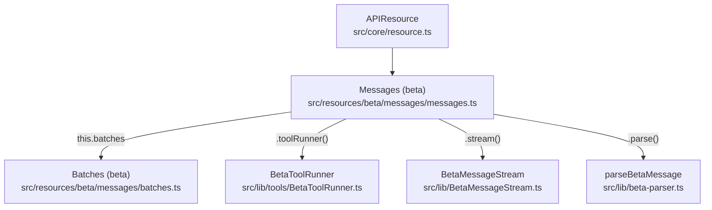
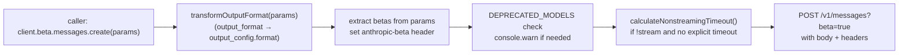
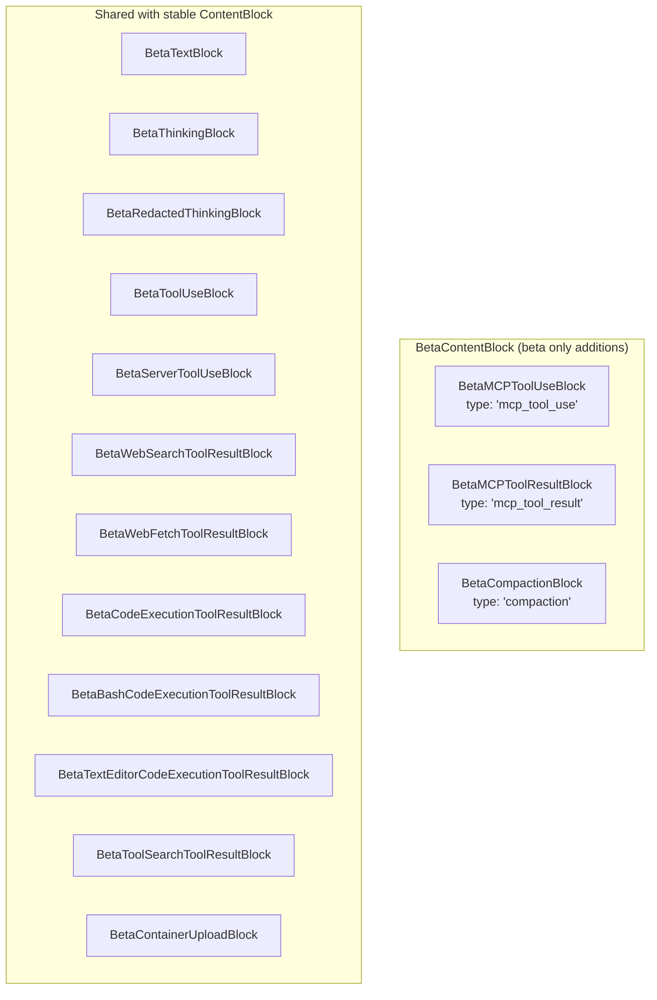
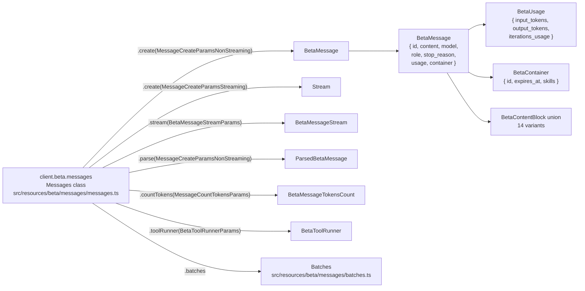

<!-- source: DeepWiki mcp.deepwiki.com · repo anthropics/anthropic-sdk-typescript · page 4.1 Beta Messages API · fetched 2026-10-26 -->

# Beta Messages API

<details>
<summary>Relevant source files</summary>

The following files were used as context for generating this wiki page:

- [src/resources/beta/messages/messages.ts](src/resources/beta/messages/messages.ts)
- [src/resources/messages/messages.ts](src/resources/messages/messages.ts)
- [tests/api-resources/beta/messages/batches.test.ts](tests/api-resources/beta/messages/batches.test.ts)
- [tests/api-resources/beta/messages/messages.test.ts](tests/api-resources/beta/messages/messages.test.ts)
- [tests/api-resources/messages/batches.test.ts](tests/api-resources/messages/batches.test.ts)
- [tests/api-resources/messages/messages.test.ts](tests/api-resources/messages/messages.test.ts)

</details>


This page covers `client.beta.messages` — the beta variant of the Messages resource. It documents the `Messages` class in `src/resources/beta/messages/messages.ts`, the beta-specific request parameters (`betas`, `container`, `context_management`, `mcp_servers`, `speed`, `inference_geo`), and the `BetaMessage` response type.

For the stable (non-beta) Messages API and its core concepts (content blocks, tools, streaming, batches), see [3.2](). For the automated tool-execution loop exposed through `toolRunner()`, see [4.2](). For structured output parsing via `parse()`, see [4.2.1](). For context management edits, see [4.5]().

---

## Overview

`client.beta.messages` is an instance of the `Messages` class defined in [src/resources/beta/messages/messages.ts:67-67](). It wraps the same `/v1/messages` endpoint as the stable API but appends `?beta=true` to the URL [src/resources/beta/messages/messages.ts:134-134]() and serialises a `betas[]` parameter into the `anthropic-beta` HTTP header [src/resources/beta/messages/messages.ts:139-139](), enabling experimental capabilities.

The beta messages resource exposes five methods:

| Method | Returns | Description |
|---|---|---|
| `create(params)` | `APIPromise<BetaMessage>` or `APIPromise<Stream<BetaRawMessageStreamEvent>>` | Send a message, optionally streaming |
| `stream(params)` | `BetaMessageStream` | High-level streaming helper |
| `parse(params)` | `APIPromise<ParsedBetaMessage<T>>` | Create + parse structured output |
| `countTokens(params)` | `APIPromise<BetaMessageTokensCount>` | Count tokens without creating a message |
| `toolRunner(params)` | `BetaToolRunner` | Automated multi-turn tool execution loop |

A `batches` sub-resource is also available as `client.beta.messages.batches` [src/resources/beta/messages/messages.ts:68-68]().

**Class hierarchy diagram: `Messages` (beta)**



Sources: [src/resources/beta/messages/messages.ts:67-238](), [src/resources/beta/messages/batches.ts:36-36]()

---

## The `create()` Method

`create()` is the core method. It is overloaded to distinguish streaming from non-streaming calls based on the `stream` flag in `params` [src/resources/beta/messages/messages.ts:89-97]().

```ts
create(params: MessageCreateParamsNonStreaming) → APIPromise<BetaMessage>
create(params: MessageCreateParamsStreaming)    → APIPromise<Stream<BetaRawMessageStreamEvent>>
```

Internally, the method:

1. Calls `transformOutputFormat(params)` to rewrite deprecated `output_format` → `output_config.format` [src/resources/beta/messages/messages.ts:103-103]().
2. Extracts `betas` from params and sets it as the `anthropic-beta` header value [src/resources/beta/messages/messages.ts:139-139]().
3. Emits a `console.warn` for deprecated models (defined in `DEPRECATED_MODELS`) [src/resources/beta/messages/messages.ts:107-113]() and for deprecated thinking configurations on certain models [src/resources/beta/messages/messages.ts:115-123]().
4. Calculates a non-streaming timeout based on `MODEL_NONSTREAMING_TOKENS` when streaming is off and no explicit timeout is set [src/resources/beta/messages/messages.ts:126-129]().
5. Posts to `/v1/messages?beta=true` [src/resources/beta/messages/messages.ts:134-134]().

**Request flow diagram**



Sources: [src/resources/beta/messages/messages.ts:98-145](), [src/resources/beta/messages/messages.ts:244-265]()

---

## Beta-Specific Request Parameters

`MessageCreateParams` in the beta namespace extends the stable params with additional fields. The table below lists the parameters that are unique to the beta API.

| Parameter | Type | Description |
|---|---|---|
| `betas` | `Array<AnthropicBeta>` | List of beta feature strings. Sent as the `anthropic-beta` header. |
| `container` | `BetaContainerParams` | Specifies a container for code execution, including optional `id` and `skills`. |
| `context_management` | `BetaContextManagementConfig` | Server-side context editing before sampling (clear tool uses, thinking, or compact). |
| `mcp_servers` | `Array<BetaRequestMCPServerURLDefinition>` | MCP server definitions for remote tool access. |
| `speed` | `'standard'` \| `'fast'` | Preferred inference speed tier. |
| `inference_geo` | `string` | Preferred inference geography. |
| `output_format` | `BetaJSONOutputFormat` | **Deprecated.** Use `output_config.format` instead. |

All stable parameters (`max_tokens`, `messages`, `model`, `system`, `temperature`, `tools`, `tool_choice`, `thinking`, `stop_sequences`, `metadata`, `service_tier`, `output_config`, etc.) are also accepted.

### The `betas` Parameter and Header Injection

`betas` is not sent in the request body. The `create()` method extracts it from params and serialises it as a comma-separated string in the `anthropic-beta` HTTP header:

```ts
headers: buildHeaders([
  { ...(betas?.toString() != null ? { 'anthropic-beta': betas?.toString() } : undefined) },
  helperHeader,
  options?.headers,
]),
```

Sources: [src/resources/beta/messages/messages.ts:105-144]()

### The `AnthropicBeta` Type

`AnthropicBeta` is a string union defined in [src/resources/beta/beta.ts:235-256]() (inferred from usage) that enumerates known beta identifiers:

| Value | Feature |
|---|---|
| `'message-batches-2024-09-24'` | Message Batches |
| `'prompt-caching-2024-07-31'` | Prompt caching |
| `'computer-use-2024-10-22'` / `'computer-use-2025-01-24'` | Computer use tool |
| `'pdfs-2024-09-25'` | PDF document support |
| `'token-counting-2024-11-01'` | Token counting (auto-added by `countTokens`) |
| `'files-api-2025-04-14'` | Files API |
| `'mcp-client-2025-04-04'` / `'mcp-client-2025-11-20'` | MCP client |
| `'code-execution-2025-05-22'` | Code execution tool |
| `'extended-cache-ttl-2025-04-11'` | 1-hour cache TTL |
| `'context-1m-2025-08-07'` | 1M context window |
| `'context-management-2025-06-27'` | Server-side context management |
| `'skills-2025-10-02'` | Skills in containers |
| `'fast-mode-2026-02-01'` | Fast inference mode |

The type also accepts any arbitrary `string & {}`, so future or custom flags can be passed without a type error.

### The `container` Parameter

`BetaContainerParams` provides a container for the code execution tool:

```ts
BetaContainerParams {
  id?:     string | null          // reuse an existing container
  skills?: Array<BetaSkillParams> | null  // skills to load
}
```

When a container is used, the response `BetaMessage.container` field is populated with the container's metadata [src/resources/beta/messages/messages.ts:1435-1435]().

Sources: [tests/api-resources/beta/messages/messages.test.ts:32-41]()

### The `mcp_servers` Parameter

Each entry defines an MCP server connection for remote tool access:

```ts
mcp_servers: [
  {
    name: 'name',
    type: 'url',
    url: 'url',
    authorization_token: 'authorization_token',
    tool_configuration: { allowed_tools: ['string'], enabled: true },
  },
]
```

Sources: [tests/api-resources/beta/messages/messages.test.ts:55-63]()

### The `context_management` Parameter

`BetaContextManagementConfig` accepts an `edits` array. Each edit is one of three types:

| Type | Interface |
|---|---|
| `'clear_tool_uses_20250919'` | `BetaClearToolUses20250919Edit` |
| `'clear_thinking_20251015'` | `BetaClearThinking20251015Edit` |
| `'compact_20260112'` | `BetaCompact20260112Edit` |

This feature is documented in detail in [4.5]().

Sources: [tests/api-resources/beta/messages/messages.test.ts:42-53]()

---

## The `BetaMessage` Response Type

`BetaMessage` is the response object returned by non-streaming `create()` calls.

**`BetaMessage` fields**

| Field | Type | Description |
|---|---|---|
| `id` | `string` | Unique message identifier |
| `type` | `'message'` | Always `'message'` |
| `role` | `'assistant'` | Always `'assistant'` |
| `model` | `Model` | The model that generated the response |
| `content` | `Array<BetaContentBlock>` | Generated content blocks |
| `stop_reason` | `BetaStopReason \| null` | Why generation stopped |
| `stop_sequence` | `string \| null` | The stop sequence matched, if any |
| `usage` | `BetaUsage` | Token usage statistics |
| `container` | `BetaContainer \| null` | Container info (when code execution used) |

Sources: [src/resources/beta/messages/messages.ts:1416-1440]()

### `BetaUsage`

`BetaUsage` extends the stable `Usage` type with an `iterations_usage` field [src/resources/beta/messages/messages.ts:1163-1163]():

```ts
BetaUsage {
  input_tokens:                 number
  output_tokens:                number
  cache_creation_input_tokens:  number
  cache_read_input_tokens:      number
  iterations_usage:             BetaIterationsUsage | null   // beta-only
}
```

`BetaIterationsUsage` is an array of per-iteration token counts, useful for understanding token accumulation across server-side tool use loops.

### `BetaContentBlock`

The beta `BetaContentBlock` union includes all stable content block types plus three additional ones:

**Diagram: `BetaContentBlock` union vs stable `ContentBlock`**



Sources: [src/resources/beta/messages/messages.ts:989-1004]()

---

## The `stream()` Method

`stream()` wraps `create()` via `BetaMessageStream.createMessage()` and returns a `BetaMessageStream` instance [src/resources/beta/messages/messages.ts:187-187](). It accepts the same `BetaMessageStreamParams` as `create()` and supports all the same event handlers.

```ts
stream(body: Params, options?: RequestOptions): BetaMessageStream<T>
```

Sources: [src/resources/beta/messages/messages.ts:183-188]()

---

## The `parse()` Method

`parse()` calls `create()` and then runs `parseBetaMessage()` on the result to attach a `parsed_output` field to content blocks that match the declared `output_format` [src/resources/beta/messages/messages.ts:175-177]().

It automatically injects the `structured-outputs-2025-12-15` beta flag into the `anthropic-beta` header [src/resources/beta/messages/messages.ts:170-170]().

```ts
parse<Params extends MessageCreateParamsNonStreaming>(
  params: Params,
  options?: RequestOptions,
): APIPromise<ParsedBetaMessage<ExtractParsedContentFromBetaParams<Params>>>
```

Sources: [src/resources/beta/messages/messages.ts:163-178]()

---

## The `countTokens()` Method

`countTokens()` sends a request to `/v1/messages/count_tokens?beta=true` [src/resources/beta/messages/messages.ts:219-219]() to get a token count without creating a message. It automatically appends `token-counting-2024-11-01` to the `anthropic-beta` header [src/resources/beta/messages/messages.ts:214-214]().

```ts
countTokens(params: MessageCountTokensParams): APIPromise<BetaMessageTokensCount>
```

Sources: [src/resources/beta/messages/messages.ts:208-224]()

---

## The `batches` Sub-Resource

`client.beta.messages.batches` is an instance of `Batches` from [src/resources/beta/messages/batches.ts](). It shares the same methods as the stable batches API but allows beta-specific parameters in the requests array.

| Method | Description |
|---|---|
| `.create(params)` | Submit a batch; each request accepts the full beta `MessageCreateParams` |
| `.retrieve(id, params?)` | Get batch status |
| `.list(params?)` | List batches |
| `.delete(id, params?)` | Delete a batch |
| `.cancel(id, params?)` | Cancel a batch |
| `.results(id, params?)` | Stream JSONL batch results |

Sources: [src/resources/beta/messages/messages.ts:68-68](), [tests/api-resources/beta/messages/batches.test.ts:12-32]()

---

## Full Method and Type Map

**Diagram: Beta Messages namespace — methods, params, and return types**



Sources: [src/resources/beta/messages/messages.ts:67-238](), [src/resources/beta/messages/messages.ts:1416-1500]()

---

