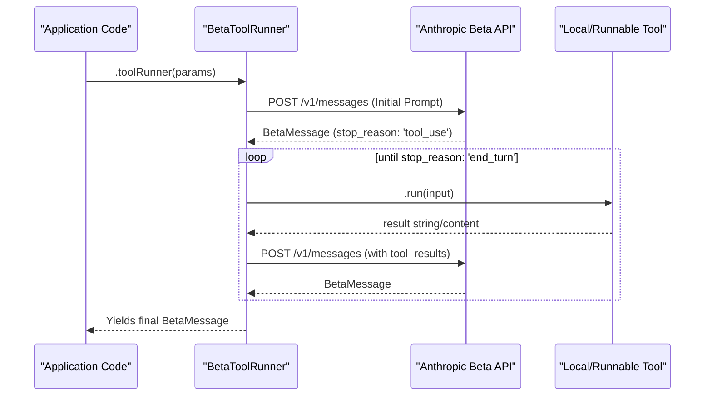
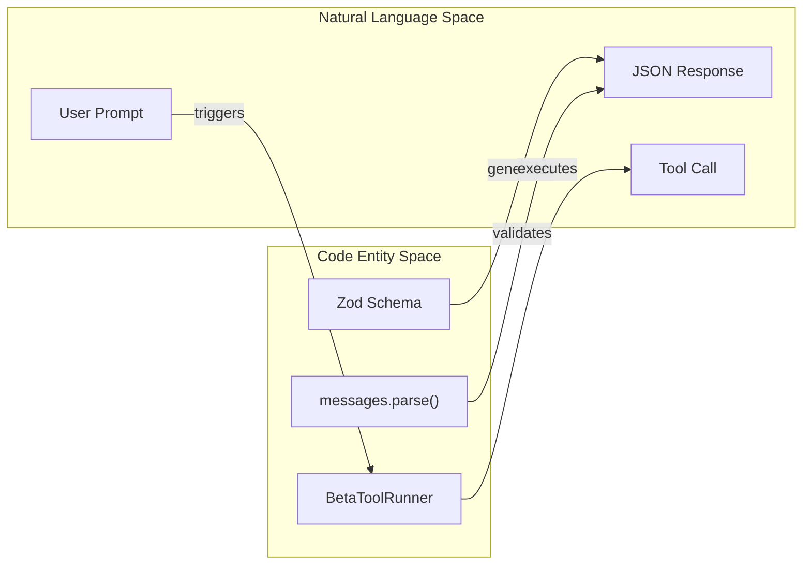

<!-- source: DeepWiki mcp.deepwiki.com · repo anthropics/anthropic-sdk-typescript · page 4.2 Beta Tools & ToolRunner · fetched 2026-10-26 -->

# Beta Tools & ToolRunner

<details>
<summary>Relevant source files</summary>

The following files were used as context for generating this wiki page:

- [examples/autoCompaction.ts](examples/autoCompaction.ts)
- [examples/count-tokens.ts](examples/count-tokens.ts)
- [examples/mcp.ts](examples/mcp.ts)
- [examples/thinking-stream.ts](examples/thinking-stream.ts)
- [examples/thinking.ts](examples/thinking.ts)
- [examples/tools-streaming.ts](examples/tools-streaming.ts)
- [examples/tools.ts](examples/tools.ts)
- [examples/web-search-stream.ts](examples/web-search-stream.ts)
- [examples/web-search.ts](examples/web-search.ts)
- [src/lib/tools/BetaToolRunner.ts](src/lib/tools/BetaToolRunner.ts)
- [src/lib/tools/CompactionControl.ts](src/lib/tools/CompactionControl.ts)
- [src/lib/tools/ToolRunner.ts](src/lib/tools/ToolRunner.ts)
- [tests/lib/tools/ToolRunner.test.ts](tests/lib/tools/ToolRunner.test.ts)
- [tests/lib/tools/ToolRunnerE2E.test.ts](tests/lib/tools/ToolRunnerE2E.test.ts)

</details>


The Beta Tools system in the Anthropic TypeScript SDK provides an automated framework for Claude to interact with external systems. While the core Messages API supports manual tool use, the Beta Tools layer introduces the `BetaToolRunner` for automated multi-turn execution loops, Zod-based schema validation, and deep integration with the Model Context Protocol (MCP).

## Automated Tool Execution Loop

The `BetaToolRunner` class automates the "thought-action-observation" loop. Instead of manually handling `tool_use` blocks and submitting `tool_result` blocks, the runner manages the conversation state and executes local code automatically.



### Key Features
- **Async Iteration**: `BetaToolRunner` is an `AsyncIterable` that yields `BetaMessage` or `BetaMessageStream` objects as they arrive from the API [src/lib/tools/BetaToolRunner.ts:30-35]().
- **Iteration Control**: Use `max_iterations` to prevent infinite loops in autonomous agents [src/lib/tools/BetaToolRunner.ts:181-185]().
- **State Management**: The runner maintains a `messages` array internally, appending assistant responses and tool results automatically [src/lib/tools/BetaToolRunner.ts:61-69]().
- **Dynamic Parameters**: `setMessagesParams()` allows updating model parameters (like `temperature` or `max_tokens`) mid-stream between iterations [src/lib/tools/ToolRunner.ts:164-177]().

**Sources:** [src/lib/tools/BetaToolRunner.ts:30-79](), [src/lib/tools/ToolRunner.ts:145-177]()

---

## Defining Runnable Tools

The SDK provides helpers to bridge the gap between JSON Schema definitions and executable TypeScript functions.

### betaZodTool & betaTool
The `betaZodTool` helper allows you to define tools using **Zod** schemas. This provides automatic JSON Schema generation for the API and type-safe arguments for your implementation.

```typescript
const weatherTool = betaZodTool({
  name: 'get_weather',
  description: 'Get the weather',
  inputSchema: z.object({ location: z.string() }),
  run: async ({ location }) => `The weather in ${location} is 72°F`,
});
```

- **`betaZodTool`**: Uses Zod for validation and schema generation [tests/lib/tools/ToolRunnerE2E.test.ts:105-112]().
- **`BetaRunnableTool`**: The underlying interface requiring a `name`, `input_schema`, and a `run()` function [src/lib/tools/BetaRunnableTool.ts:1-10]().
- **`ToolError`**: A specialized error class for tools to report structured failures back to Claude, allowing the model to attempt a fix [src/lib/tools/ToolError.ts:1-10]().

**Sources:** [src/lib/tools/BetaRunnableTool.ts:1-10](), [tests/lib/tools/ToolRunner.test.ts:9-16](), [tests/lib/tools/ToolRunnerE2E.test.ts:105-112]()

---

## Context Management & Compaction

As tool-heavy conversations grow, they can exceed context limits. The SDK includes `compactionControl` to automatically summarize or prune history when a token threshold is reached.

### Compaction Logic
When `compactionControl.enabled` is true, the `BetaToolRunner` monitors usage. If total tokens exceed `contextTokenThreshold`, it triggers a hidden API call to summarize the conversation before continuing the loop [src/lib/tools/BetaToolRunner.ts:81-106]().

| Option | Default | Description |
|--------|---------|-------------|
| `enabled` | `false` | Whether to enable automatic compaction |
| `contextTokenThreshold` | `32000` | Token count that triggers compaction [src/lib/tools/CompactionControl.ts:5-10]() |
| `summaryPrompt` | (Standard) | The prompt used to ask Claude to summarize the history |

**Sources:** [src/lib/tools/BetaToolRunner.ts:81-161](), [src/lib/tools/CompactionControl.ts:1-15]()

---

## MCP Integration Helpers

The Model Context Protocol (MCP) allows Claude to use tools hosted on remote servers. The SDK provides a suite of helpers in `helpers/beta/mcp` to simplify these integrations.

### MCP Tool Mapping
The `mcpTool` and `mcpTools` helpers convert MCP server tool definitions into the format expected by the Anthropic Beta API [examples/mcp.ts:12-24]().

- **`mcpMessage` / `mcpMessages`**: Formats MCP-specific content (like resources or prompts) into standard `BetaMessageParam` objects.
- **`mcpContent`**: Converts MCP content types (text, image, resource) into Anthropic content blocks.
- **`mcpResourceToContent`**: Specifically handles turning an MCP resource (like a file or database row) into a message block.
- **`mcpResourceToFile`**: Helper for the Files API to upload an MCP resource directly.

**Sources:** [examples/mcp.ts:8-37](), [src/resources/beta/beta.ts:369-371]()

---

## Structured Outputs (Beta)

Beyond tool use, the Beta system supports **Structured Outputs**, allowing you to force Claude to respond in a specific JSON format without explicitly calling a tool. This is managed via `betaZodOutputFormat` and the `messages.parse()` utility.

For details, see [Structured Outputs](#4.2.1).



**Sources:** [tests/lib/tools/ToolRunnerE2E.test.ts:105-112](), [src/lib/tools/BetaToolRunner.ts:129-149]()

---

