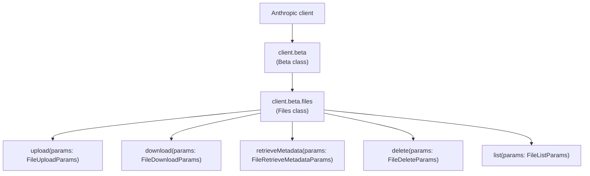
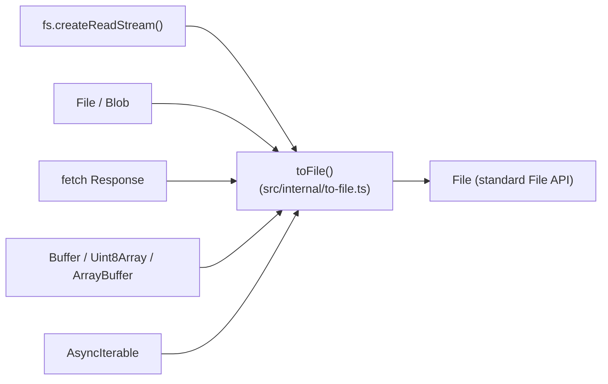
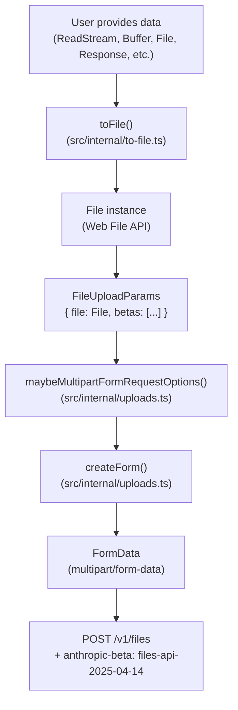
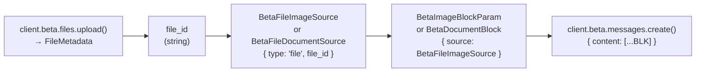

<!-- source: DeepWiki mcp.deepwiki.com · repo anthropics/anthropic-sdk-typescript · page 4.3 Files API · fetched 2026-10-26 -->

# Files API

<details>
<summary>Relevant source files</summary>

The following files were used as context for generating this wiki page:

- [src/internal/to-file.ts](src/internal/to-file.ts)
- [src/internal/uploads.ts](src/internal/uploads.ts)
- [src/internal/utils/uuid.ts](src/internal/utils/uuid.ts)
- [src/uploads.ts](src/uploads.ts)
- [tests/api-resources/beta/files.test.ts](tests/api-resources/beta/files.test.ts)
- [tests/form.test.ts](tests/form.test.ts)
- [tests/uploads.test.ts](tests/uploads.test.ts)

</details>


This page documents the `client.beta.files` resource namespace, which provides persistent file storage for use with the Anthropic API. It covers the five available methods on the `Files` resource, the `toFile()` helper and `Uploadable` type, and how uploaded files are referenced in message content.

For information about how beta features are enabled and how the `betas` header is transmitted, see [Beta Features](#4). For message content blocks (including `BetaFileDocumentSource` and `BetaFileImageSource`), see [Beta Messages API](#4.1).

---

## Overview

The Files API is a beta feature that lets you upload files once and reference them by ID in subsequent API calls, avoiding repeated data transmission. It lives at `client.beta.files` and requires the `'files-api-2025-04-14'` beta flag.

The `Files` resource is registered on the `Beta` class, allowing access via `client.beta.files`.

**Beta flag:** `'files-api-2025-04-14'` — must be included in the `betas` array on requests that interact with files or reference uploaded files in message content.

Sources: [src/resources/beta/beta.ts:4-15](), [src/resources/beta/beta.ts:245](), [tests/api-resources/beta/files.test.ts:11-103]()

---

## Resource Hierarchy

**Files resource location in the client tree:**



Sources: [src/resources/beta/beta.ts:556-566](), [tests/api-resources/beta/files.test.ts:10-104]()

---

## Methods

### Summary

| Method | HTTP | Returns | Description |
|---|---|---|---|
| `upload(params)` | `POST /v1/files` | `FileMetadata` | Upload a new file |
| `download(file_id, params?)` | `GET /v1/files/{file_id}/content` | `Response` | Download file content |
| `retrieveMetadata(file_id, params?)` | `GET /v1/files/{file_id}` | `FileMetadata` | Get metadata for a file |
| `delete(file_id, params?)` | `DELETE /v1/files/{file_id}` | `DeletedFile` | Delete a file |
| `list(params?)` | `GET /v1/files` | `FileMetadataPage` | List all files (paginated) |

Sources: [tests/api-resources/beta/files.test.ts:11-103]()

---

### `upload()`

Uploads a file and returns a `FileMetadata` object containing the assigned `file_id`. The request is automatically converted to `multipart/form-data` if an `Uploadable` value is detected in the body.

**Parameter type:** `FileUploadParams`

The `file` field accepts any `Uploadable` value (see [Uploadable Types](#uploadable-types) below).

**Returns:** `FileMetadata`

Sources: [src/internal/uploads.ts:72-79](), [tests/api-resources/beta/files.test.ts:84-102]()

---

### `download()`

Downloads the raw content of a previously uploaded file.

**Parameter type:** `FileDownloadParams` — requires the `file_id`.

**Returns:** The raw HTTP `Response` object, allowing the caller to stream or buffer the bytes as needed.

Sources: [tests/api-resources/beta/files.test.ts:55-60]()

---

### `retrieveMetadata()`

Retrieves the `FileMetadata` object for a given `file_id` without downloading content.

**Parameter type:** `FileRetrieveMetadataParams`

**Returns:** `FileMetadata`

Sources: [tests/api-resources/beta/files.test.ts:62-82]()

---

### `delete()`

Deletes a file by `file_id`.

**Parameter type:** `FileDeleteParams`

**Returns:** `DeletedFile`

Sources: [tests/api-resources/beta/files.test.ts:37-53]()

---

### `list()`

Returns a paginated list of all uploaded files.

**Parameter type:** `FileListParams` (optional) supporting `limit`, `after_id`, and `before_id`.

**Returns:** `FileMetadataPage` — a `Page<FileMetadata>` that supports auto-pagination.

Sources: [tests/api-resources/beta/files.test.ts:11-35]()

---

## `toFile()` Helper and Uploadable Types

### `Uploadable`

The `Uploadable` type is defined in `src/internal/uploads.ts`. It represents types that can be sent in a multipart form.

```typescript
export type Uploadable = File | Response | FsReadStream | BunFile;
```

Sources: [src/internal/uploads.ts:37]()

### `toFile()`

The `toFile()` utility is the primary way to prepare data for upload. It handles normalization of various input types into a standard `File` object. It ensures that environments like Node.js (pre-v20) have a `File` implementation available via `checkFileSupport()`.

**Signature:**

```typescript
export async function toFile(
  value: ToFileInput | PromiseLike<ToFileInput>,
  name?: string | null | undefined,
  options?: FilePropertyBag | undefined,
): Promise<File>
```

**`ToFileInput` union:**

```typescript
export type ToFileInput =
  | FileLike
  | ResponseLike
  | Exclude<BlobLikePart, string>
  | AsyncIterable<BlobLikePart>;
```

**Input-to-output mapping:**



**Name resolution order** (if `name` is not explicitly provided):
1. `getName(value)`: checks `.name`, `.url`, `.filename`, or `.path`.
2. Fallback to `'unknown_file'`.

Sources: [src/internal/to-file.ts:68-125](), [src/internal/uploads.ts:14-26](), [src/internal/uploads.ts:43-63](), [tests/uploads.test.ts:17-102]()

---

## Upload Flow

The SDK uses `maybeMultipartFormRequestOptions` to intercept requests containing `Uploadable` values and transform them into `FormData`.



Sources: [src/internal/uploads.ts:72-79](), [src/internal/uploads.ts:123-138](), [src/internal/to-file.ts:83-125]()

---

## Referencing Uploaded Files in Messages

Once a file is uploaded, the resulting `file_id` is used within message content blocks.

| Type | Use Case |
|---|---|
| `BetaFileImageSource` | Reference an uploaded image file by ID |
| `BetaFileDocumentSource` | Reference an uploaded document (e.g. PDF) by ID |

**Flow from file upload to message reference:**



Sources: [tests/api-resources/beta/files.test.ts:84-102]()

---

## Pagination

`list()` returns a `FileMetadataPage`. The SDK's core pagination logic allows iterating over these files using `for await ... of`.

```typescript
for await (const file of client.beta.files.list()) {
  console.log(file.id, file.name);
}
```

Sources: [tests/api-resources/beta/files.test.ts:11-20]()

---

## Enabling the Beta Flag

The Files API requires `'files-api-2025-04-14'` in the `betas` array. This is passed via the `betas` parameter in method calls or globally in the client configuration.

```typescript
const response = await client.beta.files.upload({
  file: await toFile(Buffer.from('data'), 'test.txt'),
  betas: ['files-api-2025-04-14'],
});
```

Sources: [tests/api-resources/beta/files.test.ts:97-102]()

---

