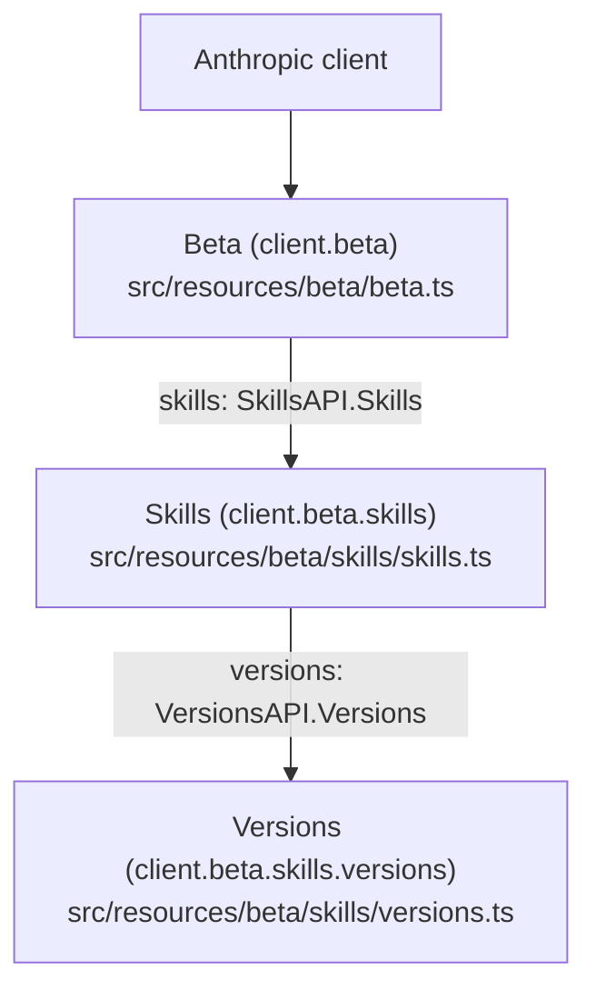
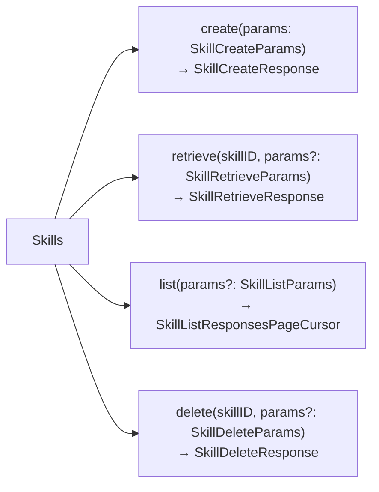
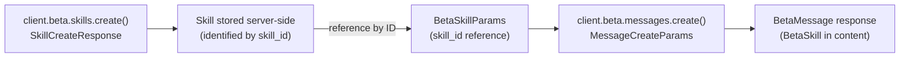
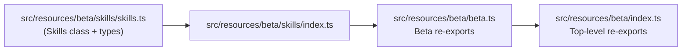
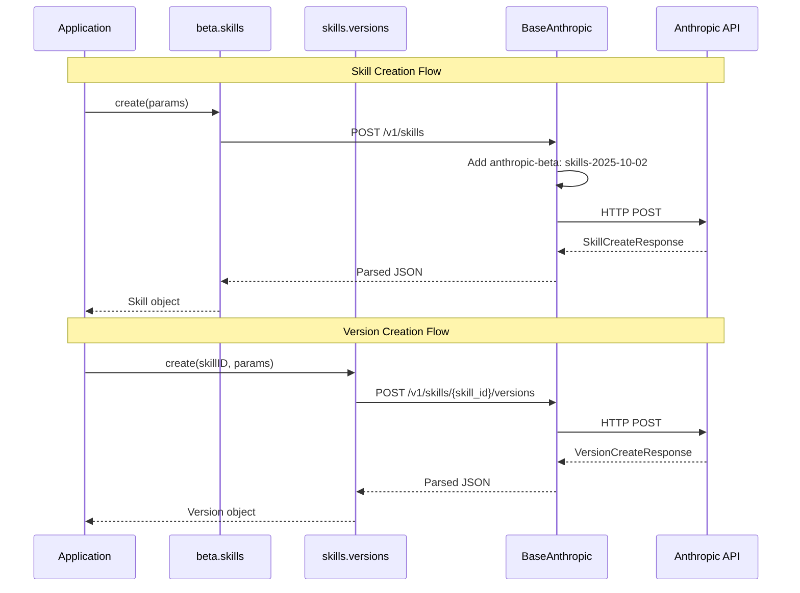

<!-- source: DeepWiki mcp.deepwiki.com · repo anthropics/anthropic-sdk-typescript · page 4.4 Skills API · fetched 2026-10-26 -->

# Skills API

Relevant source files

The following files were used as context for generating this wiki page:

- [src/resources/beta/beta.ts](src/resources/beta/beta.ts)
- [src/resources/beta/index.ts](src/resources/beta/index.ts)
- [src/resources/beta/messages/index.ts](src/resources/beta/messages/index.ts)
- [tests/api-resources/beta/skills/skills.test.ts](tests/api-resources/beta/skills/skills.test.ts)
- [tests/api-resources/beta/skills/versions.test.ts](tests/api-resources/beta/skills/versions.test.ts)

## Purpose and Scope

The Skills API is a beta resource for creating and managing reusable skill definitions. Skills are stored server-side and can be referenced in beta message requests. This resource is gated behind the `skills-2025-10-02` beta feature flag.

This page documents `client.beta.skills` — the CRUD surface for skill definitions — and its `Versions` sub-resource. For information about using skills within conversations via `BetaSkillParams`, see [Beta Messages API](./4.1). For file upload/download functionality, see [Files API](./4.3).

Sources: [src/resources/beta/beta.ts:227-241](), [src/resources/beta/index.ts:241-251]()

---

## Architecture Overview

The `Skills` class is instantiated as `skills` on the `Beta` resource. It exposes four primary operations and hosts the `Versions` sub-resource.

**Resource class hierarchy**

**Skills operations and their types**

Sources: [src/resources/beta/beta.ts:227-241](), [src/resources/beta/index.ts:241-251]()

---

## Beta Feature Flag

The Skills API requires the `skills-2025-10-02` beta feature flag. This string is part of the `AnthropicBeta` union type.

| Flag string | Union type |
|---|---|
| `skills-2025-10-02` | `AnthropicBeta` |

The flag is passed in the `anthropic-beta` request header. When using `client.beta.skills`, the resource handles this automatically.

Sources: [src/resources/beta/beta.ts:5-17]()

---

## Skill Management Operations

The methods on `client.beta.skills` correspond to the REST endpoints for the skills resource.

| Method | HTTP | Path | Params type | Return type |
|---|---|---|---|---|
| `create(params)` | POST | `/v1/skills` | `SkillCreateParams` | `SkillCreateResponse` |
| `retrieve(skillID, params?)` | GET | `/v1/skills/{skill_id}` | `SkillRetrieveParams` | `SkillRetrieveResponse` |
| `list(params?)` | GET | `/v1/skills` | `SkillListParams` | `SkillListResponsesPageCursor` |
| `delete(skillID, params?)` | DELETE | `/v1/skills/{skill_id}` | `SkillDeleteParams` | `SkillDeleteResponse` |

### Creating Skills
`create(params: SkillCreateParams)` sends a POST to `/v1/skills`. It accepts optional `display_title`, `files`, and `betas` parameters.

### Retrieving Skills
`retrieve(skillID, params?)` sends a GET to `/v1/skills/{skill_id}`. It returns the full `SkillRetrieveResponse` metadata.

### Listing Skills
`list(params?)` returns `SkillListResponsesPageCursor`, a cursor-paginated wrapper. It supports filtering by `source` and `limit`.

### Deleting Skills
`delete(skillID, params?)` sends a DELETE to `/v1/skills/{skill_id}`.

Sources: [src/resources/beta/beta.ts:228-241](), [tests/api-resources/beta/skills/skills.test.ts:11-97]()

---

## Versions Sub-resource

The `Versions` sub-resource allows managing specific versions of a skill. It is accessed via `client.beta.skills.versions`.

| Method | HTTP | Path | Params type |
|---|---|---|---|
| `create(skillID, params)` | POST | `/v1/skills/{skill_id}/versions` | `VersionCreateParams` |
| `retrieve(version, params)` | GET | `/v1/skills/{skill_id}/versions/{version}` | `VersionRetrieveParams` |
| `list(skillID, params?)` | GET | `/v1/skills/{skill_id}/versions` | `VersionListParams` |
| `delete(version, params)` | DELETE | `/v1/skills/{skill_id}/versions/{version}` | `VersionDeleteParams` |

Sources: [tests/api-resources/beta/skills/versions.test.ts:10-94]()

---

## Integration with Messages

Skills are bridged to the Messages API through the following types:

- **`BetaSkill`**: The skill object returned by the Skills API.
- **`BetaSkillParams`**: Parameters used to reference a skill by its `skill_id` when constructing a message.

**Data Flow: Creation to Execution**

Sources: [src/resources/beta/beta.ts:145-146](), [src/resources/beta/messages/messages.ts:136-137]()

---

## Type System

All types for the Skills resource are re-exported through the beta namespace.

**Key Types**

| Type | Role |
|---|---|
| `SkillCreateParams` | Input for `create()`, includes `files` array |
| `SkillCreateResponse` | Response from `create()`, includes `id` |
| `SkillListResponsesPageCursor` | Paginated wrapper returned by `list()` |
| `SkillDeleteResponse` | Confirmation of deletion |

**Export Chain**

Sources: [src/resources/beta/beta.ts:227-241](), [src/resources/beta/index.ts:241-251]()

---

## API Request Flow

The Skills API follows the standard SDK request pipeline, injecting the required beta headers.

Sources: [tests/api-resources/beta/skills/skills.test.ts:11-34](), [tests/api-resources/beta/skills/versions.test.ts:11-31]()

---

