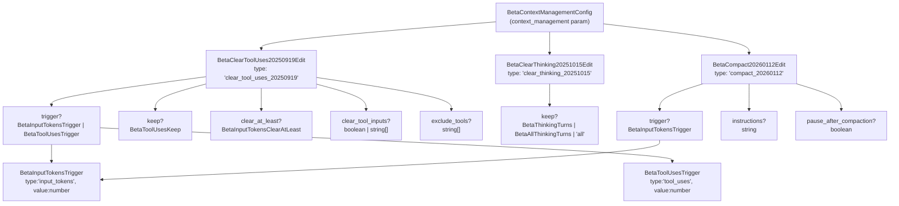
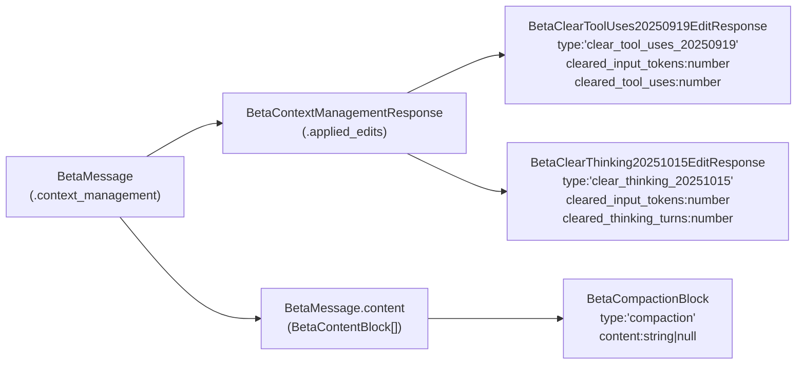
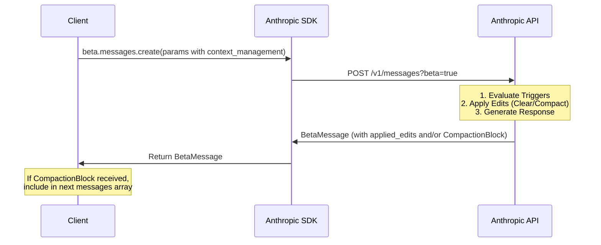

<!-- source: DeepWiki mcp.deepwiki.com · repo anthropics/anthropic-sdk-typescript · page 4.5 Context Management · fetched 2026-10-26 -->

# Context Management

<details>
<summary>Relevant source files</summary>

The following files were used as context for generating this wiki page:

- [examples/autoCompaction.ts](examples/autoCompaction.ts)
- [src/lib/tools/CompactionControl.ts](src/lib/tools/CompactionControl.ts)
- [src/resources/beta/messages/messages.ts](src/resources/beta/messages/messages.ts)
- [src/resources/messages/messages.ts](src/resources/messages/messages.ts)

</details>


Context management is a beta feature (flag: `context-management-2025-06-27`) that automatically manages conversation context by applying one or more "edits" to the conversation history. This allows developers to maintain long-running conversations without manually truncating history or exceeding model context limits.

| Edit Type | Type String | Purpose |
|-----------|-------------|---------|
| `BetaClearToolUses20250919Edit` | `'clear_tool_uses_20250919'` | Remove older tool use blocks when a trigger threshold is reached |
| `BetaClearThinking20251015Edit` | `'clear_thinking_20251015'` | Remove thinking blocks from older assistant turns |
| `BetaCompact20260112Edit` | `'compact_20260112'` | Summarize older context into a compaction block |

For information about tool usage and execution, see page 4.2. For general beta feature configuration, see page 4.

## Overview

Context management is configured via the `context_management` parameter in `client.beta.messages.create()` and `client.beta.messages.countTokens()`. Multiple edits can be listed; each carries its own trigger condition and behavior. When triggered, the API applies the edits server-side before generation and reports what was changed in the response's `context_management` field.

Sources: [src/resources/beta/messages/messages.ts:1038-1057](), [src/resources/beta/messages/messages.ts:134-144]()

## Configuration Structure

`BetaContextManagementConfig` holds an optional `edits` array. Each element is one of three edit types, identified by its `type` field.

**`BetaContextManagementConfig` interface** — [src/resources/beta/messages/messages.ts:1038-1043]()

```typescript
{
  edits?: Array<
    BetaClearToolUses20250919Edit |
    BetaClearThinking20251015Edit |
    BetaCompact20260112Edit
  >
}
```

The following diagram maps the edit types to their fields and shared trigger/keep helper types:

**Edit Type Relationships**



Sources: [src/resources/beta/messages/messages.ts:561-569](), [src/resources/beta/messages/messages.ts:588-616](), [src/resources/beta/messages/messages.ts:827-844](), [src/resources/beta/messages/messages.ts:1038-1043](), [src/resources/beta/messages/messages.ts:1141-1151]()

## Edit Types

### BetaClearToolUses20250919Edit

Removes older tool use blocks from the conversation history when a trigger threshold is reached. This is useful for clearing large tool outputs (like search results or file contents) that are no longer needed for the current turn.

**Interface:** [src/resources/beta/messages/messages.ts:588-616]()

| Parameter | Type | Description |
|-----------|------|-------------|
| `type` | `'clear_tool_uses_20250919'` | Identifies the edit type |
| `trigger` | `BetaInputTokensTrigger \| BetaToolUsesTrigger` | Condition that activates the edit |
| `keep` | `BetaToolUsesKeep` | Number of most-recent tool uses to retain |
| `clear_at_least` | `BetaInputTokensClearAtLeast \| null` | Minimum tokens that must be clearable for the edit to apply |
| `clear_tool_inputs` | `boolean \| string[] \| null` | `true` clears all inputs; an array clears inputs for the named tools only |
| `exclude_tools` | `string[] \| null` | Tool names whose uses are never cleared |

**Trigger types** — [src/resources/beta/messages/messages.ts:1141-1151]()

- `BetaInputTokensTrigger` — fires when input tokens ≥ `value`
- `BetaToolUsesTrigger` — fires when total tool uses ≥ `value`

### BetaClearThinking20251015Edit

Removes thinking blocks from older assistant turns. This reduces token usage from extended "chain-of-thought" reasoning without discarding the final text responses that the user actually sees.

**Interface:** [src/resources/beta/messages/messages.ts:561-569]()

| Parameter | Type | Description |
|-----------|------|-------------|
| `type` | `'clear_thinking_20251015'` | Identifies the edit type |
| `keep` | `BetaThinkingTurns \| BetaAllThinkingTurns \| 'all'` | Number of most-recent assistant turns whose thinking blocks are retained |

### BetaCompact20260112Edit

Summarizes older context into a `BetaCompactionBlock`, replacing the summarized turns. This is the most aggressive form of context management. The model generates the summary during the compaction step based on the provided instructions.

**Interface:** [src/resources/beta/messages/messages.ts:827-844]()

| Parameter | Type | Description |
|-----------|------|-------------|
| `type` | `'compact_20260112'` | Identifies the edit type |
| `trigger` | `BetaInputTokensTrigger \| null` | Token threshold that triggers compaction (default: 150,000) |
| `instructions` | `string \| null` | Additional instructions for the summarization model |
| `pause_after_compaction` | `boolean` | If `true`, the API pauses and returns the `BetaCompactionBlock` before generating a response |

#### Compaction Content Blocks

When compaction runs, it produces a `BetaCompactionBlock` in the response content.

**`BetaCompactionBlock`** — [src/resources/beta/messages/messages.ts:853-860]()

```typescript
{
  type: 'compaction';
  content: string | null;   // The generated summary text
}
```

Callers must round-trip this block back to the API in subsequent requests (as `BetaCompactionBlockParam`) to maintain context across compaction boundaries.

**`BetaCompactionBlockParam`** — [src/resources/beta/messages/messages.ts:871-883]()

```typescript
{
  type: 'compaction';
  content: string | null;
  cache_control?: BetaCacheControlEphemeral | null;
}
```

Sources: [src/resources/beta/messages/messages.ts:853-924](), [src/lib/tools/CompactionControl.ts:29-52]()

## Response Information

When edits are applied, `BetaMessage.context_management` contains a `BetaContextManagementResponse` describing each applied edit. 

**Response Structure Diagram**



### Applied Edit Response Fields

**`BetaClearToolUses20250919EditResponse`** — [src/resources/beta/messages/messages.ts:618-633]()

| Field | Type | Description |
|-------|------|-------------|
| `type` | `'clear_tool_uses_20250919'` | Identifies which edit was applied |
| `cleared_input_tokens` | `number` | Total input tokens removed by this edit |
| `cleared_tool_uses` | `number` | Total tool use blocks removed |

**`BetaClearThinking20251015EditResponse`** — [src/resources/beta/messages/messages.ts:571-586]()

| Field | Type | Description |
|-------|------|-------------|
| `type` | `'clear_thinking_20251015'` | Identifies which edit was applied |
| `cleared_input_tokens` | `number` | Total input tokens removed by this edit |
| `cleared_thinking_turns` | `number` | Assistant turns whose thinking was cleared |

Sources: [src/resources/beta/messages/messages.ts:571-586](), [src/resources/beta/messages/messages.ts:618-633](), [src/resources/beta/messages/messages.ts:1045-1050]()

## Integration with Token Counting

`client.beta.messages.countTokens()` accepts the same `context_management` parameter. This allows developers to predict how much context will be removed before actually sending a generation request.

**`BetaMessageTokensCount`** — [src/resources/beta/messages/messages.ts:208-224]()

When context management is active, the response includes both the post-edit count and the original count:

| Field | Description |
|-------|-------------|
| `input_tokens` | Token count after context management edits have been applied |
| `context_management.original_input_tokens` | Token count before any edits were applied |

Sources: [src/resources/beta/messages/messages.ts:208-224](), [src/resources/beta/messages/messages.ts:1052-1057]()

## Automatic Compaction in ToolRunner

The `BetaToolRunner` helper class provides an abstraction for automatic compaction through the `compactionControl` option. This simplifies the manual handling of `BetaCompactionBlock`.

**`CompactionControl` Interface** — [src/lib/tools/CompactionControl.ts:29-52]()

```typescript
const runner = client.beta.messages.toolRunner({
  model: 'claude-3-5-sonnet-20241022',
  messages: [...],
  tools: [...],
  compactionControl: {
    enabled: true,
    contextTokenThreshold: 3000, // Trigger compaction early for testing
    summaryPrompt: "Custom summary instructions..."
  },
});
```

When `compactionControl.enabled` is `true`, the `BetaToolRunner` will:
1. Monitor the cumulative token count.
2. Automatically inject `BetaCompact20260112Edit` into the request when the threshold is reached.
3. Update its internal `messages` state with the resulting `BetaCompactionBlock`.

Sources: [examples/autoCompaction.ts:47-63](), [src/lib/tools/CompactionControl.ts:29-52]()

## Data Flow Diagram

The following diagram shows how context management edits interact with the request/response lifecycle.



Sources: [src/resources/beta/messages/messages.ts:98-145](), [examples/autoCompaction.ts:65-102]()

## Best Practices

1. **Set Appropriate Triggers**: Choose trigger thresholds based on your application's token budget. A common threshold for `compact_20260112` is 100,000 to 150,000 tokens.
2. **Preserve Critical Tools**: Use `exclude_tools` in `clear_tool_uses_20250919` to prevent clearing tools that maintain long-term state, such as memory or configuration tools.
3. **Use Minimum Clear Threshold**: Set `clear_at_least` to avoid "flapping" where the API applies an edit only to remove a handful of tokens, which may not be cost-effective.
4. **Handle Compaction Blocks**: Ensure your application logic correctly persists and returns `BetaCompactionBlock` content. If using `BetaToolRunner`, this is handled automatically.
5. **Monitor Token Savings**: Use the `context_management` response fields to log how many tokens are being saved by your management policies.

Sources: [src/resources/beta/messages/messages.ts:588-616](), [src/lib/tools/CompactionControl.ts:3-27]()

---

