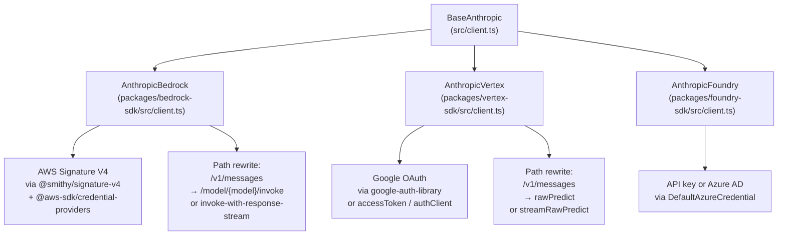
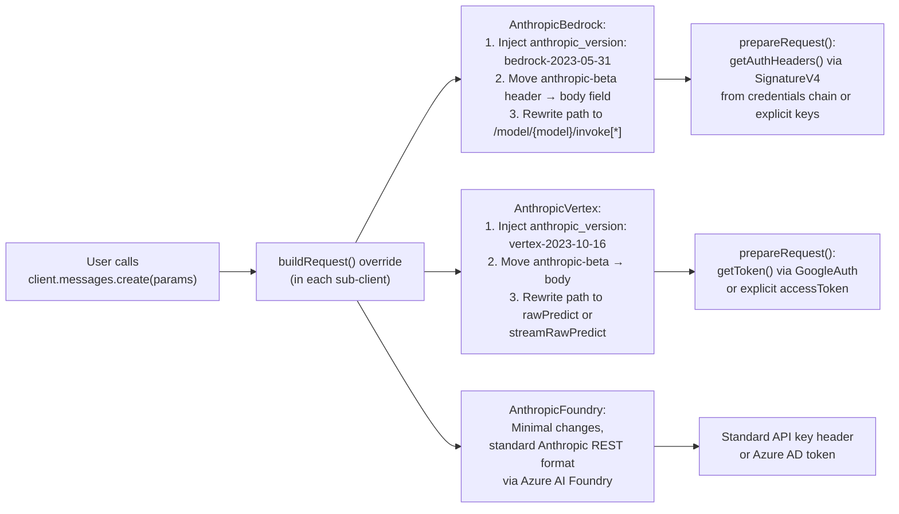

<!-- source: DeepWiki mcp.deepwiki.com · repo anthropics/anthropic-sdk-typescript · page 5 Cloud Provider SDKs · fetched 2026-10-26 -->

# Cloud Provider SDKs

<details>
<summary>Relevant source files</summary>

The following files were used as context for generating this wiki page:

- [packages/bedrock-sdk/CHANGELOG.md](packages/bedrock-sdk/CHANGELOG.md)
- [packages/bedrock-sdk/package.json](packages/bedrock-sdk/package.json)
- [packages/foundry-sdk/CHANGELOG.md](packages/foundry-sdk/CHANGELOG.md)
- [packages/foundry-sdk/package.json](packages/foundry-sdk/package.json)
- [packages/vertex-sdk/CHANGELOG.md](packages/vertex-sdk/CHANGELOG.md)
- [packages/vertex-sdk/package.json](packages/vertex-sdk/package.json)

</details>


This page explains that Claude models are available through multiple hosting platforms beyond `api.anthropic.com`, and that dedicated npm packages handle the platform-specific authentication and request transformation for each. It covers the high-level purpose, package coordinates, architecture, and key differences between the three cloud provider integrations.

For detailed documentation on each provider, see:
- [Vertex AI SDK](#5.1) — `AnthropicVertex` client configuration, Google OAuth, and path rewriting
- [Bedrock SDK](#5.2) — `AnthropicBedrock` client configuration, AWS Signature V4, and path rewriting
- [Foundry SDK](#5.3) — `@anthropic-ai/foundry-sdk` for the Anthropic Foundry API

---

## Overview

The monorepo ships four independently versioned npm packages. Three of them target cloud provider platforms that host Claude models:

| Package | NPM name | Location | Target platform | Current version |
|---|---|---|---|---|
| Main SDK | `@anthropic-ai/sdk` | `src/` | `api.anthropic.com` | 0.36.3 |
| Bedrock SDK | `@anthropic-ai/bedrock-sdk` | `packages/bedrock-sdk/` | AWS Bedrock | 0.26.4 |
| Vertex SDK | `@anthropic-ai/vertex-sdk` | `packages/vertex-sdk/` | Google Vertex AI | 0.14.4 |
| Foundry SDK | `@anthropic-ai/foundry-sdk` | `packages/foundry-sdk/` | Anthropic Foundry | 0.2.3 |

Both the Bedrock and Vertex packages list `@anthropic-ai/sdk` as a direct dependency via a local path reference (`file:../../dist/`), as seen in [packages/bedrock-sdk/package.json:28]() and [packages/vertex-sdk/package.json:28](). This means they build on top of the core SDK logic rather than duplicating it.

Sources: [packages/bedrock-sdk/package.json:1-39](), [packages/vertex-sdk/package.json:1-30](), [packages/foundry-sdk/package.json:1-29]()

---

## Architecture

All three cloud provider clients extend the core `BaseAnthropic` class. They override internal methods to rewrite request paths and inject platform-specific fields, and handle cloud-native authentication (e.g., AWS Signature V4 or Google OAuth).

**Diagram: Cloud Provider Client Inheritance**



Sources: [packages/bedrock-sdk/package.json:27-39](), [packages/vertex-sdk/package.json:27-30](), [packages/foundry-sdk/package.json:27-29]()

---

## How Each Package Transforms Requests

The cloud provider SDKs intercept the standard request pipeline to ensure compatibility with provider-specific API schemas and security requirements.

**Diagram: Per-Provider Request Transformation**



Sources: [packages/bedrock-sdk/package.json:27-39](), [packages/vertex-sdk/package.json:27-30](), [packages/foundry-sdk/package.json:27-29]()

---

## External Dependencies

Each cloud provider package pulls in platform-specific authentication and runtime libraries.

| Package | Key external dependencies |
|---|---|
| `@anthropic-ai/bedrock-sdk` | `@aws-sdk/client-bedrock-runtime`, `@aws-sdk/credential-providers`, `@smithy/signature-v4`, `@smithy/protocol-http` |
| `@anthropic-ai/vertex-sdk` | `google-auth-library` |
| `@anthropic-ai/foundry-sdk` | `@anthropic-ai/sdk` (core SDK only) |

Sources: [packages/bedrock-sdk/package.json:27-39](), [packages/vertex-sdk/package.json:27-30](), [packages/foundry-sdk/package.json:27-29]()

---

## Feature Availability by Provider

Not all features of the main SDK are available through every cloud provider due to platform-specific API constraints.

| Feature | `@anthropic-ai/sdk` | `@anthropic-ai/bedrock-sdk` | `@anthropic-ai/vertex-sdk` |
|---|---|---|---|
| `messages.create()` | ✅ | ✅ | ✅ |
| `messages.stream()` | ✅ | ✅ | ✅ |
| `beta.messages.create()` | ✅ | ✅ | ✅ |
| `messages.countTokens()` | ✅ | ❌ (removed) | ✅ (via beta) |
| `messages.batches.*` | ✅ | ❌ (removed) | ❌ |
| `models.*` | ✅ | ❌ | ❌ |
| `beta.files.*` | ✅ | ❌ | ❌ |
| `completions.create()` (legacy) | ✅ | ✅ | ✅ |

Removal of unsupported methods from Bedrock and Vertex is documented in their respective changelogs. For example, `countTokens` was explicitly removed from Bedrock in [packages/bedrock-sdk/CHANGELOG.md:142]().

Sources: [packages/bedrock-sdk/CHANGELOG.md:46-161](), [packages/vertex-sdk/CHANGELOG.md:36-144]()

---

## Installation

Each package is installed independently. They do not re-export types from `@anthropic-ai/sdk`; if you need shared types (e.g., `Anthropic.Message`), import directly from `@anthropic-ai/sdk`.

```bash
# AWS Bedrock
npm install @anthropic-ai/bedrock-sdk

# Google Vertex AI
npm install @anthropic-ai/vertex-sdk

# Microsoft Azure AI Foundry
npm install @anthropic-ai/foundry-sdk
```

Each package exports a primary client class (`AnthropicBedrock`, `AnthropicVertex`, or `AnthropicFoundry`) that is a drop-in replacement for the main `Anthropic` client for supported operations.

---

## Sub-package Build Outputs

Like the main SDK, cloud provider packages produce CJS and ESM outputs. Their `exports` fields in `package.json` expose both formats:

- `require` → `dist/index.js`
- `import` (ESM) → `dist/index.mjs`
- Type declarations → `dist/index.d.ts` / `dist/index.d.mts`

See [packages/bedrock-sdk/package.json:63-85]() and [packages/vertex-sdk/package.json:52-74]() for the full `exports` maps.

Sources: [packages/bedrock-sdk/package.json:63-85](), [packages/vertex-sdk/package.json:52-74]()

---

