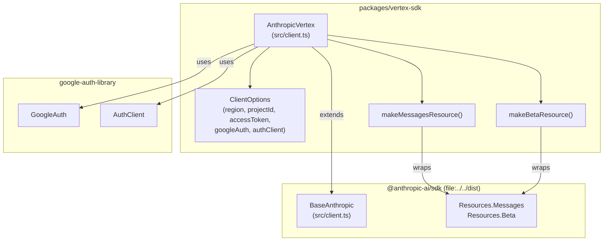
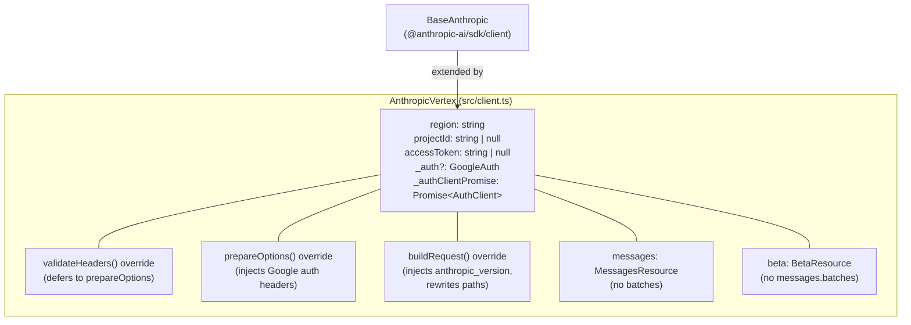
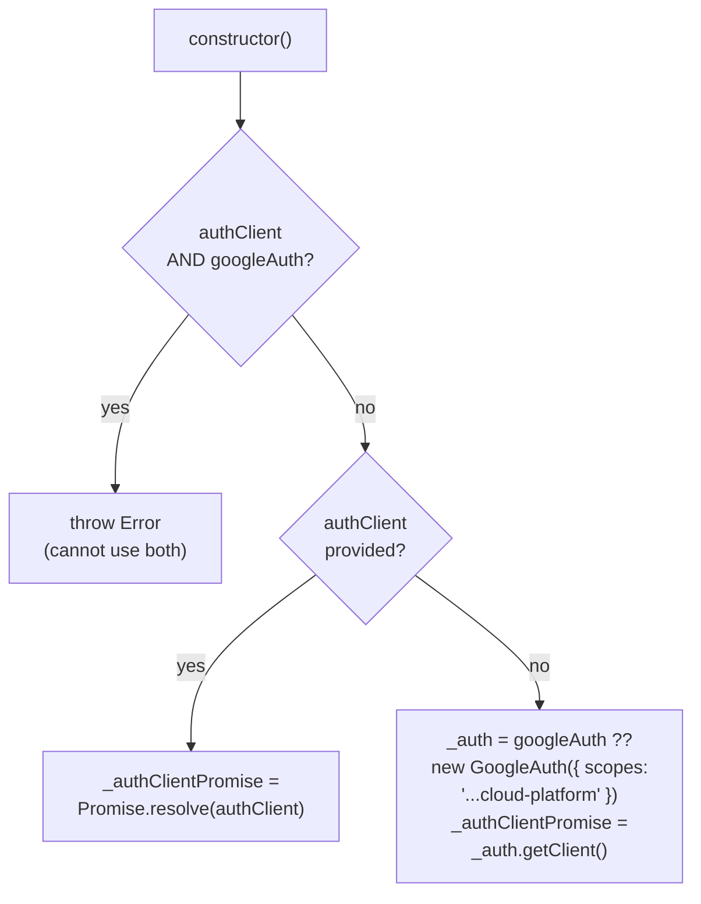
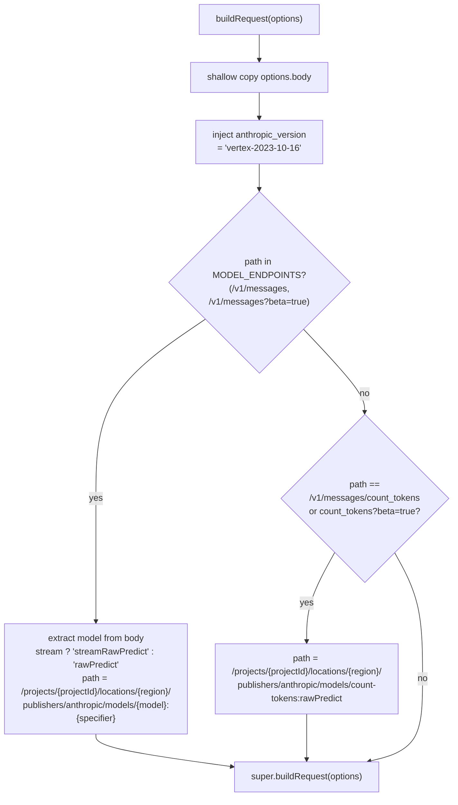
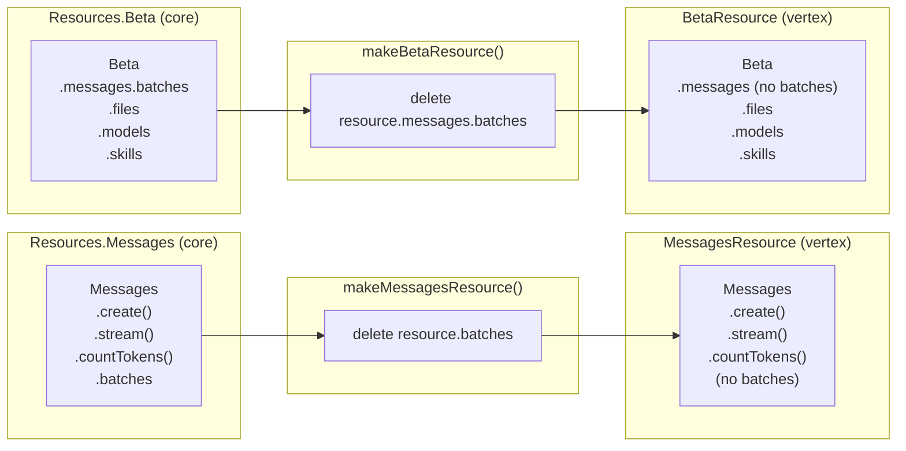

<!-- source: DeepWiki mcp.deepwiki.com · repo anthropics/anthropic-sdk-typescript · page 5.1 Vertex AI SDK · fetched 2026-10-26 -->

# Vertex AI SDK

<details>
<summary>Relevant source files</summary>

The following files were used as context for generating this wiki page:

- [packages/bedrock-sdk/CHANGELOG.md](packages/bedrock-sdk/CHANGELOG.md)
- [packages/bedrock-sdk/package.json](packages/bedrock-sdk/package.json)
- [packages/vertex-sdk/CHANGELOG.md](packages/vertex-sdk/CHANGELOG.md)
- [packages/vertex-sdk/README.md](packages/vertex-sdk/README.md)
- [packages/vertex-sdk/examples/streaming.ts](packages/vertex-sdk/examples/streaming.ts)
- [packages/vertex-sdk/examples/vertex.ts](packages/vertex-sdk/examples/vertex.ts)
- [packages/vertex-sdk/package.json](packages/vertex-sdk/package.json)
- [packages/vertex-sdk/src/client.ts](packages/vertex-sdk/src/client.ts)

</details>


The `@anthropic-ai/vertex-sdk` package provides access to Anthropic's Claude models through Google Cloud's Vertex AI platform. It extends the core `@anthropic-ai/sdk` to handle Google Cloud authentication, request path transformation, and Vertex AI-specific endpoint routing.

For information about the AWS Bedrock integration, see page [5.2](). For details about the core SDK architecture, see page [2]().

## Architecture Overview

The Vertex AI integration is implemented as a separate package that extends the core Anthropic SDK while providing Google Cloud-specific functionality. The integration handles authentication through Google's auth library and transforms requests to match Vertex AI's API structure.

### Package Structure

**Vertex AI SDK package layout:**



Sources: [packages/vertex-sdk/src/client.ts:1-10](), [packages/vertex-sdk/package.json:27-30]()

### Client Class Hierarchy

**Class relationships and overridden methods in `AnthropicVertex`:**



Sources: [packages/vertex-sdk/src/client.ts:52-117]()

## Authentication System

The Vertex SDK supports multiple authentication methods through Google's auth library, providing flexibility for different deployment scenarios.

### Authentication Flow

On each request, `prepareOptions()` is called asynchronously before `buildRequest()`. It awaits `_authClientPromise` to obtain an `AuthClient`, then calls `authClient.getRequestHeaders()` to get the `Authorization` bearer token and any other Google-required headers. If `projectId` has not been set explicitly, it is resolved from `authClient.projectId` or the `x-goog-user-project` response header.

**How `_authClientPromise` is constructed at instantiation:**



Sources: [packages/vertex-sdk/src/client.ts:98-113](), [packages/vertex-sdk/src/client.ts:118-132]()

### Authentication Methods

The SDK supports three authentication approaches:

| Method | How to Use | When to Use |
|---|---|---|
| Default Google auth | Pass no auth options; uses `google-auth-library` ADC | Local dev with `gcloud auth`, GCE, GKE, Cloud Run |
| `googleAuth` option | Pass a `GoogleAuth` instance with custom config | Custom key file, custom scopes |
| `authClient` option | Pass a pre-configured `AuthClient` instance | Service account impersonation, workload identity federation |

`googleAuth` and `authClient` are mutually exclusive; passing both throws an error [packages/vertex-sdk/src/client.ts:102-106]().

Sources: [packages/vertex-sdk/src/client.ts:29-50](), [packages/vertex-sdk/README.md:46-102]()

## Request Transformation

The Vertex SDK transforms requests from the standard Anthropic API format to match Vertex AI's endpoint structure and requirements.

### Request Processing Pipeline

`buildRequest()` in `AnthropicVertex` makes several modifications before delegating to the parent `super.buildRequest()`:

1. Shallow-copies `options.body` to avoid mutating the caller's object [packages/vertex-sdk/src/client.ts:139-143]().
2. Injects `anthropic_version: 'vertex-2023-10-16'` if not already present [packages/vertex-sdk/src/client.ts:146-149]().
3. Rewrites the request path based on the endpoint being called [packages/vertex-sdk/src/client.ts:151-183]().

**Path rewriting logic in `buildRequest()`:**



The `model` field is extracted from the request body and embedded in the path; the body's `model` field is set to `undefined` before the request is sent [packages/vertex-sdk/src/client.ts:162-164]().

Sources: [packages/vertex-sdk/src/client.ts:134-186](), [packages/vertex-sdk/src/client.ts:12-13]()

### Endpoint Transformation Summary

| Standard Anthropic Path | Vertex AI Path |
|---|---|
| `POST /v1/messages` (non-streaming) | `/projects/{projectId}/locations/{region}/publishers/anthropic/models/{model}:rawPredict` |
| `POST /v1/messages` (streaming) | `/projects/{projectId}/locations/{region}/publishers/anthropic/models/{model}:streamRawPredict` |
| `POST /v1/messages/count_tokens` | `/projects/{projectId}/locations/{region}/publishers/anthropic/models/count-tokens:rawPredict` |

Sources: [packages/vertex-sdk/src/client.ts:147-183]()

## Feature Differences

The Vertex SDK provides a subset of the full Anthropic API functionality, with some features omitted due to Vertex AI platform limitations.

### Supported and Unsupported Features

| Feature | Main SDK | Vertex SDK | Notes |
|---------|----------|------------|-------|
| Messages API | ✓ | ✓ | Core functionality |
| Streaming | ✓ | ✓ | Full streaming support |
| Token Counting | ✓ | ✓ | Available via `countTokens` |
| Message Batches | ✓ | ✗ | Not supported on Vertex AI |
| Models API | ✓ | ✓ | Inherited from core |
| Beta Features | ✓ | ✓ | Limited subset (no batches) |

Sources: [packages/vertex-sdk/src/client.ts:186-217]()

### Resource Limitations

`AnthropicVertex` exposes `messages` and `beta` resources constructed by `makeMessagesResource()` and `makeBetaResource()`. Both factory functions create a standard resource instance and then delete the `batches` property, since the Vertex AI platform does not support the Batch API.

**How resources are modified:**



Sources: [packages/vertex-sdk/src/client.ts:189-217]()

## Configuration Options

`ClientOptions` in the Vertex SDK is defined as `CoreClientOptions` with `apiKey` and `authToken` omitted, plus additional Vertex-specific fields.

### Vertex-specific ClientOptions

| Option | Type | Default / Env Var | Description |
|---|---|---|---|
| `region` | `string \| null` | `CLOUD_ML_REGION` | GCP region (e.g. `us-central1`). Use `'global'` for global endpoint. **Required.** |
| `projectId` | `string \| null` | `ANTHROPIC_VERTEX_PROJECT_ID` | GCP project ID. Can also be resolved from auth credentials. |
| `accessToken` | `string \| null` | — | Static access token. Rarely needed; prefer `googleAuth` or ADC. |
| `googleAuth` | `GoogleAuth \| null` | — | Custom `GoogleAuth` instance from `google-auth-library`. |
| `authClient` | `AuthClient \| null` | — | Pre-configured `AuthClient`. Mutually exclusive with `googleAuth`. |
| `baseURL` | `string` | `ANTHROPIC_VERTEX_BASE_URL` or derived from `region` | Overrides the computed base URL. |

Sources: [packages/vertex-sdk/src/client.ts:15-50](), [packages/vertex-sdk/src/client.ts:77-113]()

### Base URL Derivation

If `baseURL` is not explicitly provided, it is constructed from the `region`:

| `region` value | Base URL |
|---|---|
| `'global'` | `https://aiplatform.googleapis.com/v1` |
| Any other value | `https://{region}-aiplatform.googleapis.com/v1` |

Sources: [packages/vertex-sdk/src/client.ts:90-94]()

## Usage Examples

### Basic Usage (Environment Variables)

If `CLOUD_ML_REGION` and `ANTHROPIC_VERTEX_PROJECT_ID` are set, the client can be instantiated with no arguments and uses Application Default Credentials automatically:

```typescript
import { AnthropicVertex } from '@anthropic-ai/vertex-sdk';

const client = new AnthropicVertex();

async function main() {
  const result = await client.messages.create({
    messages: [{ role: 'user', content: 'Hello!' }],
    model: 'claude-3-7-sonnet@20250219',
    max_tokens: 300,
  });
  console.log(result);
}
```
Sources: [packages/vertex-sdk/examples/vertex.ts:1-27]()

### Streaming

The `messages.stream()` helper works similarly to the main SDK:

```typescript
import { AnthropicVertex } from '@anthropic-ai/vertex-sdk';

const client = new AnthropicVertex();

async function main() {
  const stream = client.messages.stream({
    messages: [{ role: 'user', content: 'Hello!' }],
    model: 'claude-3-7-sonnet@20250219',
    max_tokens: 300,
  });
  for await (const event of stream) {
    console.log('event', event);
  }
}
```
Sources: [packages/vertex-sdk/examples/streaming.ts:1-29]()

### Custom GoogleAuth and Impersonation

The SDK allows passing a custom `GoogleAuth` configuration or a pre-configured `AuthClient` for advanced scenarios like impersonation:

```typescript
import { AnthropicVertex } from '@anthropic-ai/vertex-sdk';
import { GoogleAuth, Impersonated } from 'google-auth-library';

// Impersonation example
const authClient = new Impersonated({
  sourceClient: await new GoogleAuth().getClient(),
  targetPrincipal: 'impersonated-account@projectID.iam.gserviceaccount.com',
  targetScopes: ['https://www.googleapis.com/auth/cloud-platform']
});

const client = new AnthropicVertex({
  authClient,
  region: 'us-central1'
});
```
Sources: [packages/vertex-sdk/README.md:82-102](), [packages/vertex-sdk/src/client.ts:31-49]()

## Version and Compatibility

- **Default Version**: `vertex-2023-10-16` [packages/vertex-sdk/src/client.ts:12]().
- **Dependency**: Uses `@anthropic-ai/sdk` as a core dependency [packages/vertex-sdk/package.json:28]().
- **Google Auth**: Built on `google-auth-library` [packages/vertex-sdk/package.json:29]().

---

