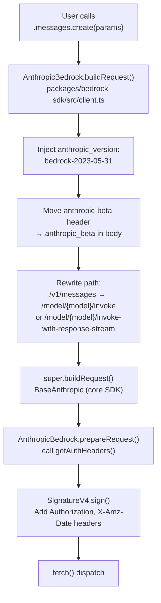
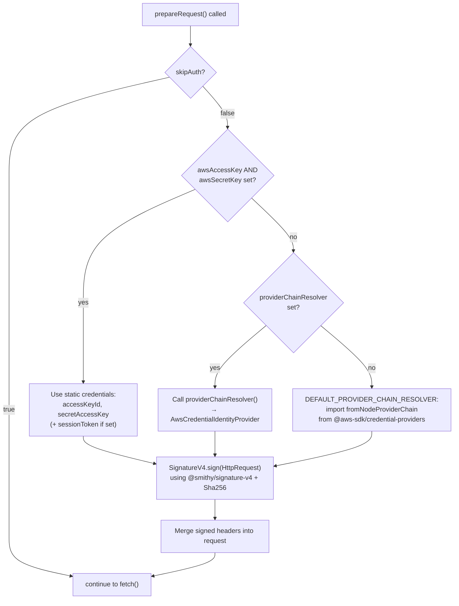
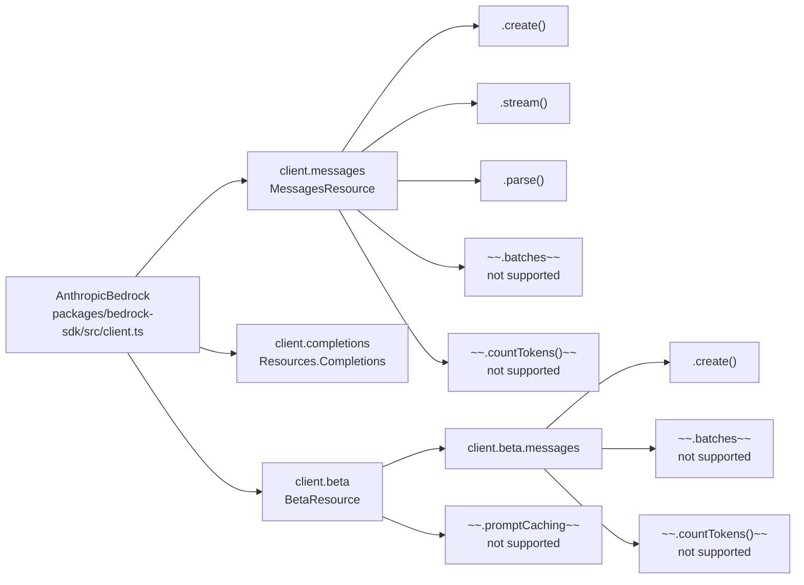

<!-- source: DeepWiki mcp.deepwiki.com · repo anthropics/anthropic-sdk-typescript · page 5.2 Bedrock SDK · fetched 2026-10-26 -->

# Bedrock SDK

<details>
<summary>Relevant source files</summary>

The following files were used as context for generating this wiki page:

- [packages/bedrock-sdk/CHANGELOG.md](packages/bedrock-sdk/CHANGELOG.md)
- [packages/bedrock-sdk/README.md](packages/bedrock-sdk/README.md)
- [packages/bedrock-sdk/examples/demo.ts](packages/bedrock-sdk/examples/demo.ts)
- [packages/bedrock-sdk/examples/streaming.ts](packages/bedrock-sdk/examples/streaming.ts)
- [packages/bedrock-sdk/package.json](packages/bedrock-sdk/package.json)
- [packages/bedrock-sdk/src/client.ts](packages/bedrock-sdk/src/client.ts)
- [packages/bedrock-sdk/src/core/auth.ts](packages/bedrock-sdk/src/core/auth.ts)
- [packages/bedrock-sdk/tests/client.test.ts](packages/bedrock-sdk/tests/client.test.ts)
- [packages/vertex-sdk/CHANGELOG.md](packages/vertex-sdk/CHANGELOG.md)
- [packages/vertex-sdk/package.json](packages/vertex-sdk/package.json)

</details>


This page documents the `@anthropic-ai/bedrock-sdk` package ([packages/bedrock-sdk/package.json:1-86]()), which provides access to Claude models through AWS Bedrock. It covers the `AnthropicBedrock` client, its configuration options, AWS credential resolution, request transformation, and the features that differ from or are absent in the base SDK.

For the base Claude API at `api.anthropic.com`, see the core SDK documentation. For Google Vertex AI access, see the Vertex AI SDK documentation.

---

## Overview

`AnthropicBedrock` extends `BaseAnthropic` from `@anthropic-ai/sdk` and intercepts requests to apply two transformations before they are dispatched:

1.  **Path rewriting**: Converts Anthropic API paths (e.g., `/v1/messages`) into Bedrock endpoint paths (`/model/{model}/invoke` or `/model/{model}/invoke-with-response-stream`).
2.  **AWS Signature V4 signing**: Computes and injects AWS authentication headers using resolved credentials.

The client is a standard extension of the core library—the same resource methods (`.messages.create()`, `.messages.stream()`, etc.) are available, with a few unsupported features removed.

Sources: [packages/bedrock-sdk/src/client.ts:59-130](), [packages/bedrock-sdk/README.md:1-8]()

---

## Package Structure

**Package name:** `@anthropic-ai/bedrock-sdk`  
**Entry point:** `packages/bedrock-sdk/src/client.ts`  
**Depends on:** `@anthropic-ai/sdk` (local build at `file:../../dist/`)

**Runtime dependencies:**

| Package | Role |
|---|---|
| `@anthropic-ai/sdk` | Base client, resource classes, error types [packages/bedrock-sdk/package.json:28]() |
| `@aws-crypto/sha256-js` | SHA-256 implementation for request signing [packages/bedrock-sdk/package.json:29]() |
| `@aws-sdk/credential-providers` | Default AWS credential provider chain (Node.js) [packages/bedrock-sdk/package.json:31]() |
| `@smithy/fetch-http-handler` | HTTP handler used when fetching credentials [packages/bedrock-sdk/package.json:33]() |
| `@smithy/protocol-http` | `HttpRequest` type for Signature V4 [packages/bedrock-sdk/package.json:34]() |
| `@smithy/signature-v4` | `SignatureV4` signer [packages/bedrock-sdk/package.json:35]() |
| `@smithy/types` | `AwsCredentialIdentityProvider` type [packages/bedrock-sdk/package.json:37]() |

Sources: [packages/bedrock-sdk/package.json:27-39]()

---

## Client Architecture

**Request transformation flow:**

The `AnthropicBedrock` client overrides `buildRequest` and `prepareRequest` to adapt standard Anthropic requests to the Bedrock Runtime API requirements.



Sources: [packages/bedrock-sdk/src/client.ts:136-207]()

---

## ClientOptions

`AnthropicBedrock` accepts all standard `CoreClientOptions` **except** `apiKey` and `authToken`, plus the following AWS-specific fields:

| Option | Type | Default | Description |
|---|---|---|---|
| `awsAccessKey` | `string \| null` | `null` | AWS access key ID for static credentials |
| `awsSecretKey` | `string \| null` | `null` | AWS secret access key for static credentials |
| `awsRegion` | `string` | `process.env['AWS_REGION']` ?? `'us-east-1'` | AWS region for endpoint and signing |
| `awsSessionToken` | `string \| null` | `null` | AWS session token for temporary credentials |
| `skipAuth` | `boolean` | `false` | Bypass all AWS credential resolution and signing |
| `providerChainResolver` | `(() => Promise<AwsCredentialIdentityProvider>) \| null` | `null` | Custom credential provider factory, for non-Node environments |
| `baseURL` | `string` | `process.env['ANTHROPIC_BEDROCK_BASE_URL']` ?? `https://bedrock-runtime.${awsRegion}.amazonaws.com` | Override the Bedrock endpoint |

> **Deprecation:** Providing only one of `awsAccessKey` / `awsSecretKey` without the other is deprecated [packages/bedrock-sdk/src/client.ts:113-118](). Either provide both, or provide neither and rely on the credential provider chain.

Sources: [packages/bedrock-sdk/src/client.ts:19-126]()

---

## AWS Credential Resolution

The credential resolution strategy is determined at request time inside `prepareRequest()` [packages/bedrock-sdk/src/client.ts:136-160](). If `skipAuth` is `true`, authentication is bypassed.

**Credential resolution diagram:**



The `DEFAULT_PROVIDER_CHAIN_RESOLVER` lazily imports `fromNodeProviderChain` at runtime [packages/bedrock-sdk/src/core/auth.ts:19-41](). This avoids breaking non-Node environments where the package is unavailable; in those environments, users should provide their own `providerChainResolver`.

Sources: [packages/bedrock-sdk/src/core/auth.ts:43-91](), [packages/bedrock-sdk/src/client.ts:136-160]()

---

## Request Transformation Detail

The `buildRequest()` override in `AnthropicBedrock` performs the following steps on each request:

### 1. Stream class injection
Sets `options.__streamClass = Stream` to use the Bedrock-specific `Stream` implementation [packages/bedrock-sdk/src/client.ts:167]().

### 2. Body mutation protection
Creates a shallow copy of the request body object to avoid mutating the caller's original object [packages/bedrock-sdk/src/client.ts:172]().

### 3. Version injection
Injects `anthropic_version: 'bedrock-2023-05-31'` into the request body if not already present [packages/bedrock-sdk/src/client.ts:176]().

### 4. Beta header migration
If the request includes an `anthropic-beta` header, its value is extracted and moved to `anthropic_beta` in the request body as an array [packages/bedrock-sdk/src/client.ts:182-192](). Bedrock does not accept the header form.

### 5. Path rewriting
For paths in `MODEL_ENDPOINTS` (`/v1/complete`, `/v1/messages`, `/v1/messages?beta=true`) [packages/bedrock-sdk/src/client.ts:17]():

*   `model` and `stream` are removed from the body [packages/bedrock-sdk/src/client.ts:196-197]().
*   The path is rewritten to `/model/{model}/invoke` (unary) or `/model/{model}/invoke-with-response-stream` (streaming) [packages/bedrock-sdk/src/client.ts:199-201]().
*   The `model` identifier (including ARNs with slashes) is URL-encoded in the path [packages/bedrock-sdk/tests/client.test.ts:72-73]().

Sources: [packages/bedrock-sdk/src/client.ts:162-207](), [packages/bedrock-sdk/tests/client.test.ts:40-114]()

---

## Available Resources

`AnthropicBedrock` exposes a restricted subset of the full SDK resource surface. Features not supported by Bedrock are explicitly omitted.

**Resource availability diagram:**



The `MessagesResource` and `BetaResource` type aliases use `Omit` to remove `.batches`, `.countTokens`, and `.promptCaching` [packages/bedrock-sdk/src/client.ts:210-247]().

Sources: [packages/bedrock-sdk/src/client.ts:128-130](), [packages/bedrock-sdk/src/client.ts:210-247]()

---

## Usage Examples

### Basic Message

```typescript
import { AnthropicBedrock } from '@anthropic-ai/bedrock-sdk';
const client = new AnthropicBedrock();

const message = await client.messages.create({
  model: 'anthropic.claude-3-5-sonnet-20241022-v2:0',
  messages: [{ role: 'user', content: 'Hello!' }],
  max_tokens: 1024,
});
```
Sources: [packages/bedrock-sdk/examples/demo.ts:10-23]()

### Custom Credential Provider (Edge Runtimes)

```typescript
const client = new AnthropicBedrock({
  awsRegion: 'us-east-1',
  providerChainResolver: async () => {
    return async () => ({
      accessKeyId: 'your-access-key',
      secretAccessKey: 'your-secret-key',
      sessionToken: 'your-session-token', // Optional
    });
  },
});
```
Sources: [packages/bedrock-sdk/README.md:45-67]()

---

## Supported Runtimes

| Runtime | Supported |
|---|---|
| Node.js 18 LTS+ | ✓ [packages/bedrock-sdk/README.md:77]() |
| Deno v1.28.0+ | ✓ [packages/bedrock-sdk/README.md:78]() |
| Bun 1.0+ | ✓ [packages/bedrock-sdk/README.md:79]() |
| Cloudflare Workers | ✓ [packages/bedrock-sdk/README.md:80]() |
| Vercel Edge Runtime | ✓ [packages/bedrock-sdk/README.md:81]() |
| React Native | ✗ [packages/bedrock-sdk/README.md:85]() |

For non-Node runtimes, use either static credentials or a custom `providerChainResolver` [packages/bedrock-sdk/src/core/auth.ts:37-39]().

Sources: [packages/bedrock-sdk/README.md:72-87]()

---

