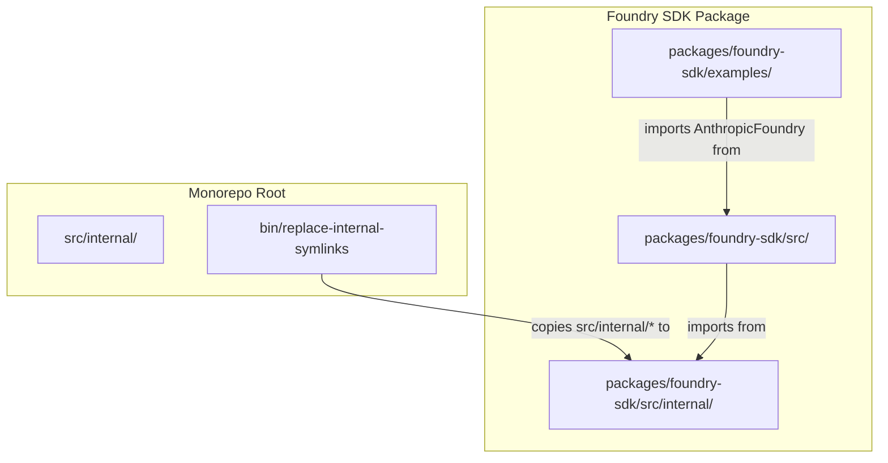
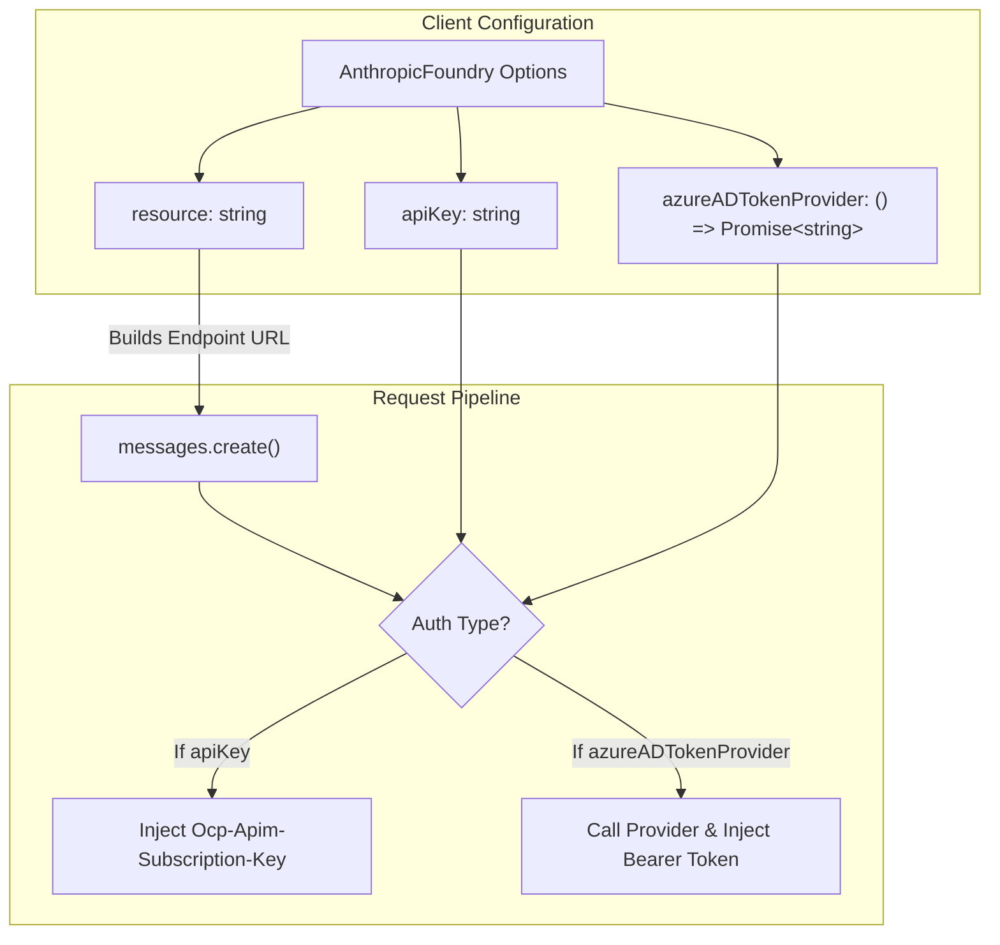

<!-- source: DeepWiki mcp.deepwiki.com · repo anthropics/anthropic-sdk-typescript · page 5.3 Foundry SDK · fetched 2026-10-26 -->

# Foundry SDK

<details>
<summary>Relevant source files</summary>

The following files were used as context for generating this wiki page:

- [bin/replace-internal-symlinks](bin/replace-internal-symlinks)
- [packages/foundry-sdk/.gitignore](packages/foundry-sdk/.gitignore)
- [packages/foundry-sdk/CHANGELOG.md](packages/foundry-sdk/CHANGELOG.md)
- [packages/foundry-sdk/examples/adTokenProvider.ts](packages/foundry-sdk/examples/adTokenProvider.ts)
- [packages/foundry-sdk/examples/basic.ts](packages/foundry-sdk/examples/basic.ts)
- [packages/foundry-sdk/jest.config.ts](packages/foundry-sdk/jest.config.ts)
- [packages/foundry-sdk/package.json](packages/foundry-sdk/package.json)
- [packages/foundry-sdk/scripts/postprocess-dist-package-json.cjs](packages/foundry-sdk/scripts/postprocess-dist-package-json.cjs)

</details>


The Foundry SDK (`@anthropic-ai/foundry-sdk`) is a platform-specific TypeScript library that provides access to Claude models through the Microsoft Azure AI Foundry platform. This package extends the core `@anthropic-ai/sdk` with Foundry-specific authentication and endpoint configuration, supporting both API key and Azure Active Directory (AAD) token-based authentication.

## Package Overview

The Foundry SDK follows the same thin-adapter pattern as other platform SDKs in the monorepo, maintaining a dependency on the core SDK while implementing Azure-specific concerns.

### Package Metadata

| Property | Value |
|----------|-------|
| Package Name | `@anthropic-ai/foundry-sdk` |
| Current Version | 0.2.3 |
| Main Entrypoint | `dist/index.js` (CommonJS) |
| ESM Entrypoint | `dist/index.mjs` |
| Types | `dist/index.d.ts` / `dist/index.d.mts` |
| Core SDK Dependency | `@anthropic-ai/sdk` (mapped to `../../dist/` in dev) |

Sources: [packages/foundry-sdk/package.json:1-8](), [packages/foundry-sdk/package.json:27-29](), [packages/foundry-sdk/package.json:51-73]()

### Monorepo Position

The Foundry SDK is one of three platform-specific SDKs. During the build process, internal symlinks to core logic are replaced with actual file contents to ensure the package is self-contained upon publication.



Sources: [bin/replace-internal-symlinks:11-27](), [packages/foundry-sdk/package.json:47-50]()

## Client Architecture

The primary class provided by this package is `AnthropicFoundry`. It manages the connection to Azure AI Foundry resources and handles request signing/token injection.

### Authentication Options

The SDK supports two primary authentication modes:

1.  **API Key**: Using a static key provided by the Azure AI Foundry portal.
2.  **Azure AD Token Provider**: Using a dynamic token provider, typically integrated with `@azure/identity`.

**Authentication Data Flow**



Sources: [packages/foundry-sdk/examples/basic.ts:5-12](), [packages/foundry-sdk/examples/adTokenProvider.ts:5-14]()

## Usage Examples

### Basic Authentication (API Key)
Users must set `ANTHROPIC_FOUNDRY_API_KEY` and `ANTHROPIC_FOUNDRY_RESOURCE` environment variables or pass them in the constructor.

```typescript
import AnthropicFoundry from '@anthropic-ai/foundry-sdk';

const anthropic = new AnthropicFoundry({
  apiKey: 'your-api-key',
  resource: 'your-resource-name'
});

async function main() {
  const message = await anthropic.messages.create({
    model: 'anthropic.claude-3-5-sonnet-20241022-v2:0',
    messages: [{ role: 'user', content: 'Hello!' }],
    max_tokens: 1024,
  });
}
```
Sources: [packages/foundry-sdk/examples/basic.ts:3-19]()

### Azure AD Authentication
This method is preferred for production environments using Managed Identities or Service Principals. It requires the `@azure/identity` package.

```typescript
import AnthropicFoundry from '@anthropic-ai/foundry-sdk';
import { getBearerTokenProvider, DefaultAzureCredential } from '@azure/identity';

const credential = new DefaultAzureCredential();
const scope = 'https://ai.azure.com/.default';
const azureADTokenProvider = getBearerTokenProvider(credential, scope);

const anthropic = new AnthropicFoundry({
  azureADTokenProvider,
  resource: 'your-foundry-anthropic-resource-name',
});
```
Sources: [packages/foundry-sdk/examples/adTokenProvider.ts:3-14]()

## Implementation Details

### Dependency Management
The package uses a `postprocess-dist-package-json.cjs` script during the build process to normalize dependencies. It ensures that the local `file:../../dist/` reference used during development is converted to a standard NPM version range (`>=0.50.3 <1`) before the package is published.

Sources: [packages/foundry-sdk/scripts/postprocess-dist-package-json.cjs:4-9]()

### Build and Entrypoints
The package supports both CommonJS and ESM via a dual-build system. The `package.json` defines complex exports to ensure compatibility across different Node.js versions and module systems.

| Export Path | Type | Target File |
|-------------|------|-------------|
| `.` | CommonJS | `dist/index.js` |
| `.` | ESM | `dist/index.mjs` |
| `./*` | TypeScript Types | `dist/*.d.ts` |

Sources: [packages/foundry-sdk/package.json:51-73]()

### Development and Testing
Testing is performed using `jest` with the `@swc/jest` transformer for high-performance TypeScript execution. The configuration includes a `moduleNameMapper` to resolve the package name to local source files during test runs.

Sources: [packages/foundry-sdk/jest.config.ts:3-15](), [packages/foundry-sdk/package.json:16-18]()

## Version History

| Version | Date | Description |
|---------|------|-------------|
| 0.2.3 | 2026-02-05 | Bug fix: Avoid memory leak with abort signals. |
| 0.2.2 | 2026-01-29 | Documentation: Update README with Claude branding. |
| 0.2.0 | 2025-11-18 | Initial release of the Foundry SDK. |

Sources: [packages/foundry-sdk/CHANGELOG.md:3-35]()

---

