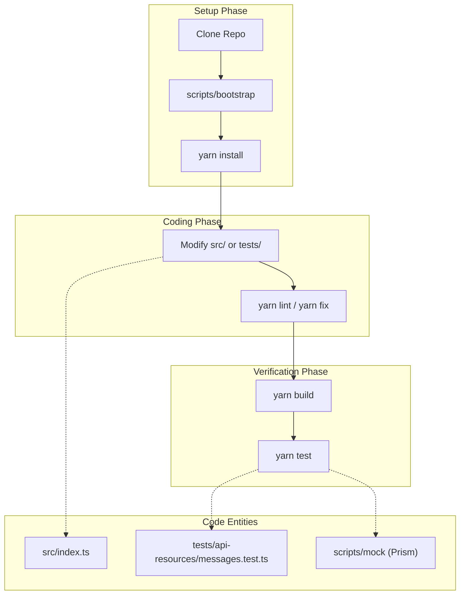

<!-- source: DeepWiki mcp.deepwiki.com · repo anthropics/anthropic-sdk-typescript · page 6 Development Guide · fetched 2026-10-26 -->

# Development Guide

Relevant source files

The following files were used as context for generating this wiki page:

- [.devcontainer/devcontainer.json](.devcontainer/devcontainer.json)
- [.prettierrc.json](.prettierrc.json)
- [CONTRIBUTING.md](CONTRIBUTING.md)
- [README.md](README.md)

This document provides a high-level overview of the development lifecycle for the Anthropic TypeScript SDK. It covers the essential prerequisites, repository conventions, and the orchestration of building, testing, and releasing the SDK.

For detailed instructions on specific topics, please refer to the child pages linked in each section.

---

## Getting Started

The repository is a monorepo containing the core SDK and several platform-specific provider SDKs (Bedrock, Vertex, and Foundry). Development requires Node.js 18+ and `yarn@v1`.

### Core Development Flow

Sources: [README.md:35-37](), [CONTRIBUTING.md:5-15](), [package.json:19-28]()

---

## Environment Setup

To contribute to this SDK, you must configure your local environment to handle the monorepo structure and the automated code generation patterns used by the project.

*   **Prerequisites**: Node.js 18+ and Yarn v1. [CONTRIBUTING.md:7-9]()
*   **Dev Container**: A pre-configured VS Code Dev Container is available, providing a consistent environment with Node.js and Prettier pre-installed. [.devcontainer/devcontainer.json:1-15]()
*   **Tooling**: The project uses **ESLint** for linting and **Prettier** for code formatting. Configuration is managed via `.prettierrc.json`. [.prettierrc.json:1-7]()

For details, see [Environment Setup](#6.1).

---

## Build System

The build system transforms TypeScript source code into multiple distribution formats (CommonJS and ESM) while managing internal dependencies between the core SDK and platform-specific packages.

*   **Orchestration**: Building is typically handled via `yarn build` which triggers the underlying build scripts. [CONTRIBUTING.md:13-15]()
*   **Compilation**: Uses `tsc` with specific configurations for the core package and sub-packages.
*   **Distribution**: The `dist/` directory is the primary target for published artifacts, containing both `.js` and `.mjs` files for compatibility. [package.json:69-84]()

For details, see [Build System](#6.2).

---

## Testing

The SDK employs a robust testing strategy using **Jest** and **Prism** to ensure API compatibility and client reliability.

*   **Mocking**: Most tests require a mock server running against the OpenAPI spec, initiated via `./scripts/mock`. [CONTRIBUTING.md:72-76]()
*   **Execution**: Tests are run using `yarn test`. [CONTRIBUTING.md:78-80]()
*   **Infrastructure**: Uses `@swc/jest` for high-performance TypeScript transformation during test execution. [package.json:52-54]()

For details, see [Testing](#6.3).

---

## CI/CD Pipeline

The GitHub Actions pipeline automates the validation of every pull request and the preparation of release artifacts.

*   **Workflows**: The primary `ci.yml` workflow handles linting, building, and testing across all supported environments.
*   **Artifacts**: Successful builds on specific branches may trigger internal artifact uploads to `pkg.stainless.com`.
*   **Validation**: Includes "release-doctor" checks to ensure the environment is correctly configured for a production release.

For details, see [CI/CD Pipeline](#6.4).

---

## Release Process

Releases are managed through an automated pipeline that handles versioning, changelog generation, and NPM publication.

*   **Automation**: Uses `release-please` to manage version increments and PRs based on conventional commits.
*   **Publication**: The `scripts/publish-packages.ts` script handles the logic of pushing verified builds to the NPM registry.
*   **Symlink Management**: Before publication, the `bin/replace-internal-symlinks` utility ensures that local workspace dependencies are resolved to valid package references. [CONTRIBUTING.md:100-113]()

For details, see [Release Process](#6.5).

---

## Repository Conventions

| Category | Convention | Code Pointer |
| :--- | :--- | :--- |
| **Formatting** | Prettier with 110 char width, single quotes | [.prettierrc.json:4-5]() |
| **Generation** | Most code is generated; manual changes in `src/lib/` are safe | [CONTRIBUTING.md:19-23]() |
| **Examples** | New examples should be added to `examples/` | [CONTRIBUTING.md:25-30]() |
| **Entrypoints** | Main entrypoint is `src/index.ts` | [package.json:65]() |

Sources: [CONTRIBUTING.md:19-40](), [package.json:65-84](), [.prettierrc.json:1-7]()

---

