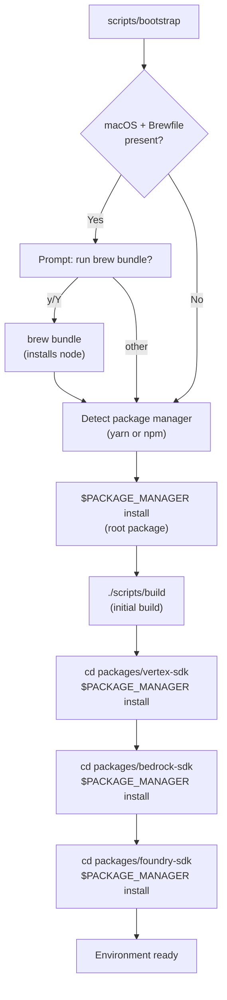
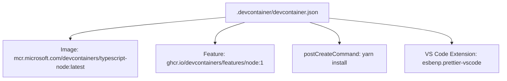
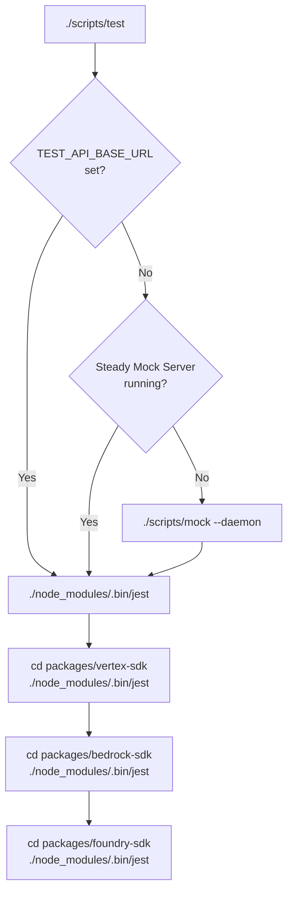

<!-- source: DeepWiki mcp.deepwiki.com · repo anthropics/anthropic-sdk-typescript · page 6.1 Environment Setup · fetched 2026-10-26 -->

# Environment Setup

<details>
<summary>Relevant source files</summary>

The following files were used as context for generating this wiki page:

- [.devcontainer/devcontainer.json](.devcontainer/devcontainer.json)
- [.prettierrc.json](.prettierrc.json)
- [Brewfile](Brewfile)
- [eslint.config.mjs](eslint.config.mjs)
- [jest.config.ts](jest.config.ts)
- [scripts/bootstrap](scripts/bootstrap)
- [scripts/format](scripts/format)
- [scripts/lint](scripts/lint)
- [scripts/mock](scripts/mock)
- [scripts/test](scripts/test)

</details>


## Purpose and Scope

This document covers the process of setting up a local development environment for contributing to the Anthropic TypeScript SDK. It includes cloning the repository, installing dependencies, performing initial builds, and verifying the environment is correctly configured via the provided bootstrap and testing scripts.

---

## Prerequisites

Before setting up the development environment, ensure the following are installed on your system:

| Requirement | Notes |
|------------|-------|
| Node.js | Required. The `Brewfile` installs this via Homebrew on macOS. [Brewfile:1]() |
| Yarn | Preferred package manager. The `scripts/bootstrap` script auto-detects `yarn` or falls back to `npm`. [scripts/bootstrap:24-26]() |
| Git | For cloning the repository. |
| Homebrew (macOS only) | Optional. Used to install Node.js if the `Brewfile` is present. [scripts/bootstrap:7-20]() |

TypeScript itself is installed as a dev dependency and does not need to be pre-installed globally.

Sources: [Brewfile:1](), [scripts/bootstrap:7-26]()

---

## Bootstrap Script

The canonical way to set up the full development environment is via `scripts/bootstrap`. This single script handles Homebrew dependencies, root package installation, an initial build, and installation of all sub-package dependencies.

**Bootstrap script flow (`scripts/bootstrap`)**



### Running the Bootstrap Script

```bash
./scripts/bootstrap
```

- **Homebrew Integration**: On **macOS**, if a `Brewfile` is present and Homebrew is installed, it will prompt to run `brew bundle` [scripts/bootstrap:7-20]().
- **Dependency Installation**: Detects `yarn` or falls back to `npm` for the root install [scripts/bootstrap:24-26]().
- **Sub-package Setup**: Sequentially installs dependencies for `packages/vertex-sdk`, `packages/bedrock-sdk`, and `packages/foundry-sdk` [scripts/bootstrap:31-40]().
- **Initial Build**: Calls `./scripts/build` [scripts/bootstrap:28]() to produce the initial build artifacts required by the sub-packages.

Sources: [scripts/bootstrap:1-40](), [Brewfile:1]()

---

## Dev Container

The repository includes a dev container configuration for VS Code and GitHub Codespaces. It sets up a fully working TypeScript/Node.js environment automatically.

**Dev container configuration (`.devcontainer/devcontainer.json`)**



| Setting | Value |
|---------|-------|
| Base image | `mcr.microsoft.com/devcontainers/typescript-node:latest` [devcontainer.json:5]() |
| Additional feature | `ghcr.io/devcontainers/features/node:1` [devcontainer.json:7]() |
| Post-create command | `yarn install` [devcontainer.json:9]() |
| VS Code extension | `esbenp.prettier-vscode` [devcontainer.json:12]() |

Sources: [.devcontainer/devcontainer.json:1-15]()

---

## Editor Tooling (Linting & Formatting)

The repository uses **ESLint** for static analysis and **Prettier** for code formatting.

### ESLint
The configuration is defined in `eslint.config.mjs`. It uses `typescript-eslint` and includes rules to prevent package-level imports from within the SDK, forcing relative imports instead [eslint.config.mjs:23-34]().

- **Run linter**: `./scripts/lint` [scripts/lint:8]()
- **Fix issues**: `./scripts/format` [scripts/format:8]()

### Prettier
Prettier is configured via `.prettierrc.json` with a `printWidth` of 110 and `singleQuote` enabled [.prettierrc.json:4-5]().

- **Run formatter**: `./scripts/format` [scripts/format:12]()

Sources: [eslint.config.mjs:1-43](), [.prettierrc.json:1-7](), [scripts/lint:1-22](), [scripts/format:1-13]()

---

## Verifying the Setup

After running `./scripts/bootstrap`, verify the environment by running the test suite.

**Test Execution Pipeline (`scripts/test`)**



### Mock Server Infrastructure
The test suite requires a mock server (Steady) unless `TEST_API_BASE_URL` is provided [scripts/test:24-28](). The `scripts/mock` script starts a local server on port 4010 using the OpenAPI spec URL found in `.stats.yml` [scripts/mock:11-27]().

### Jest Configuration
The root `jest.config.ts` uses `@swc/jest` for fast compilation [jest.config.ts:7](). It maps the `@anthropic-ai/sdk` package name directly to the `src/` directory for testing [jest.config.ts:9-12]().

Sources: [scripts/test:1-68](), [scripts/mock:1-53](), [jest.config.ts:1-25]()

---

