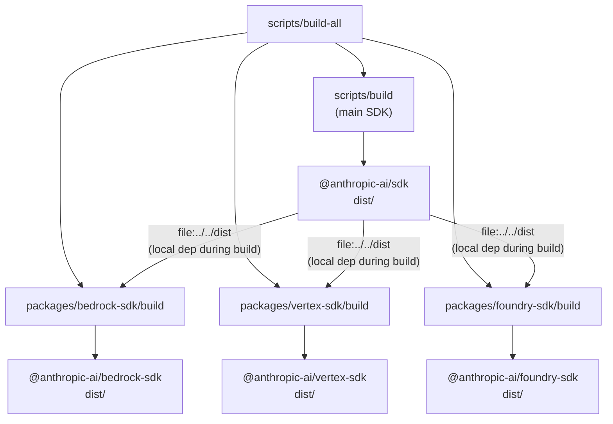
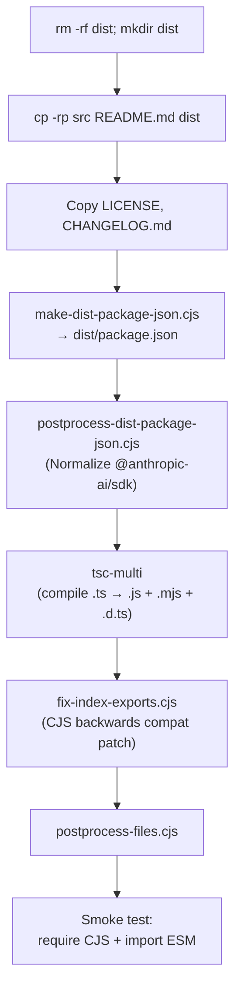

<!-- source: DeepWiki mcp.deepwiki.com · repo anthropics/anthropic-sdk-typescript · page 6.2 Build System · fetched 2026-10-26 -->

# Build System

Relevant source files

The following files were used as context for generating this wiki page:

- [.gitignore](.gitignore)
- [.prettierignore](.prettierignore)
- [packages/bedrock-sdk/build](packages/bedrock-sdk/build)
- [packages/vertex-sdk/build](packages/vertex-sdk/build)
- [scripts/build](scripts/build)
- [scripts/build-all](scripts/build-all)
- [tsconfig.build.json](tsconfig.build.json)
- [tsconfig.deno.json](tsconfig.deno.json)
- [tsconfig.json](tsconfig.json)
- [yarn.lock](yarn.lock)

This page documents the build pipeline for the `anthropic-sdk-typescript` monorepo: how source TypeScript is compiled into publishable `dist/` artifacts for both the core `@anthropic-ai/sdk` package and the three sub-packages (`bedrock-sdk`, `vertex-sdk`, and `foundry-sdk`).

---

## Overview

The monorepo contains four independently versioned and published packages. Each package has its own `build` script that produces a self-contained `dist/` directory. The top-level `scripts/build-all` script coordinates building all packages in the correct dependency order.

**Build orchestration flow:**

Sources: [scripts/build-all:1-13]()

---

## `scripts/build-all` Orchestration

The top-level orchestration script [scripts/build-all:1-13]() runs the following in order:

1. Calls `bash ./scripts/build` to build the core SDK package [scripts/build-all:6-6]().
2. Iterates over every directory under `packages/`, and for each runs `yarn install && yarn build` [scripts/build-all:8-12]().

Sub-packages reference the core SDK via a local path (`file:../../dist`) in their `package.json`. This means the core SDK **must** be built first so that sub-package installs resolve correctly. `build-all` enforces this ordering by building the core SDK before iterating over sub-packages.

---

## Core SDK Build (`scripts/build`)

The core SDK source lives in `src/`. The build process compiles it into the `dist/` directory using `tsc-multi`.

**Core Build Steps:**
1. **Version Check**: Runs `scripts/utils/check-version.cjs` [scripts/build:7-7]().
2. **Environment Prep**: Cleans `dist/` and copies `src/`, `README.md`, `LICENSE`, `CHANGELOG.md`, and `.github/logo.svg` into `dist/` [scripts/build:14-24]().
3. **CLI Assets**: Copies `bin/cli` and `bin/migration-config.json` if they exist [scripts/build:25-32]().
4. **Package Metadata**: Generates `dist/package.json` using `scripts/utils/make-dist-package-json.cjs` [scripts/build:35-35]().
5. **Compilation**: Runs `./node_modules/.bin/tsc-multi` to generate `.js`, `.mjs`, and `.d.ts` files [scripts/build:38-38]().
6. **CJS Patching**: Runs `scripts/utils/fix-index-exports.cjs` to ensure `new module.exports()` compatibility [scripts/build:42-42]().
7. **Post-processing**: Runs `scripts/utils/postprocess-files.cjs` [scripts/build:45-45]().
8. **Smoke Test**: Attempts to `require` and `import` the resulting package to ensure it doesn't crash [scripts/build:49-50]().

Sources: [scripts/build:1-56](), [tsconfig.build.json:1-18]()

---

## Sub-package Build Pipeline

The sub-packages (Bedrock, Vertex, Foundry) use a standardized build script [packages/bedrock-sdk/build:1-44](), [packages/vertex-sdk/build:1-44]().

**Sub-package build sequence:**

### Dependency Normalization
During development, sub-packages point to the core SDK via `file:../../dist`. Before publishing, `postprocess-dist-package-json.cjs` is called to update the `@anthropic-ai/sdk` dependency to point to the correct NPM version range [packages/bedrock-sdk/build:27-27](), [packages/vertex-sdk/build:27-27]().

### CJS/ESM Compatibility Patching
The script `scripts/utils/fix-index-exports.cjs` is critical for CJS/ESM interoperability. It patches the compiled `dist/index.js` so that `new module.exports()` works for legacy CommonJS consumers. This is necessary because TypeScript's default ESM-to-CJS translation often makes the default export an object with a `.default` property, which breaks the `new Anthropic()` pattern for `require` users [packages/bedrock-sdk/build:31-34]().

Sources: [packages/bedrock-sdk/build:1-44](), [packages/vertex-sdk/build:1-44]()

---

## Compilation with `tsc-multi`

The project uses `tsc-multi` to handle simultaneous emission of multiple module formats.

**Compiler Targets:**
- **CommonJS (`.js`)**: For standard Node.js environments.
- **ES Modules (`.mjs`)**: For modern bundlers, browsers, and `import` statements in Node.js.
- **Declarations (`.d.ts`)**: For TypeScript type checking, including source maps (`.d.ts.map`) for IDE navigation.

The configuration in `tsconfig.build.json` extends the base `tsconfig.json` but sets `noEmit: false` and defines `dist/src` as the `rootDir` [tsconfig.build.json:1-18]().

**TypeScript Configuration Comparison:**

| Feature | `tsconfig.json` (Dev) | `tsconfig.build.json` (Build) |
|---|---|---|
| `target` | `es2020` | Inherited (`es2020`) |
| `module` | `commonjs` | Inherited |
| `noEmit` | `true` [tsconfig.json:14-14]() | `false` [tsconfig.build.json:11-11]() |
| `declaration` | `false` | `true` [tsconfig.build.json:12-12]() |
| `outDir` | N/A | `dist` [tsconfig.build.json:14-14]() |

Sources: [tsconfig.json:1-37](), [tsconfig.build.json:1-18]()

---

## Build Artifacts & Distribution

The build system ensures that the published `dist/` directory is a valid, self-contained package.

**`dist/` Directory Structure:**
- `src/`: Original TypeScript source (for source map resolution) [scripts/build:17-17]().
- `resources/`: Compiled resource modules (e.g., `messages.js`, `messages.mjs`) [scripts/build:10-11]().
- `index.js` / `index.mjs`: Main entry points [scripts/build:38-38]().
- `package.json`: The modified package descriptor with corrected `exports` maps [scripts/build:35-35]().

The `scripts/utils/make-dist-package-json.cjs` utility is responsible for converting the internal development `package.json` into a version suitable for the `dist/` folder, ensuring that `exports` point to the correct relative paths within the distribution [scripts/build:35-35]().

Sources: [scripts/build:1-56](), [packages/bedrock-sdk/build:1-44]()

---

