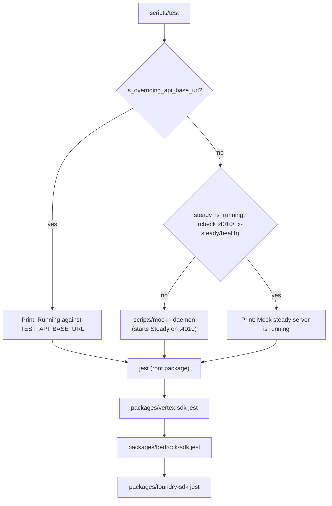
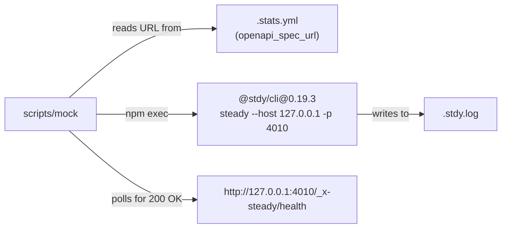

<!-- source: DeepWiki mcp.deepwiki.com · repo anthropics/anthropic-sdk-typescript · page 6.3 Testing · fetched 2026-10-26 -->

# Testing

<details>
<summary>Relevant source files</summary>

The following files were used as context for generating this wiki page:

- [Brewfile](Brewfile)
- [jest.config.ts](jest.config.ts)
- [scripts/bootstrap](scripts/bootstrap)
- [scripts/mock](scripts/mock)
- [scripts/test](scripts/test)
- [tests/lib/fixtures/basic_response.txt](tests/lib/fixtures/basic_response.txt)
- [tests/lib/fixtures/tool_use_response.txt](tests/lib/fixtures/tool_use_response.txt)
- [tests/lib/mock-fetch.ts](tests/lib/mock-fetch.ts)
- [tests/lib/sse-helpers.ts](tests/lib/sse-helpers.ts)

</details>


This page covers the test infrastructure for the `anthropic-sdk-typescript` monorepo: the Jest configuration, the **Steady** mock server (which replaces Prism in recent versions), the `TEST_API_BASE_URL` override mechanism, and the execution flow across the root package and sub-packages.

---

## Overview

Tests are written with [Jest](https://jestjs.io/) and run against a locally started **Steady** mock HTTP server (using `@stdy/cli`) that validates requests against the Anthropic OpenAPI spec. Every resource method in the SDK has a corresponding test file under `tests/`. The `scripts/test` shell script coordinates starting the mock server, running the root-package tests, and then running each sub-package's own Jest suite.

---

## Test Runner Flow

The `scripts/test` script is the primary entry point for execution. It checks for an existing mock server or a `TEST_API_BASE_URL` override before dispatching to Jest.

**Diagram: `scripts/test` execution flow**



Sources: [scripts/test:12-68]()

---

## Steady Mock Server

The `scripts/mock` script launches a Steady HTTP mock server. Steady reads the Anthropic OpenAPI spec (defined in `.stats.yml`) and returns schema-valid stub responses. Tests send real HTTP requests to `http://127.0.0.1:4010`.

**Diagram: Mock Server Initialization**



Sources: [scripts/mock:7-52](), [scripts/test:12-14]()

The mock script accepts an optional first positional argument to override the spec URL [scripts/mock:7-12](). When invoked with `--daemon`, it starts the process in the background and waits up to 30 seconds for the health endpoint to return a success code [scripts/mock:23-47]().

---

## Jest Configuration

The Jest configuration is defined in `jest.config.ts` at the repo root and utilizes `@swc/jest` for high-performance transpilation.

| Option | Value | Effect |
|---|---|---|
| `preset` | `ts-jest/presets/default-esm` | Enables ESM support for TypeScript [jest.config.ts:4](). |
| `testEnvironment` | `node` | Runs tests in a Node.js environment [jest.config.ts:5](). |
| `transform` | `@swc/jest` | Uses SWC for faster compilation than standard `ts-jest` [jest.config.ts:7](). |
| `moduleNameMapper` | `@anthropic-ai/sdk` → `src/index.ts` | Maps package imports directly to source files for testing [jest.config.ts:10-11](). |
| `modulePathIgnorePatterns` | `packages/`, `dist/`, `deno/` | Prevents the root runner from picking up sub-package or build artifacts [jest.config.ts:13-19](). |

Sources: [jest.config.ts:1-24]()

---

## Specialized Testing Utilities

### SSE and Streaming Helpers
For testing Server-Sent Events (SSE), the SDK includes helpers to parse raw fixtures.
- `loadFixture(filename)`: Reads raw SSE streams from `tests/lib/fixtures/` [tests/lib/sse-helpers.ts:6-9]().
- `parseSSEFixture(sseContent)`: Uses the internal `_iterSSEMessages` to transform raw text into an array of parsed JSON events [tests/lib/sse-helpers.ts:11-31]().

### Mock Fetch Implementation
The `tests/lib/mock-fetch.ts` utility provides a programmable `fetch` implementation for unit tests that require fine-grained control over the response stream [tests/lib/mock-fetch.ts:9-14]().
- `handleStreamEvents(events)`: Queues a set of JSON objects to be emitted as a standard `text/event-stream` [tests/lib/mock-fetch.ts:52-69]().
- `handleMessageStreamEvents(iter)`: Accepts an `AsyncIterable` to simulate dynamic stream generation [tests/lib/mock-fetch.ts:71-88]().

Sources: [tests/lib/sse-helpers.ts:1-31](), [tests/lib/mock-fetch.ts:1-91]()

---

## Sub-Package Test Suites

The monorepo contains several provider-specific SDKs (Vertex, Bedrock, Foundry). `scripts/test` ensures these are tested in isolation using their own local dependencies.

```bash
# Example logic in scripts/test
echo "==> Running vertex-sdk tests"
(cd packages/vertex-sdk && ./node_modules/.bin/jest)

echo "==> Running bedrock-sdk tests"
(cd packages/bedrock-sdk && ./node_modules/.bin/jest)

echo "==> Running foundry-sdk tests"
(cd packages/foundry-sdk && ./node_modules/.bin/jest)
```

Sources: [scripts/test:59-68]()

---

## Running Tests Locally

### Full Suite
To run the mock server and all tests across all packages:
```bash
./scripts/test
```

### Targeted Testing
To run only the root package tests (requires Steady to be running or `TEST_API_BASE_URL` to be set):
```bash
npm exec jest
```

### Environment Overrides
To test against a live staging environment or a custom proxy:
```bash
export TEST_API_BASE_URL="https://my-proxy.internal"
./scripts/test
```

Sources: [scripts/test:24-38]()

---

