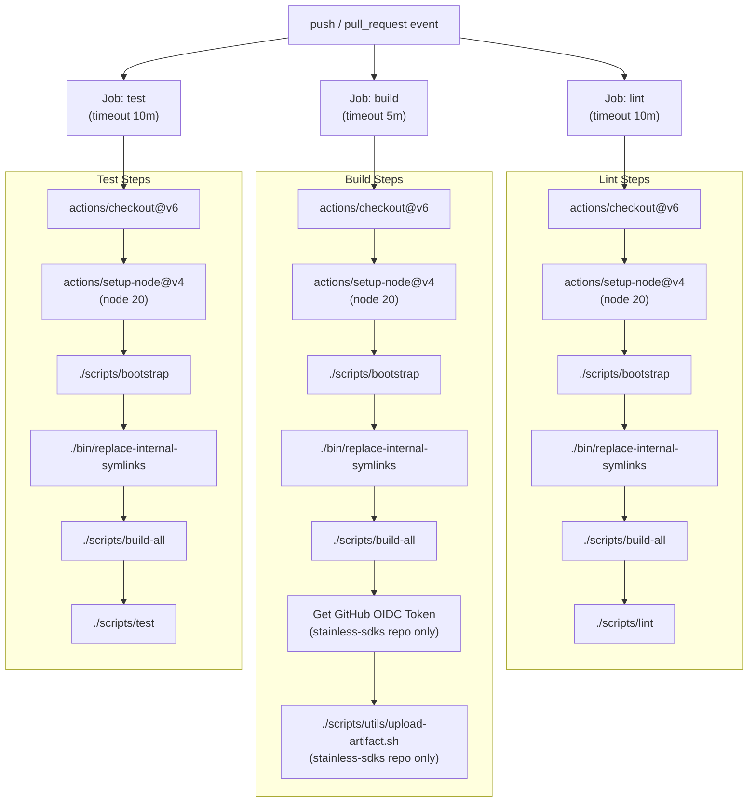
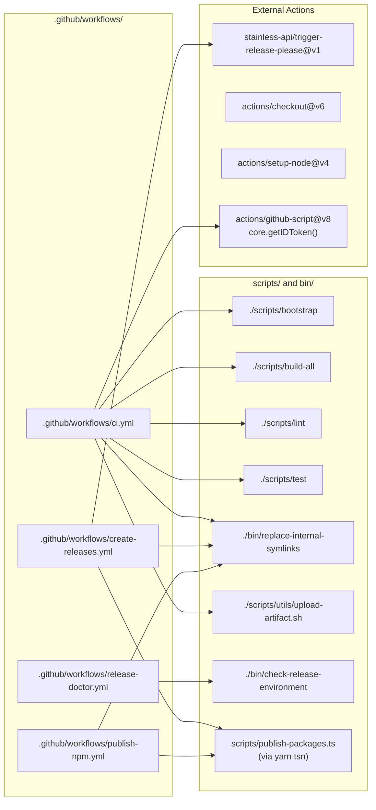

<!-- source: DeepWiki mcp.deepwiki.com · repo anthropics/anthropic-sdk-typescript · page 6.4 CI/CD Pipeline · fetched 2026-10-26 -->

# CI/CD Pipeline

<details>
<summary>Relevant source files</summary>

The following files were used as context for generating this wiki page:

- [.github/CODEOWNERS](.github/CODEOWNERS)
- [.github/workflows/ci.yml](.github/workflows/ci.yml)
- [.github/workflows/create-releases.yml](.github/workflows/create-releases.yml)
- [.github/workflows/publish-npm.yml](.github/workflows/publish-npm.yml)
- [.github/workflows/release-doctor.yml](.github/workflows/release-doctor.yml)
- [bin/check-release-environment](bin/check-release-environment)
- [release-please-config.json](release-please-config.json)
- [scripts/publish-packages.ts](scripts/publish-packages.ts)
- [scripts/utils/upload-artifact.sh](scripts/utils/upload-artifact.sh)

</details>


This page documents the GitHub Actions workflows that automate linting, building, testing, and artifact upload for the `anthropic-sdk-typescript` monorepo. It covers branch filter rules, job structure, runner selection, and the artifact upload mechanism used in the `ci.yml` workflow.

For the release automation that runs after CI completes — including `release-please`, changelog generation, and NPM publishing — see the Release Process page ([6.5]()). For the local build system that these workflows invoke, see Build System ([6.2]()). For test configuration, see Testing ([6.3]()).

---

## Workflow Overview

The repository contains four GitHub Actions workflows, each with a distinct responsibility:

| Workflow file | Name | Trigger | Purpose |
|---|---|---|---|
| `.github/workflows/ci.yml` | CI | `push`, `pull_request` | Lint, build, test, artifact upload |
| `.github/workflows/release-doctor.yml` | Release Doctor | `push` to `main`, manual | Validate release secrets |
| `.github/workflows/create-releases.yml` | Create releases | `push` to `main`, daily cron | Run `release-please`, publish to NPM |
| `.github/workflows/publish-npm.yml` | Publish NPM | manual (`workflow_dispatch`) | Manually publish a specific package path |

Sources: [.github/workflows/ci.yml:1-4](), [.github/workflows/release-doctor.yml:1-7](), [.github/workflows/create-releases.yml:1-8](), [.github/workflows/publish-npm.yml:1-10]()

---

## CI Workflow (`ci.yml`)

The CI workflow is the primary gate for every push and pull request. It runs three independent jobs in parallel: `lint`, `build`, and `test`.

### Trigger Rules

[.github/workflows/ci.yml:2-15]()

```yaml
on:
  push:
    branches:
      - '**'
      - '!integrated/**'
      - '!stl-preview-head/**'
      - '!stl-preview-base/**'
      - '!generated'
      - '!codegen/**'
      - 'codegen/stl/**'
  pull_request:
    branches-ignore:
      - 'stl-preview-head/**'
      - 'stl-preview-base/**'
```

The workflow deliberately skips branches used by the Stainless code-generation pipeline (`generated`, `codegen/**` except `codegen/stl/**`, `stl-preview-head/**`, `stl-preview-base/**`) and integration branches (`integrated/**`). This prevents redundant CI runs on machine-managed branches.

Each job also has a conditional:

```yaml
if: github.event_name == 'push' || github.event.pull_request.head.repo.fork
```

This means jobs run on all pushes, but for pull requests they only run if the PR comes from a fork. PRs from the same repository (non-fork) are gated through the push trigger instead.

Sources: [.github/workflows/ci.yml:2-22](), [.github/workflows/ci.yml:48](), [.github/workflows/ci.yml:91]()

### Runner Selection

All three CI jobs use a dynamic runner expression:

```yaml
runs-on: ${{ github.repository == 'stainless-sdks/anthropic-typescript' && 'depot-ubuntu-24.04' || 'ubuntu-latest' }}
```

On the internal Stainless mirror (`stainless-sdks/anthropic-typescript`), a [Depot](https://depot.dev) runner is used for faster builds. On the public `anthropics/anthropic-sdk-typescript` repository, standard `ubuntu-latest` GitHub-hosted runners are used.

Sources: [.github/workflows/ci.yml:21](), [.github/workflows/ci.yml:47](), [.github/workflows/ci.yml:90]()

### Job: `lint`

**Timeout:** 10 minutes

Steps:
1. **Checkout code** (`actions/checkout@v6`)
2. **Set up Node 20** (`actions/setup-node@v4`)
3. **Bootstrap** — Run `./scripts/bootstrap` (installs dependencies) [.github/workflows/ci.yml:32]()
4. **Update internal symlinks** — Run `./bin/replace-internal-symlinks` (materializes `src/internal` symlinks into real directories for sub-packages) [.github/workflows/ci.yml:35]()
5. **Run build all** — Run `./scripts/build-all` (required so sub-packages can resolve the `dist/` folder in the root) [.github/workflows/ci.yml:39]()
6. **Check types** — Run `./scripts/lint` (TypeScript type checking) [.github/workflows/ci.yml:42]()

Sources: [.github/workflows/ci.yml:18-42]()

### Job: `build`

**Timeout:** 5 minutes  
**Extra permissions:** `contents: read`, `id-token: write` (needed for OIDC token) [.github/workflows/ci.yml:49-51]()

Steps mirror the `lint` job through the build step, then conditionally upload a tarball:

1–5. Same as `lint` through `./scripts/build-all` [.github/workflows/ci.yml:53-67]()
6. **Get GitHub OIDC Token** — Only on the internal Stainless repo. Uses `actions/github-script@v8` to call `core.getIDToken()`, which produces a short-lived token for authenticating with Stainless artifact storage. [.github/workflows/ci.yml:74-76]()
7. **Upload tarball** — Only on the internal Stainless repo. Calls `./scripts/utils/upload-artifact.sh`. [.github/workflows/ci.yml:86]()

Sources: [.github/workflows/ci.yml:44-86]()

### Job: `test`

**Timeout:** 10 minutes

Steps:
1. Checkout, Node 20, bootstrap (same as other jobs) [.github/workflows/ci.yml:93-101]()
2. `./bin/replace-internal-symlinks` [.github/workflows/ci.yml:104]()
3. `./scripts/build-all` [.github/workflows/ci.yml:108]()
4. **Run tests** — Runs `./scripts/test`, which executes the full Jest suite across the root package and all sub-packages. [.github/workflows/ci.yml:111]()

Sources: [.github/workflows/ci.yml:87-111]()

---

## CI Job Dependency and Flow Diagram

**Diagram: ci.yml job structure and script calls**



Sources: [.github/workflows/ci.yml:1-112]()

---

## Artifact Upload

The `build` job conditionally uploads a tarball of the compiled `dist/` folder to Stainless artifact storage. This only runs on the internal `stainless-sdks/anthropic-typescript` repository.

**Script:** `scripts/utils/upload-artifact.sh`

The upload process uses three environment variables set by the workflow:
- `URL`: `https://pkg.stainless.com/s` [.github/workflows/ci.yml:83]()
- `AUTH`: The GitHub OIDC token obtained via `core.getIDToken()` [.github/workflows/ci.yml:84]()
- `SHA`: The commit SHA (`github.sha`) [.github/workflows/ci.yml:85]()

The script `upload-artifact.sh` performs the following:
1. **Request Signed URL**: POSTs to `$URL` with the OIDC token to obtain a pre-signed S3 URL. [scripts/utils/upload-artifact.sh:4-8]()
2. **Pack Artifact**: Runs `npm pack --silent` inside the `dist/` directory to produce a tarball. [scripts/utils/upload-artifact.sh:15]()
3. **Binary Upload**: PUTs the tarball to the pre-signed URL. [scripts/utils/upload-artifact.sh:17-19]()
4. **Verification**: Checks for a `200 OK` response and prints the installation URL: `npm install 'https://pkg.stainless.com/s/anthropic-typescript/$SHA'`. [scripts/utils/upload-artifact.sh:21-23]()

Sources: [scripts/utils/upload-artifact.sh:1-28](), [.github/workflows/ci.yml:69-86]()

---

## Release Doctor Workflow (`release-doctor.yml`)

**Trigger:** `push` to `main`, or manual `workflow_dispatch`. [.github/workflows/release-doctor.yml:1-6]()

**Condition:** Only runs on `anthropics/anthropic-sdk-typescript` (the public repo), not the Stainless mirror. [.github/workflows/release-doctor.yml:13]()

This workflow validates that all required secrets are present before a release can proceed. It runs `bin/check-release-environment` with two secrets injected:

- `STAINLESS_API_KEY` [.github/workflows/release-doctor.yml:22]()
- `NPM_TOKEN` (falls back from `ANTHROPIC_NPM_TOKEN` to `NPM_TOKEN`) [.github/workflows/release-doctor.yml:23]()

The script `check-release-environment` checks each variable and collects error messages. If any are missing, it prints the errors and exits with code 1. If all are present, it prints `"The environment is ready to push releases!"`. [bin/check-release-environment:15-25]()

Sources: [.github/workflows/release-doctor.yml:1-24](), [bin/check-release-environment:1-27]()

---

## Workflow-to-Script Mapping Diagram

**Diagram: GitHub Actions workflows and the scripts/binaries they invoke**



Sources: [.github/workflows/ci.yml:1-112](), [.github/workflows/release-doctor.yml:1-24](), [.github/workflows/create-releases.yml:1-46](), [.github/workflows/publish-npm.yml:1-37]()

---

## Branch Filter Summary

| Branch pattern | `ci.yml` push | `ci.yml` PR | `release-doctor.yml` | `create-releases.yml` |
|---|---|---|---|---|
| `main` | ✅ runs | ✅ runs (fork only) | ✅ runs | ✅ runs |
| `generated` | ❌ skipped | ❌ skipped | — | — |
| `codegen/**` | ❌ skipped | ❌ skipped | — | — |
| `codegen/stl/**` | ✅ runs | ✅ runs (fork only) | — | — |
| `integrated/**` | ❌ skipped | ❌ skipped | — | — |
| `stl-preview-head/**` | ❌ skipped | ❌ skipped | — | — |
| `stl-preview-base/**` | ❌ skipped | ❌ skipped | — | — |
| All other branches | ✅ runs | ✅ runs (fork only) | — | — |

Sources: [.github/workflows/ci.yml:2-15](), [.github/workflows/release-doctor.yml:3-5](), [.github/workflows/create-releases.yml:5-7]()

---

## Required Secrets

| Secret name | Used by | Purpose |
|---|---|---|
| `STAINLESS_API_KEY` | `release-doctor.yml`, `create-releases.yml` | Authenticate with Stainless release-please API |
| `ANTHROPIC_NPM_TOKEN` | `create-releases.yml`, `publish-npm.yml` | Publish to NPM (preferred) |
| `NPM_TOKEN` | `create-releases.yml`, `publish-npm.yml` | Publish to NPM (fallback) |

The `create-releases.yml` and `publish-npm.yml` workflows both run in the `production-release` GitHub environment, which gates access to these secrets.

Sources: [.github/workflows/create-releases.yml:14-45](), [.github/workflows/publish-npm.yml:15-36](), [bin/check-release-environment:5-11]()

---

## CODEOWNERS

[.github/CODEOWNERS:1-5]()

All files in the repository are owned by `@anthropics/sdk`. This means every PR automatically requests a review from that team.

Sources: [.github/CODEOWNERS:1-5]()

---

