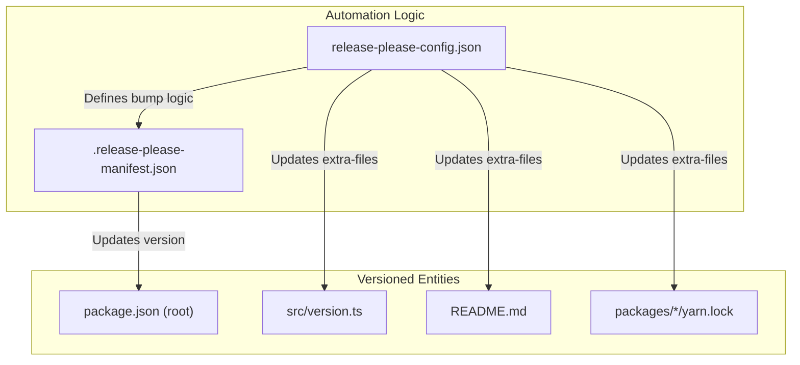
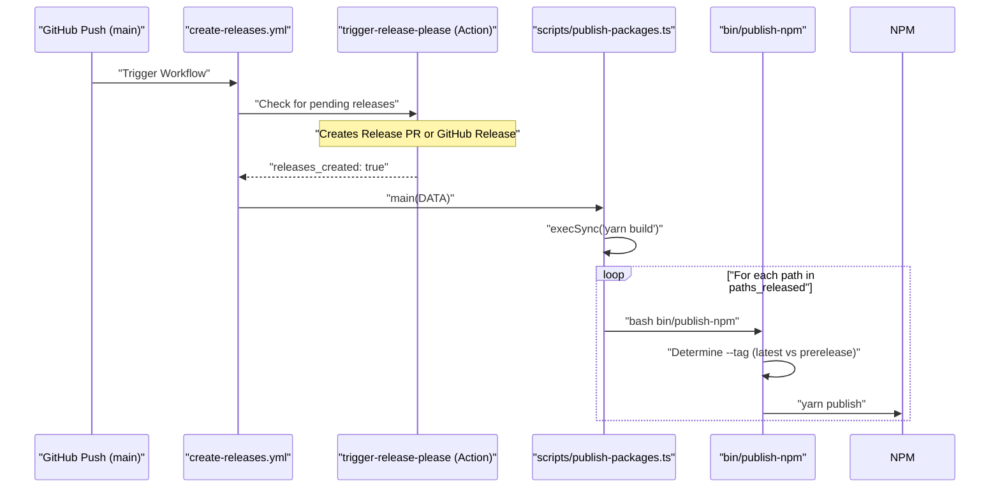
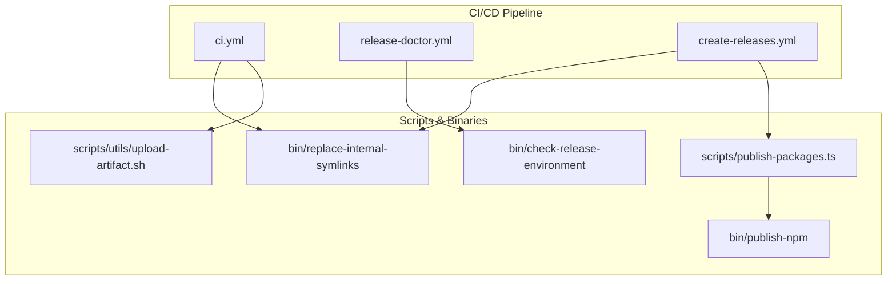

<!-- source: DeepWiki mcp.deepwiki.com · repo anthropics/anthropic-sdk-typescript · page 6.5 Release Process · fetched 2026-10-26 -->

# Release Process

Relevant source files

The following files were used as context for generating this wiki page:

- [.github/CODEOWNERS](.github/CODEOWNERS)
- [.github/workflows/ci.yml](.github/workflows/ci.yml)
- [.github/workflows/create-releases.yml](.github/workflows/create-releases.yml)
- [.github/workflows/publish-npm.yml](.github/workflows/publish-npm.yml)
- [.github/workflows/release-doctor.yml](.github/workflows/release-doctor.yml)
- [bin/check-release-environment](bin/check-release-environment)
- [bin/publish-npm](bin/publish-npm)
- [bin/replace-internal-symlinks](bin/replace-internal-symlinks)
- [packages/foundry-sdk/.gitignore](packages/foundry-sdk/.gitignore)
- [packages/foundry-sdk/examples/adTokenProvider.ts](packages/foundry-sdk/examples/adTokenProvider.ts)
- [packages/foundry-sdk/examples/basic.ts](packages/foundry-sdk/examples/basic.ts)
- [packages/foundry-sdk/jest.config.ts](packages/foundry-sdk/jest.config.ts)
- [packages/foundry-sdk/scripts/postprocess-dist-package-json.cjs](packages/foundry-sdk/scripts/postprocess-dist-package-json.cjs)
- [release-please-config.json](release-please-config.json)
- [scripts/publish-packages.ts](scripts/publish-packages.ts)
- [scripts/utils/upload-artifact.sh](scripts/utils/upload-artifact.sh)

This document explains the release process for the Anthropic TypeScript SDK, including version management, build procedures, CI/CD integration, and NPM publishing. The SDK uses a monorepo structure with automated, coordinated releases across multiple packages using `release-please`.

## Overview

The release process is primarily automated via GitHub Actions and the `release-please` utility, triggered by pushes to the `main` branch.

1.  **Change Tracking**: Developers merge PRs to `main` using [Conventional Commits](https://www.conventionalcommits.org/).
2.  **Release PR**: The `create-releases.yml` workflow triggers `trigger-release-please@v1`. This action maintains a "Release PR" that aggregates pending changes, updates versions in `package.json` and `.release-please-manifest.json`, and generates changelogs.
3.  **Release Creation**: When the Release PR is merged into `main`, GitHub creates a new Release tag.
4.  **NPM Publishing**: The merge triggers `create-releases.yml` again. Since `releases_created` is now true, it invokes `scripts/publish-packages.ts` to build and upload the artifacts to NPM.

The SDK maintains four separately versioned packages:

| Package | NPM name | Path |
| :--- | :--- | :--- |
| Core SDK | `@anthropic-ai/sdk` | `.` |
| Vertex AI SDK | `@anthropic-ai/vertex-sdk` | `packages/vertex-sdk` |
| Bedrock SDK | `@anthropic-ai/bedrock-sdk` | `packages/bedrock-sdk` |
| Foundry SDK | `@anthropic-ai/foundry-sdk` | `packages/foundry-sdk` |

Sources: [.release-please-manifest.json:1-6](), [release-please-config.json:2-7](), [.github/workflows/create-releases.yml:1-46]()

## Version Management

### Manifest-Based Versioning
All package versions are centrally tracked in `.release-please-manifest.json`. Each key is a package path; the value is its current version.

[.release-please-manifest.json:1-6]()

### Release-Please Configuration
`release-please-config.json` defines how the automation behaves. Key settings include:
*   `versioning: "prerelease"`: Uses prerelease versioning logic [[release-please-config.json:11]]().
*   `bump-minor-pre-major: true`: Bumps the minor version for features while the major version is 0 [[release-please-config.json:13]]().
*   `extra-files`: A list of files where version strings must be synchronized, including `src/version.ts`, `README.md`, and sub-package `yarn.lock` files [[release-please-config.json:66-72]]().

### Version file relationships

Sources: [release-please-config.json:1-73](), [.release-please-manifest.json:1-6]()

## Automated Release Flow

### create-releases.yml
This workflow orchestrates the entire process. It runs on a schedule (daily at 5am UTC) and on every push to `main` [[.github/workflows/create-releases.yml:3-7]]().

1.  **Trigger Release Please**: It uses `stainless-api/trigger-release-please@v1` with a `STAINLESS_API_KEY` [[.github/workflows/create-releases.yml:19-23]]().
2.  **Conditional Publish**: If `steps.release.outputs.releases_created` is true, it proceeds to install dependencies and run the publish script [[.github/workflows/create-releases.yml:26-45]]().
3.  **Environment Setup**: It ensures internal symlinks are replaced before publishing [[.github/workflows/create-releases.yml:36-37]]().

### scripts/publish-packages.ts
This script is the entry point for the publishing logic. It parses the output from `release-please` to determine which paths need to be published [[scripts/publish-packages.ts:56-77]]().

1.  **Build Root**: It runs `yarn build` at the repository root to ensure all shared assets are ready [[scripts/publish-packages.ts:82-84]]().
2.  **Iterate Paths**: For every path in `paths_released`, it changes directory, runs `yarn install`, and executes the `bin/publish-npm` bash script [[scripts/publish-packages.ts:86-97]]().

### bin/publish-npm
This bash script handles the low-level NPM interaction [[bin/publish-npm:1-62]]().
*   **Tag Logic**: It determines whether to publish with the `latest` tag or a specific prerelease tag (e.g., `alpha`, `beta`) by comparing the current version against the latest version on NPM [[bin/publish-npm:40-59]]().
*   **Execution**: It runs `yarn publish --tag "$TAG"` from within the `dist` directory [[bin/publish-npm:61]]().

### Release Data Flow (Natural Language to Code)

Sources: [.github/workflows/create-releases.yml:1-46](), [scripts/publish-packages.ts:46-102](), [bin/publish-npm:1-62]()

## Release Utilities

### bin/replace-internal-symlinks
In the monorepo, sub-packages like `vertex-sdk` and `bedrock-sdk` use symlinks to share code located in `src/internal` of the root package [[bin/replace-internal-symlinks:5-11]](). 
Before publishing, this script replaces those symlinks with actual copies of the files to ensure the published NPM package is self-contained and valid [[bin/replace-internal-symlinks:17-29]]().

### bin/check-release-environment
Used by the `Release Doctor` workflow, this script validates that the necessary secrets (`STAINLESS_API_KEY` and `NPM_TOKEN`) are configured in the GitHub environment [[bin/check-release-environment:5-11]]().

### scripts/utils/upload-artifact.sh
Used during the CI `build` job, this script packs the `dist` directory into a tarball and uploads it to Stainless storage [[scripts/utils/upload-artifact.sh:15-19]](). This provides a preview install URL for every commit: `npm install 'https://pkg.stainless.com/s/anthropic-typescript/$SHA'` [[scripts/utils/upload-artifact.sh:23]]().

### System Component Map

Sources: [bin/replace-internal-symlinks:1-34](), [bin/check-release-environment:1-27](), [scripts/utils/upload-artifact.sh:1-28](), [.github/workflows/ci.yml:34-35]()

## Manual Publishing
A `publish-npm.yml` workflow allows for manual publishing via `workflow_dispatch` [[.github/workflows/publish-npm.yml:4-9]](). It requires a `path` input (e.g., `packages/vertex-sdk`) and executes the same `scripts/publish-packages.ts` logic used in the automated flow [[.github/workflows/publish-npm.yml:32-34]]().

Sources: [.github/workflows/publish-npm.yml:1-37]()

---

