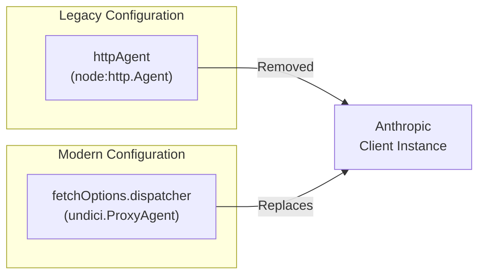
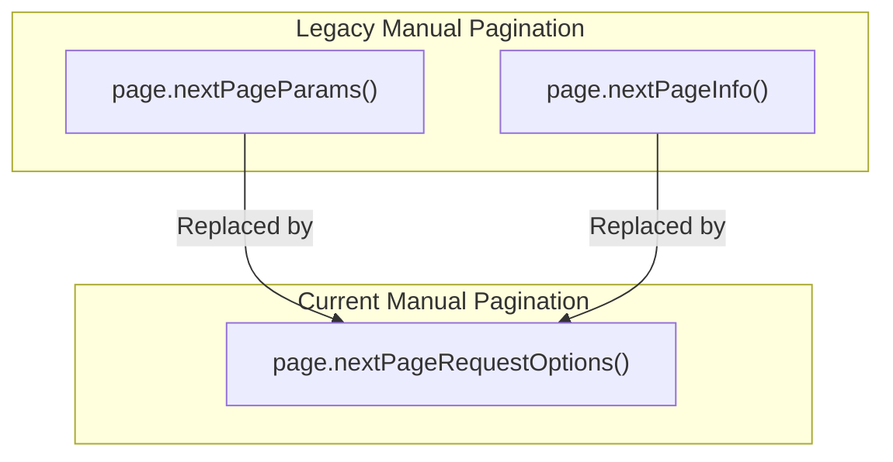

<!-- source: DeepWiki mcp.deepwiki.com · repo anthropics/anthropic-sdk-typescript · page 7 Migration Guide · fetched 2026-10-26 -->

# Migration Guide

<details>
<summary>Relevant source files</summary>

The following files were used as context for generating this wiki page:

- [MIGRATION.md](MIGRATION.md)
- [bin/cli](bin/cli)
- [bin/migration-config.json](bin/migration-config.json)

</details>


This page documents the breaking changes introduced in `@anthropic-ai/sdk` version 0.50 and the steps needed to update code written against version 0.41. It covers the Web Fetch API adoption, renamed and removed exports, path parameter changes, shim removal, and pagination API changes.

For information about installing the SDK for the first time, see [Installation & Setup](#1.1). For information about the current client configuration options (including `fetchOptions`), see [Client Configuration](#2.1). For documentation on the legacy Completions API, see [Completions API (Legacy)](#3.3).

---

## Migration CLI

Before making any manual changes, run the automated migration tool. After upgrading `@anthropic-ai/sdk`, execute:

```bash
./node_modules/.bin/anthropic-ai-sdk migrate ./your/src/folders
```

To preview changes without writing them to disk, add the `--dry` flag:

```bash
./node_modules/.bin/anthropic-ai-sdk migrate --dry ./your/src/folders
```

The CLI is defined in [bin/cli:1-54]() and invokes a migration transform using the configuration in [bin/migration-config.json:1-83](). It handles the named path parameter changes for `beta.skills.versions.retrieve()` and `beta.skills.versions.delete()` automatically.

Sources: [bin/cli:1-54](), [bin/migration-config.json:1-83]()

---

## Environment Requirements

The minimum supported runtime and tooling versions are now:

| Requirement | Minimum version |
|---|---|
| Node.js | 20 LTS (Most recent non-EOL Node version) |
| TypeScript | 4.9 |
| Jest | 28 |

Sources: [MIGRATION.md:13-20]()

---

## Breaking Changes

### Web Fetch API

The SDK now relies on the [builtin Web fetch API](https://developer.mozilla.org/en-US/docs/Web/API/Fetch_API) instead of `node-fetch` and has zero dependencies [MIGRATION.md:5-6]().

**Impact on `withResponse` and `asResponse`:** Because the SDK uses the builtin Web fetch API on all platforms, the `body` property of a raw response is now a Web [`ReadableStream`](https://developer.mozilla.org/en-US/docs/Web/API/ReadableStream), not a Node.js `Readable` [MIGRATION.md:23-26]().

| Before | After |
|---|---|
| `res.body.pipe(process.stdout)` | `import { Readable } from 'node:stream'; Readable.fromWeb(res.body).pipe(process.stdout);` |

**Impact on `APIError.headers`:** The `headers` property on `APIError` objects is now an instance of the Web [Headers](https://developer.mozilla.org/en-US/docs/Web/API/Headers) class. It was previously defined as `Record<string, string | null | undefined>` [MIGRATION.md:39-40]().

Sources: [MIGRATION.md:5-40]()

---

### Named Path Parameters

Methods that take multiple path parameters typically now use named instead of positional arguments for better clarity and to prevent passing arguments in the incorrect order. Only the *last* path parameter remains positional; the rest must be passed as named arguments in the options object [MIGRATION.md:41-46]().

**Affected methods:**

| Method | Old signature | New signature |
|---|---|---|
| `client.beta.skills.versions.retrieve()` | `retrieve(skill_id, version)` | `retrieve(version, { skill_id })` |
| `client.beta.skills.versions.delete()` | `delete(skill_id, version)` | `delete(version, { skill_id })` |

The migration CLI ([bin/cli:1-54]()) handles these transformations automatically using the rules in [bin/migration-config.json:6-81]().

Sources: [MIGRATION.md:41-59](), [bin/migration-config.json:6-81]()

---

### URI-Encoded Path Parameters

Path parameters are now properly encoded by default. If you were manually calling `encodeURIComponent()` before passing a value to any SDK method, you must now stop doing that and pass the param without any encoding applied [MIGRATION.md:60-63]().

| Before | After |
|---|---|
| `client.example.retrieve(encodeURIComponent('string/with/slash'))` | `client.example.retrieve('string/with/slash')` |

The new behavior produces `/example/string%2Fwith%2Fslash`. Previously, without the manual encoding, the SDK would have used the path `/example/string/with/slash` [MIGRATION.md:68-72]().

Sources: [MIGRATION.md:60-73]()

---

### Removed Request Options Overloads

When making requests with no required body, query, or header parameters, you must now explicitly pass `null`, `undefined`, or an empty object `{}` to the params argument in order to customize request options [MIGRATION.md:74-76]().

```typescript
// Incorrect:
client.models.list({ headers: { ... } });

// Correct:
client.models.list({}, { headers: { ... } });
```

**Affected methods include:**
* `client.messages.batches.list()`
* `client.models.retrieve()` / `list()`
* `client.beta.models.retrieve()` / `list()`
* `client.beta.messages.batches.retrieve()` / `list()` / `delete()` / `cancel()` / `results()`
* `client.beta.files.list()` / `delete()` / `download()` / `retrieveMetadata()`
* `client.beta.skills.create()` / `retrieve()` / `list()` / `delete()`
* `client.beta.skills.versions.create()` / `list()`

Sources: [MIGRATION.md:74-109]()

---

### `httpAgent` Removed in Favor of `fetchOptions`

The `httpAgent` client option has been removed in favor of a [platform-specific `fetchOptions` property](https://github.com/anthropics/anthropic-sdk-typescript#fetch-options). This change was made because `httpAgent` relied on `node:http` agents which are not supported by any runtime's builtin fetch implementation [MIGRATION.md:110-113]().

**Migration flow:**



**Before:**
```ts
import Anthropic from '@anthropic-ai/sdk';
import { HttpsProxyAgent } from 'https-proxy-agent';

const client = new Anthropic({
  httpAgent: new HttpsProxyAgent(process.env.PROXY_URL),
});
```

**After:**
```ts
import Anthropic from '@anthropic-ai/sdk';
import * as undici from 'undici';

const proxyAgent = new undici.ProxyAgent(process.env.PROXY_URL);
const client = new Anthropic({
  fetchOptions: {
    dispatcher: proxyAgent,
  },
});
```

Sources: [MIGRATION.md:110-143]()

---

### Changed Exports

#### Module Path Restructuring

Public-facing code previously at the top level or inside `@anthropic-ai/sdk/core` has been reorganized. Internal-only code moved to a private `internal` folder, while public utilities moved to a dedicated `core` folder [MIGRATION.md:146-150]().

| Before | After |
|---|---|
| `@anthropic-ai/sdk/error` | `@anthropic-ai/sdk/core/error` |
| `@anthropic-ai/sdk/pagination` | `@anthropic-ai/sdk/core/pagination` |
| `@anthropic-ai/sdk/resource` | `@anthropic-ai/sdk/core/resource` |
| `@anthropic-ai/sdk/streaming` | `@anthropic-ai/sdk/core/streaming` |
| `@anthropic-ai/sdk/uploads` | `@anthropic-ai/sdk/core/uploads` |

Sources: [MIGRATION.md:146-167]()

#### `APIClient` Renamed to `BaseAnthropic`

The base client class used for extension or type checking has been renamed [MIGRATION.md:209-211]().

| Before | After |
|---|---|
| `import { APIClient } from '@anthropic-ai/sdk/core'` | `import { BaseAnthropic } from '@anthropic-ai/sdk/client'` |

`BaseAnthropic` is also re-exported from the main entry point [src/index.ts:7]().

Sources: [MIGRATION.md:209-219](), [src/index.ts:7]()

#### Resource Class Imports

Previously, resource classes like `Completions` could be imported directly from the root in CommonJS. This now only works if referenced as static class properties or imported from specific files [MIGRATION.md:171-175]().

| Before | After |
|---|---|
| `const { Completions } = require('@anthropic-ai/sdk')` | `const { Anthropic } = require('@anthropic-ai/sdk'); Anthropic.Completions` |

Sources: [MIGRATION.md:171-182]()

#### `uploads` Export Cleanup

Internal implementation details were removed from the public `@anthropic-ai/sdk/uploads` (now `@anthropic-ai/sdk/core/uploads`) export [MIGRATION.md:184-186]().

**Removed symbols:** `fileFromPath`, `BlobPart`, `BlobLike`, `FileLike`, `ResponseLike`, `isResponseLike`, `isBlobLike`, `isFileLike`, `isUploadable`, `isMultipartBody`, `maybeMultipartFormRequestOptions`, `multipartFormRequestOptions`, `createForm` [MIGRATION.md:187-201]().

`Uploadable` and `toFile` remain exported from the main entry point [src/index.ts:5]().

Sources: [MIGRATION.md:184-207](), [src/index.ts:5]()

---

### File Handling: `fileFromPath` Removed

The `fileFromPath` helper has been removed. Use standard runtime-specific alternatives [MIGRATION.md:221-223]().

| Environment | Replacement |
|---|---|
| **Node.js** | `fs.createReadStream('path/to/file')` |
| **Bun** | `Bun.file('path/to/file')` |

Sources: [MIGRATION.md:221-234]()

---

### Shims Removal

The `@anthropic-ai/sdk/shims` import path is removed. The SDK now uses the builtin Web fetch API unconditionally. Type compatibility should be handled via `tsconfig.json` [MIGRATION.md:237-246]().

Sources: [MIGRATION.md:237-246]()

---

### Pagination API Changes

The `for await` iteration pattern remains the standard way to consume paginated results. However, manual pagination methods have changed [MIGRATION.md:249-253]().



#### Page Classes as Type Aliases

Per-method page classes (e.g., `BetaMessageBatchesPage`) are now type aliases over the generic `Page<T>` base rather than concrete classes. Use the base `Page` class for `instanceof` checks or rely on type-level imports [MIGRATION.md:267-283]().

Sources: [MIGRATION.md:249-283]()

---

### `@anthropic-ai/sdk/src` Directory Removed

The `src/` directory is no longer included in the published package. All imports referencing `src/` must be updated to reference the package root or appropriate sub-paths [MIGRATION.md:285-298]().

| Before | After |
|---|---|
| `import Anthropic from '@anthropic-ai/sdk/src'` | `import Anthropic from '@anthropic-ai/sdk'` |

Sources: [MIGRATION.md:285-298]()

---

## TypeScript Troubleshooting

If you encounter type errors regarding global Web types (`Request`, `Response`, `Headers`), ensure your `tsconfig.json` is configured correctly for your target environment.

| Runtime | `tsconfig.json` configuration |
|---|---|
| **Browser** | `lib: ["DOM", "DOM.Iterable", "ES2018"]` |
| **Node.js** | Install `@types/node >= 20` |
| **Cloudflare Workers** | `types: ["@cloudflare/workers-types"]` |
| **Bun** | Install `@types/bun >= 1.2.0` |

All environments should target `ES2018` or higher [MIGRATION.md:300-376]().

Sources: [MIGRATION.md:300-376]()

---

