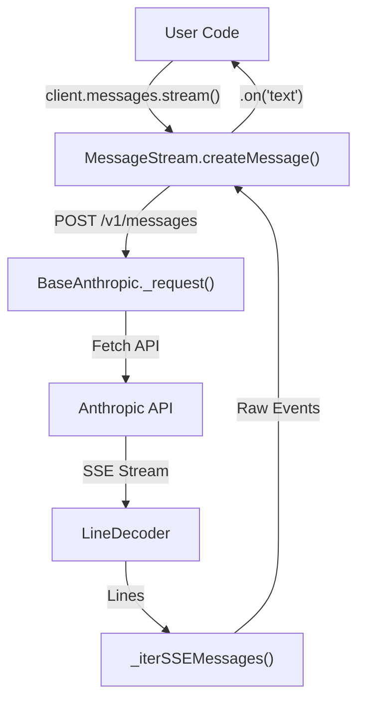
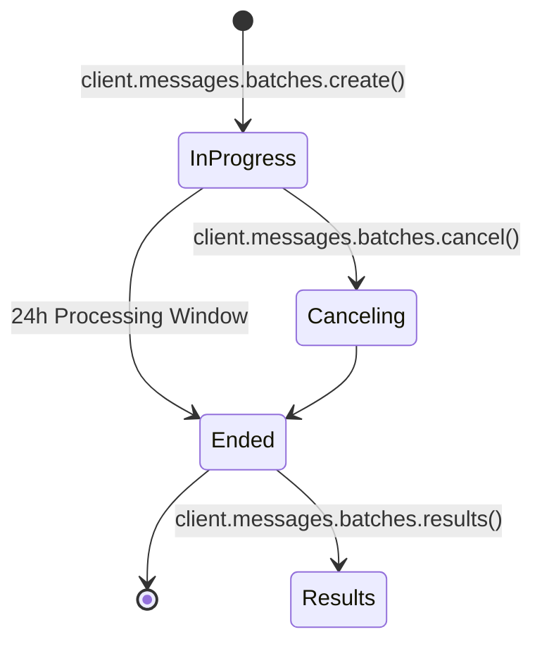

<!-- source: DeepWiki mcp.deepwiki.com · repo anthropics/anthropic-sdk-typescript · page 8 Glossary · fetched 2026-10-26 -->

# Glossary

Relevant source files

The following files were used as context for generating this wiki page:

- [MIGRATION.md](MIGRATION.md)
- [bin/cli](bin/cli)
- [bin/migration-config.json](bin/migration-config.json)
- [helpers.md](helpers.md)
- [src/client.ts](src/client.ts)
- [src/internal/decoders/line.ts](src/internal/decoders/line.ts)
- [src/lib/BetaMessageStream.ts](src/lib/BetaMessageStream.ts)
- [src/lib/MessageStream.ts](src/lib/MessageStream.ts)
- [src/lib/tools/BetaToolRunner.ts](src/lib/tools/BetaToolRunner.ts)
- [src/lib/tools/ToolRunner.ts](src/lib/tools/ToolRunner.ts)
- [src/resources/beta/messages/messages.ts](src/resources/beta/messages/messages.ts)
- [src/resources/index.ts](src/resources/index.ts)
- [src/resources/messages/index.ts](src/resources/messages/index.ts)
- [src/resources/messages/messages.ts](src/resources/messages/messages.ts)
- [src/streaming.ts](src/streaming.ts)
- [src/uploads.ts](src/uploads.ts)
- [tests/api-resources/BetaMessageStream.test.ts](tests/api-resources/BetaMessageStream.test.ts)
- [tests/api-resources/MessageStream.test.ts](tests/api-resources/MessageStream.test.ts)
- [tests/form.test.ts](tests/form.test.ts)
- [tests/internal/decoders/line.test.ts](tests/internal/decoders/line.test.ts)
- [tests/lib/fixtures/incomplete_partial_json_response.txt](tests/lib/fixtures/incomplete_partial_json_response.txt)
- [tests/lib/tools/ToolRunner.test.ts](tests/lib/tools/ToolRunner.test.ts)
- [tests/lib/tools/ToolRunnerE2E.test.ts](tests/lib/tools/ToolRunnerE2E.test.ts)
- [tests/streaming.test.ts](tests/streaming.test.ts)
- [tests/uploads.test.ts](tests/uploads.test.ts)

This glossary defines technical terms, domain-specific jargon, and core abstractions used throughout the Anthropic TypeScript SDK. It is intended to orient onboarding engineers to the codebase's architecture and the terminology used in the Anthropic API ecosystem.

## Core Client Abstractions

### APIResource
The base class for all API resource namespaces (e.g., `Messages`, `Models`, `Completions`). It provides access to the underlying client instance via `this._client`.
*   **Definition**: [src/core/resource.ts:4-12]()
*   **Usage**: Used to structure the SDK into logical namespaces like `client.messages` or `client.beta.messages`.

### BaseAnthropic
The abstract base class for the Anthropic client. It contains the core logic for request lifecycle management, retries, and platform detection.
*   **Definition**: [src/client.ts:241-241]()
*   **Role**: Handles the `_request` method which orchestrates the transformation of high-level method calls into HTTP requests.

### APIPromise
A custom Promise subclass returned by all SDK methods. it extends the standard `Promise` to include a `.withResponse()` method, allowing users to access both the parsed data and the raw HTTP response.
*   **Definition**: [src/core/api-promise.ts:10-15]()
*   **Key Method**: `withResponse()` [src/core/api-promise.ts:27-35]() which returns an object containing `data`, `response`, and the `request_id`.

### Stainless
Refers to the automated tooling used to generate the SDK from an OpenAPI specification. Most files in the SDK contain a header indicating they are "Generated from our OpenAPI spec by Stainless".
*   **Pointer**: See comments at the top of [src/client.ts:1-1]() or [src/resources/messages/messages.ts:1-1]().

---

## Messaging & Content Concepts

### ContentBlock
A discriminated union representing the different types of content that can make up a message.
*   **Definition**: [src/resources/messages/messages.ts:234-234]() (Imported/Exported)
*   **Types**: Includes `TextBlock`, `ImageBlockParam`, `ToolUseBlock`, and the newer `ThinkingBlock`.

### ThinkingBlock
A specific type of content block where the model performs internal reasoning or "chain of thought" before providing a final answer.
*   **Definition**: [src/resources/messages/messages.ts:177-177]()
*   **Beta Usage**: Often used in conjunction with `ThinkingConfig` to enable/disable reasoning capabilities [src/resources/messages/messages.ts:179-182]().

### HUMAN_PROMPT / AI_PROMPT
Legacy constants used in the Completions API to format prompts for Claude.
*   **Pointer**: Historically used to wrap text in `\n\nHuman: ` and `\n\nAssistant: ` tags. While the Messages API handles roles structurally, these constants may appear in legacy documentation or tests.

### ParsedMessage
A message object where the `content` has been processed to extract structured data (e.g., from a JSON output format).
*   **Definition**: [src/lib/parser.ts:14-14]()
*   **Usage**: Returned by `client.messages.parse()` [src/resources/messages/messages.ts:124-130]().

---

## Streaming Architecture

### MessageStream
A high-level helper class that simplifies consuming Server-Sent Events (SSE). It accumulates deltas into a final message and provides an event-emitter interface (e.g., `.on('text', ...)`).
*   **Definition**: [src/lib/MessageStream.ts:51-51]()
*   **Events**: `connect`, `text`, `message`, `contentBlock`, `finalMessage`, `error` [src/lib/MessageStream.ts:22-36]().

### RawMessageStreamEvent
The low-level JSON objects received over the wire in a stream, before being processed by the SDK into snapshots.
*   **Definition**: [src/resources/messages/messages.ts:150-150]()
*   **Event Types**: `message_start`, `content_block_start`, `content_block_delta`, `message_delta`, etc. [tests/api-resources/MessageStream.test.ts:21-30]().

### LineDecoder
An internal utility that processes raw binary chunks from a stream and splits them into discrete lines for SSE parsing.
*   **Definition**: [src/internal/decoders/line.ts:7-7]()
*   **Implementation**: Handles various newline characters (`\n`, `\r`, `\r\n`) across chunk boundaries.

### Request-to-Stream Data Flow
The following diagram illustrates how a call to `messages.stream()` moves from the user through the SDK's internal layers.

**Diagram: Streaming Data Flow**

**Sources**: [src/lib/MessageStream.ts:151-170](), [src/client.ts:400-415](), [src/core/streaming.ts:60-80]().

---

## Beta Features & Tools

### AnthropicBeta
A string union of available beta feature flags passed via the `anthropic-beta` header.
*   **Definition**: [src/resources/beta/beta.ts:6-6]()
*   **Common Values**: `prompt-caching-2024-07-31`, `mcp-2024-11-05`, `message-batches-2024-09-24`.

### BetaToolRunner
An advanced helper that manages a multi-turn conversation loop where the model can call tools, the SDK executes them, and the results are fed back to the model automatically.
*   **Definition**: [src/lib/tools/BetaToolRunner.ts:19-19]()
*   **Process**: It continues looping until the model provides a final text response or hits `max_iterations`.

### ModelContextProtocol (MCP)
A protocol that allows Claude to interact with external data sources and tools via a standardized interface.
*   **Related Entity**: `MCPToolset` — A collection of tools derived from an MCP server.
*   **Beta Helpers**: `mcpTool`, `mcpTools` [src/resources/beta/messages/messages.ts:25-47]().

### ToolError
A specific error class used within the `BetaToolRunner` to indicate that a tool execution failed, which is then reported back to the model as a `tool_result` with `is_error: true`.
*   **Definition**: [src/lib/tools/ToolError.ts:23-23]()

---

## Infrastructure & Utilities

### IdempotencyKey
A unique string sent in the `idempotency-key` header to ensure that a request is processed only once, even if retried due to network issues.
*   **Implementation**: Generated automatically for retries if not provided by the user.

### PageCursor
Used in paginated list responses. It contains the `after` or `before` pointers for the next set of results.
*   **Definition**: [src/core/pagination.ts:21-25]()
*   **Usage**: Seen in `ModelInfosPage` and `MessageBatchesPage`.

### toFile / Uploadable
Utilities for handling file uploads. `toFile` converts various inputs (Buffer, Blob, String) into a format compatible with the `multipart/form-data` requirements of the Files API.
*   **Definition**: [src/core/uploads.ts:50-50]()
*   **Types**: `Uploadable` represents any type that can be converted to a file [src/core/uploads.ts:15-15]().

### CacheControlEphemeral
An object used to mark a specific content block for "Prompt Caching", allowing the model to reuse processed tokens in subsequent requests.
*   **Definition**: [src/resources/messages/messages.ts:76-76]()
*   **Field**: `type: 'ephemeral'`.

### Entity Mapping: Natural Language to Code
This table bridges domain concepts to their specific implementation classes in the SDK.

| Domain Concept | SDK Entity (Code) | Primary Location |
| :--- | :--- | :--- |
| **API Request** | `APIPromise` | [src/core/api-promise.ts]() |
| **Error Handling** | `APIError` | [src/core/error.ts]() |
| **Streaming** | `MessageStream` | [src/lib/MessageStream.ts]() |
| **Beta Logic** | `Beta` resource | [src/resources/beta/beta.ts]() |
| **Pagination** | `PageCursorResponse` | [src/core/pagination.ts]() |
| **Tool Execution** | `BetaToolRunner` | [src/lib/tools/BetaToolRunner.ts]() |

**Sources**: [src/resources/index.ts:1-206](), [src/client.ts:1-100]().

---

## Message Batches

### MessageBatch
A resource representing a collection of message requests sent for asynchronous processing.
*   **Definition**: [src/resources/messages/batches.ts:22-22]()
*   **Lifecycle**: Batches move through states like `processing`, `ended`, and `canceling`.
*   **Results**: Retrieved via `client.messages.batches.results(batch_id)`, which returns a stream of JSONL results [src/resources/messages/batches.ts:34-34]().

**Diagram: Batch Lifecycle**

**Sources**: [src/resources/messages/batches.ts:1-47](), [src/resources/beta/messages/batches.ts:1-47]().