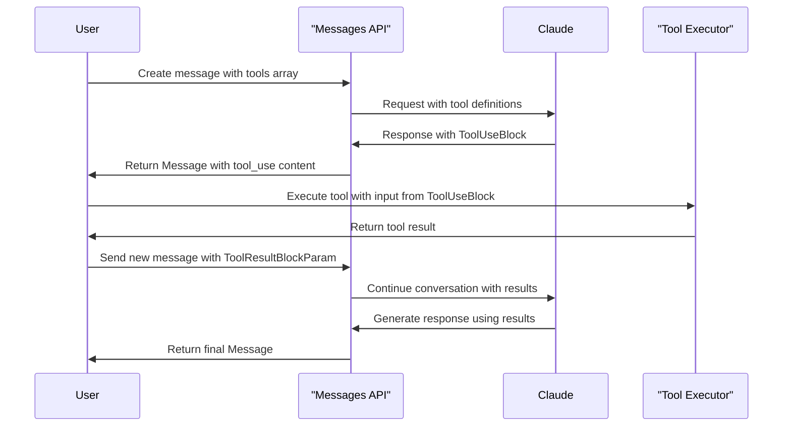
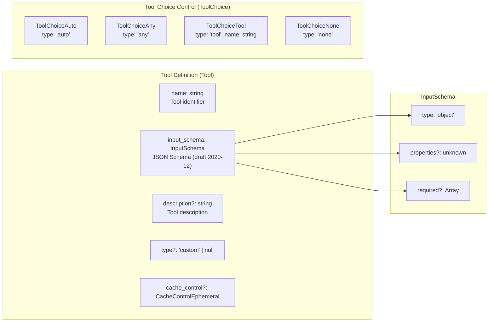
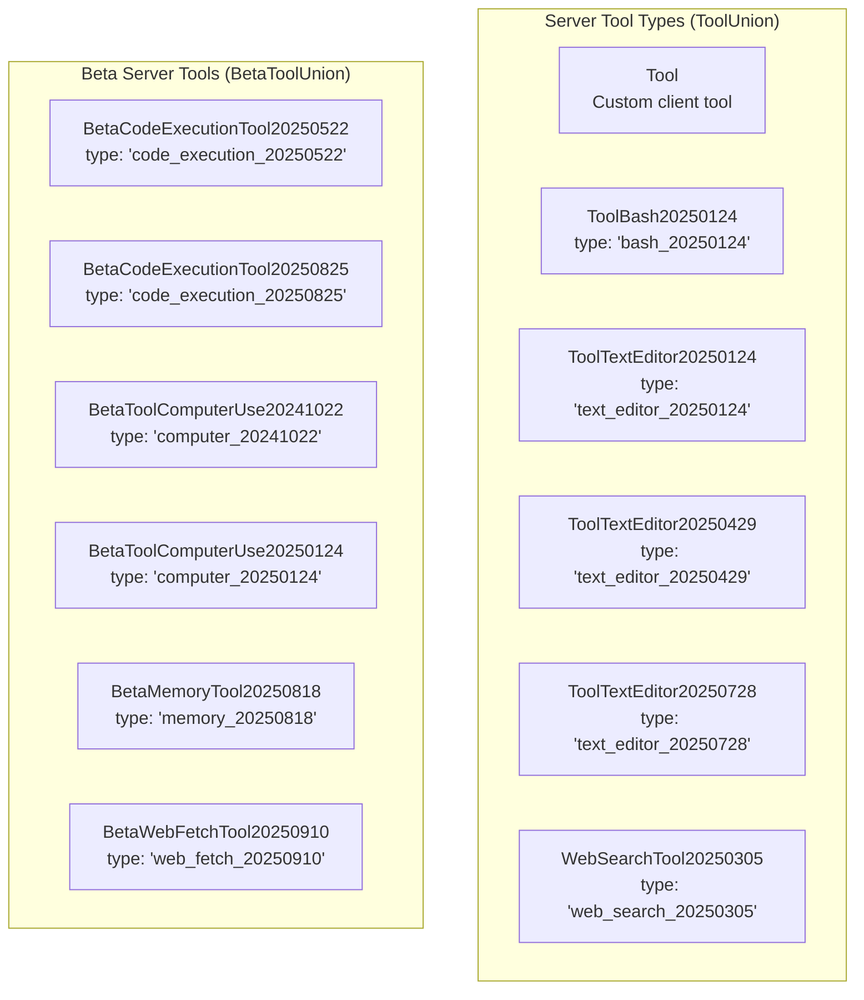

<!-- source: DeepWiki mcp.deepwiki.com · repo anthropics/anthropic-sdk-typescript · extra page Content Blocks & Tools · fetched 2026-10-26 -->

# Content Blocks & Tools

<details>
<summary>Relevant source files</summary>

The following files were used as context for generating this wiki page:

- [.stats.yml](.stats.yml)
- [api.md](api.md)
- [examples/count-tokens.ts](examples/count-tokens.ts)
- [examples/thinking-stream.ts](examples/thinking-stream.ts)
- [examples/thinking.ts](examples/thinking.ts)
- [examples/tools-streaming.ts](examples/tools-streaming.ts)
- [examples/tools.ts](examples/tools.ts)
- [examples/web-search-stream.ts](examples/web-search-stream.ts)
- [examples/web-search.ts](examples/web-search.ts)
- [src/resources/beta/messages/messages.ts](src/resources/beta/messages/messages.ts)
- [src/resources/messages/messages.ts](src/resources/messages/messages.ts)

</details>


This document describes the content block types used in message exchanges and the tool system architecture in the Messages API. Content blocks are the fundamental units of communication between users and Claude, while tools enable Claude to perform actions and integrate with external systems.

For information about creating messages and basic message structure, see [Creating Messages](3.2.1). For streaming message responses, see [Streaming Responses](3.2.3).

## Content Block Overview

Content blocks are typed data structures that represent different kinds of content in messages. They come in two categories: **input blocks** (sent to Claude) and **output blocks** (received from Claude).

### Content Block Type Hierarchy

```mermaid
graph TB
    subgraph "Input Content Blocks (ContentBlockParam)"
        IN_TEXT["TextBlockParam<br/>type: 'text'"]
        IN_IMAGE["ImageBlockParam<br/>type: 'image'"]
        IN_DOC["DocumentBlockParam<br/>type: 'document'"]
        IN_SEARCH["SearchResultBlockParam<br/>type: 'search_result'"]
        IN_THINKING["ThinkingBlockParam<br/>type: 'thinking'"]
        IN_TOOL_USE["ToolUseBlockParam<br/>type: 'tool_use'"]
        IN_TOOL_RESULT["ToolResultBlockParam<br/>type: 'tool_result'"]
        IN_SERVER_TOOL["ServerToolUseBlockParam<br/>type: 'server_tool_use'"]
    end
    
    subgraph "Output Content Blocks (ContentBlock)"
        OUT_TEXT["TextBlock<br/>type: 'text'"]
        OUT_THINKING["ThinkingBlock<br/>type: 'thinking'"]
        OUT_REDACTED["RedactedThinkingBlock<br/>type: 'redacted_thinking'"]
        OUT_TOOL_USE["ToolUseBlock<br/>type: 'tool_use'"]
        OUT_SERVER_TOOL["ServerToolUseBlock<br/>type: 'server_tool_use'"]
        OUT_WEB_SEARCH["WebSearchToolResultBlock<br/>type: 'web_search_tool_result'"]
    end
    
    MSG_CONTENT["Message.content<br/>Array<ContentBlock>"]
    PARAM_CONTENT["MessageParam.content<br/>string | Array<ContentBlockParam>"]
    
    PARAM_CONTENT --> IN_TEXT
    PARAM_CONTENT --> IN_IMAGE
    PARAM_CONTENT --> IN_DOC
    PARAM_CONTENT --> IN_SEARCH
    PARAM_CONTENT --> IN_THINKING
    PARAM_CONTENT --> IN_TOOL_USE
    PARAM_CONTENT --> IN_TOOL_RESULT
    PARAM_CONTENT --> IN_SERVER_TOOL
    
    MSG_CONTENT --> OUT_TEXT
    MSG_CONTENT --> OUT_THINKING
    MSG_CONTENT --> OUT_REDACTED
    MSG_CONTENT --> OUT_TOOL_USE
    MSG_CONTENT --> OUT_SERVER_TOOL
    MSG_CONTENT --> OUT_WEB_SEARCH
```



Sources: [src/resources/messages/messages.ts:67-75](), [src/resources/messages/messages.ts:317-346]()

## Input Content Block Types

Input content blocks are sent in the `messages` array when creating a message. The `content` field of a `MessageParam` can be either a simple string (shorthand for a single text block) or an array of typed content blocks.

### Text Blocks

The most basic content block. Can include citations for referenced documents.

| Field | Type | Description |
|-------|------|-------------|
| `type` | `'text'` | Block type identifier |
| `text` | `string` | The text content |
| `citations` | `Array<TextCitationParam>` \| `null` | Optional citations |
| `cache_control` | `CacheControlEphemeral` \| `null` | Cache control breakpoint |

Sources: [src/resources/messages/messages.ts:782-793]()

### Image Blocks

Support for images via base64 encoding or URL references.

| Field | Type | Description |
|-------|------|-------------|
| `type` | `'image'` | Block type identifier |
| `source` | `Base64ImageSource` \| `URLImageSource` | Image source |
| `cache_control` | `CacheControlEphemeral` \| `null` | Cache control breakpoint |

**Image Source Types:**
- `Base64ImageSource`: `{ type: 'base64', media_type: 'image/jpeg' | 'image/png' | 'image/gif' | 'image/webp', data: string }` [src/resources/messages/messages.ts:189-195]()
- `URLImageSource`: `{ type: 'url', url: string }` [src/resources/messages/messages.ts:1104-1108]()

Sources: [src/resources/messages/messages.ts:365-374](), [src/resources/messages/messages.ts:189-195]()

### Document Blocks

Support for document content including PDFs and plain text.

| Field | Type | Description |
|-------|------|-------------|
| `type` | `'document'` | Block type identifier |
| `source` | Various document sources | Document data |
| `title` | `string` \| `null` | Document title |
| `citations` | `CitationsConfigParam` \| `null` | Citation configuration |
| `context` | `string` \| `null` | Additional context |
| `cache_control` | `CacheControlEphemeral` \| `null` | Cache control breakpoint |

**Document Source Types:**
- `Base64PDFSource`: PDF data as base64 [src/resources/messages/messages.ts:197-203]()
- `PlainTextSource`: Plain text with `media_type: 'text/plain'` [src/resources/messages/messages.ts:597-603]()

Sources: [src/resources/messages/messages.ts:348-363]()

### Tool Result Blocks

Used to send tool execution results back to Claude in subsequent messages.

| Field | Type | Description |
|-------|------|-------------|
| `type` | `'tool_result'` | Block type identifier |
| `tool_use_id` | `string` | ID from the corresponding `ToolUseBlock` |
| `content` | `string` \| `Array<ContentBlockParam>` | Tool execution result |
| `is_error` | `boolean` | Whether this represents an error |
| `cache_control` | `CacheControlEphemeral` \| `null` | Cache control breakpoint |

Sources: [src/resources/messages/messages.ts:1002-1015]()

## Output Content Block Types

Output content blocks are returned in the `content` array of a `Message` response. These represent Claude's generated content.

### Text Blocks (Output)

Text generated by Claude, potentially with citations.

```typescript
interface TextBlock {
  type: 'text';
  text: string;
  citations: Array<TextCitation> | null;
}
```

Citations can reference different location types:
- `CitationCharLocation`: Character-based location in plain text documents [src/resources/messages/messages.ts:133-138]()
- `CitationPageLocation`: Page-based location in PDFs [src/resources/messages/messages.ts:145-150]()
- `CitationContentBlockLocation`: Content block-based location [src/resources/messages/messages.ts:139-144]()

Sources: [src/resources/messages/messages.ts:767-780]()

### Thinking Blocks

Extended thinking blocks show Claude's reasoning process when the `thinking` parameter is enabled.

```typescript
interface ThinkingBlock {
  type: 'thinking';
  thinking: string;
  signature: string;
}

interface RedactedThinkingBlock {
  type: 'redacted_thinking';
  data: string;
}
```

Sources: [src/resources/messages/messages.ts:815-821](), [src/resources/messages/messages.ts:691-695](), [examples/thinking.ts:14-16]()

### Tool Use Blocks

Indicate that Claude wants to use a tool. These blocks contain the tool invocation details.

```typescript
interface ToolUseBlock {
  type: 'tool_use';
  id: string;
  name: string;
  input: unknown;
}
```

Sources: [src/resources/messages/messages.ts:1079-1087](), [examples/tools.ts:35-37]()

## Tool System Architecture

The tool system enables Claude to perform actions and integrate with external systems. There are two distinct categories of tools: **client tools** (custom tools you define) and **server tools** (pre-built tools hosted by Anthropic).

### Tool System Flow



Sources: [examples/tools.ts:8-60]()

### Tool Definition Components



Sources: [src/resources/messages/messages.ts:871-921](), [src/resources/messages/messages.ts:943-1000]()

## Custom Tools (Client Tools)

Custom tools allow you to define arbitrary functions that Claude can invoke. You provide the tool definition with a JSON schema, and Claude generates structured `tool_use` blocks when it wants to use them.

### Tool Definition Structure

| Field | Type | Required | Description |
|-------|------|----------|-------------|
| `name` | `string` | Yes | Tool identifier used by Claude |
| `input_schema` | `Tool.InputSchema` | Yes | JSON Schema defining input shape |
| `description` | `string` | No | Detailed description |
| `type` | `'custom'` \| `null` | No | Explicitly marks as custom tool |
| `cache_control` | `CacheControlEphemeral` \| `null` | No | Cache control breakpoint |

Sources: [src/resources/messages/messages.ts:871-921](), [examples/tools.ts:13-22]()

### Tool Choice Configuration

Control how Claude uses tools with the `tool_choice` parameter:

| Type | Behavior | Parameters |
|------|----------|------------|
| `ToolChoiceAuto` | Model decides automatically | `disable_parallel_tool_use?: boolean` |
| `ToolChoiceAny` | Model must use at least one tool | `disable_parallel_tool_use?: boolean` |
| `ToolChoiceTool` | Model must use specific tool | `name: string`, `disable_parallel_tool_use?: boolean` |
| `ToolChoiceNone` | Model cannot use tools | None |

Sources: [src/resources/messages/messages.ts:943-1000]()

## Server Tools

Server tools are pre-built tools hosted and executed by Anthropic's servers.

### Server Tool Categories



Sources: [src/resources/messages/messages.ts:1071-1077](), [src/resources/beta/messages/messages.ts:1934-1948]()

### Web Search Tool

Enable Claude to perform web searches with configurable domain filters and user location.

**Version:** `web_search_20250305`

```typescript
interface WebSearchTool20250305 {
  type: 'web_search_20250305';
  name: 'web_search';
  allowed_domains?: Array<string> | null;
  blocked_domains?: Array<string> | null;
  max_uses?: number | null;
  user_location?: UserLocation | null;
  cache_control?: CacheControlEphemeral | null;
}
```

Sources: [src/resources/messages/messages.ts:1177-1246](), [examples/web-search.ts:22-27]()

## Beta Server Tools

Beta tools require specific beta headers and are accessible via `client.beta`.

### Code Execution Tools

Execute Python code in isolated containers.

**Version:** `code_execution_20250825`

```typescript
interface BetaCodeExecutionTool20250825 {
  type: 'code_execution_20250825';
  name: 'code_execution';
  cache_control?: BetaCacheControlEphemeral | null;
}
```

Sources: [src/resources/beta/messages/messages.ts:564-578]()

### Memory Tool

Persistent file-based memory for maintaining state across conversations.

**Version:** `memory_20250818`

```typescript
interface BetaMemoryTool20250818 {
  type: 'memory_20250818';
  name: 'memory';
  cache_control?: BetaCacheControlEphemeral | null;
}
```

Sources: [src/resources/beta/messages/messages.ts:847-976]()

## Content Block Type Reference Table

| Type | Direction | Stable/Beta | Description |
|------|-----------|-------------|-------------|
| `text` | Both | Stable | Plain text content |
| `image` | Input | Stable | Image data (base64/URL) |
| `document` | Input | Stable | Document data (PDF/text) |
| `thinking` | Both | Stable | Extended thinking reasoning |
| `redacted_thinking` | Output | Stable | Redacted thinking data |
| `tool_use` | Both | Stable | Tool invocation request |
| `tool_result` | Input | Stable | Tool execution result |
| `server_tool_use` | Both | Stable | Server-executed tool |
| `web_search_tool_result` | Output | Stable | Web search results |
| `web_fetch_tool_result` | Output | Beta | Web fetch result |

Sources: [src/resources/messages/messages.ts:317-346](), [src/resources/beta/messages/messages.ts:670-705]()

---

