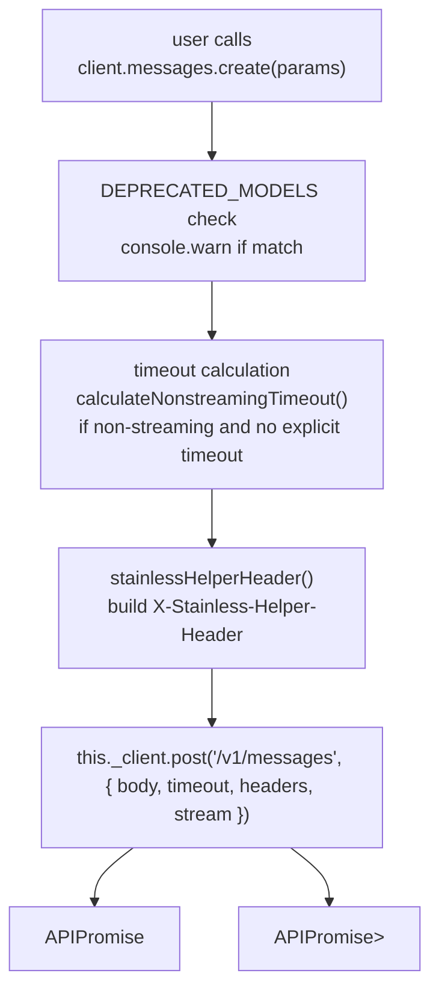
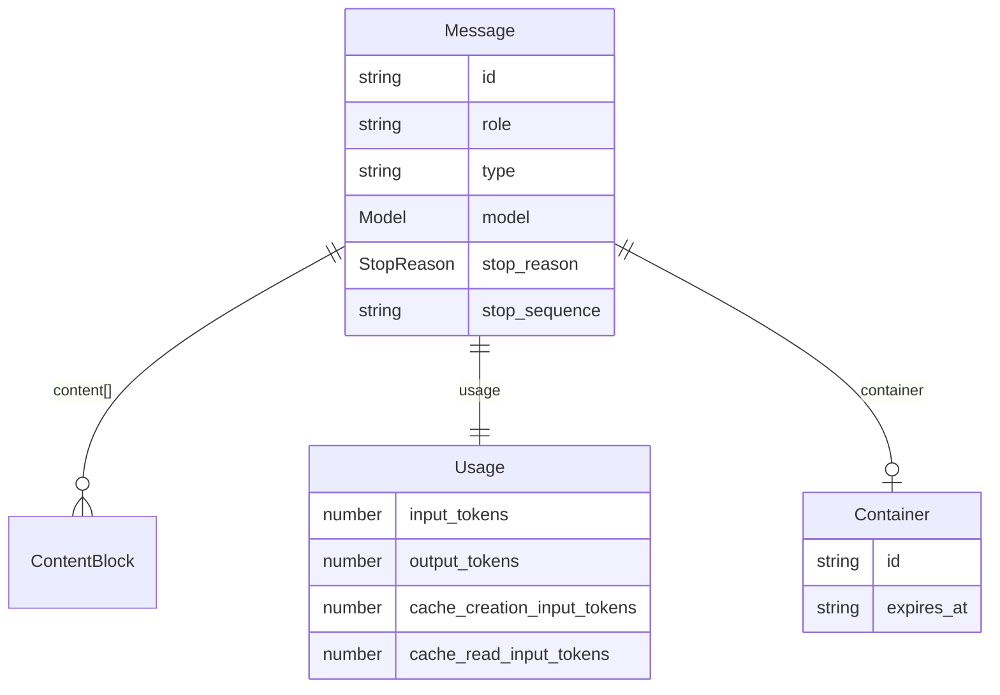
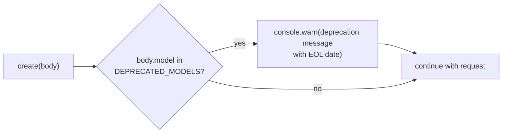

<!-- source: DeepWiki mcp.deepwiki.com · repo anthropics/anthropic-sdk-typescript · extra page Creating Messages · fetched 2026-10-26 -->

# Creating Messages

<details>
<summary>Relevant source files</summary>

The following files were used as context for generating this wiki page:

- [src/resources/beta/messages/messages.ts](src/resources/beta/messages/messages.ts)
- [src/resources/messages/messages.ts](src/resources/messages/messages.ts)
- [tests/api-resources/beta/messages/batches.test.ts](tests/api-resources/beta/messages/batches.test.ts)
- [tests/api-resources/beta/messages/messages.test.ts](tests/api-resources/beta/messages/messages.test.ts)
- [tests/api-resources/messages/batches.test.ts](tests/api-resources/messages/batches.test.ts)
- [tests/api-resources/messages/messages.test.ts](tests/api-resources/messages/messages.test.ts)

</details>


This page covers `client.messages.create()` — the primary method for sending requests to Claude and receiving completions. It documents required and optional request parameters, the shape of the response object, timeout behavior, and deprecated model warnings.

For information about **streaming responses**, see [3.2.3](). For **content block types and tool definitions**, see [3.2.2](). For **batch creation**, see [3.2.4](). For the **beta messages API** with additional parameters, see [4.1]().

---

## Method Signatures

The `Messages` class in [src/resources/messages/messages.ts:36-187]() exposes `create()` with three overloads, distinguished by whether `stream` is set:

```ts
// Non-streaming: returns a resolved Message
create(body: MessageCreateParamsNonStreaming, options?: RequestOptions): APIPromise<Message>

// Streaming: returns an async iterable of raw SSE events
create(body: MessageCreateParamsStreaming, options?: RequestOptions): APIPromise<Stream<RawMessageStreamEvent>>

// Union overload (for dynamic stream flag)
create(body: MessageCreateParamsBase, options?: RequestOptions): APIPromise<Stream<RawMessageStreamEvent> | Message>
```

The method POSTs to `/v1/messages` via the base client.

**Diagram: create() Call Flow**



Sources: [src/resources/messages/messages.ts:58-104]()

---

## Required Parameters

All three of the following fields must be present in every call:

| Parameter | Type | Description |
|-----------|------|-------------|
| `model` | `Model` (string) | The Claude model to use. See the `Model` type for the full string union. |
| `messages` | `MessageParam[]` | Ordered list of conversation turns. Each entry has `role` (`"user"` or `"assistant"`) and `content` (string or `ContentBlockParam[]`). |
| `max_tokens` | `number` | Maximum number of tokens Claude may generate in its response. |

```ts
// Minimum valid call
client.messages.create({
  model: 'claude-3-5-sonnet-20241022',
  max_tokens: 1024,
  messages: [{ role: 'user', content: 'Hello, Claude' }],
});
```

Sources: [src/resources/messages/messages.ts:58-70](), [tests/api-resources/messages/messages.test.ts:11-24]()

---

## Optional Parameters

### Sampling Controls

| Parameter | Type | Default | Description |
|-----------|------|---------|-------------|
| `temperature` | `number` | — | Randomness (0–1). Higher = more varied. Cannot be used with `thinking`. |
| `top_k` | `number` | — | Only sample from the top K tokens. |
| `top_p` | `number` | — | Nucleus sampling probability cutoff. |
| `stop_sequences` | `string[]` | — | Additional strings that, when generated, halt output. The matching sequence is not included in the response. |

### System Prompt

`system` accepts either a plain `string` or an array of `TextBlockParam` objects (enabling per-block `cache_control` and citation metadata).

```ts
// Simple string
system: "You are a helpful assistant."

// Structured form with cache control
system: [{ type: 'text', text: "Today's date is 2024-06-01.", cache_control: { type: 'ephemeral' } }]
```

### Caching

`cache_control` at the top-level request level sets a default `CacheControlEphemeral` (`{ type: 'ephemeral', ttl?: '5m' | '1h' }`). Individual content blocks (system, messages, or tools) can also carry their own `cache_control` fields.

### Metadata

`metadata` accepts `{ user_id?: string }` for associating requests with users for Anthropic's trust-and-safety systems.

### Service Tier

`service_tier` can be `'auto'` or `'standard'`. When `'auto'`, Anthropic may route to priority infrastructure if available.

### Output Configuration

`output_config` is an object used for structured outputs and quality control:

| Field | Type | Description |
|-------|------|-------------|
| `format` | `JSONOutputFormat \| ZodOutputFormat` | Structured output schema for use with `parse()`. |
| `effort` | `'low' \| ...` | Controls effort/quality tradeoff. |

### Thinking

`thinking` enables extended chain-of-thought reasoning:

```ts
thinking: { type: 'enabled', budget_tokens: 1600 }
// or
thinking: { type: 'adaptive' }
```

When `thinking` is enabled and `temperature` is set, a warning or error may result depending on the model.

### Tools and Tool Choice

`tools` accepts an array of tool definitions. `tool_choice` controls whether tool use is forced, allowed, or disabled. Both are covered in depth in [3.2.2]().

### Container

`container` (string or object) pins the request to a specific execution environment, often used with code execution tools.

Sources: [tests/api-resources/messages/messages.test.ts:26-86](), [src/resources/messages/messages.ts:39-164]()

---

## Response Shape: `Message`

The response object returned by non-streaming calls.

**Diagram: Message Entity Mapping**



### Field Reference

| Field | Type | Notes |
|-------|------|-------|
| `id` | `string` | Unique identifier for the message object. |
| `role` | `'assistant'` | Always `"assistant"`. |
| `type` | `'message'` | Always `"message"`. |
| `model` | `Model` | The model that produced the response. |
| `content` | `ContentBlock[]` | Array of typed blocks. Contains `TextBlock`, `ToolUseBlock`, `ThinkingBlock`, etc. |
| `stop_reason` | `StopReason \| null` | Why generation stopped (e.g., `"end_turn"`, `"max_tokens"`, `"tool_use"`). |
| `stop_sequence` | `string \| null` | Which custom stop sequence triggered, if any. |
| `usage` | `Usage` | Token counts for billing and rate limiting. |
| `container` | `Container \| null` | Present when a code execution container was used. |
| `_request_id` | `string` | Added by the SDK from the `request-id` response header. |

Sources: [src/resources/messages/messages.ts:58-104]()

---

## Timeout Behavior

By default, a non-streaming call times out after 10 minutes. When no explicit `timeout` is set on the client or request, and `stream` is `false`, the SDK computes a dynamic timeout based on `max_tokens` using `calculateNonstreamingTimeout()`.

The dynamic calculation is skipped (and falls back to 10 minutes) when:
- `stream: true` is set, or
- A `timeout` is explicitly set at the client or request level.

For very large `max_tokens`, it is strongly recommended to use streaming mode to avoid idle-connection timeouts on intermediate networks.

Sources: [src/resources/messages/messages.ts:88-103]()

---

## Deprecated Model Warnings

When a request is made with a model that has a scheduled end-of-life date, the SDK emits a `console.warn` before sending the request. No error is thrown.

**Diagram: Deprecated Model Logic**



The `DEPRECATED_MODELS` constant maps model identifiers to their end-of-life dates:

| Model | EOL Date |
|-------|----------|
| `claude-instant-1.2` | November 6th, 2024 |
| `claude-2.0`, `claude-2.1` | July 21st, 2025 |
| `claude-3-sonnet-20240229` | July 21st, 2025 |
| `claude-3-opus-20240229` | January 5th, 2026 |
| `claude-3-7-sonnet-20250219` | February 19th, 2026 |

Additionally, using `thinking.type === 'enabled'` on certain models (e.g., `claude-opus-4-6`) emits a warning advising use of `'adaptive'` instead.

Sources: [src/resources/beta/messages/messages.ts:49-65](), [src/resources/messages/messages.ts:71-86](), [tests/api-resources/messages/messages.test.ts:155-184]()

---

## Counting Tokens

`client.messages.countTokens()` estimates token usage for a hypothetical request **without** actually creating a message. It accepts most parameters used in `create()`.

```ts
const count = await client.messages.countTokens({
  model: 'claude-3-5-sonnet-20241022',
  messages: [{ role: 'user', content: 'Hey Claude!' }],
});
console.log(count.input_tokens);
```

The method POSTs to `/v1/messages/count_tokens` and returns a `MessageTokensCount` object.

Sources: [src/resources/messages/messages.ts:184-186](), [tests/api-resources/messages/messages.test.ts:88-152]()

---

## Companion Methods

| Method | Returns | Notes |
|--------|---------|-------|
| `messages.create({ stream: false })` | `APIPromise<Message>` | Default non-streaming path. |
| `messages.create({ stream: true })` | `APIPromise<Stream<RawMessageStreamEvent>>` | Raw SSE event iterator. See [3.2.3](). |
| `messages.stream(params)` | `MessageStream` | Higher-level streaming wrapper with event handlers. See [3.2.3](). |
| `messages.parse(params)` | `APIPromise<ParsedMessage<T>>` | Structured output variant; requires `output_config.format`. |
| `messages.countTokens(params)` | `APIPromise<MessageTokensCount>` | Token estimation without generating a response. |

Sources: [src/resources/messages/messages.ts:58-187]()

---

