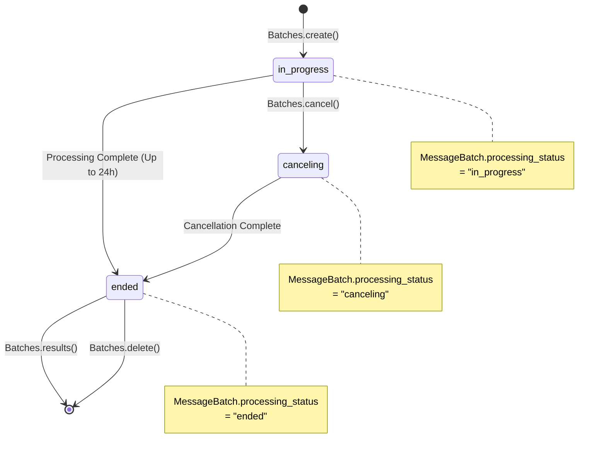
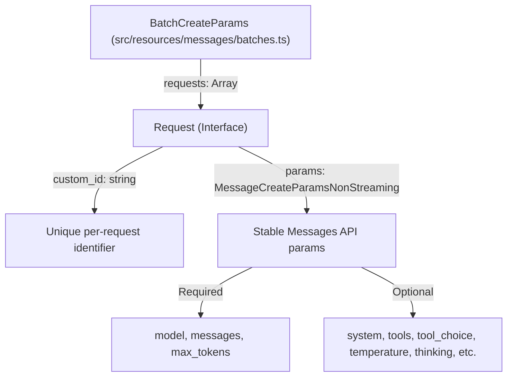
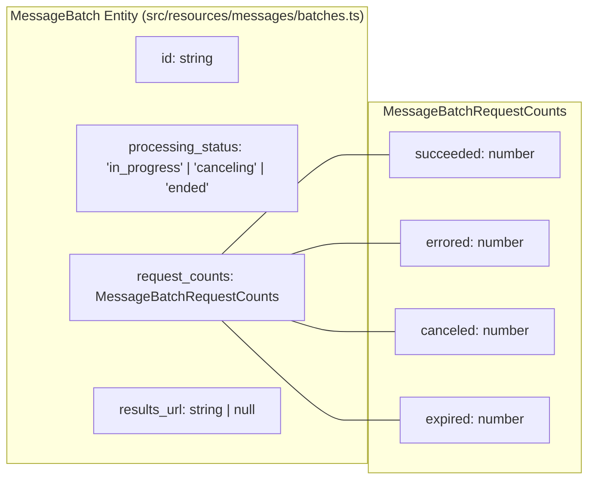
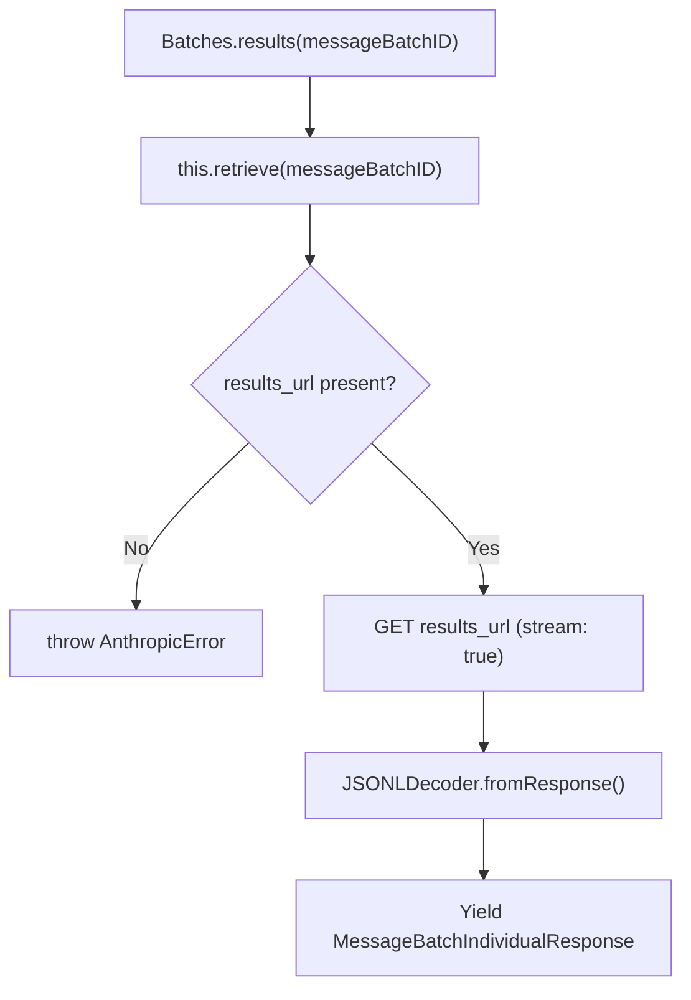

<!-- source: DeepWiki mcp.deepwiki.com · repo anthropics/anthropic-sdk-typescript · extra page Message Batches · fetched 2026-10-26 -->

# Message Batches

Relevant source files

The following files were used as context for generating this wiki page:

- [src/resources/beta/messages/batches.ts](src/resources/beta/messages/batches.ts)
- [src/resources/messages/batches.ts](src/resources/messages/batches.ts)
- [tests/api-resources/beta/messages/batches.test.ts](tests/api-resources/beta/messages/batches.test.ts)
- [tests/api-resources/beta/messages/messages.test.ts](tests/api-resources/beta/messages/messages.test.ts)
- [tests/api-resources/messages/batches.test.ts](tests/api-resources/messages/batches.test.ts)
- [tests/api-resources/messages/messages.test.ts](tests/api-resources/messages/messages.test.ts)

The Message Batches API provides asynchronous processing of multiple message requests. It is accessible under `client.messages.batches` (stable) and `client.beta.messages.batches` (beta). Both namespaces expose the same six methods: `create`, `retrieve`, `list`, `delete`, `cancel`, and `results`. For information about creating individual messages, see page 3.2.1. For streaming message responses, see page 3.2.3.

Sources: [src/resources/messages/batches.ts:14-170](), [src/resources/beta/messages/batches.ts:15-235]()

## Overview

Message Batches enable submitting multiple message creation requests as a single batch operation. Each request in a batch is identified by a `custom_id` and contains the same parameters as the standard Messages API. Batches are processed asynchronously, with results available for retrieval once processing completes.

### Key Features

| Feature | Description |
|---------|-------------|
| Asynchronous Processing | Requests are processed in the background; batches can take up to 24 hours to complete |
| Bulk Operations | Submit multiple message requests in a single API call |
| Request Tracking | Each request identified by unique `custom_id` |
| Result Retrieval | Access individual results via streaming JSONL |
| Lifecycle Management | Monitor, cancel, or delete batches |

Sources: [src/resources/messages/batches.ts:15-21](), [src/resources/beta/messages/batches.ts:16-22]()

## Batch Lifecycle

**`MessageBatch.processing_status` Transitions**

A batch progresses through states tracked by `processing_status` on the `MessageBatch` object. Once `ended`, `results_url` is populated and `results()` can be called. Batches expire 24 hours after creation.

Sources: [src/resources/messages/batches.ts:188-258](), [src/resources/beta/messages/batches.ts:253-323]()

## Request Structure

### `BatchCreateParams` Shape

**`BatchCreateParams` Type Structure**

The `params` field type in the stable resource is `MessagesAPI.MessageCreateParamsNonStreaming`. For the beta namespace, `params` supports additional beta fields like `container`, `context_management`, `mcp_servers`, and `thinking`.

Sources: [src/resources/messages/batches.ts:351-377](), [src/resources/beta/messages/batches.ts:416-771](), [tests/api-resources/beta/messages/batches.test.ts:34-137]()

### Creating a Batch

`Batches.create()` POSTs to `/v1/messages/batches`. The `custom_id` must be unique within a single batch to correlate entries in the results file.

Sources: [src/resources/messages/batches.ts:43-45](), [src/resources/beta/messages/batches.ts:45-55]()

## Batch Management Methods

### `Batches` Class API

| Method | HTTP | Return type | Notes |
|--------|------|-------------|-------|
| `create(body, options?)` | `POST /v1/messages/batches` | `APIPromise<MessageBatch>` | Starts processing immediately |
| `retrieve(id, options?)` | `GET /v1/messages/batches/{id}` | `APIPromise<MessageBatch>` | Idempotent; use for polling |
| `list(query?, options?)` | `GET /v1/messages/batches` | `PagePromise<MessageBatchesPage, MessageBatch>` | Most-recent-first ordering |
| `cancel(id, options?)` | `POST /v1/messages/batches/{id}/cancel` | `APIPromise<MessageBatch>` | Enters `canceling` state |
| `delete(id, options?)` | `DELETE /v1/messages/batches/{id}` | `APIPromise<DeletedMessageBatch>` | Batch must be `ended` first |
| `results(id, options?)` | `GET results_url` | `Promise<JSONLDecoder<...>>` | Streams results as JSONL |

Sources: [src/resources/messages/batches.ts:14-170](), [src/resources/beta/messages/batches.ts:15-235]()

### `MessageBatch` Object

The `retrieve()` and `create()` methods return a `MessageBatch` object containing metadata and request tallies.

Sources: [src/resources/messages/batches.ts:188-330](), [src/resources/beta/messages/batches.ts:253-395]()

## Result Retrieval

### `results()` Internal Flow

`results()` first calls `this.retrieve(messageBatchID)`. If `results_url` is missing, it throws an `AnthropicError`. Otherwise, it fetches the binary stream and wraps it in a `JSONLDecoder`.

Sources: [src/resources/messages/batches.ts:148-169](), [src/resources/beta/messages/batches.ts:205-234]()

## Result Types

### `MessageBatchResult` Discriminated Union

Individual request results are yielded as a discriminated union:

| Type | `type` discriminator | Payload |
|------|----------------------|---------|
| `MessageBatchSucceededResult` | `'succeeded'` | `message: Message` |
| `MessageBatchErroredResult` | `'errored'` | `error: ErrorResponse` |
| `MessageBatchCanceledResult` | `'canceled'` | None |
| `MessageBatchExpiredResult` | `'expired'` | None |

Sources: [src/resources/messages/batches.ts:260-349](), [src/resources/beta/messages/batches.ts:325-414]()

## Beta API Support

The `client.beta.messages.batches` resource automatically injects the `anthropic-beta: message-batches-2024-09-24` header. It supports additional parameters in the `params` object of each request, such as `mcp_servers`, `context_management`, and `thinking`.

Sources: [src/resources/beta/messages/batches.ts:45-55](), [tests/api-resources/beta/messages/batches.test.ts:34-137]()

---

