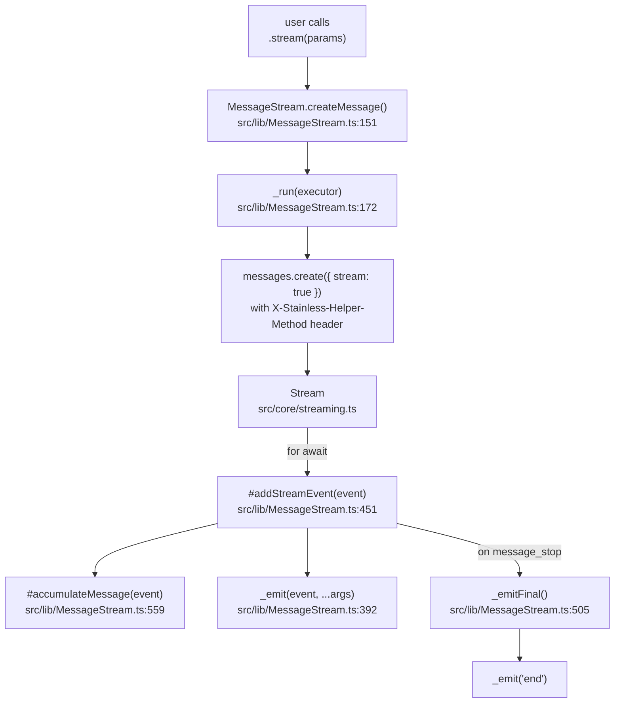
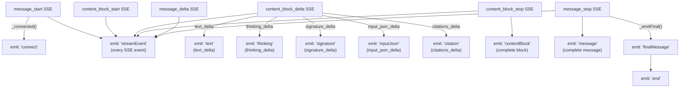
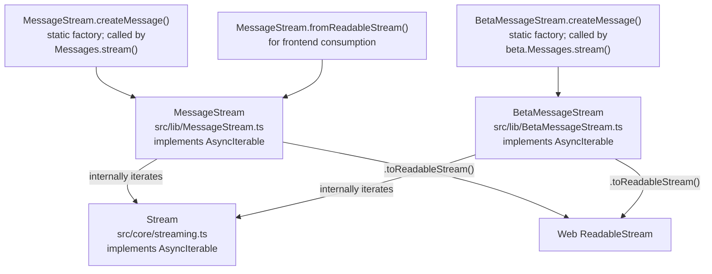

<!-- source: DeepWiki mcp.deepwiki.com · repo anthropics/anthropic-sdk-typescript · extra page Streaming Responses · fetched 2026-10-26 -->

# Streaming Responses

<details>
<summary>Relevant source files</summary>

The following files were used as context for generating this wiki page:

- [examples/cancellation.ts](examples/cancellation.ts)
- [examples/demo.ts](examples/demo.ts)
- [examples/raw-streaming.ts](examples/raw-streaming.ts)
- [examples/streaming.ts](examples/streaming.ts)
- [helpers.md](helpers.md)
- [src/internal/decoders/line.ts](src/internal/decoders/line.ts)
- [src/lib/BetaMessageStream.ts](src/lib/BetaMessageStream.ts)
- [src/lib/MessageStream.ts](src/lib/MessageStream.ts)
- [src/streaming.ts](src/streaming.ts)
- [tests/api-resources/BetaMessageStream.test.ts](tests/api-resources/BetaMessageStream.test.ts)
- [tests/api-resources/MessageStream.test.ts](tests/api-resources/MessageStream.test.ts)
- [tests/internal/decoders/line.test.ts](tests/internal/decoders/line.test.ts)
- [tests/lib/fixtures/incomplete_partial_json_response.txt](tests/lib/fixtures/incomplete_partial_json_response.txt)
- [tests/streaming.test.ts](tests/streaming.test.ts)

</details>


This page covers the three streaming consumption patterns available in `@anthropic-ai/sdk`, the `MessageStream` helper class and its event API, cancellation mechanics, and the underlying SSE/`LineDecoder` pipeline that converts raw HTTP bytes into structured events.

For the stable Messages API parameters (model, max_tokens, etc.), see [Creating Messages](3.2.1). For the beta equivalent (`client.beta.messages.stream()`), see [Beta Messages API](4.1). For batch processing (non-streaming, async), see [Message Batches](3.2.4).

---

## Overview

The SDK exposes three distinct streaming patterns:

| Pattern | Entry point | Returns | Memory | Accumulates message? |
|---|---|---|---|---|
| **Raw async iterable** | `client.messages.create({ stream: true })` | `Stream<MessageStreamEvent>` | Low | No |
| **MessageStream helper** | `client.messages.stream(params)` | `MessageStream` | Higher | Yes |
| **Event handlers** | `.on('text', ...)` | `MessageStream` | Higher | Yes |

The raw pattern iterates SSE events directly. The helper patterns wrap those events in `MessageStream`, which accumulates a complete `Message` object and fires typed event callbacks.

Both patterns terminate in the same underlying SSE pipeline: `Response.body` → `LineDecoder` → `SSEDecoder` → `Stream<RawMessageStreamEvent>`.

---

## Raw Async Iterable Pattern

When `stream: true` is passed to `client.messages.create()`, the internal request logic returns a `Stream<MessageStreamEvent>` instead of a parsed JSON object. The `Stream` class is defined in [src/core/streaming.ts:22-213]().

The caller iterates with `for await`:

```ts
// examples/raw-streaming.ts
const stream = await client.messages.create({
  model: 'claude-sonnet-4-5-20250929',
  stream: true,
  max_tokens: 500,
  messages: [{ role: 'user', content: 'Hey Claude!' }],
});

for await (const event of stream) {
  if (event.type === 'content_block_delta' && event.delta.type === 'text_delta') {
    process.stdout.write(event.delta.text);
  }
}
```

To cancel, call `stream.controller.abort()` or `break` from the loop. A `break` triggers the `finally` block in `Stream.fromSSEResponse` [src/core/streaming.ts:87-93](), which calls `controller.abort()` automatically.

**Sources:** [src/core/streaming.ts:35-98](), [examples/raw-streaming.ts:1-28](), [examples/cancellation.ts:1-46]()

---

## MessageStream Helper Pattern

`client.messages.stream(params)` and `client.beta.messages.stream(params)` return a `MessageStream` [src/lib/MessageStream.ts:51-743]() or `BetaMessageStream` [src/lib/BetaMessageStream.ts:54-764]() respectively. These classes accumulate the full `Message` object incrementally and expose typed event callbacks.

**Diagram: MessageStream internal wiring**



**Sources:** [src/lib/MessageStream.ts:151-170](), [src/lib/MessageStream.ts:172-219](), [src/lib/MessageStream.ts:451-512]()

---

## The SSE Pipeline

**Diagram: Byte-to-event pipeline (code entities)**

```mermaid
flowchart LR
    BODY["Response.body\n(ReadableStream)"]
    ITER["ReadableStreamToAsyncIterable\nsrc/internal/shims.ts"]
    SSE_CHUNKS["iterSSEChunks()\nsrc/core/streaming.ts:253"]
    LD["LineDecoder\nsrc/internal/decoders/line.ts:11"]
    SSED["SSEDecoder.decode(line)\nsrc/core/streaming.ts:283"]
    ITER_SSE["_iterSSEMessages()\nsrc/core/streaming.ts:215"]
    FROM_SSE["Stream.fromSSEResponse()\nsrc/core/streaming.ts:35"]
    PARSED["Stream<Item>\nasync iterable of JSON-parsed events"]

    BODY --> ITER
    ITER --> SSE_CHUNKS
    SSE_CHUNKS --> LD
    LD --> SSED
    SSED --> ITER_SSE
    ITER_SSE --> FROM_SSE
    FROM_SSE --> PARSED
```



**Key components:**

| Class / Function | File | Role |
|---|---|---|
| `LineDecoder` | [src/internal/decoders/line.ts:11-75]() | Buffers bytes, yields complete text lines. Handles `\n`, `\r`, `\r\n`, multi-byte UTF-8 across chunks. |
| `SSEDecoder` | [src/core/streaming.ts:283-336]() | Accumulates `event:` and `data:` fields, yields `ServerSentEvent` on double-newline. |
| `iterSSEChunks()` | [src/core/streaming.ts:253-281]() | Splits byte stream at double-newline boundaries before line decoding. |
| `_iterSSEMessages()` | [src/core/streaming.ts:215-247]() | Combines `iterSSEChunks` + `LineDecoder` + `SSEDecoder` into an `AsyncGenerator<ServerSentEvent>`. |
| `Stream.fromSSEResponse()` | [src/core/streaming.ts:35-98]() | Wraps `_iterSSEMessages`, JSON-parses each event's `data`, throws `APIError` on `error` events. |

**Error handling:** If the server emits an SSE event with `event: error`, `Stream.fromSSEResponse` throws an `APIError` [src/core/streaming.ts:82-84]().

**Sources:** [src/core/streaming.ts:1-346](), [src/internal/decoders/line.ts:1-104](), [tests/streaming.test.ts:1-245]()

---

## MessageStream API

`MessageStream` ([src/lib/MessageStream.ts:51-743]()) is the stable API version. `BetaMessageStream` ([src/lib/BetaMessageStream.ts:54-764]()) is the beta equivalent with additional events like `compaction`.

### Event Handlers

Register via `.on(event, callback)`. Returns `this` for chaining. Use `.once()` for one-shot listeners and `.off()` to remove.

**Diagram: Event emission points mapped to SSE event types**



**Sources:** [src/lib/MessageStream.ts:451-512](), [src/lib/MessageStream.ts:440-445](), [src/lib/MessageStream.ts:392-438]()

### Complete Event Reference

| Event | Callback signature | Fired when |
|---|---|---|
| `connect` | `() => void` | HTTP connection established |
| `streamEvent` | `(event, snapshot)` | Every SSE event; `snapshot` is the accumulated `Message` |
| `text` | `(textDelta, textSnapshot)` | `content_block_delta` with `text_delta` |
| `thinking` | `(thinkingDelta, thinkingSnapshot)` | `content_block_delta` with `thinking_delta` |
| `signature` | `(signature)` | `content_block_delta` with `signature_delta` |
| `inputJson` | `(partialJson, jsonSnapshot)` | `content_block_delta` with `input_json_delta` |
| `citation` | `(citation, citationsSnapshot)` | `content_block_delta` with `citations_delta` |
| `contentBlock` | `(content)` | `content_block_stop` — block is complete |
| `message` | `(message)` | `message_stop` — full message received |
| `finalMessage` | `(message)` | After `message`; last event before `end` |
| `error` | `(error)` | Any stream error |
| `abort` | `(error)` | Stream aborted |
| `end` | `() => void` | Always last; stream fully finished |

**Sources:** [src/lib/MessageStream.ts:22-36](), [helpers.md:24-66]()

### Methods

| Method | Returns | Description |
|---|---|---|
| `.done()` | `Promise<void>` | Resolves when stream ends; rejects on error/abort |
| `.finalMessage()` | `Promise<Message>` | Resolves with last accumulated `Message` |
| `.finalText()` | `Promise<string>` | Resolves with concatenated text of final message |
| `.abort()` | `void` | Calls `controller.abort()` |
| `.toReadableStream()` | `ReadableStream` | Converts stream to a Web `ReadableStream` for transport |
| `.withResponse()` | `Promise<{data, response, request_id}>` | Returns stream + raw `Response` + `request_id` |

**Sources:** [src/lib/MessageStream.ts:242-369](), [src/lib/MessageStream.ts:101-136](), [helpers.md:68-100]()

---

## Message Accumulation

`MessageStream` builds a `Message` snapshot incrementally. Each call to `#addStreamEvent` [src/lib/MessageStream.ts:451-503]() calls `#accumulateMessage` [src/lib/MessageStream.ts:559-673](), which mutates a private `#currentMessageSnapshot`:

- `message_start` → initializes the snapshot from `event.message`
- `content_block_start` → pushes a new content block
- `content_block_delta` → appends text/thinking/JSON to the last block
- `message_delta` → updates `stop_reason`, `stop_sequence`, token usage
- `message_stop` → finalizes; snapshot is added to `receivedMessages`

For `input_json_delta`, partial JSON is buffered in a non-enumerable `__json_buf` property on the content block and re-parsed via `partialParse()` on every delta [src/lib/MessageStream.ts:629-643]().

**Sources:** [src/lib/MessageStream.ts:559-673](), [src/lib/MessageStream.ts:629-643]()

---

## Cancellation

There are two equivalent ways to cancel a streaming request:

1. **`break` from the async iterator** — The `return()` method on the async iterator [src/lib/MessageStream.ts:729-732]() calls `this.abort()`, which signals `controller.abort()`.
2. **`stream.controller.abort()` or `stream.abort()`** — Can be called from outside the iterator, e.g. from a `setTimeout`.

After cancellation, `stream.aborted` becomes `true` and any awaited promise (`.done()`, `.finalMessage()`) rejects with `APIUserAbortError`.

**Sources:** [src/lib/MessageStream.ts:242-244](), [src/lib/MessageStream.ts:696-734](), [examples/cancellation.ts:1-46]()

---

## Thinking Blocks

Extended thinking responses produce `thinking_delta` and `signature_delta` SSE events. `MessageStream` handles these via the `thinking` and `signature` events. The `ThinkingBlock` content accumulates `thinking` text and a final `signature` value [src/lib/MessageStream.ts:645-659]().

```ts
client.messages
  .stream({ 
    thinking: { type: 'enabled', budget_tokens: 1600 },
    model: 'claude-3-7-sonnet-20250219',
    ... 
  })
  .on('thinking', (delta) => process.stdout.write(delta))
  .on('text', (text) => process.stdout.write(text));
```

**Sources:** [src/lib/MessageStream.ts:479-489](), [src/lib/MessageStream.ts:645-659]()

---

## Relationship Between Stream Classes

**Diagram: Class relationships and instantiation paths**



**Sources:** [src/lib/MessageStream.ts:51-170](), [src/lib/BetaMessageStream.ts:54-171](), [src/core/streaming.ts:22-213]()

---

## Error Propagation

Errors in the stream surface through multiple channels:

- **Event handler:** `.on('error', (err) => ...)` or `.on('abort', (err) => ...)`
- **Awaited promise:** `.done()` / `.finalMessage()` / `.finalText()` reject
- **Async iterator:** the `for await` loop throws

If no error handler is registered and no promise-returning method has been called, the SDK calls `Promise.reject(error)` to trigger an unhandled rejection [src/lib/MessageStream.ts:424-435]().

**Sources:** [src/lib/MessageStream.ts:371-438](), [tests/api-resources/MessageStream.test.ts:85-138]()

---

