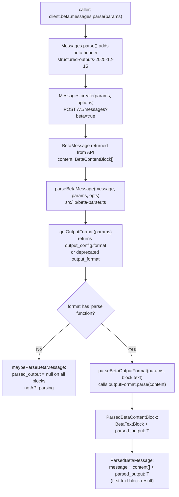
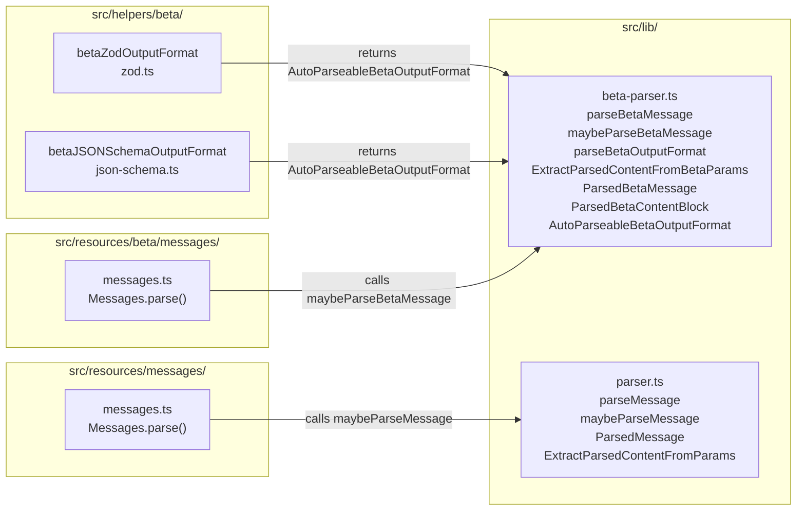

<!-- source: DeepWiki mcp.deepwiki.com · repo anthropics/anthropic-sdk-typescript · extra page Structured Outputs · fetched 2026-10-26 -->

# Structured Outputs

<details>
<summary>Relevant source files</summary>

The following files were used as context for generating this wiki page:

- [src/helpers/beta/json-schema.ts](src/helpers/beta/json-schema.ts)
- [src/helpers/beta/zod.ts](src/helpers/beta/zod.ts)
- [src/lib/beta-parser.ts](src/lib/beta-parser.ts)
- [tests/lib/parser.test.ts](tests/lib/parser.test.ts)
- [tests/resources/beta/messages/parse.test.ts](tests/resources/beta/messages/parse.test.ts)

</details>


This page covers the SDK's structured output parsing system: the format helpers that describe the desired shape, the `parse()` method that invokes the API and triggers automatic parsing, and the typed response objects that carry the parsed result.

For information on the broader Beta Messages API (including streaming and tool calling), see [Beta Messages API](#4.1). For the `BetaToolRunner` and its relationship with structured outputs in an automated tool loop, see [Beta Tools & ToolRunner](#4.2).

---

## Overview

Structured outputs let you ask Claude to return JSON conforming to a schema, and have the SDK automatically parse and validate that JSON into a typed object. The feature is available on both the stable and beta message endpoints, but the helper functions and beta flag differ between the two.

| Endpoint | Helper functions | Request field | Beta header required |
|---|---|---|---|
| `client.messages.parse()` | `zodOutputFormat`, `jsonSchemaOutputFormat` | `output_config.format` | No |
| `client.beta.messages.parse()` | `betaZodOutputFormat`, `betaJSONSchemaOutputFormat` | `output_config.format` | Yes (`structured-outputs-2025-12-15`, added automatically) |

The SDK appends the `structured-outputs-2025-12-15` beta header automatically when `client.beta.messages.parse()` is called; callers do not need to add it manually.

---

## Format Helpers

A format helper builds an `AutoParseableBetaOutputFormat<T>` (or `AutoParseableOutputFormat<T>` on the stable side) — a plain object with `type: 'json_schema'`, a `schema` field, and a `parse(content: string): T` function. That `parse` function is what the SDK calls after receiving the model's response.

### `betaZodOutputFormat` (beta API)

Converts a Zod schema to JSON Schema using `z.toJSONSchema` [src/helpers/beta/zod.ts:20-20](), then applies `transformJSONSchema` [src/helpers/beta/zod.ts:22-22]() to ensure compatibility with Claude's schema requirements. Returns an `AutoParseableBetaOutputFormat<zodInfer<ZodInput>>` [src/helpers/beta/zod.ts:17-19]() whose `parse` function runs `zodObject.safeParse(JSON.parse(content))` [src/helpers/beta/zod.ts:29-30]().

If Zod validation fails, a descriptive `AnthropicError` is thrown [src/helpers/beta/zod.ts:32-36]().

### `betaJSONSchemaOutputFormat` (beta API)

Accepts a raw JSON schema object typed via `json-schema-to-ts` [src/helpers/beta/json-schema.ts:43-50](). By default (`transform: true`), runs `transformJSONSchema` to normalize the schema [src/helpers/beta/json-schema.ts:55-60](). The `parse` function performs only `JSON.parse(content)` [src/helpers/beta/json-schema.ts:67-69]() — no structural validation beyond successful JSON parsing.

### `zodOutputFormat` and `jsonSchemaOutputFormat` (stable API)

Mirror of the beta helpers, used with `client.messages.parse()`. The stable API does not require any beta header.

---

### Format Helper Type Diagram

**AutoParseable format hierarchy**

```mermaid
classDiagram
    class "BetaJSONOutputFormat" {
        +type: 'json_schema'
        +schema: object
    }
    class "AutoParseableBetaOutputFormat~T~" {
        +type: 'json_schema'
        +schema: object
        +parse(content: string) T
    }
    class "betaZodOutputFormat~T~" {
        <<function>>
        +returns AutoParseableBetaOutputFormat~T~
        "uses z.toJSONSchema + transformJSONSchema"
        "parse: zodObject.safeParse(JSON.parse(content))"
    }
    class "betaJSONSchemaOutputFormat~T~" {
        <<function>>
        +returns AutoParseableBetaOutputFormat~T~
        "parse: JSON.parse(content)"
    }
    "BetaJSONOutputFormat" <|-- "AutoParseableBetaOutputFormat~T~"
    "AutoParseableBetaOutputFormat~T~" <.. "betaZodOutputFormat~T~" : "creates"
    "AutoParseableBetaOutputFormat~T~" <.. "betaJSONSchemaOutputFormat~T~" : "creates"
```

Sources: [src/helpers/beta/zod.ts:17-41](), [src/helpers/beta/json-schema.ts:43-75](), [src/lib/beta-parser.ts:35-37]()

---

## The `parse()` Method

### Beta: `client.beta.messages.parse()`

Steps performed internally:

1. Merges `structured-outputs-2025-12-15` into the `anthropic-beta` header alongside any caller-supplied betas.
2. Calls `this.create(params, options)` to make the API request.
3. On the resolved `BetaMessage`, calls `maybeParseBetaMessage(message, params, { logger })` [src/lib/beta-parser.ts:55-59]().
4. Returns a `ParsedBetaMessage<T>` with `parsed_output` populated.

### Stable: `client.messages.parse()`

Mirrors the beta flow but calls `parseMessage` from `src/lib/parser.ts` instead of `parseBetaMessage`. No beta header is added.

---

## Response Types

### `ParsedBetaMessage<ParsedT>`

Defined in [src/lib/beta-parser.ts:39-42]().

```typescript
export type ParsedBetaMessage<ParsedT> = BetaMessage & {
  content: Array<ParsedBetaContentBlock<ParsedT>>;
  parsed_output: ParsedT | null;
};
```

The top-level `parsed_output` is taken from the **first** text block's parsed result [src/lib/beta-parser.ts:126-126](). If no text blocks exist or if the format is not auto-parseable, `parsed_output` is `null`.

### `ParsedBetaContentBlock<ParsedT>`

Defined in [src/lib/beta-parser.ts:44-46]().

```typescript
export type ParsedBetaContentBlock<ParsedT> =
  | (BetaTextBlock & { parsed_output: ParsedT | null })
  | Exclude<BetaContentBlock, BetaTextBlock>;
```

Only `BetaTextBlock` entries gain a `parsed_output` property. All other block types (e.g., `BetaThinkingBlock`, `BetaToolUseBlock`) are passed through unchanged [src/lib/beta-parser.ts:120-120]().

> **Deprecation note:** Text blocks also expose a `.parsed` property for backward compatibility, but accessing it logs a warning via the client's logger. Use `.parsed_output` instead [src/lib/beta-parser.ts:110-118]().

---

## How `parsed_output` Is Attached

### Parsing flow diagram

**`parseBetaMessage` internal data flow**



Sources: [src/lib/beta-parser.ts:48-128](), [src/lib/beta-parser.ts:87-87]()

### Content block iteration

`parseBetaMessage` maps over `message.content` [src/lib/beta-parser.ts:98-98](). For each block:

- **`type === 'text'`**: Calls `parseBetaOutputFormat(params, block.text)` [src/lib/beta-parser.ts:100-100](). Attaches the result as `parsed_output` via `Object.defineProperty` [src/lib/beta-parser.ts:106-109]().
- **Any other type**: Returned as-is [src/lib/beta-parser.ts:120-120]().

The first non-null parsed result from any text block becomes the top-level `parsed_output` on the message [src/lib/beta-parser.ts:102-104](), [src/lib/beta-parser.ts:126-126]().

---

## Deprecated `output_format` Parameter

The top-level `output_format` request parameter is deprecated [src/lib/beta-parser.ts:22-25](). The current form is `output_config: { format: ... }`.

`getOutputFormat` in [src/lib/beta-parser.ts:48-53]() handles backward compatibility: it prefers `output_format` (deprecated) over `output_config.format`.

| Deprecated | Current |
|---|---|
| `output_format: betaZodOutputFormat(schema)` | `output_config: { format: betaZodOutputFormat(schema) }` |

---

## Type Inference with `ExtractParsedContentFromBetaParams`

The generic type parameter `ParsedT` on `ParsedBetaMessage<ParsedT>` is inferred at compile time from the request params [src/lib/beta-parser.ts:30-33]():

```typescript
export type ExtractParsedContentFromBetaParams<Params extends BetaParseableMessageCreateParams> =
  Params['output_format'] extends AutoParseableBetaOutputFormat<infer P> ? P
  : Params['output_config'] extends { format: AutoParseableBetaOutputFormat<infer P> } ? P
  : null;
```

If neither `output_format` nor `output_config.format` is an `AutoParseableBetaOutputFormat`, `ParsedT` resolves to `null`, and `parsed_output` is typed as `null`.

---

## Entity Map

**Code entities involved in structured output**



Sources: [src/lib/beta-parser.ts:1-148](), [src/helpers/beta/zod.ts:1-41](), [src/helpers/beta/json-schema.ts:1-75]()

---

## Error Handling

| Condition | Error thrown |
|---|---|
| JSON response cannot be parsed | `AnthropicError`: "Failed to parse structured output: ..." [src/lib/beta-parser.ts:145-147]() |
| Zod validation fails (via `betaZodOutputFormat`) | `AnthropicError` wrapping Zod's error message [src/helpers/beta/zod.ts:32-36]() |
| No text blocks in response when format is set | `parsed_output: null`, no error [src/lib/beta-parser.ts:123-128]() |

Sources: [src/lib/beta-parser.ts:130-148](), [src/helpers/beta/zod.ts:29-40]()

---

