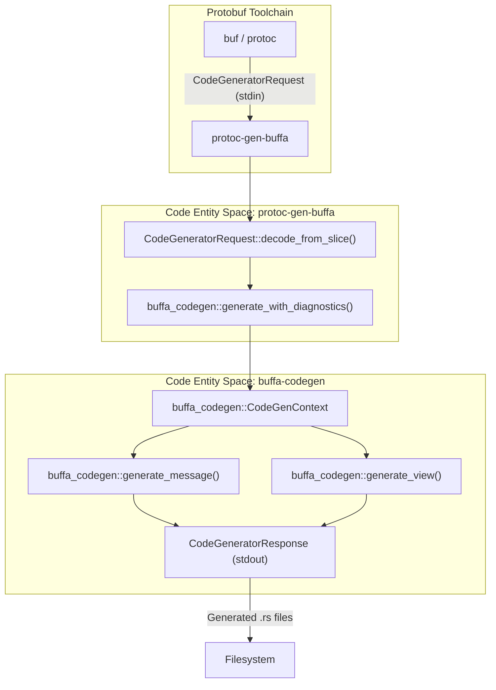
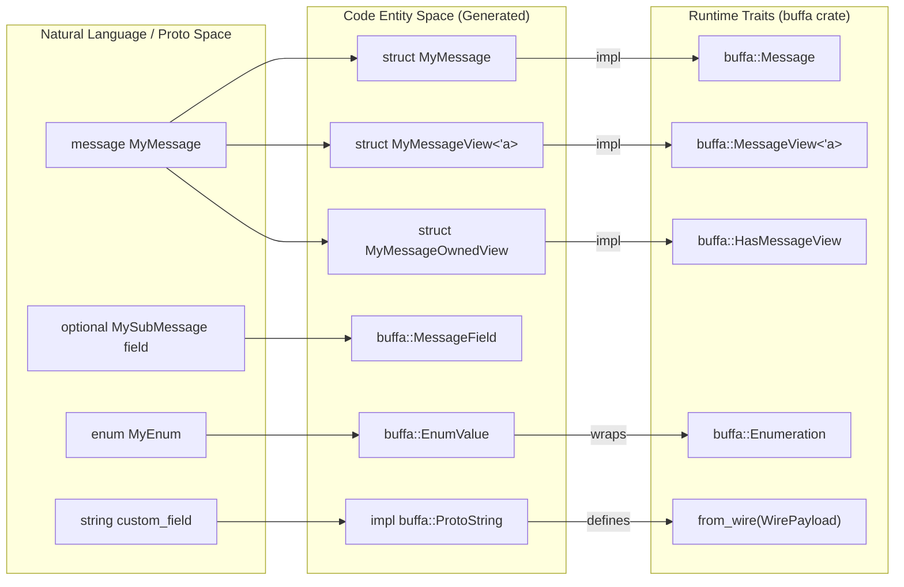

<!-- source: DeepWiki mcp.deepwiki.com · repo anthropics/buffa · page 1.1 Getting Started · fetched 2026-10-26 -->

# Getting Started

<details>
<summary>Relevant source files</summary>

The following files were used as context for generating this wiki page:

- [CHANGELOG.md](CHANGELOG.md)
- [Cargo.lock](Cargo.lock)
- [Cargo.toml](Cargo.toml)
- [buffa-build/Cargo.toml](buffa-build/Cargo.toml)
- [buffa-codegen/Cargo.toml](buffa-codegen/Cargo.toml)
- [buffa/Cargo.toml](buffa/Cargo.toml)
- [docs/guide.md](docs/guide.md)
- [docs/migration-from-prost.md](docs/migration-from-prost.md)
- [docs/migration-from-protobuf.md](docs/migration-from-protobuf.md)
- [protoc-gen-buffa-packaging/Cargo.toml](protoc-gen-buffa-packaging/Cargo.toml)
- [protoc-gen-buffa/Cargo.toml](protoc-gen-buffa/Cargo.toml)
- [protoc-gen-buffa/src/main.rs](protoc-gen-buffa/src/main.rs)

</details>


This page provides a step-by-step guide for integrating `buffa` into a Rust project. It covers installation, build-system configuration, basic usage for encoding and decoding, and the new pluggable type system introduced in version 0.8.0.

## Installation

To use `buffa`, add the core runtime and (optionally) the well-known types crate to your `Cargo.toml`.

```toml
[dependencies]
buffa = "0.8"
buffa-types = "0.8" # Required for Timestamp, Duration, Any, etc.

[build-dependencies]
buffa-build = "0.8" # Required if using build.rs integration
```
Sources: [Cargo.toml:50-51](), [docs/guide.md:9-17]()

### Feature Flags

`buffa` and its associated crates use feature flags to control dependencies, particularly for `no_std` environments and high-performance UTF-8 validation.

| Feature | Default | Description |
| :--- | :--- | :--- |
| `std` | **Yes** | Enables `std::io` integration, `HashMap` for maps, and `std::time` conversions. [buffa/Cargo.toml:19-26]() |
| `fast-utf8` | **Yes** | Uses `smoothutf8` for formally verified, SIMD-accelerated UTF-8 validation on the decode hot path. [buffa/Cargo.toml:27-31]() |
| `json` | No | Enables canonical Proto3 JSON mapping via `serde` (works with `no_std` + `alloc`). [buffa/Cargo.toml:36-43]() |
| `reflect` | No | Enables `buffa-descriptor` integration for `DescriptorPool` and `DynamicMessage`. [docs/guide.md:37-37]() |
| `arbitrary` | No | Enables `arbitrary::Arbitrary` derives for generated types (useful for fuzzing). [buffa/Cargo.toml:44-44]() |

Sources: [buffa/Cargo.toml:17-45](), [docs/guide.md:27-43]()

## Choosing a Build Integration

There are two primary ways to generate Rust code from `.proto` files: the `buf` remote plugin (recommended) or the `buffa-build` build script helper.

### 1. Using `buf generate` (Recommended)
This approach uses the [buf](https://buf.build/) CLI. It supports remote generation, meaning you do not need `protoc` or the `buffa` plugins installed locally.

**Configuration (`buf.gen.yaml`):**
```yaml
version: v2
plugins:
  - remote: buf.build/anthropics/buffa
    out: src/gen
    opt:
      - file_per_package=true
      - json=true
```

To generate a full module tree (`mod.rs`) automatically, add the `protoc-gen-buffa-packaging` plugin:

```yaml
version: v2
plugins:
  - remote: buf.build/anthropics/buffa
    out: src/gen
  - local: protoc-gen-buffa-packaging
    out: src/gen
    strategy: all
```

Sources: [docs/guide.md:88-139](), [protoc-gen-buffa/src/main.rs:36-45]()

### 2. Using `buffa-build`
For projects preferring `build.rs` integration, `buffa-build` provides a `Config` API with extensive knobs for pluggable types.

**Example `build.rs`:**
```rust
fn main() {
    buffa_build::Config::new()
        .files(&["proto/service.proto"])
        .includes(&["proto/"])
        .include_file("_include.rs")
        // Example of 0.8.0 pluggable types:
        .string_type_custom("::buffa_smolstr::SmolStr") 
        .compile()
        .expect("codegen failed");
}
```

Sources: [buffa-build/Cargo.toml:1-10](), [CHANGELOG.md:86-98](), [docs/guide.md:141-166]()

## Implementation Flow: Codegen Request

The following diagram illustrates how the compiler plugins interface with the `buffa-codegen` library to transform Protobuf descriptors into Rust source code.

**Plugin Data Flow**

Sources: [protoc-gen-buffa/src/main.rs:94-139](), [buffa-codegen/Cargo.toml:12-23](), [CHANGELOG.md:21-24]()

## Quick Encode/Decode Examples

`buffa` provides two tiers of types: **Owned Types** (standard structs) and **View Types** (zero-copy borrowed views).

### Binary Wire Format
```rust
use buffa::Message;

// 1. Encode
let msg = MyMessage { id: 42, ..Default::default() };
let bytes: Vec<u8> = msg.encode_to_vec();

// 2. Decode (Owned)
let decoded = MyMessage::decode_from_slice(&bytes).unwrap();

// 3. Decode (Zero-copy View)
// Decodes directly into a view that borrows from the slice
let view = MyMessageView::decode_view(&bytes).unwrap();
println!("ID: {}", view.id); 

// 4. OwnedView (Zero-copy + 'static for async)
// Wraps the buffer and the view together in a self-referential container
let owned_view = buffa::OwnedView::<MyMessageView>::decode(bytes.into()).unwrap();
```
Sources: [CHANGELOG.md:32-36](), [docs/migration-from-prost.md:151-182](), [docs/migration-from-protobuf.md:85-112]()

### JSON Serialization
Requires the `json` feature. Buffa implements the canonical Proto3 JSON mapping.
```rust
// Encode to JSON string
let json = serde_json::to_string(&msg).unwrap();

// Decode from JSON string
let decoded: MyMessage = serde_json::from_str(&json).unwrap();
```
Sources: [buffa/Cargo.toml:36-43](), [docs/migration-from-prost.md:221-239]()

## Compiler Compatibility Matrix

`buffa` treats Protobuf Editions as the core abstraction. While it supports legacy proto2 and proto3, the required version of `protoc` is determined by the edition features used.

| Feature / Edition | Minimum `protoc` | Notes |
| :--- | :--- | :--- |
| Proto2 / Proto3 | v21.12 | Baseline support. [docs/guide.md:75-75]() |
| Editions 2023 | v27.0 | Support for feature resolution and `EDITION_2023`. [docs/guide.md:76-76]() |
| Editions 2024 | v33.0 | Required for `EDITION_2024` and latest features. [docs/guide.md:77-77]() |

Sources: [docs/guide.md:71-80](), [protoc-gen-buffa/src/main.rs:131-132]()

## Architecture: Type Space Mapping

The following diagram bridges the gap between Protobuf schema concepts and the specific Rust entities and traits used by the `buffa` runtime.

**Protobuf to Rust Mapping**

Sources: [CHANGELOG.md:11-16](), [CHANGELOG.md:86-98](), [docs/migration-from-prost.md:79-112](), [docs/migration-from-protobuf.md:128-164]()

---

