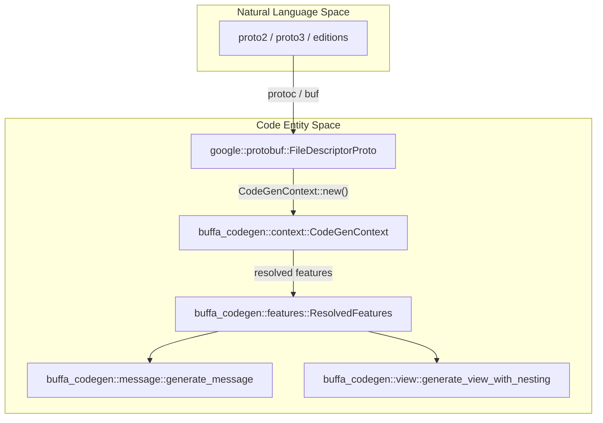
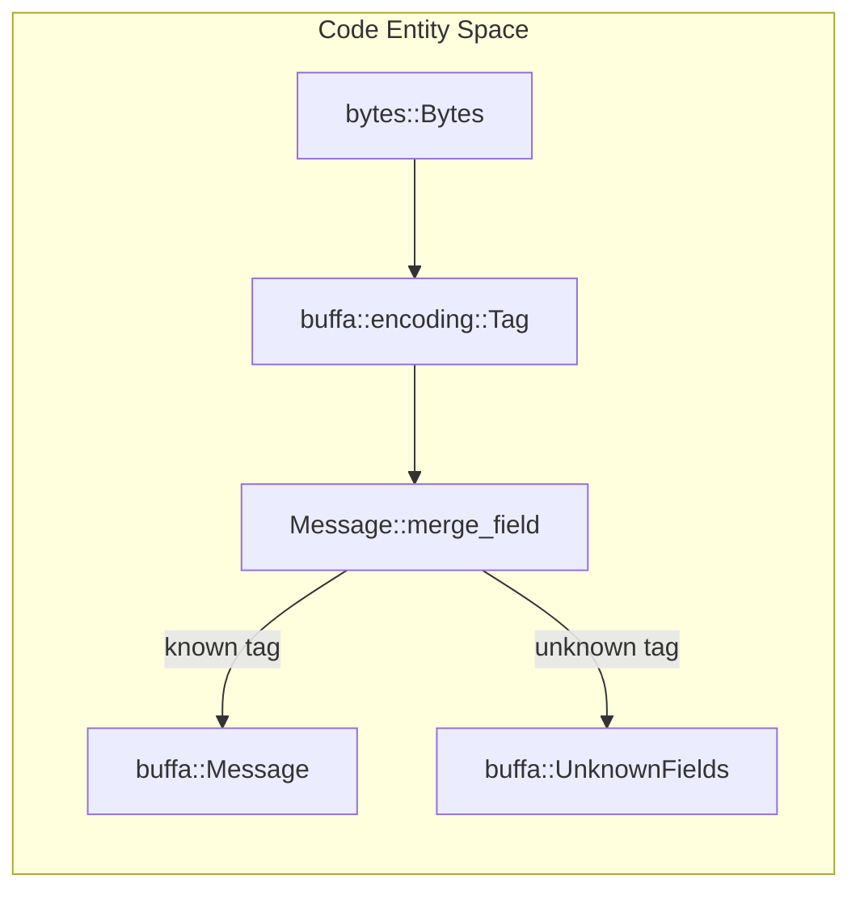

<!-- source: DeepWiki mcp.deepwiki.com · repo anthropics/buffa · page 1.2 Design Principles and Architecture · fetched 2026-10-26 -->

# Design Principles and Architecture

Relevant source files

The following files were used as context for generating this wiki page:

- [CHANGELOG.md](CHANGELOG.md)
- [buffa-codegen/src/impl_message.rs](buffa-codegen/src/impl_message.rs)
- [buffa-codegen/src/impl_text.rs](buffa-codegen/src/impl_text.rs)
- [buffa-codegen/src/view.rs](buffa-codegen/src/view.rs)
- [buffa-types/src/generated/google.protobuf.any.__view.rs](buffa-types/src/generated/google.protobuf.any.__view.rs)
- [buffa-types/src/generated/google.protobuf.duration.__view.rs](buffa-types/src/generated/google.protobuf.duration.__view.rs)
- [buffa-types/src/generated/google.protobuf.empty.__view.rs](buffa-types/src/generated/google.protobuf.empty.__view.rs)
- [buffa-types/src/generated/google.protobuf.field_mask.__view.rs](buffa-types/src/generated/google.protobuf.field_mask.__view.rs)
- [buffa-types/src/generated/google.protobuf.struct.__view.rs](buffa-types/src/generated/google.protobuf.struct.__view.rs)
- [buffa-types/src/generated/google.protobuf.timestamp.__view.rs](buffa-types/src/generated/google.protobuf.timestamp.__view.rs)
- [buffa-types/src/generated/google.protobuf.wrappers.__view.rs](buffa-types/src/generated/google.protobuf.wrappers.__view.rs)
- [buffa/src/lib.rs](buffa/src/lib.rs)
- [buffa/src/view.rs](buffa/src/view.rs)
- [docs/guide.md](docs/guide.md)
- [protoc-gen-buffa/src/main.rs](protoc-gen-buffa/src/main.rs)

This page provides a deep dive into the core design decisions and architectural patterns that define `buffa`. It explains the transition from traditional Protobuf models to an editions-first approach, the two-tier type system for performance, and the internal mechanisms for serialization and field management.

## Editions-First Model

`buffa` is designed with Protobuf Editions as its primary abstraction. Unlike legacy implementations that branch on "is this proto2 or proto3?", `buffa` treats these as feature presets within a unified editions model [buffa/src/lib.rs:1-2](). The internal representation is always editions-based, ensuring future-proof compatibility as new editions are released [protoc-gen-buffa/src/main.rs:130-132]().

The code generator operates on resolved edition features. When `protoc` or `buf` parses a `.proto` file, it resolves the `FeatureSet` for every message, field, and enum. `buffa-codegen` consumes these resolved features from the `FileDescriptorProto` [buffa-codegen/src/impl_message.rs:18-24]().

### Feature Resolution Pipeline

The pipeline ensures that the generated Rust code correctly reflects the behavior defined by the edition, such as field presence or enum closedness.

Title: Feature Resolution and Codegen Pipeline

Sources: [buffa-codegen/src/impl_message.rs:55-76](), [buffa-codegen/src/impl_message.rs:108-112](), [buffa-codegen/src/view.rs:81-92]()

## Two-Tier Type System: Owned and Borrowed

To support both ergonomic mutation and high-performance zero-copy reads, `buffa` generates two distinct Rust types for every Protobuf message [buffa/src/view.rs:3-6]().

1.  **Owned Message (`MyMessage`)**: A standard Rust struct that owns its data. It uses `String`, `Vec<u8>`, and `Vec<T>` for fields [buffa/src/view.rs:5-6]().
2.  **Message View (`MyMessageView<'a>`)**: A borrowed struct that holds references directly into an input buffer. It provides zero-copy access to fields [buffa/src/view.rs:8-10]().

### `OwnedView<V>`, `FooOwnedView`, and `HasMessageView`
For async and RPC frameworks that require `'static` types, `buffa` provides `OwnedView<V>`. This is a self-contained container that pairs a `bytes::Bytes` buffer with a decoded view, making the result `Send + Sync + 'static` [buffa/src/lib.rs:103-103]().

The `FooOwnedView` wrappers (introduced in 0.7.0) provide a self-contained handle with accessor methods that borrow from the internal buffer [buffa/src/view.rs:61-64]().

The `HasMessageView` trait links owned types to their view families, enabling generic code to move between owned and view representations [CHANGELOG.md:32-36]().

Sources: [buffa/src/view.rs:3-11](), [buffa/src/view.rs:40-46](), [buffa/src/lib.rs:102-105]()

## Field Management and Types

### `MessageField<T>`
Singular message fields are wrapped in `MessageField<T>`. This provides an ergonomic API that implements `Deref` to a "default instance" when the field is unset [buffa/src/lib.rs:97-97](). Version 0.8.0 added `unwrap()` and `expect()` methods to consume a `MessageField` directly [CHANGELOG.md:37-41]().

### `EnumValue<T>`
To handle "open" enums (where unknown numeric values must be preserved), `buffa` uses `EnumValue<T>`. This wrapper holds either a known variant of the generated Rust enum or an unknown `i32` value [buffa/src/lib.rs:98-98]().

### Pluggable Owned Types (v0.8.0+)
As of version 0.8.0, the owned representation of every field kind is now pluggable. Users can use crate-local types via traits like `ProtoString`, `ProtoBytes`, `ProtoList`, and `MapStorage` [CHANGELOG.md:11-16](). This allows avoiding per-field heap allocations by using inline-string or small-vector representations [CHANGELOG.md:86-91]().

### External `SizeCache` Serialization Model
`buffa` uses a linear-time serialization model. Serialization is a two-pass process using an **external** `SizeCache`:
-   **Pass 1**: `compute_size` walks the message tree and records the encoded size of every length-delimited sub-message in the cache [buffa-types/src/generated/google.protobuf.duration.__view.rs:159-171]().
-   **Pass 2**: `write_to` walks the tree again, writing bytes and consuming the cached sizes [buffa-types/src/generated/google.protobuf.duration.__view.rs:173-187]().

In 0.8.0, `SizeCachePool` was introduced to allow opt-in reuse of the encode size-cache spill allocations across many encodes [CHANGELOG.md:42-47]().

Sources: [CHANGELOG.md:11-16](), [CHANGELOG.md:42-53](), [buffa/src/lib.rs:97-98]()

## Unknown Field Preservation

`buffa` prioritizes wire compatibility by preserving unknown fields. During decoding, any field tag not recognized by the generated code is stored in `UnknownFields` (owned) or `UnknownFieldsView` (borrowed) [buffa/src/lib.rs:99-99](), [buffa-codegen/src/view.rs:36-45](). These fields are re-emitted during serialization, ensuring round-trip fidelity [buffa-types/src/generated/google.protobuf.any.__view.rs:181-185]().

Title: Message Deserialization and Unknown Field Handling

Sources: [buffa/src/lib.rs:99-99](), [buffa-codegen/src/view.rs:36-45](), [buffa-types/src/generated/google.protobuf.any.__view.rs:155-188]()

## Runtime and Environment Support

### `no_std` Support
The `buffa` core runtime is `no_std` compatible but requires an allocator (`alloc`) [buffa/src/lib.rs:86-89](). It re-exports `alloc::string::String` and `alloc::vec::Vec` so generated code works on bare-metal targets [buffa/src/lib.rs:112-116]().

### Code Generation Integration
`buffa` provides two primary paths for code generation:
-   **`protoc-gen-buffa`**: A standard `protoc` plugin binary [protoc-gen-buffa/src/main.rs:1-7]().
-   **`buffa-build`**: A `build.rs` helper that simplifies integration into Cargo workflows [buffa/src/lib.rs:4-5]().

| Feature | Implementation |
| :--- | :--- |
| **Serialization** | Two-pass via external `SizeCache` [buffa-types/src/generated/google.protobuf.duration.__view.rs:157-188]() |
| **Allocation** | `alloc` required, `std` optional [buffa/src/lib.rs:118-118]() |
| **JSON** | Proto3-JSON mapping via `serde` [buffa/src/lib.rs:75-76]() |
| **Pluggable Types** | `ProtoString`, `ProtoBytes`, `ProtoList`, `MapStorage` [CHANGELOG.md:11-16]() |
| **Views** | Zero-copy `MessageView` with `OwnedView` wrapper [buffa/src/view.rs:1-10]() |

Sources: [buffa/src/lib.rs:86-118](), [CHANGELOG.md:11-16](), [buffa/src/view.rs:1-10]()

---

