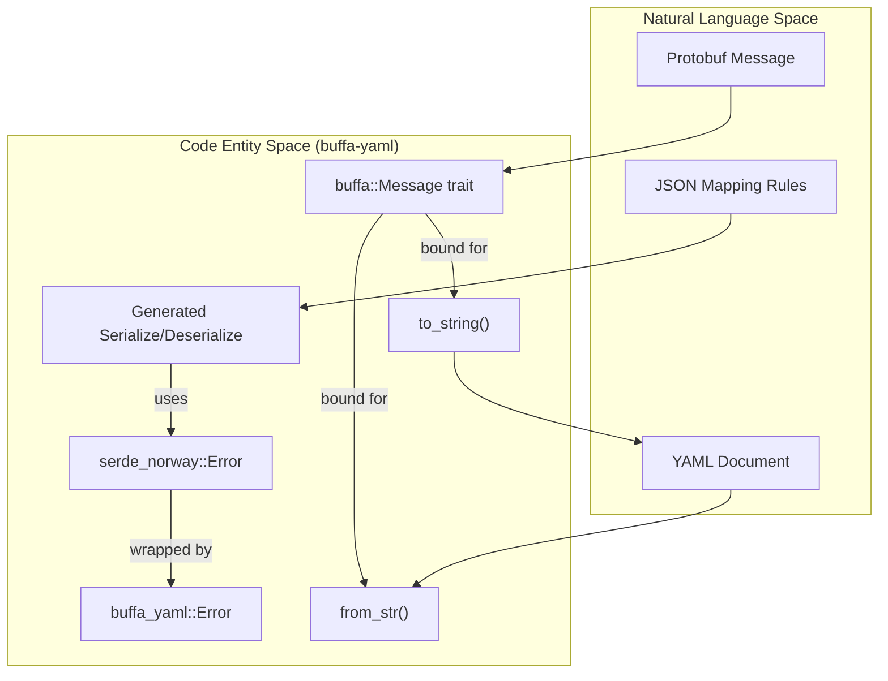
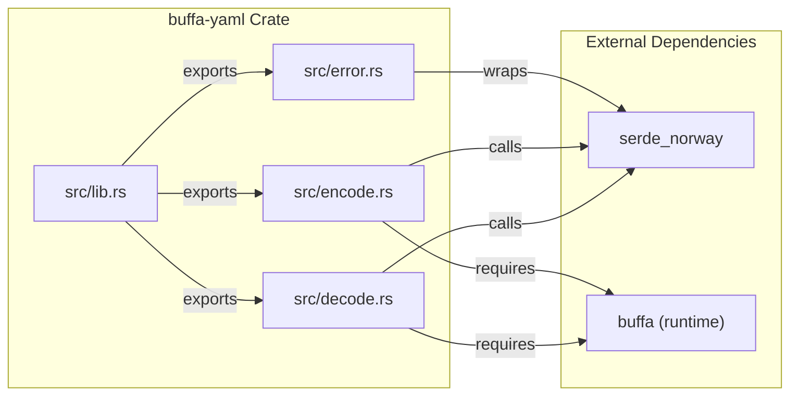

<!-- source: DeepWiki mcp.deepwiki.com · repo anthropics/buffa · page 10 YAML Serialization (`buffa-yaml`) · fetched 2026-10-26 -->

# YAML Serialization (`buffa-yaml`)

Relevant source files

The following files were used as context for generating this wiki page:

- [buffa-yaml/Cargo.toml](buffa-yaml/Cargo.toml)
- [buffa-yaml/src/decode.rs](buffa-yaml/src/decode.rs)
- [buffa-yaml/src/encode.rs](buffa-yaml/src/encode.rs)
- [buffa-yaml/src/error.rs](buffa-yaml/src/error.rs)
- [buffa-yaml/src/lib.rs](buffa-yaml/src/lib.rs)

The `buffa-yaml` crate provides YAML serialization and deserialization for `buffa` Protocol Buffers messages [buffa-yaml/src/lib.rs:1-1](). It functions as a thin carrier layer that routes `buffa`'s existing protobuf-JSON `serde` implementations through `serde_norway` [buffa-yaml/src/lib.rs:3-5]().

This approach ensures that YAML I/O maintains full parity with the standard Protobuf JSON mapping, including `camelCase` field names, quoted `int64`/`uint64` types, base64-encoded bytes, and canonical Well-Known Type (WKT) encodings [buffa-yaml/src/lib.rs:5-7]().

### Core Architecture

The crate relies on the `serde` implementations emitted by the `buffa` code generator. Consequently, messages must be generated with JSON support enabled (`json = true`) to be compatible with this crate [buffa-yaml/src/lib.rs:9-12]().

#### Data Flow: Natural Language to Code Entities
The following diagram illustrates how Protobuf concepts are mapped through the YAML carrier into Rust types.

**Protobuf to YAML Mapping Flow**

Sources: [buffa-yaml/src/lib.rs:3-12](), [buffa-yaml/src/decode.rs:17-22](), [buffa-yaml/src/encode.rs:15-20](), [buffa-yaml/src/error.rs:1-10]()

### Key Capabilities

*   **Standard I/O**: Supports `String`, `&[u8]` (slice), and `std::io` (Reader/Writer) interfaces for both encoding and decoding [buffa-yaml/src/decode.rs:17-49](), [buffa-yaml/src/encode.rs:15-36]().
*   **Zero-Copy View Encoding**: Specifically supports encoding `MessageView<'a>` types directly to YAML without converting them to owned messages first [buffa-yaml/src/encode.rs:38-45]().
*   **Error Location Reporting**: Wraps carrier errors to provide 1-based line and column information for diagnostic purposes [buffa-yaml/src/error.rs:12-35]().
*   **Security**: Expands anchors and aliases during parsing, requiring users to bound untrusted input sizes to prevent "billion laughs" resource exhaustion attacks [buffa-yaml/src/lib.rs:48-53]().

### Component Relationships

The crate is structured into three primary internal modules: `decode`, `encode`, and `error`, which are re-exported at the crate root [buffa-yaml/src/lib.rs:55-61]().

**buffa-yaml Module Interaction**

Sources: [buffa-yaml/src/lib.rs:55-61](), [buffa-yaml/Cargo.toml:12-16](), [buffa-yaml/src/decode.rs:1-3]()

---

### Child Pages

#### [buffa-yaml API and Usage](#10.1)
Details the specific functions for YAML I/O, including `to_string_view` for zero-copy views and how to handle `OwnedView` handles via `reborrow()`. It also covers scalar resolution behaviors like the "Norway fix" and float special handling (`.nan`, `.inf`).
For details, see [buffa-yaml API and Usage](#10.1).

#### [buffa-yaml Behavioral Notes and Limitations](#10.2)
Compares `buffa-yaml` with `protoyaml-go`, outlining the Phase 1 scope. It documents current limitations such as the lack of byte-size suffixes or Go-style durations, and the specific handling of `int64` as quoted strings for precision.
For details, see [buffa-yaml Behavioral Notes and Limitations](#10.2).

---

