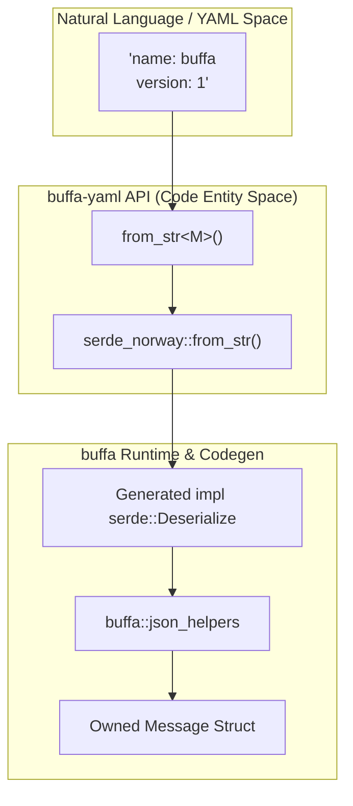
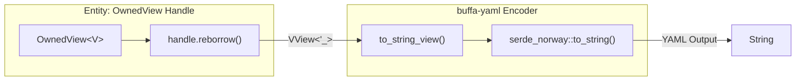

<!-- source: DeepWiki mcp.deepwiki.com · repo anthropics/buffa · page 10.1 buffa-yaml API and Usage · fetched 2026-10-26 -->

# buffa-yaml API and Usage

<details>
<summary>Relevant source files</summary>

The following files were used as context for generating this wiki page:

- [.changes/unreleased/fixed-20260628-211100.yaml](.changes/unreleased/fixed-20260628-211100.yaml)
- [buffa-yaml/Cargo.toml](buffa-yaml/Cargo.toml)
- [buffa-yaml/src/decode.rs](buffa-yaml/src/decode.rs)
- [buffa-yaml/src/encode.rs](buffa-yaml/src/encode.rs)
- [buffa-yaml/src/error.rs](buffa-yaml/src/error.rs)
- [buffa-yaml/src/lib.rs](buffa-yaml/src/lib.rs)
- [buffa/src/json_helpers.rs](buffa/src/json_helpers.rs)
- [buffa/src/json_helpers/tests.rs](buffa/src/json_helpers/tests.rs)

</details>


The `buffa-yaml` crate provides YAML serialization and deserialization for `buffa` Protocol Buffers messages [buffa-yaml/Cargo.toml:2-3](). It acts as a thin carrier layer that routes `buffa`'s existing protobuf-JSON `serde` implementations through the `serde_norway` engine [buffa-yaml/src/lib.rs:3-7](). This architecture ensures that YAML I/O maintains full parity with the official Protobuf JSON mapping, including `camelCase` field names, base64-encoded bytes, and canonical well-known type (WKT) encodings [buffa-yaml/src/lib.rs:5-8]().

### API Surface and Data Flow

The API is divided into owned message operations and zero-copy view operations. While encoding supports both owned messages and views, decoding always targets owned types because YAML input cannot be safely borrowed from using `buffa`'s zero-copy mechanics [buffa-yaml/src/lib.rs:39-40]().

#### Primary Functions

| Operation | Owned Message API | View API |
|:---|:---|:---|
| **Serialize to String** | `to_string<M>` [buffa-yaml/src/encode.rs:15]() | `to_string_view<V>` [buffa-yaml/src/encode.rs:54]() |
| **Serialize to Writer** | `to_writer<W, M>` [buffa-yaml/src/encode.rs:30]() | `to_writer_view<W, V>` [buffa-yaml/src/encode.rs:69]() |
| **Deserialize from Str** | `from_str<M>` [buffa-yaml/src/decode.rs:17]() | N/A |
| **Deserialize from Slice** | `from_slice<M>` [buffa-yaml/src/decode.rs:30]() | N/A |
| **Deserialize from Reader**| `from_reader<R, M>` [buffa-yaml/src/decode.rs:43]() | N/A |

#### Data Flow: YAML Carrier to Protobuf Logic
The following diagram illustrates how a YAML string is processed through the `buffa-yaml` entrypoints into the generated message logic.

**YAML Processing Pipeline**

Sources: [buffa-yaml/src/lib.rs:3-12](), [buffa-yaml/src/decode.rs:17-22](), [buffa/src/json_helpers.rs:1-15]()

### View Encoding and OwnedView Handles

`buffa-yaml` supports encoding zero-copy views directly via `to_string_view` and `to_writer_view` [buffa-yaml/src/encode.rs:38-40](). This is particularly useful when working with `OwnedView<V>` handles, which are self-referential containers for messages. To serialize an `OwnedView`, the user must call `.reborrow()` to obtain the underlying view reference [buffa-yaml/src/lib.rs:36-38]().

**Encoding an OwnedView Handle**

Sources: [buffa-yaml/src/lib.rs:36-38](), [buffa-yaml/src/encode.rs:47-48]()

### Scalar Resolution and Norway Fix

Because `buffa-yaml` uses `serde_norway` as its carrier, it inherits YAML 1.1 restricted scalar resolution with a specific fix for the "Norway problem" [buffa-yaml/src/lib.rs:42-44]().

*   **Norway Fix:** Unquoted strings like `no` or `yes` are resolved as strings (`"no"`, `"yes"`) rather than booleans (`false`, `true`) [buffa-yaml/src/lib.rs:43-44]().
*   **Hex Literals:** Standard YAML hex notation (e.g., `0xDEAD`) is resolved to integers during parsing.
*   **Nulls:** YAML `null`, `~`, or empty values are resolved to Protobuf null semantics (e.g., `NullValue` or default values for repeated/map fields) [buffa-yaml/src/lib.rs:125-133]().

### Float Specials and Numeric Handling

`buffa-yaml` strictly follows the Protobuf JSON mapping for floating-point numbers [buffa/src/json_helpers.rs:10-11]().

1.  **Output:** Special values are serialized as quoted strings: `"NaN"`, `"Infinity"`, and `"-Infinity"` [buffa-yaml/src/lib.rs:44-46]().
2.  **Input:** The parser is lenient and accepts both the quoted Protobuf JSON strings and the YAML-native unquoted forms `.nan`, `.inf`, and `-.inf` [buffa-yaml/src/lib.rs:46-47]().
3.  **Integer Precision:** Large `int64` and `uint64` values are serialized as quoted strings to prevent precision loss in environments that might treat them as floats (matching JSON behavior) [buffa/src/json_helpers.rs:8-9](). The parser handles both quoted and unquoted integers [buffa-yaml/src/decode.rs:8-9]().

### Error Location Reporting

The `Error` type in `buffa-yaml` wraps the underlying carrier error but provides a clean `Location` API [buffa-yaml/src/error.rs:8-10](). This allows callers to retrieve the exact line and column of a failure without a direct dependency on `serde_norway` [buffa-yaml/src/error.rs:3-5]().

```rust
pub struct Location {
    pub line: usize,   // 1-based
    pub column: usize, // 1-based
}
```
Sources: [buffa-yaml/src/error.rs:28-35]()

### Security Note: Anchor and Alias Expansion

The YAML carrier used by `buffa-yaml` automatically expands anchors and aliases during the parsing phase [buffa-yaml/src/lib.rs:50-51](). This introduces a risk of "billion laughs" attacks, where a small document with deep aliasing consumes excessive CPU and memory [buffa-yaml/src/lib.rs:51-52]().

**Security Recommendation:** Always bound the size of untrusted input (e.g., via `io::Read::take`) before passing it to `from_str`, `from_slice`, or `from_reader` [buffa-yaml/src/lib.rs:52-53]().

Sources:
*   [buffa-yaml/src/lib.rs:1-62]()
*   [buffa-yaml/src/encode.rs:1-76]()
*   [buffa-yaml/src/decode.rs:1-50]()
*   [buffa-yaml/src/error.rs:1-36]()
*   [buffa/src/json_helpers.rs:1-60]()

---

