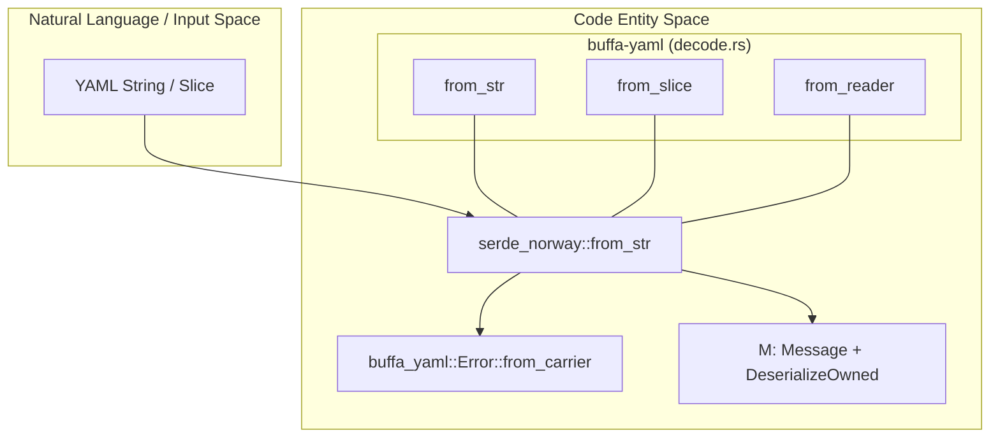
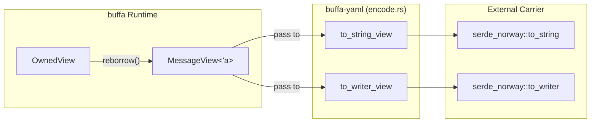

<!-- source: DeepWiki mcp.deepwiki.com · repo anthropics/buffa · page 10.2 buffa-yaml Behavioral Notes and Limitations · fetched 2026-10-26 -->

# buffa-yaml Behavioral Notes and Limitations

Relevant source files

The following files were used as context for generating this wiki page:

- [buffa-codegen/src/bin/gen_wkt_types.rs](buffa-codegen/src/bin/gen_wkt_types.rs)
- [buffa-types/Cargo.toml](buffa-types/Cargo.toml)
- [buffa-types/src/duration_chrono.rs](buffa-types/src/duration_chrono.rs)
- [buffa-types/src/lib.rs](buffa-types/src/lib.rs)
- [buffa-types/src/timestamp_ext.rs](buffa-types/src/timestamp_ext.rs)
- [buffa-yaml/Cargo.toml](buffa-yaml/Cargo.toml)
- [buffa-yaml/src/decode.rs](buffa-yaml/src/decode.rs)
- [buffa-yaml/src/encode.rs](buffa-yaml/src/encode.rs)
- [buffa-yaml/src/error.rs](buffa-yaml/src/error.rs)
- [buffa-yaml/src/lib.rs](buffa-yaml/src/lib.rs)

The `buffa-yaml` crate provides YAML serialization and deserialization for Protocol Buffers messages by layering `buffa`'s existing protobuf-JSON `serde` implementations over a YAML carrier. This page details the specific behaviors, compatibility with other implementations like `protoyaml-go`, and current architectural limitations.

## Phase 1 Scope and Compatibility

The current implementation is defined as **Phase 1: Protobuf-JSON semantics on a YAML carrier**. This means the crate focuses on providing a YAML interface that exactly mirrors the canonical Protobuf JSON mapping.

### Feature Comparison

| Feature | `buffa-yaml` Support | Notes |
| :--- | :--- | :--- |
| **JSON Mapping** | Full | Uses `camelCase` and `snake_case` aliases [buffa-yaml/src/lib.rs:5-7](). |
| **Int64/Uint64** | Quoted | Handled as quoted strings for precision [buffa-yaml/src/encode.rs:7-9](). |
| **Bytes** | Base64 | Encoded/decoded as Base64 strings [buffa-yaml/src/decode.rs:7-10](). |
| **WKT Encodings** | Canonical | Follows WKT JSON specs (e.g., Timestamp as RFC3339) [buffa-yaml/src/lib.rs:77-101](). |
| **Zero-Copy Views** | Encode-only | Supported via `to_string_view` [buffa-yaml/src/encode.rs:38-45](). |
| **Lenience Extensions** | Not Implemented | No support for byte-size suffixes or Go durations yet [buffa-yaml/src/lib.rs:31-34](). |
| **Field-Number Addressing** | Not Implemented | Fields must be addressed by name, not number [buffa-yaml/src/lib.rs:31-34](). |

Sources: [buffa-yaml/src/lib.rs:1-34](), [buffa-yaml/src/encode.rs:1-45](), [buffa-yaml/src/decode.rs:1-10]()

## Implementation Architecture

The architecture relies on `serde_norway` as the carrier. It routes calls through the `Serialize` and `Deserialize` traits emitted by `buffa-codegen` when `json = true` is configured.

### Data Flow: YAML to Message
The following diagram illustrates how a YAML string is transformed into a concrete Message struct.

**YAML Deserialization Pipeline**

Sources: [buffa-yaml/src/decode.rs:17-49](), [buffa-yaml/src/error.rs:23-26]()

### Scalar Resolution and the "Norway Problem"
The carrier (`serde_norway`) applies YAML 1.1 restricted scalar resolution. A key behavior is the "Norway fix," which ensures that unquoted strings like `no` are not incorrectly parsed as booleans (false).
*   **Input**: `name: no` -> **Result**: `String("no")` [buffa-yaml/src/lib.rs:42-44]().
*   **Float Specials**: On output, `NaN` and `Infinity` are quoted strings per Protobuf JSON spec. On input, both JSON-style strings and YAML-native `.nan` / `.inf` are accepted [buffa-yaml/src/lib.rs:44-47]().

## Zero-Copy View Support

`buffa-yaml` supports encoding from `buffa` view types (e.g., `FooView<'a>`). This allows serializing data directly from a binary-decoded buffer into YAML without intermediate owned allocations.

**View Encoding Flow**

Sources: [buffa-yaml/src/encode.rs:38-75](), [buffa-yaml/src/lib.rs:36-40]()

## Well-Known Type (WKT) Specifics

Because `buffa-yaml` uses the JSON mapping, Well-Known Types do not use standard YAML struct representation. Instead, they use their canonical forms defined in `buffa-types`.

| WKT | YAML Representation (Example) | Implementation Note |
| :--- | :--- | :--- |
| `Timestamp` | `2023-11-01T12:00:00Z` | Hand-written RFC3339 in `timestamp_ext.rs` [buffa-types/src/timestamp_ext.rs:143-150](). |
| `Duration` | `"90.5s"` | Hand-written in `duration_ext.rs` [buffa-yaml/src/lib.rs:104-112](). |
| `Struct` | `key: value` | Maps directly to YAML mapping [buffa-yaml/src/lib.rs:198-210](). |
| `Value` | `1.5` or `true` or `null` | Polymorphic based on kind [buffa-yaml/src/lib.rs:125-171](). |

Sources: [buffa-yaml/src/lib.rs:77-210](), [buffa-types/src/lib.rs:64-73]()

## Limitations and Security

### 1. Deserialization is Owned-Only
While encoding supports zero-copy views, deserialization (`from_str`, `from_slice`) always targets owned message types. YAML input cannot be borrowed from because the YAML format often requires unescaping or transformation that prevents direct aliasing of the input buffer [buffa-yaml/src/encode.rs:44-45]().

### 2. Security: Anchor/Alias Expansion
The YAML carrier expands anchors and aliases during parsing. This makes the implementation susceptible to "billion laughs" style attacks where a small document expands into a massive memory consumer.
*   **Mitigation**: Users must bound the size of untrusted input before passing it to the `buffa-yaml` API [buffa-yaml/src/lib.rs:48-53]().

### 3. Missing Lenience Extensions
Unlike `protoyaml-go`, the current version of `buffa-yaml` does not support:
*   **Byte-size suffixes**: (e.g., `memory: 2GiB`) [buffa-yaml/src/lib.rs:31-34]().
*   **Go-style Durations**: (e.g., `timeout: 5m10s`) [buffa-yaml/src/lib.rs:31-34]().
*   **Field-Number Addressing**: (e.g., `1: "value"`) [buffa-yaml/src/lib.rs:31-34]().

### 4. Error Reporting
Errors wrap `serde_norway::Error`. While `buffa-yaml` provides a `Location` struct (line/column), it does not yet provide "snippet" diagnostics that point to the exact segment of the YAML file [buffa-yaml/src/error.rs:1-35]().

Sources: [buffa-yaml/src/lib.rs:29-53](), [buffa-yaml/src/error.rs:1-35](), [buffa-yaml/src/encode.rs:38-45]()

---

