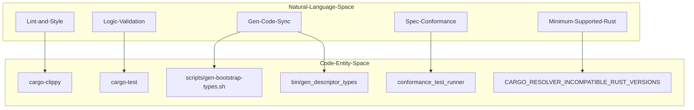
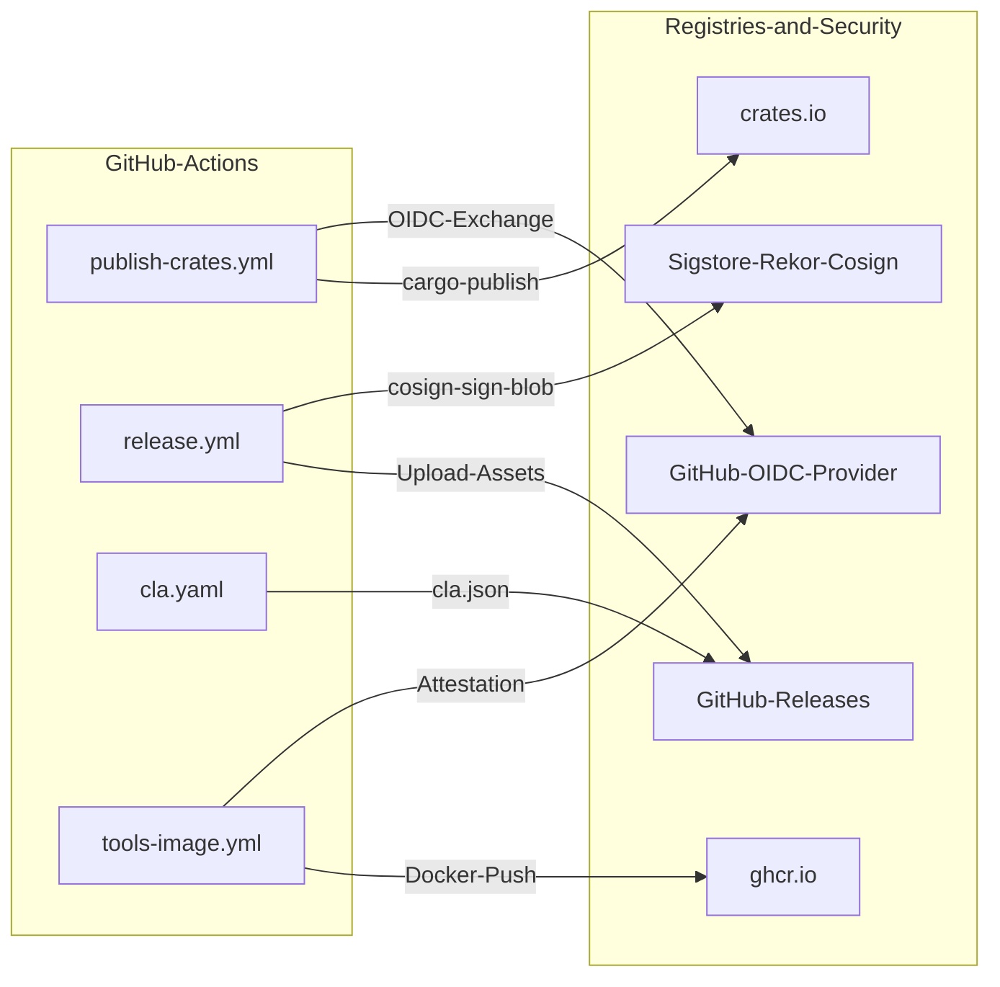

<!-- source: DeepWiki mcp.deepwiki.com · repo anthropics/buffa · page 11 CI/CD and Release Engineering · fetched 2026-10-26 -->

# CI/CD and Release Engineering

Relevant source files

The following files were used as context for generating this wiki page:

- [.github/workflows/ci.yml](.github/workflows/ci.yml)
- [.github/workflows/cla.yaml](.github/workflows/cla.yaml)
- [.github/workflows/publish-crates.yml](.github/workflows/publish-crates.yml)
- [.github/workflows/release.yml](.github/workflows/release.yml)
- [.github/workflows/tools-image.yml](.github/workflows/tools-image.yml)
- [CONTRIBUTING.md](CONTRIBUTING.md)
- [Taskfile.yml](Taskfile.yml)
- [buffa-types/src/timestamp_chrono.rs](buffa-types/src/timestamp_chrono.rs)
- [rust-toolchain.toml](rust-toolchain.toml)

This section provides a high-level overview of the automation pipelines that ensure the quality, compatibility, and distribution of the `buffa` ecosystem. The project utilizes GitHub Actions for continuous integration, automated crate publishing, and multi-platform plugin releases.

## Continuous Integration (CI)

The CI pipeline is designed to validate the codebase across multiple dimensions, including linting, unit testing, and strict conformance with the Protobuf specification. It ensures that the generated code remains compatible with older Rust versions (MSRV) and can compile in restricted environments such as `no_std` targets.

Key components of the CI infrastructure include:
*   **Linting and Testing**: Standard `cargo fmt`, `clippy`, and `cargo test` runs across the workspace [[.github/workflows/ci.yml:48-55]]().
*   **Compatibility Matrix**: Verification of `no_std` support for `buffa`, `buffa-types`, and `buffa-descriptor` on bare-metal ARM (`thumbv7em-none-eabihf`) and 32-bit x86 targets [[.github/workflows/ci.yml:167-199]]().
*   **MSRV Enforcement**: A dedicated check ensuring the workspace compiles on Rust 1.75, utilizing an MSRV-aware resolver to handle transitive dependencies [[.github/workflows/ci.yml:113-150]]().
*   **Conformance Testing**: A specialized job that builds the `conformance` workspace and runs the `conformance_test_runner` from a Dockerized toolset [[.github/workflows/ci.yml:248-254]]().
*   **Soundness Verification**: A `miri` job specifically targets the `SizeCache` to verify that `unsafe` reads do not access uninitialized memory [[.github/workflows/ci.yml:151-165]]().
*   **Feature Gating Matrix**: A specific test pass that validates `gate_impls_on_crate_features` by compiling generated code with various permutations of the `json`, `views`, and `text` features [[.github/workflows/ci.yml:69-71]]().
*   **Changelog Integrity**: Verification that `CHANGELOG.md` is in sync with `changie` fragments, preventing direct manual edits [[.github/workflows/ci.yml:85-110]]().

For a deep dive into the CI jobs and the `Taskfile.yml` automation, see **[CI Workflow and Development Tasks](#11.1)**.

### CI System Mapping

The following diagram maps the CI workflow stages to the specific scripts and tools they invoke.

**CI Workflow to Code Mapping**

Sources: [[.github/workflows/ci.yml:52-55]](), [[.github/workflows/ci.yml:129-130]](), [[.github/workflows/ci.yml:239-239]](), [[.github/workflows/ci.yml:251-254]]().

---

## Release and Publishing

Release engineering at `buffa` encompasses two distinct flows: publishing library crates to `crates.io` and releasing binary plugins to GitHub.

### Crate Publication
The project uses a sequential, idempotent publishing script (`/tmp/publish.sh`) to manage the dependency graph. This ensures that `buffa` (the runtime) is indexed before downstream crates like `buffa-codegen` or `buffa-build` are published [[.github/workflows/publish-crates.yml:64-102]](). Authentication is handled via OIDC Trusted Publishing using `rust-lang/crates-io-auth-action`, or a fallback `CARGO_REGISTRY_TOKEN` for bootstrapping [[.github/workflows/publish-crates.yml:38-54]]().

### Plugin Releases
The `protoc-gen-buffa` and `protoc-gen-buffa-packaging` binaries are cross-compiled for Linux (musl), macOS, and Windows [[.github/workflows/release.yml:38-60]](). The release process includes:
*   **Provenance**: Generating SLSA build provenance attestations using `actions/attest-build-provenance` [[.github/workflows/release.yml:146-150]]().
*   **Signing**: Keyless signing of artifacts using `cosign` and Sigstore OIDC [[.github/workflows/release.yml:154-164]]().
*   **Legal**: Automated Contributor License Agreement (CLA) management via `iainmcgin/cla-github-action` which tracks signatures in `signatures/cla.json` [[.github/workflows/cla.yaml:32-38]]().

### Tools Infrastructure
A dedicated workflow manages the `tools` Docker image used for conformance testing. This image vendors specific versions of `protoc` and the conformance runner, and is itself signed and attested [[.github/workflows/tools-image.yml:1-163]]().

For details on the publication order and security measures, see **[Release and Publishing Workflows](#11.2)**.

### Release Pipeline Mapping

This diagram illustrates how the release workflows interact with external registries and security providers.

**Release Pipeline and Entities**

Sources: [[.github/workflows/publish-crates.yml:47-54]](), [[.github/workflows/publish-crates.yml:80-102]](), [[.github/workflows/release.yml:154-173]](), [[.github/workflows/cla.yaml:32-38]](), [[.github/workflows/tools-image.yml:30-33]]().

---

## Sub-pages

*   **[CI Workflow and Development Tasks](#11.1)**: Details on the `ci.yml` configuration, `no_std` targets, MSRV checks, and the `Taskfile` interface for developers.
*   **[Release and Publishing Workflows](#11.2)**: Technical breakdown of the idempotent publication logic, OIDC Trusted Publishing, and artifact signing procedures for plugins.

---

