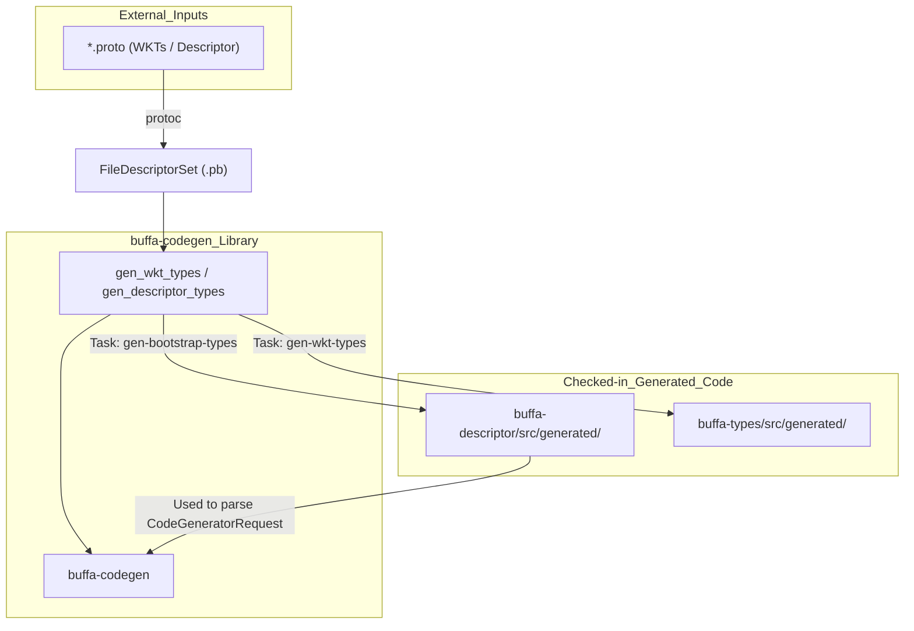
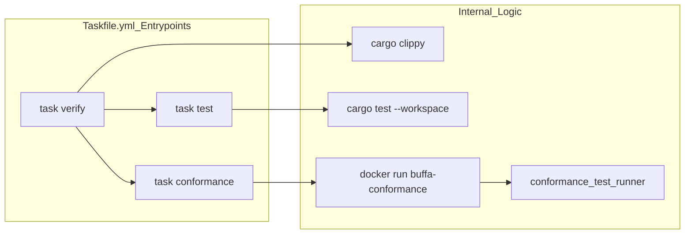

<!-- source: DeepWiki mcp.deepwiki.com · repo anthropics/buffa · page 11.1 CI Workflow and Development Tasks · fetched 2026-10-26 -->

# CI Workflow and Development Tasks

Relevant source files

The following files were used as context for generating this wiki page:

- [.github/workflows/ci.yml](.github/workflows/ci.yml)
- [CONTRIBUTING.md](CONTRIBUTING.md)
- [Taskfile.yml](Taskfile.yml)
- [buffa-types/src/timestamp_chrono.rs](buffa-types/src/timestamp_chrono.rs)
- [rust-toolchain.toml](rust-toolchain.toml)
- [scripts/build-conformance-tools.sh](scripts/build-conformance-tools.sh)
- [scripts/run-conformance-local.sh](scripts/run-conformance-local.sh)

The `buffa` project employs a multi-layered Continuous Integration (CI) strategy and a comprehensive task runner (`Taskfile.yml`) to ensure correctness, performance, and compatibility across various environments. This infrastructure manages the complexities of a code generation toolchain, including bootstrapping its own descriptor types, maintaining well-known types (WKTs), and validating against the official Protobuf conformance suite.

## CI Workflow

The CI pipeline, defined in `.github/workflows/ci.yml`, executes on every push to `main`, all pull requests, and merge queue groups [ .github/workflows/ci.yml:3-9 ](). It is designed for fast feedback while ensuring strict adherence to Rust idioms and Protobuf specifications.

### Primary Validation Jobs

*   **Lint and Test**: Runs `cargo fmt` check, `cargo clippy` (with warnings as errors), and the full workspace test suite on a pinned Rust toolchain (1.95) [ .github/workflows/ci.yml:23-56 ](). It requires `protoc` v33.5 to support the latest edition features [ .github/workflows/ci.yml:18,40-44 ]().
*   **MSRV Check**: Validates that the workspace compiles on the Minimum Supported Rust Version (MSRV), currently set to **1.75** [ .github/workflows/ci.yml:113-150 ](). It uses a specialized MSRV-aware resolver to handle transitive dependencies [ .github/workflows/ci.yml:127-130 ]().
*   **no_std and 32-bit Check**: Ensures that core crates (`buffa`, `buffa-types`, `buffa-descriptor`) compile without the standard library. It targets `thumbv7em-none-eabihf` for bare-metal ARM validation and `i686-unknown-linux-gnu` for 32-bit compatibility [ .github/workflows/ci.yml:171-202 ]().
*   **Miri**: Mechanically verifies the soundness of `SizeCache` `unsafe` operations (slots < len initialization invariant) by running `size_cache` tests under the Miri interpreter [ .github/workflows/ci.yml:163-169 ]().
*   **Changelog Check**: Verifies that `CHANGELOG.md` is in sync with fragments in `.changes/` using `changie merge`. Direct edits to the changelog are forbidden [ .github/workflows/ci.yml:85-110 ]().
*   **Feature-Gating Compile Matrix**: Runs `feature_gating_compile` tests to verify generated code compiles with various feature subsets (`json`, `views`, `text`) [ .github/workflows/ci.yml:69-70 ]().

### Checked-in Code Verification

The CI job `check-generated-code` ensures that generated code checked into the repository remains in sync with the generator logic in `buffa-codegen` [ .github/workflows/ci.yml:222-223 ]().

1.  **Regenerate Bootstrap Types**: Invokes `scripts/gen-bootstrap-types.sh` to update `buffa-descriptor/src/generated/` [ .github/workflows/ci.yml:235-238 ]().
2.  **Regenerate WKTs**: Compiles the WKT `.proto` files into a descriptor set and runs the `gen_wkt_types` binary to update `buffa-types/src/generated/` [ .github/workflows/ci.yml:240-257 ]().
3.  **Consistency Check**: Performs a `git diff`. If any changes are detected, CI fails, indicating the developer forgot to run local regeneration tasks [ .github/workflows/ci.yml:259-264 ]().

### Conformance Testing

The conformance job runs the official Google Protobuf conformance suite using Docker [ .github/workflows/ci.yml:269-282 ](). It builds two versions of the `conformance` binary: one for `std` and one for `no_std` [ scripts/run-conformance-local.sh:35-40 ]().

The suite executes seven specialized runs to verify different runtime paths [ scripts/run-conformance-local.sh:55-97 ]():
*   **std/nostd**: Basic binary and text format validation for owned types.
*   **via-view** (`BUFFA_VIA_VIEW=1`): Routes binary input through `decode_view` -> `to_owned_message` -> `encode`.
*   **view-json** (`BUFFA_VIEW_JSON=1`): Verifies generated view `Serialize` impls via `serde_json`.
*   **via-reflect** (`BUFFA_VIA_REFLECT=1`): Tests `DynamicMessage` descriptor-driven codec.
*   **via-vtable** (`BUFFA_VIA_VTABLE=1`): Decodes a view and walks its `ReflectMessage` vtable surface.

**Sources:** [ .github/workflows/ci.yml:1-282 ](), [ scripts/run-conformance-local.sh:1-100 ]().

---

## Development Tasks (`Taskfile.yml`)

The project uses `Taskfile.yml` to provide a unified interface for common development operations [ Taskfile.yml:1-3 ]().

### Task Categories

| Task | Description | Key Commands/Dependencies |
|:---|:---|:---|
| `task verify` | Full pre-commit pipeline. | `lint`, `lint-md`, `test`, `conformance` [ Taskfile.yml:153-162 ]() |
| `task conformance` | Runs the conformance suite in Docker. | `conformance-image` [ Taskfile.yml:63-68 ]() |
| `task gen-wkt-types` | Regenerates well-known types. | `buffa-codegen` -> `gen_wkt_types` [ Taskfile.yml:248-259 ]() |
| `task gen-bootstrap-types`| Regenerates descriptor types. | `scripts/gen-bootstrap-types.sh` [ Taskfile.yml:261-265 ]() |
| `task install-protoc` | Downloads pinned `protoc` into `.local/`. | `gh release download` [ Taskfile.yml:112-145 ]() |
| `task fuzz` | Runs a libfuzzer target (e.g., `decode_proto3`). | `cargo +nightly fuzz run` [ Taskfile.yml:214-221 ]() |
| `task bench-cross` | Cross-implementation benchmarks. | `benchmarks/run-bench-cross.sh` [ Taskfile.yml:228-234 ]() |

### Bootstrapping and WKT Flow

The following diagram illustrates the relationship between the source `.proto` files, the `buffa-codegen` library, and the checked-in generated code.

**Title: Code Generation and Bootstrapping Data Flow**

**Sources:** [ Taskfile.yml:248-265 ](), [ .github/workflows/ci.yml:235-257 ]().

---

## Contribution Guidelines

The `CONTRIBUTING.md` file defines the standards for code quality and submission.

### Code Generation Rules
When modifying `buffa-codegen`, developers must follow specific rules to ensure the generated code is correct and `no_std` compatible:
*   **Token Streams**: All code generation must use `quote!` blocks rather than string manipulation [ CONTRIBUTING.md:47-48 ]().
*   **Identifiers**: Must go through `format_ident!` or `Ident::new_raw` to handle Rust keywords [ CONTRIBUTING.md:54 ]().
*   **no_std Safety**: Types like `String`, `Vec`, and `Box` must be emitted as fully qualified paths like `::buffa::alloc::string::String` using `ImportResolver` [ CONTRIBUTING.md:57 ]().
*   **Re-exports**: `buffa` re-exports `alloc`, `bytes`, and `serde_json` as `#[doc(hidden)]` items for generated code [ CONTRIBUTING.md:58 ]().

### Change Management
*   **PR Size**: Keep changes to **≤ 250 lines net** (excluding tests) [ CONTRIBUTING.md:30-32 ]().
*   **Testing**: New code requires **≥ 80% line coverage** [ CONTRIBUTING.md:34-36 ]().
*   **Changelog**: Use `task changelog-new` to create fragments under `.changes/unreleased/` [ CONTRIBUTING.md:10-18 ]().

### Local Development Environment
To replicate the CI environment locally:
1.  Run `task install-protoc` to get the pinned version in `.local/bin/` [ Taskfile.yml:112-145 ]().
2.  Use `task test-local` to run tests using the local `protoc` [ Taskfile.yml:146-152 ]().
3.  Use `task tools-image-local` if the GHCR tools image is inaccessible [ Taskfile.yml:33-43 ]().

**Development Task Execution Flow**

**Sources:** [ Taskfile.yml:153-162 ](), [ CONTRIBUTING.md:40-45 ](), [ Taskfile.yml:63-68 ]().

**Sources:** [ CONTRIBUTING.md:1-60 ](), [ Taskfile.yml:1-265 ](), [ .github/workflows/ci.yml:1-282 ](), [ rust-toolchain.toml:1-19 ]().

---

