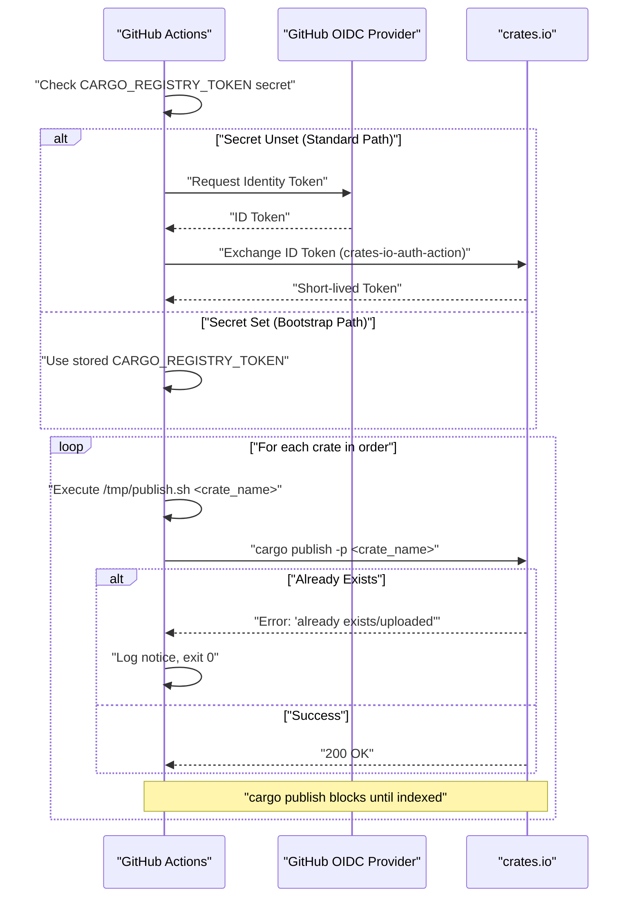
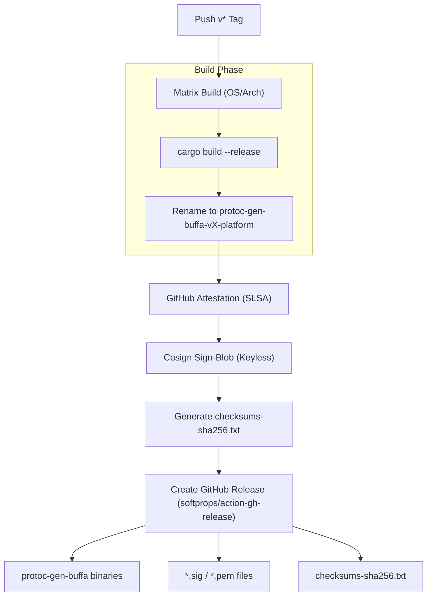

<!-- source: DeepWiki mcp.deepwiki.com · repo anthropics/buffa · page 11.2 Release and Publishing Workflows · fetched 2026-10-26 -->

# Release and Publishing Workflows

Relevant source files

The following files were used as context for generating this wiki page:

- [.github/workflows/cla.yaml](.github/workflows/cla.yaml)
- [.github/workflows/publish-crates.yml](.github/workflows/publish-crates.yml)
- [.github/workflows/release.yml](.github/workflows/release.yml)
- [.github/workflows/tools-image.yml](.github/workflows/tools-image.yml)

The `buffa` project utilizes automated GitHub Actions workflows to manage the lifecycle of its Rust crates and compiler plugins. This includes sequential crate publication to crates.io, multi-platform binary releases for plugins, Docker image builds for testing tools, and contributor license agreement (CLA) enforcement.

## Crate Publication Workflow

The `publish-crates.yml` workflow manages the distribution of the workspace crates to [crates.io](https://crates.io). Because crates in the workspace depend on one another, they must be published in a specific order to satisfy dependency requirements at the time of upload.

### Sequential Publication Order
The workflow executes publication in the following order to ensure that each crate's dependencies are already available on the registry:

1.  `buffa`: The core runtime [[.github/workflows/publish-crates.yml:80-81]]().
2.  `buffa-descriptor`: Descriptor and plugin proto types. This must precede `buffa-types` because the `reflect` feature in `buffa-types` has an optional dependency on `buffa-descriptor` [[.github/workflows/publish-crates.yml:83-87]]().
3.  `buffa-types`: Well-known types [[.github/workflows/publish-crates.yml:89-90]]().
4.  `buffa-codegen`: The code generation logic [[.github/workflows/publish-crates.yml:92-93]]().
5.  `buffa-build`: The build-script integration library [[.github/workflows/publish-crates.yml:95-96]]().
6.  `protoc-gen-buffa`: The primary protoc plugin [[.github/workflows/publish-crates.yml:98-99]]().
7.  `protoc-gen-buffa-packaging`: The module-tree generation plugin [[.github/workflows/publish-crates.yml:101-102]]().

Sources: [[.github/workflows/publish-crates.yml:80-102]]()

### Authentication: OIDC vs. Bootstrap Token
The workflow supports two authentication methods for interacting with crates.io:

*   **Trusted Publishing (OIDC):** This is the preferred method. It uses GitHub's OIDC provider to exchange a short-lived token with crates.io via the `rust-lang/crates-io-auth-action`, eliminating the need for long-lived secrets [[.github/workflows/publish-crates.yml:7-9]](), [[.github/workflows/publish-crates.yml:47-50]]().
*   **Bootstrap Token:** Since Trusted Publishing cannot be configured on crates.io for a crate that does not yet exist, the `CARGO_REGISTRY_TOKEN` secret is used for the initial "first-ever" publication of a new crate [[.github/workflows/publish-crates.yml:5-7]](), [[.github/workflows/publish-crates.yml:38]]().

### Idempotent Publish Helper
To handle partial failures (e.g., the workflow crashes after crate 3 is published), the workflow defines a helper script at `/tmp/publish.sh` that makes `cargo publish` idempotent. If the registry returns an error indicating the version already exists or was already uploaded, the script logs a notice and treats it as a success [[.github/workflows/publish-crates.yml:64-78]]().

### Publication Data Flow
The following diagram illustrates the token exchange and publication sequence.

**Crate Publication Sequence**

Sources: [[.github/workflows/publish-crates.yml:47-78]](), [[.github/workflows/publish-crates.yml:80-102]]()

## Release Workflow

The `release.yml` workflow is triggered by version tags (e.g., `v*`) and is responsible for building and distributing the `protoc` plugin binaries [[.github/workflows/release.yml:1-11]]().

### Cross-Platform Matrix
The workflow builds binaries for five target platforms:
*   Linux (x86_64 and aarch64) using `musl-tools` for static linking [[.github/workflows/release.yml:41-48]](), [[.github/workflows/release.yml:83-94]]().
*   macOS (x86_64 and aarch64) [[.github/workflows/release.yml:49-56]]().
*   Windows (x86_64) [[.github/workflows/release.yml:57-60]]().

### Security and Attestation
The release process incorporates several layers of supply chain security:
1.  **SHA-256 Checksums:** Generated for all binary assets using `sha256sum` [[.github/workflows/release.yml:135-139]]().
2.  **SLSA Provenance:** Uses `actions/attest-build-provenance` to create signed attestations of the build process, verifiable via the GitHub CLI [[.github/workflows/release.yml:146-150]]().
3.  **Cosign Signatures:** Signs blobs using keyless Sigstore OIDC via `sigstore/cosign-installer`, producing `.sig` and `.pem` files for each binary [[.github/workflows/release.yml:151-165]]().

**Plugin Release Pipeline**

Sources: [[.github/workflows/release.yml:37-60]](), [[.github/workflows/release.yml:135-174]]()

## Tools Image Workflow

The `tools-image.yml` workflow builds and pushes a multi-platform Docker image containing `protoc` and the conformance test runner to the GitHub Container Registry (GHCR) [[.github/workflows/tools-image.yml:1-9]]().

### Image Construction
*   **Platforms:** Builds for `linux/amd64` and `linux/arm64` using Docker Buildx and QEMU [[.github/workflows/tools-image.yml:44-53]](), [[.github/workflows/tools-image.yml:90]]().
*   **Caching:** Uses the `gha` cache backend to store intermediate layers (like Abseil and Protobuf compilation) in the GitHub Actions cache [[.github/workflows/tools-image.yml:102-116]]().
*   **Security:** Attaches SLSA provenance and an SPDX SBOM to the image index [[.github/workflows/tools-image.yml:95-100]](). It also signs the image digest using keyless Cosign [[.github/workflows/tools-image.yml:138-142]]().

Sources: [[.github/workflows/tools-image.yml:44-142]]()

## CLA Assistant Automation

The project uses a CLA (Contributor License Agreement) assistant to ensure all contributors have signed the legal agreement before their code is merged.

### Implementation
The workflow is implemented in `.github/workflows/cla.yaml` and uses `iainmcgin/cla-github-action` [[.github/workflows/cla.yaml:1-32]]().

*   **Signature Storage:** Signatures are stored in a JSON file (`signatures/cla.json`) on a dedicated branch named `cla-signatures` [[.github/workflows/cla.yaml:37-38]]().
*   **Allowlist:** Bot accounts (e.g., `dependabot`, `renovate`, `github-actions`) and synthetic emails like `noreply@anthropic.com` (used by AI assistants like Claude) are exempt from signing [[.github/workflows/cla.yaml:43]]().
*   **Interaction:** Users sign by commenting "I have read the CLA Document and I hereby sign the CLA" on their Pull Request [[.github/workflows/cla.yaml:25]]().
*   **Merge Group Support:** A custom verification step `Verify CLA passed for queued PRs` ensures that PRs entering a merge queue have a successful `CLAAssistant` check on their head commit [[.github/workflows/cla.yaml:58-85]]().

Sources: [[.github/workflows/cla.yaml:21-43]](), [[.github/workflows/cla.yaml:58-85]]()

---

