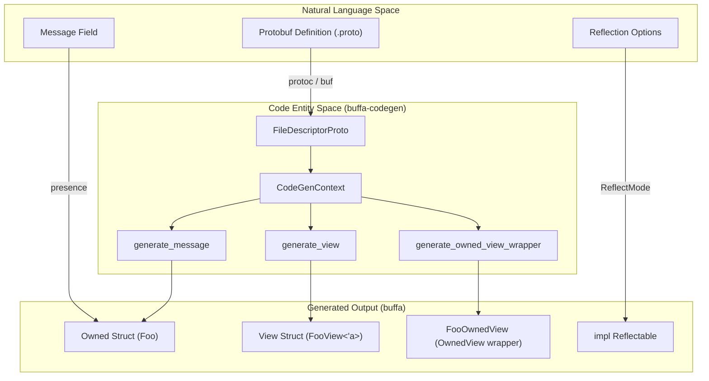
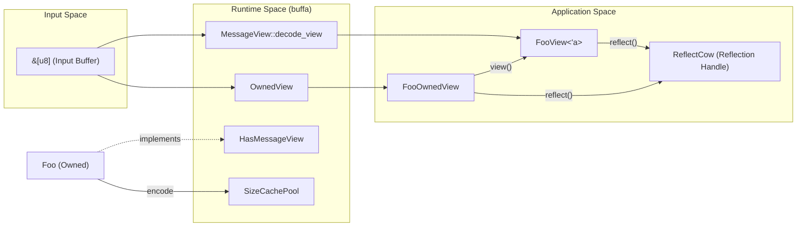

<!-- source: DeepWiki mcp.deepwiki.com · repo anthropics/buffa · page 12 Glossary · fetched 2026-10-26 -->

# Glossary

Relevant source files

The following files were used as context for generating this wiki page:

- [CHANGELOG.md](CHANGELOG.md)
- [buffa-build/src/lib.rs](buffa-build/src/lib.rs)
- [buffa-codegen/src/lib.rs](buffa-codegen/src/lib.rs)
- [buffa-codegen/src/owned_view.rs](buffa-codegen/src/owned_view.rs)
- [buffa-descriptor/src/reflect/containers.rs](buffa-descriptor/src/reflect/containers.rs)
- [buffa-test/src/tests/owned_view.rs](buffa-test/src/tests/owned_view.rs)
- [buffa-yaml/Cargo.toml](buffa-yaml/Cargo.toml)
- [buffa-yaml/src/decode.rs](buffa-yaml/src/decode.rs)
- [buffa-yaml/src/encode.rs](buffa-yaml/src/encode.rs)
- [buffa-yaml/src/error.rs](buffa-yaml/src/error.rs)
- [buffa-yaml/src/lib.rs](buffa-yaml/src/lib.rs)
- [buffa/src/map_codec.rs](buffa/src/map_codec.rs)
- [buffa/src/message_field.rs](buffa/src/message_field.rs)
- [buffa/src/types.rs](buffa/src/types.rs)
- [docs/guide.md](docs/guide.md)
- [protoc-gen-buffa/src/main.rs](protoc-gen-buffa/src/main.rs)

This page defines codebase-specific terms, jargon, and domain concepts used throughout the Buffa project. It serves as a technical reference for onboarding engineers to understand the mapping between Protobuf concepts and their Rust implementations in this codebase.

## Core Concepts

### Message
The primary unit of data in Protobuf. In Buffa, an "Owned Message" is a generated Rust `struct` that owns its data (e.g., `Vec<u8>`, `String`).
*   **Implementation**: Generated structs implement the `buffa::Message` trait [buffa-build/src/lib.rs:32-32]().
*   **Key Methods**: `compute_size()` for the first pass of serialization and `write_to()` for the second pass [buffa/src/map_codec.rs:25-29]().
*   **Codegen**: Handled by the logic in `buffa-codegen/src/message.rs` [buffa-codegen/src/lib.rs:38-38]().

### View (MessageView)
A zero-copy, borrowed representation of a Protobuf message. View types borrow `&str` and `&[u8]` directly from the input buffer.
*   **Implementation**: Generated structs named `FooView<'a>` implement the `MessageView` trait [buffa-codegen/src/lib.rs:147-148]().
*   **Data Flow**: Decoded via `decode_view` [CHANGELOG.md:32-36](). Every view can be converted to an owned message via `to_owned_message()` [buffa-codegen/src/owned_view.rs:36-36]().
*   **Codegen**: Handled by `buffa-codegen/src/view.rs` [buffa-codegen/src/lib.rs:44-44]().

### Editions
The modern Protobuf feature model that replaces the binary "proto2 vs proto3" distinction with a granular feature-set approach.
*   **Implementation**: Buffa supports editions-first design (Proto2, Proto3, Edition 2023, Edition 2024) [docs/guide.md:71-79]().
*   **Code Pointer**: The `Edition` enum is used throughout the descriptor and feature resolution logic [protoc-gen-buffa/src/main.rs:22-22]().

---

## Reflection and Dynamic Types (0.8.0+)

### DescriptorPool
The runtime registry for reflection. It holds linked, feature-resolved descriptors built from a `FileDescriptorSet`.
*   **Implementation**: `buffa_descriptor::DescriptorPool` [buffa-build/src/lib.rs:33-33]().
*   **Usage**: Provides symbol indexing and linked descriptors for `DynamicMessage` [buffa-codegen/src/lib.rs:41-43]().

### DynamicMessage
A map-backed message representation that can encode/decode any message by descriptor without generated types.
*   **Implementation**: `buffa_descriptor::reflect::DynamicMessage` [buffa-descriptor/src/reflect/containers.rs:13-15]().
*   **Mutation**: Supports checked mutation via `try_set` and `try_clear` variants [buffa-codegen/src/lib.rs:41-43]().

### ReflectMode
A configuration setting that determines how reflection is implemented for generated types [buffa-build/src/lib.rs:40-40]().
*   **Off**: No reflection support emitted.
*   **Bridge**: `Reflectable::reflect` boxes a `DynamicMessage` produced via an encode/decode round-trip.
*   **VTable**: Generated types implement `ReflectMessage` directly, allowing `foo.reflect()` to borrow in place without round-trips [buffa-descriptor/src/reflect/containers.rs:1-6]().

### Reflectable / ReflectCow
The traits and types that bridge the gap between generated code and the reflection runtime.
*   **Reflectable**: The entry-point trait implemented by every generated message [buffa-codegen/src/lib.rs:41-41]().
*   **ReflectCow**: A handle that allows a reflective message to be either `Borrowed` (vtable path) or `Owned` (bridge path).

### ReflectMessage / ReflectMessageMut
The dyn-safe, storage-agnostic accessor traits for reading and writing fields via descriptors [buffa-codegen/src/lib.rs:42-43]().

---

## Pluggable Types and Custom Storage (0.8.0)

Buffa 0.8.0 introduced traits to make the owned representation of every field kind pluggable end-to-end [CHANGELOG.md:11-16]().

| Trait | Target Field | Default Implementation | Source |
| :--- | :--- | :--- | :--- |
| `ProtoString` | `string` | `String` | [CHANGELOG.md:86-88]() |
| `ProtoBytes` | `bytes` | `Vec<u8>` | [CHANGELOG.md:86-88]() |
| `ProtoList<T>` | `repeated` | `Vec<T>` | [CHANGELOG.md:100-104]() |
| `ProtoBox<T>` | `singular message` | `Box<T>` or `Inline<T>` | [buffa/src/message_field.rs:162-164]() |
| `MapStorage` | `map<K, V>` | `HashMap<K, V>` | [buffa/src/map_codec.rs:82-85]() |

### from_wire
The core method for custom string and bytes types. It decides validation and borrow-vs-own logic during decoding [CHANGELOG.md:90-91]().
*   **Signature**: `from_wire(WirePayload<'_>) -> Result<Self, DecodeError>` [CHANGELOG.md:90-91]().

### WirePayload
A borrowed slice of wire bytes for a `string` or `bytes` field, providing `to_str` for UTF-8 validation [CHANGELOG.md:28-29]().

### SizeCachePool
An opt-in free-list of spill buffers used during serialization to avoid repeated heap allocations for deeply nested messages [CHANGELOG.md:42-47]().

---

## Type Mapping Reference

| Protobuf Concept | Buffa Rust Type | Description |
| :--- | :--- | :--- |
| **Optional Message** | `MessageField<T>` | Ergonomic wrapper that provides `Deref` to the default instance [buffa/src/message_field.rs:3-5](). |
| **Open Enum** | `EnumValue<T>` | A wrapper that preserves unknown integer values for enums [buffa-descriptor/src/reflect/containers.rs:141-143](). |
| **Oneof** | `oneof` module | Generated as a Rust `enum` inside a `__buffa::oneof` module [buffa-codegen/src/lib.rs:151-152](). |
| **String Representation** | `StringRepr` | Enum for configurable string representations (SmolStr, EcoString, CompactString) [buffa-build/src/lib.rs:42-42](). |
| **YAML Serialization** | `buffa-yaml` | Protobuf-JSON semantics on a YAML carrier via `serde_norway` [buffa-yaml/Cargo.toml:2-15](). |

---

## System Architecture Diagrams

### From Protobuf Schema to Rust Code
The following diagram illustrates how Protobuf descriptors are processed by the `buffa-codegen` logic into the two-tier owned/borrowed model, including reflection and custom storage.

**Codegen Entity Mapping**

**Sources**: [buffa-codegen/src/lib.rs:13-21](), [buffa-codegen/src/lib.rs:33-42](), [buffa-codegen/src/owned_view.rs:49-57]().

### Runtime Data Flow: Decoding and Reflection
This diagram shows how the `buffa` runtime handles incoming bytes, transitioning from raw buffers to zero-copy `View` types, `OwnedView` handles, and reflection.

**Runtime Type Interaction**

**Sources**: [CHANGELOG.md:42-53](), [buffa-test/src/tests/owned_view.rs:177-187](), [buffa-codegen/src/owned_view.rs:3-10]().

---

## Technical Jargon & Abbreviations

### WKT (Well-Known Types)
Standard messages provided by Google (e.g., `Timestamp`, `Any`, `Struct`).
*   **Implementation**: Buffa provides these in the `buffa-types` crate [docs/guide.md:12-13]().

### FooOwnedView
A generated self-contained `'static` handle wrapping `OwnedView<FooView<'static>>`.
*   **Role**: Provides one accessor method per field (`owned.name()`, `owned.id()`) that borrows from `&self` [buffa-codegen/src/owned_view.rs:3-10]().
*   **Traits**: Implements `HasMessageView` to link the owned type to its view family [CHANGELOG.md:32-34]().

### Stitcher (PackageMod)
A generated file (usually `<package>.mod.rs`) that `include!`s all per-proto content files for a specific Protobuf package.
*   **Role**: It authors the `pub mod __buffa` ancillary tree and handles module boundaries [buffa-codegen/src/lib.rs:85-93]().

### Idiomatic Enum Aliases
UpperCamelCase constants generated for enum variants to match Rust conventions.
*   **Implementation**: Controlled by `CodeGenConfig::idiomatic_enum_aliases` [buffa-build/src/lib.rs:61-61]().

### Companion
Extra content (like service stubs) generated by downstream plugins that travel with Buffa's output.
*   **Handling**: Merged via `apply_companions` and `include!`d at the package root [buffa-codegen/src/lib.rs:163-171]().

### decode_*_packed
Force-inlined decoders for varint-family types used inside packed-repeated loops to optimize performance [buffa/src/types.rs:31-37]().

---
**Sources**:
- [CHANGELOG.md]()
- [buffa/src/types.rs]()
- [buffa/src/map_codec.rs]()
- [buffa/src/message_field.rs]()
- [buffa-codegen/src/lib.rs]()
- [buffa-codegen/src/owned_view.rs]()
- [buffa-build/src/lib.rs]()
- [buffa-descriptor/src/reflect/containers.rs]()
- [buffa-test/src/tests/owned_view.rs]()
- [docs/guide.md]()
- [protoc-gen-buffa/src/main.rs]()
- [buffa-yaml/Cargo.toml]()