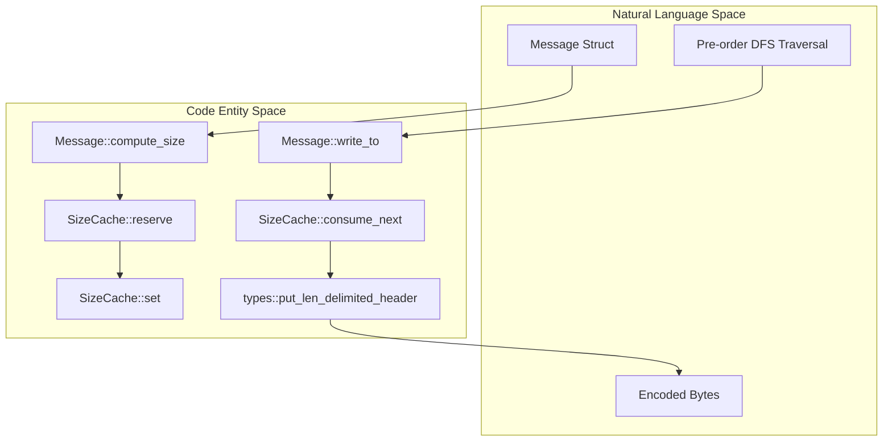
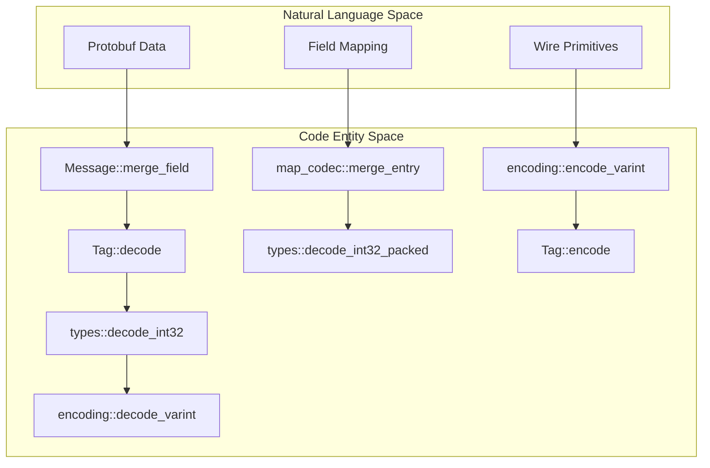

<!-- source: DeepWiki mcp.deepwiki.com · repo anthropics/buffa · page 2.1 Message Trait and Wire Format Codec · fetched 2026-10-26 -->

# Message Trait and Wire Format Codec

<details>
<summary>Relevant source files</summary>

The following files were used as context for generating this wiki page:

- [.changes/unreleased/changed-20260627-000610.yaml](.changes/unreleased/changed-20260627-000610.yaml)
- [.changes/unreleased/changed-20260629-003205.yaml](.changes/unreleased/changed-20260629-003205.yaml)
- [.changes/unreleased/changed-20260629-051500.yaml](.changes/unreleased/changed-20260629-051500.yaml)
- [buffa-codegen/src/owned_view.rs](buffa-codegen/src/owned_view.rs)
- [buffa-codegen/src/tests/view_codegen.rs](buffa-codegen/src/tests/view_codegen.rs)
- [buffa-descriptor/src/generated/google.protobuf.compiler.plugin.__view.rs](buffa-descriptor/src/generated/google.protobuf.compiler.plugin.__view.rs)
- [buffa-descriptor/src/generated/google.protobuf.descriptor.__view.rs](buffa-descriptor/src/generated/google.protobuf.descriptor.__view.rs)
- [buffa-descriptor/src/reflect/containers.rs](buffa-descriptor/src/reflect/containers.rs)
- [buffa-test/src/tests/owned_view.rs](buffa-test/src/tests/owned_view.rs)
- [buffa/src/encoding.rs](buffa/src/encoding.rs)
- [buffa/src/extension.rs](buffa/src/extension.rs)
- [buffa/src/map_codec.rs](buffa/src/map_codec.rs)
- [buffa/src/message.rs](buffa/src/message.rs)
- [buffa/src/message_field.rs](buffa/src/message_field.rs)
- [buffa/src/size_cache.rs](buffa/src/size_cache.rs)
- [buffa/src/types.rs](buffa/src/types.rs)

</details>


The `buffa` runtime centers around the `Message` trait, which defines the interface for all generated protobuf messages. It utilizes a two-pass serialization model to ensure efficient memory management and performance. This page details the trait interface, the external caching mechanism for message sizes, the `SizeCachePool` for buffer reuse, and the low-level binary wire format primitives.

## The Message Trait

The `Message` trait is the core abstraction for any type that can be serialized to or deserialized from the Protobuf binary format [buffa/src/message.rs:138-142](). It is implemented by **generated code** and provides a set of required methods for the two-pass serialization contract [buffa/src/message.rs:139-141]().

### Core Interface Methods

| Method | Description |
|:---|:---|
| `compute_size` | Recursively calculates the total encoded size and populates an external `SizeCache` [buffa/src/message.rs:172-172](). |
| `write_to` | Writes message fields to a `BufMut`, consuming sizes from the `SizeCache` [buffa/src/message.rs:178-178](). |
| `merge_field` | The primary entry point for decoding; merges a single field from the wire into the struct [buffa/src/message.rs:201-205](). |
| `encode` | Convenience method that handles both `SizeCache` creation and the two-pass write [buffa/src/message.rs:215-219](). |
| `encode_to_vec` | Encodes the message into a new `Vec<u8>`, pre-allocating the exact required capacity [buffa/src/message.rs:252-258](). |

### Two-Pass Serialization Model

Unlike implementations that might calculate lengths repeatedly (leading to exponential-time complexity in deeply nested messages), Buffa separates size calculation from byte writing [buffa/src/message.rs:166-170]().

1.  **Pass 1 (`compute_size`)**: The message tree is traversed. For every length-delimited field (strings, bytes, sub-messages), the size is calculated and stored in an external `SizeCache` [buffa/src/size_cache.rs:8-10]().
2.  **Pass 2 (`write_to`)**: The tree is traversed again. When a length-delimited field is reached, its pre-calculated size is pulled from the `SizeCache` to write the varint length prefix immediately before the data [buffa/src/size_cache.rs:9-10]().

### External SizeCache Design

Serialization state lives in an external `SizeCache` rather than inside the message struct itself [buffa/src/size_cache.rs:12-14](). This design ensures that messages contain no hidden plumbing fields, allowing them to be simple Rust structs that are easy to pattern match and move [buffa/src/size_cache.rs:13-14]().

**Sources:** [buffa/src/message.rs:138-258](), [buffa/src/size_cache.rs:1-25]()

## SizeCache and Performance Optimizations

The `SizeCache` is designed for zero-allocation encoding in common cases and efficient reuse in high-throughput scenarios.

### Inline Storage and Spill Buffers
A `SizeCache` contains an inline array of 16 `u32` slots [buffa/src/size_cache.rs:36-36]().
*   **Zero-Allocation**: Messages with ≤ 16 nested length-delimited sub-messages encode entirely on the stack [buffa/src/size_cache.rs:32-35]().
*   **Spill Buffer**: If a message exceeds 16 sub-messages, it spills to a `Vec<u32>` [buffa/src/size_cache.rs:46-48]().

### SizeCachePool
To avoid repeated heap allocations for the spill buffer, the `SizeCachePool` allows for buffer reuse [buffa/src/size_cache.rs:214-216]().
*   **Reuse**: Callers can `pull()` a cache from the pool and `push()` it back after use [buffa/src/size_cache.rs:231-241]().
*   **Thread Safety**: In `std` environments, the pool uses a `Mutex` to manage a stack of available spill buffers [buffa/src/size_cache.rs:218-220]().

**Message Encoding Flow**


**Sources:** [buffa/src/size_cache.rs:30-241](), [buffa/src/message.rs:166-180]()

## Wire Format Codec

The codec implements the Protobuf binary wire format, handling varints, fixed-width integers, and length-delimited fields.

### Wire Types and Tag Optimization
A `Tag` combines a field number and a 3-bit wire type [buffa/src/encoding.rs:59-62]().
*   **Tag::new Inlining**: `Tag::new` is `#[inline]` to allow the range assertion to const-fold away when the field number is a constant [buffa/src/encoding.rs:78-88]().
*   **Fast-Path Decoding**: `Tag::decode` handles single-byte tags (field numbers 1–15) inline, avoiding a full `decode_varint` call for the most common fields [buffa/src/encoding.rs:114-132]().

### Encoding and Decoding Primitives

*   **Varints**: `encode_varint` uses an intentionally unbounded loop for performance, writing 7-bit chunks [buffa/src/encoding.rs:175-184]().
*   **Packed Helpers**: Varint decoders have force-inlined `_packed` twins (e.g., `decode_int32_packed`) used inside repeated-field loops to remove per-element call boundaries [buffa/src/types.rs:31-35]().
*   **UTF-8 Validation**: `validate_str_in` utilizes `smoothutf8` for fast validation, including a `verify_with_slack` path that avoids tail copies when buffer slack is available [buffa/src/types.rs:105-133]().

**Encoding/Decoding Data Flow**


**Sources:** [buffa/src/encoding.rs:1-184](), [buffa/src/types.rs:1-133](), [buffa/src/map_codec.rs:1-35]()

## Decoding Context and Limits

To protect against malicious or malformed input, Buffa threads a `DecodeContext` through every merge call [buffa/src/message.rs:47-54]().

### DecodeContext
The context is a `Copy` struct carrying:
*   **Recursion Depth**: Initialized to `RECURSION_LIMIT` (100) [buffa/src/message.rs:25-25](). Every nested message call invokes `ctx.descend()`, which decrements the depth or returns `DecodeError::RecursionLimitExceeded` [buffa/src/message.rs:112-118]().
*   **Unknown Field Allowance**: A shared `Cell<usize>` initialized to `DEFAULT_UNKNOWN_FIELD_LIMIT` (1,000,000) [buffa/src/message.rs:45-45](). This bounds the total number of `UnknownField` records materialized across the entire decode operation [buffa/src/message.rs:27-38]().

### DecodeOptions
Users can configure these limits via `DecodeOptions`:
```rust
let options = DecodeOptions::new()
    .with_recursion_limit(50)
    .with_unknown_field_limit(500);
```
This builder is used to create the initial `DecodeContext` for top-level `decode` calls [buffa/src/message.rs:56-63]().

**Sources:** [buffa/src/message.rs:14-136](), [buffa/src/error.rs:49-54]()

---

